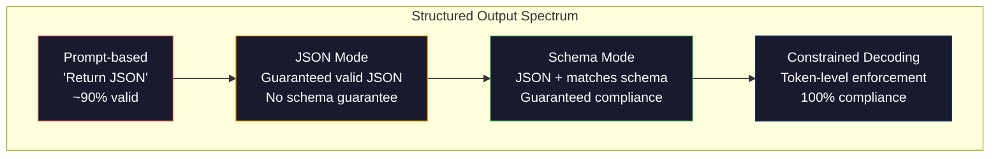
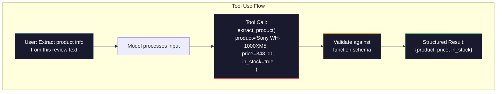

# Structured Outputs: JSON, Schema Validation, Constrained Decoding

> LLM của bạn trả về một chuỗi. Ứng dụng của bạn cần JSON. Khoảng cách đó đã làm sập nhiều hệ thống sản xuất hơn bất kỳ ảo giác mô hình nào. Đầu ra có cấu trúc là cầu nối giữa ngôn ngữ tự nhiên và dữ liệu có kiểu. Làm đúng và LLM của bạn trở thành một API đáng tin cậy. Làm sai và bạn đang phân tích văn bản tự do bằng regex lúc 3 giờ sáng.

**Type:** Build
**Languages:** Python
**Prerequisites:** Phase 10, Lessons 01-05 (LLMs from Scratch)
**Time:** ~90 minutes
**Liên quan:** Giai đoạn 5 · 20 (Structured Outputs & Constrained Decoding) trình bày lý thuyết cấp decoder (bộ xử lý logit FSM/CFG, Outlines, XGrammar). Bài học này tập trung vào giao diện SDK sản xuất (OpenAI `response_format`, tool use của Anthropic, Instructor) — đọc Giai đoạn 5 · 20 trước nếu bạn muốn hiểu những gì đang xảy ra bên dưới API.

## Learning Objectives

- Triển khai đầu ra JSON-mode và bị ràng buộc bởi schema bằng các tham số API OpenAI và Anthropic
- Xây dựng một lớp xác thực Pydantic từ chối đầu ra LLM sai định dạng và thử lại với phản hồi lỗi
- Giải thích cách constrained decoding buộc JSON hợp lệ ở cấp token mà không cần hậu xử lý
- Thiết kế các prompt trích xuất vững chắc chuyển đổi đáng tin cậy văn bản không có cấu trúc thành cấu trúc dữ liệu có kiểu

## The Problem

Bạn hỏi một LLM: "Trích xuất tên sản phẩm, giá và tình trạng sẵn có từ văn bản này." Nó phản hồi:

```
The product is the Sony WH-1000XM5 headphones, which cost $348.00 and are currently in stock.
```

Đó là một câu trả lời hoàn toàn đúng. Nó cũng hoàn toàn vô dụng đối với ứng dụng của bạn. Hệ thống tồn kho của bạn cần `{"product": "Sony WH-1000XM5", "price": 348.00, "in_stock": true}`. Bạn cần một đối tượng JSON với các khóa cụ thể, kiểu cụ thể và ràng buộc giá trị cụ thể. Bạn không cần một câu.

Giải pháp đơn giản: thêm "Phản hồi bằng JSON" vào prompt của bạn. Điều này hoạt động 90% số lần. Trong 10% còn lại, mô hình bọc JSON trong hàng rào mã markdown, hoặc thêm lời mở đầu như "Đây là JSON:", hoặc tạo JSON không hợp lệ về cú pháp vì đóng ngoặc sớm. Bộ phân tích JSON của bạn gặp lỗi. Pipeline của bạn hỏng. Bạn thêm try/except và vòng lặp thử lại. Lần thử lại đôi khi tạo dữ liệu khác. Giờ bạn có vấn đề nhất quán bên cạnh vấn đề phân tích cú pháp.

Đây không phải vấn đề prompt engineering. Đây là vấn đề giải mã. Mô hình sinh token từ trái sang phải. Ở mỗi vị trí, nó chọn token tiếp theo có khả năng cao nhất từ từ vựng 100K+ lựa chọn. Phần lớn lựa chọn đó sẽ tạo JSON không hợp lệ tại bất kỳ vị trí nhất định nào. Nếu mô hình vừa phát `{"price":`, token tiếp theo phải là một chữ số, dấu ngoặc kép (cho chuỗi), `null`, `true`, `false` hoặc dấu âm. Bất kỳ thứ gì khác tạo JSON không hợp lệ. Không có ràng buộc, mô hình có thể chọn một từ tiếng Anh hoàn toàn hợp lý nhưng sai thảm hại về cú pháp.

## The Concept

### The Structured Output Spectrum

Có bốn mức kiểm soát đầu ra có cấu trúc, mỗi mức đáng tin cậy hơn mức trước.



**Dựa trên prompt** ("Phản hồi bằng JSON hợp lệ"): không cưỡng chế. Mô hình thường tuân thủ nhưng đôi khi không. Độ tin cậy: ~90%. Dạng thất bại: hàng rào markdown, văn bản mở đầu, đầu ra bị cắt, cấu trúc sai.

**Chế độ JSON**: API bảo đảm đầu ra là JSON hợp lệ. `response_format: { type: "json_object" }` của OpenAI bật điều này. Đầu ra sẽ được phân tích cú pháp không lỗi. Nhưng có thể không khớp schema kỳ vọng của bạn -- khóa thừa, kiểu sai, trường thiếu.

**Chế độ schema**: API nhận một JSON Schema và bảo đảm đầu ra khớp nó. Năm 2026 mọi nhà cung cấp lớn hỗ trợ điều này nguyên bản: `response_format: { type: "json_schema", json_schema: {...} }` của OpenAI (cũng dưới dạng `tool_choice="required"`), tool use của Anthropic với `input_schema`, và `response_schema` + `response_mime_type: "application/json"` của Gemini. Đầu ra có đúng các khóa, kiểu và ràng buộc mà bạn chỉ định.

**Constrained decoding**: tại mỗi vị trí token trong lúc sinh, decoder che mọi token sẽ tạo đầu ra không hợp lệ. Nếu schema yêu cầu một số và mô hình sắp phát một chữ cái, token đó được đặt xác suất bằng không. Mô hình chỉ có thể tạo token dẫn đến đầu ra hợp lệ. Đây là điều mà chế độ structured output của OpenAI và các thư viện như Outlines và Guidance triển khai bên trong.

### JSON Schema: The Contract Language

JSON Schema là cách bạn cho mô hình (hoặc lớp xác thực) biết đầu ra phải có hình dạng nào. Mọi hệ thống đầu ra có cấu trúc lớn đều dùng nó.

```json
{
  "type": "object",
  "properties": {
    "product": { "type": "string" },
    "price": { "type": "number", "minimum": 0 },
    "in_stock": { "type": "boolean" },
    "categories": {
      "type": "array",
      "items": { "type": "string" }
    }
  },
  "required": ["product", "price", "in_stock"]
}
```

Schema này nói: đầu ra phải là một đối tượng với chuỗi `product`, số không âm `price`, boolean `in_stock` và một mảng chuỗi `categories` tùy chọn. Bất kỳ đầu ra nào không khớp đều bị từ chối.

Schema xử lý các trường hợp khó: đối tượng lồng nhau, mảng với phần tử có kiểu, enum (ràng buộc một chuỗi vào các giá trị cụ thể), khớp mẫu (regex trên chuỗi) và bộ kết hợp (oneOf, anyOf, allOf cho đầu ra đa hình).

### The Pydantic Pattern

Trong Python, bạn không viết JSON Schema bằng tay. Bạn định nghĩa một mô hình Pydantic và nó tạo schema cho bạn.

```python
from pydantic import BaseModel

class Product(BaseModel):
    product: str
    price: float
    in_stock: bool
    categories: list[str] = []
```

Điều này tạo cùng JSON Schema như trên. Thư viện Instructor (và SDK của OpenAI) nhận trực tiếp các mô hình Pydantic: truyền lớp mô hình, nhận lại một instance đã xác thực. Nếu đầu ra LLM không khớp, Instructor tự động thử lại.

### Function Calling / Tool Use

Một giao diện thay thế cho cùng vấn đề. Thay vì yêu cầu mô hình tạo JSON trực tiếp, bạn định nghĩa "công cụ" (hàm) với các tham số có kiểu. Mô hình xuất một lệnh gọi hàm với đối số có cấu trúc. OpenAI gọi đây là "function calling." Anthropic gọi là "tool use." Kết quả giống nhau: dữ liệu có cấu trúc.



Tool use được ưu tiên khi mô hình cần chọn hàm nào để gọi, không chỉ điền tham số. Nếu bạn có 10 schema trích xuất khác nhau và mô hình phải chọn schema đúng dựa trên đầu vào, tool use cho bạn cả lựa chọn schema và đầu ra có cấu trúc.

### Common Failure Modes

Ngay cả khi cưỡng chế schema, đầu ra có cấu trúc có thể thất bại theo những cách tinh vi.

**Giá trị ảo giác**: đầu ra khớp schema nhưng chứa dữ liệu bịa ra. Mô hình tạo `{"price": 299.99}` khi văn bản nói $348. Xác thực schema không thể bắt điều này -- kiểu đúng, giá trị sai.

**Nhầm lẫn enum**: bạn ràng buộc một trường vào `["in_stock", "out_of_stock", "preorder"]`. Mô hình xuất `"available"` -- đúng về ngữ nghĩa, nhưng không nằm trong tập cho phép. Constrained decoding tốt ngăn điều này. Các cách tiếp cận dựa trên prompt thì không.

**Độ sâu đối tượng lồng nhau**: các schema lồng sâu (4+ mức) tạo nhiều lỗi hơn. Mỗi mức lồng là một chỗ nữa mà mô hình có thể mất dấu cấu trúc.

**Độ dài mảng**: mô hình có thể tạo quá nhiều hoặc quá ít phần tử trong một mảng. Schema hỗ trợ `minItems` và `maxItems` nhưng không phải mọi nhà cung cấp đều cưỡng chế chúng ở cấp giải mã.

**Bỏ sót trường tùy chọn**: mô hình bỏ các trường tùy chọn về mặt kỹ thuật nhưng quan trọng về ngữ nghĩa cho trường hợp sử dụng của bạn. Đặt chúng là bắt buộc trong schema ngay cả khi dữ liệu đôi khi thiếu -- buộc mô hình tạo `null` rõ ràng.

```figure
mx-schema-funnel
```

## Build It

### Step 1: JSON Schema Validator

Xây dựng một bộ xác thực từ đầu kiểm tra liệu một đối tượng Python có khớp một JSON Schema không. Đây là thứ chạy ở phía đầu ra để xác minh sự tuân thủ.

```python
import json

def validate_schema(data, schema):
    errors = []
    _validate(data, schema, "", errors)
    return errors

def _validate(data, schema, path, errors):
    schema_type = schema.get("type")

    if schema_type == "object":
        if not isinstance(data, dict):
            errors.append(f"{path}: expected object, got {type(data).__name__}")
            return
        for key in schema.get("required", []):
            if key not in data:
                errors.append(f"{path}.{key}: required field missing")
        properties = schema.get("properties", {})
        for key, value in data.items():
            if key in properties:
                _validate(value, properties[key], f"{path}.{key}", errors)

    elif schema_type == "array":
        if not isinstance(data, list):
            errors.append(f"{path}: expected array, got {type(data).__name__}")
            return
        min_items = schema.get("minItems", 0)
        max_items = schema.get("maxItems", float("inf"))
        if len(data) < min_items:
            errors.append(f"{path}: array has {len(data)} items, minimum is {min_items}")
        if len(data) > max_items:
            errors.append(f"{path}: array has {len(data)} items, maximum is {max_items}")
        items_schema = schema.get("items", {})
        for i, item in enumerate(data):
            _validate(item, items_schema, f"{path}[{i}]", errors)

    elif schema_type == "string":
        if not isinstance(data, str):
            errors.append(f"{path}: expected string, got {type(data).__name__}")
            return
        enum_values = schema.get("enum")
        if enum_values and data not in enum_values:
            errors.append(f"{path}: '{data}' not in allowed values {enum_values}")

    elif schema_type == "number":
        if not isinstance(data, (int, float)):
            errors.append(f"{path}: expected number, got {type(data).__name__}")
            return
        minimum = schema.get("minimum")
        maximum = schema.get("maximum")
        if minimum is not None and data < minimum:
            errors.append(f"{path}: {data} is less than minimum {minimum}")
        if maximum is not None and data > maximum:
            errors.append(f"{path}: {data} is greater than maximum {maximum}")

    elif schema_type == "boolean":
        if not isinstance(data, bool):
            errors.append(f"{path}: expected boolean, got {type(data).__name__}")

    elif schema_type == "integer":
        if not isinstance(data, int) or isinstance(data, bool):
            errors.append(f"{path}: expected integer, got {type(data).__name__}")
```

### Step 2: Pydantic-Style Model to Schema

Xây dựng một bộ chuyển đổi lớp thành schema tối thiểu. Định nghĩa một lớp Python và tự động tạo JSON Schema của nó.

```python
class SchemaField:
    def __init__(self, field_type, required=True, default=None, enum=None, minimum=None, maximum=None):
        self.field_type = field_type
        self.required = required
        self.default = default
        self.enum = enum
        self.minimum = minimum
        self.maximum = maximum

def python_type_to_schema(field):
    type_map = {
        str: "string",
        int: "integer",
        float: "number",
        bool: "boolean",
    }

    schema = {}

    if field.field_type in type_map:
        schema["type"] = type_map[field.field_type]
    elif field.field_type == list:
        schema["type"] = "array"
        schema["items"] = {"type": "string"}
    elif isinstance(field.field_type, dict):
        schema = field.field_type

    if field.enum:
        schema["enum"] = field.enum
    if field.minimum is not None:
        schema["minimum"] = field.minimum
    if field.maximum is not None:
        schema["maximum"] = field.maximum

    return schema

def model_to_schema(name, fields):
    properties = {}
    required = []

    for field_name, field in fields.items():
        properties[field_name] = python_type_to_schema(field)
        if field.required:
            required.append(field_name)

    return {
        "type": "object",
        "properties": properties,
        "required": required,
    }
```

### Step 3: Constrained Token Filter

Mô phỏng constrained decoding. Với một chuỗi JSON chưa hoàn chỉnh và một schema, xác định các loại token nào hợp lệ tại vị trí hiện tại.

```python
def next_valid_tokens(partial_json, schema):
    stripped = partial_json.strip()

    if not stripped:
        return ["{"]

    try:
        json.loads(stripped)
        return ["<EOS>"]
    except json.JSONDecodeError:
        pass

    last_char = stripped[-1] if stripped else ""

    if last_char == "{":
        return ['"', "}"]
    elif last_char == '"':
        if stripped.endswith('":'):
            return ['"', "0-9", "true", "false", "null", "[", "{"]
        return ["a-z", '"']
    elif last_char == ":":
        return [" ", '"', "0-9", "true", "false", "null", "[", "{"]
    elif last_char == ",":
        return [" ", '"', "{", "["]
    elif last_char in "0123456789":
        return ["0-9", ".", ",", "}", "]"]
    elif last_char == "}":
        return [",", "}", "]", "<EOS>"]
    elif last_char == "]":
        return [",", "}", "<EOS>"]
    elif last_char == "[":
        return ['"', "0-9", "true", "false", "null", "{", "[", "]"]
    else:
        return ["any"]

def demonstrate_constrained_decoding():
    partial_states = [
        '',
        '{',
        '{"product"',
        '{"product":',
        '{"product": "Sony"',
        '{"product": "Sony",',
        '{"product": "Sony", "price":',
        '{"product": "Sony", "price": 348',
        '{"product": "Sony", "price": 348}',
    ]

    print(f"{'Partial JSON':<45} {'Valid Next Tokens'}")
    print("-" * 80)
    for state in partial_states:
        valid = next_valid_tokens(state, {})
        display = state if state else "(empty)"
        print(f"{display:<45} {valid}")
```

### Step 4: Extraction Pipeline

Kết hợp mọi thứ thành một pipeline trích xuất: định nghĩa một schema, mô phỏng một LLM tạo đầu ra có cấu trúc, xác thực đầu ra và xử lý thử lại.

```python
def simulate_llm_extraction(text, schema, attempt=0):
    if "headphones" in text.lower() or "sony" in text.lower():
        if attempt == 0:
            return '{"product": "Sony WH-1000XM5", "price": 348.00, "in_stock": true, "categories": ["audio", "headphones"]}'
        return '{"product": "Sony WH-1000XM5", "price": 348.00, "in_stock": true}'

    if "laptop" in text.lower():
        return '{"product": "MacBook Pro 16", "price": 2499.00, "in_stock": false, "categories": ["computers"]}'

    return '{"product": "Unknown", "price": 0, "in_stock": false}'

def extract_with_retry(text, schema, max_retries=3):
    for attempt in range(max_retries):
        raw = simulate_llm_extraction(text, schema, attempt)

        try:
            data = json.loads(raw)
        except json.JSONDecodeError as e:
            print(f"  Attempt {attempt + 1}: JSON parse error -- {e}")
            continue

        errors = validate_schema(data, schema)
        if not errors:
            return data

        print(f"  Attempt {attempt + 1}: Schema validation errors -- {errors}")

    return None

product_schema = {
    "type": "object",
    "properties": {
        "product": {"type": "string"},
        "price": {"type": "number", "minimum": 0},
        "in_stock": {"type": "boolean"},
        "categories": {"type": "array", "items": {"type": "string"}},
    },
    "required": ["product", "price", "in_stock"],
}
```

### Step 5: Run the Full Pipeline

```python
def run_demo():
    print("=" * 60)
    print("  Structured Output Pipeline Demo")
    print("=" * 60)

    print("\n--- Schema Definition ---")
    product_fields = {
        "product": SchemaField(str),
        "price": SchemaField(float, minimum=0),
        "in_stock": SchemaField(bool),
        "categories": SchemaField(list, required=False),
    }
    generated_schema = model_to_schema("Product", product_fields)
    print(json.dumps(generated_schema, indent=2))

    print("\n--- Schema Validation ---")
    test_cases = [
        ({"product": "Test", "price": 10.0, "in_stock": True}, "Valid object"),
        ({"product": "Test", "price": -5.0, "in_stock": True}, "Negative price"),
        ({"product": "Test", "in_stock": True}, "Missing price"),
        ({"product": "Test", "price": "ten", "in_stock": True}, "String as price"),
        ("not an object", "String instead of object"),
    ]

    for data, label in test_cases:
        errors = validate_schema(data, product_schema)
        status = "PASS" if not errors else f"FAIL: {errors}"
        print(f"  {label}: {status}")

    print("\n--- Constrained Decoding Simulation ---")
    demonstrate_constrained_decoding()

    print("\n--- Extraction Pipeline ---")
    texts = [
        "The Sony WH-1000XM5 headphones are priced at $348 and currently available.",
        "The new MacBook Pro 16-inch laptop costs $2499 but is sold out.",
        "This is a random sentence with no product info.",
    ]

    for text in texts:
        print(f"\n  Input: {text[:60]}...")
        result = extract_with_retry(text, product_schema)
        if result:
            print(f"  Output: {json.dumps(result)}")
        else:
            print(f"  Output: FAILED after retries")
```

## Use It

### OpenAI Structured Outputs

```python
# from openai import OpenAI
# from pydantic import BaseModel
#
# client = OpenAI()
#
# class Product(BaseModel):
#     product: str
#     price: float
#     in_stock: bool
#
# response = client.beta.chat.completions.parse(
#     model="gpt-5-mini",
#     messages=[
#         {"role": "system", "content": "Extract product information."},
#         {"role": "user", "content": "Sony WH-1000XM5, $348, in stock"},
#     ],
#     response_format=Product,
# )
#
# product = response.choices[0].message.parsed
# print(product.product, product.price, product.in_stock)
```

Chế độ structured output của OpenAI dùng constrained decoding bên trong. Mỗi token mô hình sinh được bảo đảm tạo đầu ra khớp schema Pydantic. Không cần thử lại. Không cần xác thực. Ràng buộc được tích hợp vào quá trình giải mã.

### Anthropic Tool Use

```python
# import anthropic
#
# client = anthropic.Anthropic()
#
# response = client.messages.create(
#     model="claude-opus-4-7",
#     max_tokens=1024,
#     tools=[{
#         "name": "extract_product",
#         "description": "Extract product information from text",
#         "input_schema": {
#             "type": "object",
#             "properties": {
#                 "product": {"type": "string"},
#                 "price": {"type": "number"},
#                 "in_stock": {"type": "boolean"},
#             },
#             "required": ["product", "price", "in_stock"],
#         },
#     }],
#     messages=[{"role": "user", "content": "Extract: Sony WH-1000XM5, $348, in stock"}],
# )
```

Anthropic đạt đầu ra có cấu trúc thông qua tool use. Mô hình phát một lệnh gọi công cụ với đối số có cấu trúc khớp input_schema. Cùng kết quả, giao diện API khác.

### Instructor Library

```python
# pip install instructor
# import instructor
# from openai import OpenAI
# from pydantic import BaseModel
#
# client = instructor.from_openai(OpenAI())
#
# class Product(BaseModel):
#     product: str
#     price: float
#     in_stock: bool
#
# product = client.chat.completions.create(
#     model="gpt-5-mini",
#     response_model=Product,
#     messages=[{"role": "user", "content": "Sony WH-1000XM5, $348, in stock"}],
# )
```

Instructor bọc bất kỳ LLM client nào và thêm thử lại tự động với xác thực. Nếu lần thử đầu tiên không vượt xác thực, nó gửi lỗi trở lại mô hình làm ngữ cảnh và yêu cầu mô hình sửa đầu ra. Điều này hoạt động với mọi nhà cung cấp, không chỉ OpenAI.

## Ship It

Bài học này tạo ra `outputs/prompt-structured-extractor.md` -- một khuôn mẫu prompt tái sử dụng trích xuất dữ liệu có cấu trúc từ bất kỳ văn bản nào với định nghĩa schema cho trước. Đưa vào một JSON Schema và văn bản không có cấu trúc, và nó trả về JSON đã xác thực.

Nó cũng tạo ra `outputs/skill-structured-outputs.md` -- một khung quyết định để chọn chiến lược đầu ra có cấu trúc phù hợp dựa trên nhà cung cấp, yêu cầu độ tin cậy và độ phức tạp schema của bạn.

## Exercises

1. Mở rộng bộ xác thực schema để hỗ trợ `oneOf` (dữ liệu phải khớp đúng một trong nhiều schema). Điều này xử lý đầu ra đa hình -- ví dụ, một trường có thể là đối tượng `Product` hoặc `Service` với các hình dạng khác nhau.

2. Xây dựng một công cụ "diff schema" so sánh hai schema và xác định các thay đổi phá vỡ tương thích (bỏ trường bắt buộc, đổi kiểu) so với thay đổi không phá vỡ tương thích (thêm trường tùy chọn, nới ràng buộc). Điều này thiết yếu để quản lý phiên bản các schema trích xuất của bạn trong sản xuất.

3. Triển khai một bộ mô phỏng constrained decoding thực tế hơn. Với một JSON Schema và một từ vựng 100 token (chữ cái, chữ số, dấu câu, từ khóa), đi qua quá trình sinh từng bước, che token không hợp lệ tại mỗi vị trí. Đo bao nhiêu phần trăm từ vựng hợp lệ ở mỗi bước.

4. Xây dựng một bộ đánh giá trích xuất. Tạo 50 mô tả sản phẩm với đầu ra JSON được gán nhãn bằng tay. Chạy pipeline trích xuất của bạn trên cả 50 và đo khớp chính xác, độ chính xác cấp trường và tuân thủ kiểu. Xác định những trường khó trích xuất đúng nhất.

5. Thêm "điểm độ tin cậy" vào pipeline trích xuất của bạn. Với mỗi trường được trích xuất, ước lượng mức tự tin của mô hình (dựa trên xác suất token, hoặc bằng cách chạy trích xuất 3 lần và đo tính nhất quán). Đánh dấu các trường độ tin cậy thấp để con người xem xét.

## Key Terms

| Thuật ngữ | Mọi người nói gì | Ý nghĩa thực sự |
|------|----------------|----------------------|
| JSON mode (Chế độ JSON) | "Trả về JSON" | Cờ API bảo đảm đầu ra JSON hợp lệ về cú pháp, nhưng không cưỡng chế bất kỳ schema cụ thể nào |
| Structured output (Đầu ra có cấu trúc) | "JSON có kiểu" | Đầu ra khớp một JSON Schema cụ thể với đúng khóa, kiểu và ràng buộc |
| Constrained decoding (Giải mã có ràng buộc) | "Sinh có hướng dẫn" | Tại mỗi vị trí token, che các token sẽ tạo đầu ra không hợp lệ -- bảo đảm tuân thủ schema 100% |
| JSON Schema | "Một khuôn mẫu JSON" | Một ngôn ngữ khai báo để mô tả cấu trúc, kiểu và ràng buộc của dữ liệu JSON (được OpenAPI, JSON Forms, v.v. sử dụng) |
| Pydantic | "Python dataclasses+" | Thư viện Python định nghĩa các mô hình dữ liệu với xác thực kiểu, được FastAPI và Instructor dùng để tạo JSON Schema |
| Function calling (Gọi hàm) | "Sử dụng công cụ" | LLM xuất một lời gọi hàm có cấu trúc (tên + đối số có kiểu) thay vì văn bản tự do -- cả OpenAI và Anthropic đều hỗ trợ |
| Instructor | "Pydantic cho LLM" | Thư viện Python bọc LLM client để trả về các instance Pydantic đã xác thực, với tự động thử lại khi xác thực thất bại |
| Token masking (Che token) | "Lọc từ vựng" | Đặt xác suất token cụ thể thành không trong khi sinh để mô hình không thể tạo chúng |
| Schema compliance (Tuân thủ schema) | "Khớp hình dạng" | Đầu ra có mọi trường bắt buộc, đúng kiểu, giá trị trong ràng buộc và không có trường thừa không được phép |
| Retry loop (Vòng lặp thử lại) | "Thử lại đến khi hoạt động" | Gửi lỗi xác thực trở lại mô hình và yêu cầu nó sửa đầu ra -- Instructor tự động làm điều này, đến mức tối đa có thể cấu hình |

## Further Reading

- [OpenAI Structured Outputs Guide](https://platform.openai.com/docs/guides/structured-outputs) -- tài liệu chính thức về constrained decoding dựa trên JSON Schema trong API OpenAI
- [Willard & Louf, 2023 -- "Efficient Guided Generation for Large Language Models"](https://arxiv.org/abs/2307.09702) -- bài báo Outlines, mô tả cách biên dịch JSON Schema thành máy trạng thái hữu hạn cho các ràng buộc cấp token
- [Instructor documentation](https://python.useinstructor.com/) -- thư viện tiêu chuẩn để lấy đầu ra có cấu trúc từ bất kỳ LLM nào với xác thực Pydantic và thử lại
- [Anthropic Tool Use Guide](https://docs.anthropic.com/en/docs/tool-use) -- cách Claude triển khai đầu ra có cấu trúc qua tool use với input_schema JSON Schema
- [JSON Schema specification](https://json-schema.org/) -- đặc tả đầy đủ cho ngôn ngữ schema được mọi hệ thống đầu ra có cấu trúc lớn dùng
- [Outlines library](https://github.com/outlines-dev/outlines) -- sinh có ràng buộc mã nguồn mở dùng regex và JSON Schema được biên dịch thành máy trạng thái hữu hạn
- [Dong et al., "XGrammar: Flexible and Efficient Structured Generation Engine for Large Language Models" (MLSys 2025)](https://arxiv.org/abs/2411.15100) -- bộ máy ngữ pháp tiên tiến nhất hiện tại; biên dịch máy tự động ngăn xếp che token ở ~100 ns / token.
- [Beurer-Kellner et al., "Prompting Is Programming: A Query Language for Large Language Models" (LMQL)](https://arxiv.org/abs/2212.06094) -- bài báo LMQL đặt constrained decoding thành một ngôn ngữ truy vấn với ràng buộc kiểu và giá trị.
- [Microsoft Guidance (framework docs)](https://github.com/guidance-ai/guidance) -- sinh có ràng buộc theo khuôn mẫu; phần bổ sung không phụ thuộc nhà cung cấp cho Outlines và XGrammar.
