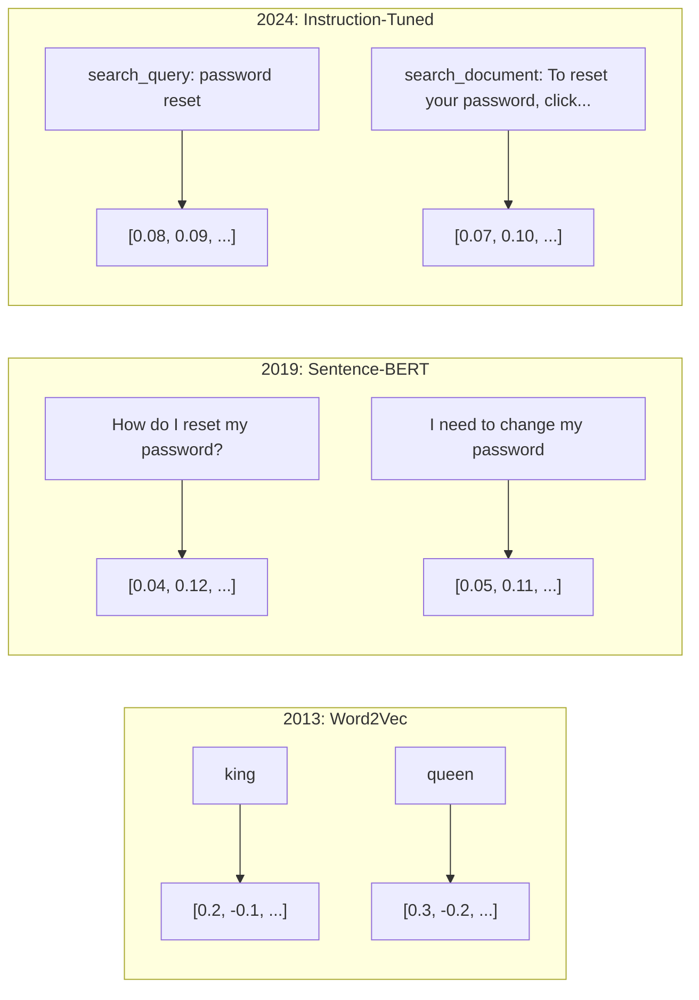
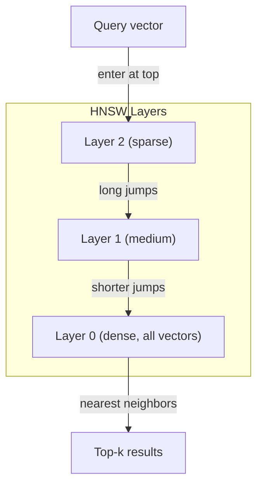

# Embeddings & Vector Representations

> Văn bản là rời rạc. Toán học là liên tục. Mỗi khi bạn yêu cầu một LLM tìm tài liệu "tương tự", so sánh ý nghĩa hoặc tìm kiếm vượt ngoài từ khóa, bạn đang dựa vào một cầu nối giữa hai thế giới này. Cầu nối đó là một embedding. Nếu bạn không hiểu embedding, bạn không hiểu AI hiện đại. Bạn chỉ dùng nó.

**Type:** Build
**Languages:** Python
**Prerequisites:** Phase 11, Lesson 01 (Prompt Engineering)
**Time:** ~75 minutes
**Liên quan:** Giai đoạn 5 · 22 (Embedding Models Deep Dive) trình bày dense so với sparse so với multi-vector, cắt ngắn Matryoshka và lựa chọn mô hình theo từng trục. Bài học này tập trung vào pipeline sản xuất (cơ sở dữ liệu vector, HNSW, toán học độ tương đồng). Đọc Giai đoạn 5 · 22 trước khi chọn mô hình.

## Learning Objectives

- Tạo embedding văn bản bằng các nhà cung cấp API và mô hình mã nguồn mở, đồng thời tính cosine similarity giữa chúng
- Giải thích tại sao embedding giải quyết vấn đề không khớp từ vựng mà tìm kiếm từ khóa không xử lý được
- Xây dựng một chỉ mục tìm kiếm ngữ nghĩa truy xuất tài liệu theo ý nghĩa thay vì khớp từ khóa chính xác
- Đánh giá chất lượng embedding bằng các benchmark truy xuất (precision@k, recall) và chọn mô hình embedding phù hợp cho tác vụ của bạn

## The Problem

Bạn có 10,000 phiếu hỗ trợ. Một khách hàng viết "thanh toán của tôi không thực hiện được." Bạn cần tìm các phiếu tương tự trước đây. Tìm kiếm từ khóa tìm các phiếu chứa "thanh toán" và "không thực hiện được." Nó bỏ lỡ "giao dịch thất bại", "khoản thanh toán bị từ chối" và "lỗi lập hóa đơn." Các phiếu này mô tả đúng cùng một vấn đề bằng những từ hoàn toàn khác nhau.

Đây là vấn đề không khớp từ vựng. Ngôn ngữ con người có hàng chục cách nói cùng một điều. Tìm kiếm từ khóa xem mỗi từ là một ký hiệu độc lập không có ý nghĩa. Nó không thể biết rằng "bị từ chối" và "không thực hiện được" chỉ cùng một khái niệm.

Bạn cần một biểu diễn văn bản mà ý nghĩa, không phải cách viết, quyết định độ tương đồng. Bạn cần một cách đặt "thanh toán của tôi không thực hiện được" và "giao dịch bị từ chối" gần nhau trong một không gian toán học nào đó, trong khi đẩy "thanh toán của tôi đến đúng hạn" ra xa dù cùng có từ "thanh toán."

Biểu diễn đó là một embedding.

## The Concept

### What Is an Embedding?

Một embedding là một vector dày đặc các số thực dấu phẩy động biểu diễn ý nghĩa của văn bản. Từ "dày đặc" quan trọng -- mỗi chiều mang thông tin, không như các biểu diễn thưa (bag-of-words, TF-IDF) nơi phần lớn các chiều bằng không.

"Con mèo ngồi trên tấm thảm" trở thành một thứ như `[0.023, -0.041, 0.087, ..., 0.012]` -- danh sách từ 768 đến 3072 số tùy mô hình. Các số này mã hóa ý nghĩa. Bạn không bao giờ kiểm tra chúng trực tiếp. Bạn so sánh chúng.

### The Word2Vec Breakthrough

Năm 2013, Tomas Mikolov và các đồng nghiệp tại Google công bố Word2Vec. Nhận thức cốt lõi: huấn luyện một mạng nơ-ron dự đoán một từ từ các từ lân cận (hoặc các từ lân cận từ một từ), và trọng số lớp ẩn trở thành các biểu diễn vector có ý nghĩa.

Kết quả nổi tiếng:

```
king - man + woman = queen
```

Số học vector trên word embedding nắm bắt các quan hệ ngữ nghĩa. Hướng từ "đàn ông" đến "phụ nữ" gần giống hướng từ "vua" đến "nữ hoàng." Đây là thời điểm lĩnh vực nhận ra hình học có thể mã hóa ý nghĩa.

Word2Vec tạo các vector 300 chiều. Mỗi từ nhận một vector bất kể ngữ cảnh. "Bank" trong "river bank" và "bank account" có cùng embedding. Giới hạn này thúc đẩy thập kỷ nghiên cứu tiếp theo.

### From Words to Sentences

Word embedding biểu diễn các token đơn. Hệ thống sản xuất cần nhúng toàn bộ câu, đoạn văn hoặc tài liệu. Bốn cách tiếp cận xuất hiện:

**Lấy trung bình**: lấy trung bình mọi vector từ trong câu. Rẻ, mất thông tin, khá tốt đến ngạc nhiên với văn bản ngắn. Mất hoàn toàn thứ tự từ -- "chó cắn người" và "người cắn chó" nhận các embedding giống hệt nhau.

**Token CLS**: các mô hình transformer (BERT, 2018) xuất một embedding token [CLS] đặc biệt biểu diễn toàn bộ đầu vào. Tốt hơn lấy trung bình nhưng token [CLS] được huấn luyện cho dự đoán câu tiếp theo, không phải độ tương đồng.

**Học tương phản**: huấn luyện mô hình rõ ràng để đẩy các cặp tương tự lại gần và các cặp khác nhau ra xa. Sentence-BERT (Reimers & Gurevych, 2019) dùng cách này và trở thành nền tảng cho các mô hình embedding hiện đại. Với "Làm thế nào để tôi đặt lại mật khẩu?" và "Tôi cần đổi mật khẩu", mô hình học rằng chúng phải có các vector gần như giống hệt nhau.

**Embedding được tinh chỉnh chỉ dẫn**: cách tiếp cận mới nhất. Các mô hình như E5 và GTE nhận một tiền tố tác vụ ("search_query:", "search_document:") cho mô hình biết loại embedding cần tạo. Điều này cho phép một mô hình phục vụ nhiều tác vụ.



### Modern Embedding Models

Thị trường đã ổn định vào một số ít lựa chọn cấp sản xuất (điểm MTEB tính đến đầu năm 2026, MTEB v2):

| Mô hình | Nhà cung cấp | Số chiều | MTEB | Ngữ cảnh | Chi phí / 1M token |
|-------|----------|-----------|------|---------|------------------|
| Gemini Embedding 2 | Google | 3072 (Matryoshka) | 67.7 (truy xuất) | 8192 | $0.15 |
| embed-v4 | Cohere | 1024 (Matryoshka) | 65.2 | 128K | $0.12 |
| voyage-4 | Voyage AI | 1024/2048 (Matryoshka) | 66.8 | 32K | $0.12 |
| text-embedding-3-large | OpenAI | 3072 (Matryoshka) | 64.6 | 8192 | $0.13 |
| text-embedding-3-small | OpenAI | 1536 (Matryoshka) | 62.3 | 8192 | $0.02 |
| BGE-M3 | BAAI | 1024 (dense+sparse+ColBERT) | 63.0 đa ngôn ngữ | 8192 | Trọng số mở |
| Qwen3-Embedding | Alibaba | 4096 (Matryoshka) | 66.9 | 32K | Trọng số mở |
| Nomic-embed-v2 | Nomic | 768 (Matryoshka) | 63.1 | 8192 | Trọng số mở |

MTEB (Massive Text Embedding Benchmark) v2 bao quát 100+ tác vụ trên truy xuất, phân loại, phân cụm, xếp hạng lại và tóm tắt. Cao hơn là tốt hơn. Đến năm 2026, các mô hình trọng số mở (Qwen3-Embedding, BGE-M3) ngang hoặc vượt các mô hình đóng được lưu trữ trên hầu hết các trục. Gemini Embedding 2 dẫn đầu truy xuất thuần; Voyage/Cohere dẫn đầu các miền cụ thể (tài chính, luật, mã). Luôn benchmark trên truy vấn của chính bạn trước khi chốt lựa chọn.

### Similarity Metrics

Với hai vector embedding, ba cách đo chúng tương tự đến mức nào:

**Cosine similarity**: cosin của góc giữa hai vector. Từ -1 (đối nhau) đến 1 (cùng hướng). Bỏ qua độ lớn -- một câu 10 từ và một tài liệu 500 từ có thể đạt 1.0 nếu cùng hướng. Đây là mặc định cho 90% trường hợp sử dụng.

```math
\mathop{\mathrm{cosine\_sim}}(a, b) = \frac{\mathop{\mathrm{dot}}(a, b)}{\lVert a \rVert \cdot \lVert b \rVert}
```

**Tích vô hướng**: tích trong thô của hai vector. Giống cosine similarity khi các vector được chuẩn hóa (độ dài đơn vị). Tính nhanh hơn. Embedding của OpenAI được chuẩn hóa, nên tích vô hướng và cosin cho cùng thứ hạng.

```math
\mathop{\mathrm{dot}}(a, b) = \sum_i a_i b_i
```

**Khoảng cách Euclid (L2)**: khoảng cách đường thẳng trong không gian vector. Nhỏ hơn = tương tự hơn. Nhạy với khác biệt độ lớn. Dùng khi vị trí tuyệt đối trong không gian quan trọng, không chỉ hướng.

```math
\mathop{\mathrm{L2}}(a, b) = \sqrt{\sum_i (a_i - b_i)^2}
```

Khi nào dùng loại nào:

| Thước đo | Dùng khi | Tránh khi |
|--------|----------|------------|
| Cosine similarity | So sánh văn bản khác độ dài; hầu hết tác vụ truy xuất | Độ lớn mang thông tin |
| Tích vô hướng | Embedding đã được chuẩn hóa; tốc độ tối đa | Vector có độ lớn khác nhau |
| Khoảng cách Euclid | Phân cụm; bài toán láng giềng gần nhất trong không gian | So sánh tài liệu có độ dài rất khác nhau |

### Vector Databases and HNSW

Tìm kiếm độ tương đồng vét cạn so sánh truy vấn với mọi vector đã lưu. Với 1 triệu vector có 1536 chiều, đó là 1.5 tỷ phép nhân-cộng mỗi truy vấn. Quá chậm.

Cơ sở dữ liệu vector giải quyết điều này bằng các thuật toán Approximate Nearest Neighbor (ANN). Thuật toán thống trị là HNSW (Hierarchical Navigable Small World):

1. Xây dựng một đồ thị nhiều lớp các vector
2. Các lớp trên thưa -- kết nối phạm vi dài giữa các cụm xa nhau
3. Các lớp dưới dày đặc -- kết nối chi tiết giữa các vector gần nhau
4. Tìm kiếm bắt đầu ở lớp trên, đi xuống tham lam để tinh chỉnh
5. Trả về kết quả top-k xấp xỉ trong thời gian $O(\log n)$ thay vì $O(n)$

HNSW đánh đổi mất mát độ chính xác nhỏ (thường recall 95-99%) lấy mức tăng tốc lớn. Với 10 triệu vector, vét cạn mất vài giây. HNSW mất vài mili giây.



Các lựa chọn sản xuất:

| Cơ sở dữ liệu | Loại | Tốt nhất cho | Quy mô tối đa |
|----------|------|----------|-----------|
| Pinecone | SaaS được quản lý | Sản xuất không cần vận hành | Hàng tỷ |
| Weaviate | Mã nguồn mở | Tự lưu trữ, tìm kiếm lai | 100M+ |
| Qdrant | Mã nguồn mở | Hiệu năng cao, lọc | 100M+ |
| ChromaDB | Nhúng | Tạo mẫu, phát triển cục bộ | 1M |
| pgvector | Phần mở rộng Postgres | Đã dùng Postgres | 10M |
| FAISS | Thư viện | Trong tiến trình, nghiên cứu | 1B+ |

### Chunking Strategies

Tài liệu quá dài để nhúng thành các vector đơn. Một PDF 50 trang bao quát hàng chục chủ đề -- embedding của nó trở thành trung bình của mọi thứ, không tương tự thứ gì cụ thể. Bạn chia tài liệu thành các chunk và nhúng từng chunk.

**Chia chunk kích thước cố định**: chia mỗi N token với phần chồng lấp M token. Đơn giản và có thể dự đoán. Hoạt động tốt khi tài liệu không có cấu trúc rõ ràng. Một chunk 512 token với chồng lấp 50 token: chunk 1 là token 0-511, chunk 2 là token 462-973.

**Chia chunk theo câu**: chia tại ranh giới câu, nhóm các câu đến khi đạt giới hạn token. Mỗi chunk ít nhất là một câu hoàn chỉnh. Tốt hơn kích thước cố định vì bạn không bao giờ cắt đôi một ý.

**Chia chunk đệ quy**: thử chia ở ranh giới lớn nhất trước (tiêu đề phần). Nếu vẫn quá lớn, thử ranh giới đoạn văn. Rồi ranh giới câu. Rồi giới hạn ký tự. Đây là `RecursiveCharacterTextSplitter` của LangChain và nó hoạt động tốt cho ngữ liệu định dạng hỗn hợp.

**Chia chunk ngữ nghĩa**: nhúng từng câu, rồi nhóm các câu liên tiếp có embedding tương tự. Khi độ tương đồng embedding giảm dưới một ngưỡng, bắt đầu chunk mới. Tốn kém (cần nhúng riêng từng câu) nhưng tạo các chunk mạch lạc nhất.

| Chiến lược | Độ phức tạp | Chất lượng | Tốt nhất cho |
|----------|-----------|---------|----------|
| Kích thước cố định | Thấp | Khá | Văn bản không có cấu trúc, log |
| Theo câu | Thấp | Tốt | Bài viết, email |
| Đệ quy | Trung bình | Tốt | Markdown, HTML, tài liệu hỗn hợp |
| Ngữ nghĩa | Cao | Tốt nhất | Chất lượng truy xuất then chốt |

Điểm tối ưu cho hầu hết hệ thống: chunk 256-512 token với chồng lấp 50 token.

### Bi-Encoders vs Cross-Encoders

Một bi-encoder nhúng truy vấn và tài liệu độc lập, rồi so sánh vector. Nhanh -- bạn nhúng truy vấn một lần và so sánh với các embedding tài liệu đã tính trước. Đây là thứ bạn dùng cho truy xuất.

Một cross-encoder nhận truy vấn và tài liệu thành một đầu vào duy nhất rồi xuất điểm liên quan. Chậm -- nó xử lý mỗi cặp truy vấn-tài liệu qua toàn bộ mô hình. Nhưng chính xác hơn nhiều vì có thể attend đồng thời trên các token truy vấn và tài liệu.

Mẫu sản xuất: bi-encoder truy xuất top-100 ứng viên, cross-encoder xếp hạng lại chúng thành top-10. Đây là pipeline truy xuất rồi xếp hạng lại.


Các mô hình xếp hạng lại: Cohere Rerank 3.5 ($2 mỗi 1000 truy vấn), BGE-reranker-v2 (miễn phí, mã nguồn mở), Jina Reranker v2 (miễn phí, mã nguồn mở).

### Matryoshka Embeddings

Embedding truyền thống là tất cả hoặc không gì cả. Một vector 1536 chiều dùng 1536 số thực dấu phẩy động. Bạn không thể cắt ngắn xuống 256 chiều mà không huấn luyện lại.

Matryoshka Representation Learning (Kusupati và cộng sự, 2022) khắc phục điều này. Mô hình được huấn luyện sao cho N chiều đầu nắm bắt thông tin quan trọng nhất, như một búp bê Nga lồng nhau. Cắt ngắn một embedding Matryoshka 1536 chiều xuống 256 chiều mất một ít độ chính xác nhưng vẫn hoạt động.

text-embedding-3-small và text-embedding-3-large của OpenAI hỗ trợ cắt ngắn Matryoshka qua tham số `dimensions`. Yêu cầu 256 chiều thay vì 1536 giảm lưu trữ 6x với mất mát độ chính xác khoảng 3-5% trên các benchmark MTEB.

### Binary Quantization

Một embedding 1536 chiều lưu dưới dạng float32 dùng 6,144 byte. Nhân với 10 triệu tài liệu: 61 GB chỉ cho vector.

Lượng tử hóa nhị phân chuyển mỗi số thực dấu phẩy động thành một bit: giá trị dương thành 1, giá trị âm thành 0. Lưu trữ giảm từ 6,144 byte xuống 192 byte -- giảm 32x. Độ tương đồng được tính bằng khoảng cách Hamming (đếm các bit khác nhau), mà CPU có thể làm trong một lệnh duy nhất.

Mức giảm độ chính xác khoảng 5-10% trên recall truy xuất. Mẫu phổ biến: lượng tử hóa nhị phân cho lượt tìm kiếm đầu trên hàng triệu vector, rồi chấm điểm lại top-1000 bằng vector độ chính xác đầy đủ. Điều này mang lại 95%+ độ chính xác đầy đủ với bộ nhớ ít hơn 32x.

```figure
cosine-similarity
```

## Build It

Chúng ta xây dựng một bộ máy tìm kiếm ngữ nghĩa từ đầu. Không cơ sở dữ liệu vector. Không API embedding bên ngoài. Python thuần với numpy cho phần toán.

### Step 1: Text Chunking

```python
def chunk_text(text, chunk_size=200, overlap=50):
    words = text.split()
    chunks = []
    start = 0
    while start < len(words):
        end = start + chunk_size
        chunk = " ".join(words[start:end])
        chunks.append(chunk)
        start += chunk_size - overlap
    return chunks


def chunk_by_sentences(text, max_chunk_tokens=200):
    sentences = text.replace("\n", " ").split(".")
    sentences = [s.strip() + "." for s in sentences if s.strip()]
    chunks = []
    current_chunk = []
    current_length = 0
    for sentence in sentences:
        sentence_length = len(sentence.split())
        if current_length + sentence_length > max_chunk_tokens and current_chunk:
            chunks.append(" ".join(current_chunk))
            current_chunk = []
            current_length = 0
        current_chunk.append(sentence)
        current_length += sentence_length
    if current_chunk:
        chunks.append(" ".join(current_chunk))
    return chunks
```

### Step 2: Building Embeddings from Scratch

Chúng ta triển khai một embedding dày đặc đơn giản bằng TF-IDF với chuẩn hóa L2. Đây không phải embedding nơ-ron, nhưng tuân cùng hợp đồng: văn bản vào, vector kích thước cố định ra, văn bản tương tự tạo vector tương tự.

```python
import math
import numpy as np
from collections import Counter

class SimpleEmbedder:
    def __init__(self):
        self.vocab = []
        self.idf = []
        self.word_to_idx = {}

    def fit(self, documents):
        vocab_set = set()
        for doc in documents:
            vocab_set.update(doc.lower().split())
        self.vocab = sorted(vocab_set)
        self.word_to_idx = {w: i for i, w in enumerate(self.vocab)}
        n = len(documents)
        self.idf = np.zeros(len(self.vocab))
        for i, word in enumerate(self.vocab):
            doc_count = sum(1 for doc in documents if word in doc.lower().split())
            self.idf[i] = math.log((n + 1) / (doc_count + 1)) + 1

    def embed(self, text):
        words = text.lower().split()
        count = Counter(words)
        total = len(words) if words else 1
        vec = np.zeros(len(self.vocab))
        for word, freq in count.items():
            if word in self.word_to_idx:
                tf = freq / total
                vec[self.word_to_idx[word]] = tf * self.idf[self.word_to_idx[word]]
        norm = np.linalg.norm(vec)
        if norm > 0:
            vec = vec / norm
        return vec
```

### Step 3: Similarity Functions

```python
def cosine_similarity(a, b):
    dot = np.dot(a, b)
    norm_a = np.linalg.norm(a)
    norm_b = np.linalg.norm(b)
    if norm_a == 0 or norm_b == 0:
        return 0.0
    return float(dot / (norm_a * norm_b))


def dot_product(a, b):
    return float(np.dot(a, b))


def euclidean_distance(a, b):
    return float(np.linalg.norm(a - b))
```

### Step 4: Vector Index with Brute-Force Search

```python
class VectorIndex:
    def __init__(self):
        self.vectors = []
        self.texts = []
        self.metadata = []

    def add(self, vector, text, meta=None):
        self.vectors.append(vector)
        self.texts.append(text)
        self.metadata.append(meta or {})

    def search(self, query_vector, top_k=5, metric="cosine"):
        scores = []
        for i, vec in enumerate(self.vectors):
            if metric == "cosine":
                score = cosine_similarity(query_vector, vec)
            elif metric == "dot":
                score = dot_product(query_vector, vec)
            elif metric == "euclidean":
                score = -euclidean_distance(query_vector, vec)
            else:
                raise ValueError(f"Unknown metric: {metric}")
            scores.append((i, score))
        scores.sort(key=lambda x: x[1], reverse=True)
        results = []
        for idx, score in scores[:top_k]:
            results.append({
                "text": self.texts[idx],
                "score": score,
                "metadata": self.metadata[idx],
                "index": idx
            })
        return results

    def size(self):
        return len(self.vectors)
```

### Step 5: The Semantic Search Engine

```python
class SemanticSearchEngine:
    def __init__(self, chunk_size=200, overlap=50):
        self.embedder = SimpleEmbedder()
        self.index = VectorIndex()
        self.chunk_size = chunk_size
        self.overlap = overlap

    def index_documents(self, documents, source_names=None):
        all_chunks = []
        all_sources = []
        for i, doc in enumerate(documents):
            chunks = chunk_text(doc, self.chunk_size, self.overlap)
            all_chunks.extend(chunks)
            name = source_names[i] if source_names else f"doc_{i}"
            all_sources.extend([name] * len(chunks))
        self.embedder.fit(all_chunks)
        for chunk, source in zip(all_chunks, all_sources):
            vec = self.embedder.embed(chunk)
            self.index.add(vec, chunk, {"source": source})
        return len(all_chunks)

    def search(self, query, top_k=5, metric="cosine"):
        query_vec = self.embedder.embed(query)
        return self.index.search(query_vec, top_k, metric)

    def search_with_scores(self, query, top_k=5):
        results = self.search(query, top_k)
        return [
            {
                "text": r["text"][:200],
                "source": r["metadata"].get("source", "unknown"),
                "score": round(r["score"], 4)
            }
            for r in results
        ]
```

### Step 6: Comparing Similarity Metrics

```python
def compare_metrics(engine, query, top_k=3):
    results = {}
    for metric in ["cosine", "dot", "euclidean"]:
        hits = engine.search(query, top_k=top_k, metric=metric)
        results[metric] = [
            {"score": round(h["score"], 4), "preview": h["text"][:80]}
            for h in hits
        ]
    return results
```

## Use It

Với một API embedding sản xuất, kiến trúc giữ nguyên. Chỉ bộ nhúng thay đổi:

```python
from openai import OpenAI

client = OpenAI()

def openai_embed(texts, model="text-embedding-3-small", dimensions=None):
    kwargs = {"model": model, "input": texts}
    if dimensions:
        kwargs["dimensions"] = dimensions
    response = client.embeddings.create(**kwargs)
    return [item.embedding for item in response.data]
```

Cắt ngắn Matryoshka với OpenAI -- cùng mô hình, ít chiều hơn, lưu trữ thấp hơn:

```python
full = openai_embed(["semantic search query"], dimensions=1536)
compact = openai_embed(["semantic search query"], dimensions=256)
```

Vector 256 chiều dùng lưu trữ ít hơn 6x. Với 10 triệu tài liệu, đó là 10 GB so với 61 GB. Mất mát độ chính xác khoảng 3-5% trên các benchmark tiêu chuẩn.

Để xếp hạng lại với Cohere:

```python
import cohere

co = cohere.ClientV2()

results = co.rerank(
    model="rerank-v3.5",
    query="What is the refund policy?",
    documents=["Full refund within 30 days...", "No refunds after 90 days..."],
    top_n=3
)
```

Để nhúng cục bộ không phụ thuộc API:

```python
from sentence_transformers import SentenceTransformer

model = SentenceTransformer("BAAI/bge-small-en-v1.5")
embeddings = model.encode(["semantic search query", "another document"])
```

Lớp VectorIndex từ phần xây dựng của chúng ta hoạt động với bất kỳ lựa chọn nào trong số này. Thay hàm embedding, giữ logic tìm kiếm.

## Ship It

Bài học này tạo ra:
- `outputs/prompt-embedding-advisor.md` -- một prompt để chọn mô hình và chiến lược embedding cho các trường hợp sử dụng cụ thể
- `outputs/skill-embedding-patterns.md` -- một skill dạy tác tử cách dùng embedding hiệu quả trong sản xuất

## Exercises

1. **So sánh thước đo**: chạy cùng 5 truy vấn trên các tài liệu mẫu bằng cosine similarity, tích vô hướng và khoảng cách Euclid. Ghi kết quả top-3 cho mỗi loại. Với những truy vấn nào các thước đo bất đồng? Tại sao?

2. **Thí nghiệm kích thước chunk**: lập chỉ mục các tài liệu mẫu với kích thước chunk 50, 100, 200 và 500 từ. Với mỗi loại, chạy 5 truy vấn và ghi điểm tương đồng top-1. Vẽ quan hệ giữa kích thước chunk và chất lượng truy xuất. Tìm điểm mà các chunk lớn hơn bắt đầu gây hại.

3. **Mô phỏng Matryoshka**: xây dựng một SimpleEmbedder tạo các vector 500 chiều. Cắt ngắn xuống 50, 100, 200 và 500 chiều. Đo mức suy giảm recall truy xuất ở mỗi lần cắt ngắn. Điều này mô phỏng hành vi Matryoshka mà không cần thủ thuật huấn luyện thực tế.

4. **Lượng tử hóa nhị phân**: lấy các embedding từ bộ máy tìm kiếm, chuyển chúng sang nhị phân (1 nếu dương, 0 nếu âm), và triển khai tìm kiếm khoảng cách Hamming. So sánh kết quả top-10 với cosine similarity độ chính xác đầy đủ. Đo phần trăm chồng lấp.

5. **Chia chunk theo câu**: thay chia chunk kích thước cố định bằng `chunk_by_sentences`. Chạy cùng truy vấn và so sánh điểm truy xuất. Tôn trọng ranh giới câu có cải thiện kết quả không?

## Key Terms

| Thuật ngữ | Mọi người nói gì | Ý nghĩa thực sự |
|------|----------------|----------------------|
| Embedding (Biểu diễn nhúng) | "Văn bản thành số" | Một vector dày đặc trong đó khoảng cách gần về hình học mã hóa tương đồng ngữ nghĩa |
| Word2Vec | "Embedding đời đầu" | Mô hình năm 2013 học vector từ bằng cách dự đoán từ ngữ cảnh; chứng minh số học vector mã hóa ý nghĩa |
| Cosine similarity (Độ tương đồng cosin) | "Hai vector tương tự đến mức nào" | Cosin của góc giữa các vector; 1 = cùng hướng, 0 = trực giao, -1 = đối nhau |
| HNSW | "Tìm kiếm vector nhanh" | Đồ thị Hierarchical Navigable Small World -- cấu trúc nhiều lớp cho phép tìm kiếm láng giềng gần nhất xấp xỉ $O(\log n)$ |
| Bi-encoder (Bộ mã hóa đôi) | "Nhúng riêng, so sánh nhanh" | Mã hóa truy vấn và tài liệu độc lập thành vector; cho phép tính trước và truy xuất nhanh |
| Cross-encoder (Bộ mã hóa chéo) | "Bộ xếp hạng lại chậm nhưng chính xác" | Xử lý đồng thời cặp truy vấn-tài liệu qua toàn bộ mô hình; độ chính xác cao hơn, không tính trước |
| Matryoshka embeddings (Embedding Matryoshka) | "Vector có thể cắt ngắn" | Embedding được huấn luyện sao cho N chiều đầu nắm bắt thông tin quan trọng nhất, cho phép lưu trữ kích thước thay đổi |
| Binary quantization (Lượng tử hóa nhị phân) | "Embedding 1 bit" | Chuyển vector số thực dấu phẩy động sang nhị phân (chỉ bit dấu) để giảm lưu trữ 32x với tìm kiếm khoảng cách Hamming |
| Chunking (Chia đoạn) | "Chia tài liệu để nhúng" | Chia tài liệu thành các đoạn 256-512 token để mỗi đoạn có thể được nhúng và truy xuất độc lập |
| Vector database (Cơ sở dữ liệu vector) | "Bộ máy tìm kiếm cho embedding" | Kho dữ liệu tối ưu cho lưu vector và thực hiện tìm kiếm láng giềng gần nhất xấp xỉ ở quy mô lớn |
| Contrastive learning (Học tương phản) | "Huấn luyện bằng so sánh" | Cách huấn luyện đẩy embedding của các cặp tương tự lại gần và embedding của các cặp khác nhau ra xa |
| MTEB | "Benchmark embedding" | Massive Text Embedding Benchmark -- 56 bộ dữ liệu trên 8 tác vụ; tiêu chuẩn để so sánh các mô hình embedding |

## Further Reading

- Mikolov và cộng sự, "Efficient Estimation of Word Representations in Vector Space" (2013) -- bài báo Word2Vec khởi đầu cuộc cách mạng embedding với phép tương tự vua-nữ hoàng
- Reimers & Gurevych, "Sentence-BERT: Sentence Embeddings using Siamese BERT-Networks" (2019) -- cách huấn luyện bi-encoder cho độ tương đồng cấp câu, nền tảng của các mô hình embedding hiện đại
- Kusupati và cộng sự, "Matryoshka Representation Learning" (2022) -- kỹ thuật đằng sau embedding số chiều thay đổi mà OpenAI áp dụng cho text-embedding-3
- Malkov & Yashunin, "Efficient and Robust Approximate Nearest Neighbor using Hierarchical Navigable Small World Graphs" (2018) -- bài báo HNSW, thuật toán đằng sau phần lớn tìm kiếm vector sản xuất
- OpenAI Embeddings Guide (platform.openai.com/docs/guides/embeddings) -- tài liệu tham chiếu thực hành cho các mô hình text-embedding-3 gồm giảm chiều Matryoshka
- MTEB Leaderboard (huggingface.co/spaces/mteb/leaderboard) -- benchmark trực tiếp so sánh mọi mô hình embedding trên các tác vụ và ngôn ngữ
- [Muennighoff et al., "MTEB: Massive Text Embedding Benchmark" (EACL 2023)](https://arxiv.org/abs/2210.07316) -- benchmark định nghĩa 8 loại tác vụ (phân loại, phân cụm, phân loại cặp, xếp hạng lại, truy xuất, STS, tóm tắt, khai thác văn bản song ngữ) mà bảng xếp hạng báo cáo; đọc trước khi tin bất kỳ điểm MTEB đơn lẻ nào.
- [Sentence Transformers documentation](https://www.sbert.net/) -- tài liệu tham chiếu chuẩn cho bi-encoder so với cross-encoder, chiến lược pooling và pipeline RAG nạp-chia-nhúng-lưu mà bài học này triển khai.
