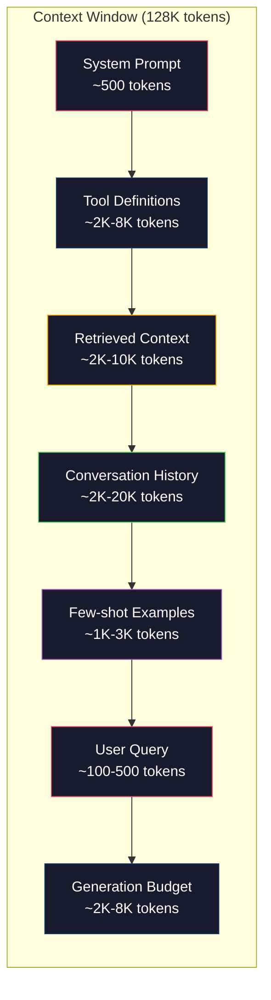
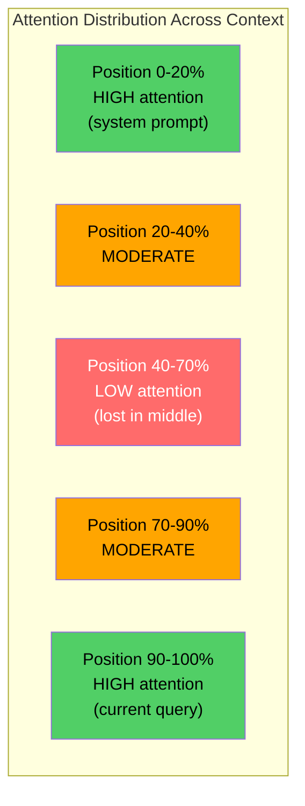
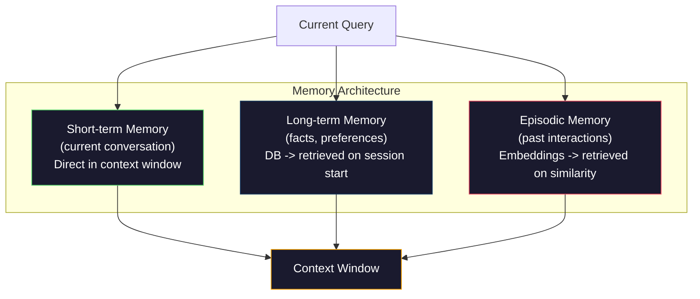

# Context Engineering: Windows, Budgets, Memory, and Retrieval

> Prompt engineering là một tập con. Context engineering là toàn bộ cuộc chơi. Prompt là một chuỗi bạn gõ. Ngữ cảnh là mọi thứ đi vào cửa sổ của mô hình: chỉ dẫn hệ thống, tài liệu được truy xuất, định nghĩa công cụ, lịch sử hội thoại, ví dụ few-shot và chính prompt. Các kỹ sư AI giỏi nhất năm 2026 là các kỹ sư ngữ cảnh. Họ quyết định những gì đi vào, những gì ở ngoài và theo thứ tự nào.

**Type:** Build
**Languages:** Python
**Prerequisites:** Phase 10 (LLMs from Scratch), Phase 11 Lesson 01-02
**Time:** ~90 minutes
**Liên quan:** Giai đoạn 11 · 15 (Prompt Caching) — bố trí thân thiện với cache là phần mở rộng của context engineering. Giai đoạn 5 · 28 (Long-Context Evaluation) về cách đo lost-in-the-middle bằng NIAH/RULER.

## Learning Objectives

- Tính ngân sách token trên mọi thành phần cửa sổ ngữ cảnh (system prompt, công cụ, lịch sử, tài liệu truy xuất, phần dư cho sinh)
- Triển khai các chiến lược quản lý cửa sổ ngữ cảnh: cắt ngắn, tóm tắt và cửa sổ trượt cho lịch sử hội thoại
- Ưu tiên và sắp thứ tự các thành phần ngữ cảnh để tối đa hóa attention của mô hình trên thông tin liên quan nhất
- Xây dựng một bộ lắp ráp ngữ cảnh phân bổ token động theo loại truy vấn và không gian cửa sổ sẵn có

## The Problem

Claude Opus 4.7 có cửa sổ 200K token (1M trong beta). GPT-5 có 400K. Gemini 3 Pro có 2M. Llama 4 tuyên bố 10M. Những con số này nghe khổng lồ cho đến khi bạn lấp đầy chúng.

Đây là một phân tích thực tế cho trợ lý lập trình. System prompt: 500 token. Định nghĩa cho 50 công cụ: 8,000 token. Tài liệu được truy xuất: 4,000 token. Lịch sử hội thoại (10 lượt): 6,000 token. Truy vấn người dùng hiện tại: 200 token. Ngân sách sinh (đầu ra tối đa): 4,000 token. Tổng: 22,700 token. Đó chỉ là 18% cửa sổ 128K.

Nhưng attention không tăng tuyến tính theo độ dài ngữ cảnh. Một mô hình có 128K token ngữ cảnh trả chi phí attention bậc hai ($O(n^2)$ trong transformer nguyên bản, dù hầu hết mô hình sản xuất dùng các biến thể attention hiệu quả). Quan trọng hơn, độ chính xác truy xuất suy giảm. Kiểm thử "Needle in a Haystack" cho thấy mô hình gặp khó khi tìm thông tin đặt ở giữa ngữ cảnh dài. Nghiên cứu của Liu và cộng sự (2023) cho thấy LLM truy xuất thông tin ở đầu và cuối ngữ cảnh dài với độ chính xác gần hoàn hảo, nhưng độ chính xác giảm 10-20% cho thông tin đặt ở giữa (các vị trí 40-70% ngữ cảnh). Hiệu ứng "lost-in-the-middle" này khác nhau theo mô hình nhưng ảnh hưởng mọi kiến trúc hiện tại.

Bài học thực tế: có sẵn 200K token không có nghĩa dùng 200K token là hiệu quả. Một ngữ cảnh 10K token được tuyển chọn cẩn thận thường vượt trội hơn ngữ cảnh 100K token đổ vào. Context engineering là lĩnh vực tối đa hóa tỷ số tín hiệu trên nhiễu trong cửa sổ ngữ cảnh.

Mỗi token bạn đưa vào cửa sổ chiếm chỗ một token có thể mang thông tin liên quan hơn. Mọi định nghĩa công cụ không liên quan, mọi lượt hội thoại lỗi thời, mọi chunk văn bản truy xuất không trả lời câu hỏi -- mỗi thứ khiến mô hình kém hơn một chút ở tác vụ.

## The Concept

### The Context Window is a Scarce Resource

Hãy nghĩ cửa sổ ngữ cảnh là RAM, không phải đĩa. Nó nhanh và truy cập trực tiếp được, nhưng có giới hạn. Bạn không thể chứa mọi thứ. Bạn phải chọn.



Mỗi thành phần cạnh tranh không gian. Thêm định nghĩa công cụ nghĩa là ít chỗ hơn cho lịch sử hội thoại. Thêm ngữ cảnh truy xuất nghĩa là ít chỗ hơn cho ví dụ few-shot. Context engineering là nghệ thuật phân bổ ngân sách này để tối đa hóa hiệu năng tác vụ.

### Lost-in-the-Middle

Phát hiện thực nghiệm quan trọng nhất trong context engineering. Mô hình attend tốt hơn đến thông tin ở đầu và cuối ngữ cảnh. Thông tin ở giữa nhận điểm attention thấp hơn và dễ bị bỏ qua hơn.

Liu và cộng sự (2023) kiểm thử điều này có hệ thống. Họ đặt một tài liệu liên quan giữa 20 tài liệu không liên quan ở các vị trí khác nhau và đo độ chính xác câu trả lời. Khi tài liệu liên quan ở đầu hoặc cuối, độ chính xác là 85-90%. Khi ở giữa (vị trí 10 trong 20), độ chính xác giảm còn 60-70%.

Điều này có các hệ quả kỹ thuật trực tiếp:

- Đặt thông tin quan trọng nhất trước (system prompt, chỉ dẫn then chốt)
- Đặt truy vấn hiện tại và ngữ cảnh liên quan nhất cuối cùng (thiên lệch gần đây giúp ích)
- Xem phần giữa ngữ cảnh là vùng ưu tiên thấp nhất
- Nếu bạn phải bao gồm thông tin ở giữa, lặp lại điểm chính ở cuối



### Context Components

**System prompt**: đặt nhân vật, ràng buộc và quy tắc hành vi. Phần này đi đầu và giữ cố định giữa các lượt. Claude Code dùng khoảng 6,000 token cho system prompt gồm định nghĩa công cụ và chỉ dẫn hành vi. Giữ nó gọn. Mỗi từ trong system prompt được lặp lại ở mỗi lệnh gọi API.

**Định nghĩa công cụ**: mỗi công cụ thêm 50-200 token (tên, mô tả, schema tham số). 50 công cụ với 150 token mỗi công cụ là 7,500 token trước khi có bất kỳ hội thoại nào. Lựa chọn công cụ động -- chỉ bao gồm công cụ liên quan đến truy vấn hiện tại -- có thể giảm phần này 60-80%.

**Ngữ cảnh được truy xuất**: tài liệu từ cơ sở dữ liệu vector, kết quả tìm kiếm, nội dung file. Chất lượng truy xuất quyết định trực tiếp chất lượng phản hồi. Truy xuất kém tệ hơn không truy xuất -- nó lấp cửa sổ bằng nhiễu và chủ động dẫn mô hình sai hướng.

**Lịch sử hội thoại**: mọi thông điệp người dùng và phản hồi trợ lý trước đó. Tăng tuyến tính theo độ dài hội thoại. Một hội thoại 50 lượt ở 200 token mỗi lượt là 10,000 token lịch sử. Phần lớn không liên quan đến truy vấn hiện tại.

**Ví dụ few-shot**: các cặp đầu vào/đầu ra minh họa hành vi mong muốn. Hai đến ba ví dụ được chọn tốt thường cải thiện chất lượng đầu ra hơn hàng nghìn token chỉ dẫn. Nhưng chúng tốn không gian.

**Ngân sách sinh**: các token dành cho phản hồi của mô hình. Nếu bạn lấp đầy cửa sổ đến sức chứa tối đa, mô hình không có chỗ trả lời. Dành ít nhất 2,000-4,000 token cho sinh.

### Context Compression Strategies

**Tóm tắt lịch sử**: thay vì giữ nguyên văn mọi lượt trước, định kỳ tóm tắt hội thoại. "Chúng ta đã thảo luận X, quyết định Y và người dùng muốn Z" trong 100 token thay thế 10 lượt tốn 2,000 token. Chạy tóm tắt khi lịch sử vượt một ngưỡng (ví dụ 5,000 token).

**Lọc mức liên quan**: chấm điểm mỗi tài liệu truy xuất so với truy vấn hiện tại và bỏ tài liệu dưới ngưỡng. Nếu bạn truy xuất 10 chunk nhưng chỉ 3 liên quan, bỏ 7 chunk còn lại. Có 3 chunk rất liên quan tốt hơn 10 chunk tầm thường.

**Cắt tỉa công cụ**: phân loại ý định truy vấn người dùng và chỉ bao gồm công cụ liên quan đến ý định đó. Câu hỏi mã không cần công cụ lịch. Câu hỏi lên lịch không cần công cụ hệ thống file. Điều này có thể giảm định nghĩa công cụ từ 8,000 token xuống 1,000.

**Tóm tắt đệ quy**: với tài liệu rất dài, tóm tắt theo các giai đoạn. Đầu tiên tóm tắt từng phần, rồi tóm tắt các bản tóm tắt. Một tài liệu 50 trang trở thành bản lược 500 token nắm các điểm chính.

### Memory Systems

Context engineering trải trên ba khoảng thời gian.

**Bộ nhớ ngắn hạn**: hội thoại hiện tại. Được lưu trực tiếp trong cửa sổ ngữ cảnh. Tăng với mỗi lượt. Được quản lý bằng tóm tắt và cắt ngắn.

**Bộ nhớ dài hạn**: các sự kiện và sở thích tồn tại qua các hội thoại. "Người dùng thích TypeScript." "Dự án dùng PostgreSQL." Lưu trong cơ sở dữ liệu, truy xuất khi phiên bắt đầu. Claude Code lưu phần này trong các file CLAUDE.md. ChatGPT lưu trong tính năng bộ nhớ.

**Bộ nhớ tình tiết**: các tương tác quá khứ cụ thể có thể liên quan. "Thứ Ba tuần trước, chúng ta gỡ một lỗi tương tự trong mô-đun xác thực." Lưu dưới dạng embedding, truy xuất khi hội thoại hiện tại khớp một tình tiết quá khứ.



### Dynamic Context Assembly

Nhận thức chính: truy vấn khác nhau cần ngữ cảnh khác nhau. System prompt tĩnh + công cụ tĩnh + lịch sử tĩnh là lãng phí. Các hệ thống tốt nhất lắp ráp ngữ cảnh động theo từng truy vấn.

1. Phân loại ý định truy vấn
2. Chọn công cụ liên quan (không phải mọi công cụ)
3. Truy xuất tài liệu liên quan (không phải một tập cố định)
4. Bao gồm các lượt lịch sử liên quan (không phải toàn bộ lịch sử)
5. Thêm ví dụ few-shot khớp loại tác vụ
6. Sắp mọi thứ theo mức quan trọng: then chốt đầu tiên, quan trọng cuối cùng, tùy chọn ở giữa

Đây là điều tách một ứng dụng AI tốt khỏi một ứng dụng xuất sắc. Mô hình giống nhau. Ngữ cảnh là yếu tố tạo khác biệt.

```figure
lost-in-the-middle
```

## Build It

### Step 1: Token Counter

Bạn không thể lập ngân sách cho thứ không đo được. Xây dựng một bộ đếm token đơn giản (xấp xỉ bằng tách theo khoảng trắng, vì số đếm chính xác phụ thuộc tokenizer).

```python
import json
import numpy as np
from collections import OrderedDict

def count_tokens(text):
    if not text:
        return 0
    return int(len(text.split()) * 1.3)

def count_tokens_json(obj):
    return count_tokens(json.dumps(obj))
```

### Step 2: Context Budget Manager

Lớp trừu tượng cốt lõi. Một bộ quản lý ngân sách theo dõi số token mỗi thành phần dùng và cưỡng chế giới hạn.

```python
class ContextBudget:
    def __init__(self, max_tokens=128000, generation_reserve=4000):
        self.max_tokens = max_tokens
        self.generation_reserve = generation_reserve
        self.available = max_tokens - generation_reserve
        self.allocations = OrderedDict()

    def allocate(self, component, content, max_tokens=None):
        tokens = count_tokens(content)
        if max_tokens and tokens > max_tokens:
            words = content.split()
            target_words = int(max_tokens / 1.3)
            content = " ".join(words[:target_words])
            tokens = count_tokens(content)

        used = sum(self.allocations.values())
        if used + tokens > self.available:
            allowed = self.available - used
            if allowed <= 0:
                return None, 0
            words = content.split()
            target_words = int(allowed / 1.3)
            content = " ".join(words[:target_words])
            tokens = count_tokens(content)

        self.allocations[component] = tokens
        return content, tokens

    def remaining(self):
        used = sum(self.allocations.values())
        return self.available - used

    def utilization(self):
        used = sum(self.allocations.values())
        return used / self.max_tokens

    def report(self):
        total_used = sum(self.allocations.values())
        lines = []
        lines.append(f"Context Budget Report ({self.max_tokens:,} token window)")
        lines.append("-" * 50)
        for component, tokens in self.allocations.items():
            pct = tokens / self.max_tokens * 100
            bar = "#" * int(pct / 2)
            lines.append(f"  {component:<25} {tokens:>6} tokens ({pct:>5.1f}%) {bar}")
        lines.append("-" * 50)
        lines.append(f"  {'Used':<25} {total_used:>6} tokens ({total_used/self.max_tokens*100:.1f}%)")
        lines.append(f"  {'Generation reserve':<25} {self.generation_reserve:>6} tokens")
        lines.append(f"  {'Remaining':<25} {self.remaining():>6} tokens")
        return "\n".join(lines)
```

### Step 3: Lost-in-the-Middle Reordering

Triển khai chiến lược sắp lại: các mục quan trọng nhất ở đầu và cuối, ít quan trọng nhất ở giữa.

```python
def reorder_lost_in_middle(items, scores):
    paired = sorted(zip(scores, items), reverse=True)
    sorted_items = [item for _, item in paired]

    if len(sorted_items) <= 2:
        return sorted_items

    first_half = sorted_items[::2]
    second_half = sorted_items[1::2]
    second_half.reverse()

    return first_half + second_half

def score_relevance(query, documents):
    query_words = set(query.lower().split())
    scores = []
    for doc in documents:
        doc_words = set(doc.lower().split())
        if not query_words:
            scores.append(0.0)
            continue
        overlap = len(query_words & doc_words) / len(query_words)
        scores.append(round(overlap, 3))
    return scores
```

### Step 4: Conversation History Compressor

Tóm tắt các lượt hội thoại cũ để thu hồi ngân sách token.

```python
class ConversationManager:
    def __init__(self, max_history_tokens=5000):
        self.turns = []
        self.summaries = []
        self.max_history_tokens = max_history_tokens

    def add_turn(self, role, content):
        self.turns.append({"role": role, "content": content})
        self._compress_if_needed()

    def _compress_if_needed(self):
        total = sum(count_tokens(t["content"]) for t in self.turns)
        if total <= self.max_history_tokens:
            return

        while total > self.max_history_tokens and len(self.turns) > 4:
            old_turns = self.turns[:2]
            summary = self._summarize_turns(old_turns)
            self.summaries.append(summary)
            self.turns = self.turns[2:]
            total = sum(count_tokens(t["content"]) for t in self.turns)

    def _summarize_turns(self, turns):
        parts = []
        for t in turns:
            content = t["content"]
            if len(content) > 100:
                content = content[:100] + "..."
            parts.append(f"{t['role']}: {content}")
        return "Previous: " + " | ".join(parts)

    def get_context(self):
        parts = []
        if self.summaries:
            parts.append("[Conversation Summary]")
            for s in self.summaries:
                parts.append(s)
        parts.append("[Recent Conversation]")
        for t in self.turns:
            parts.append(f"{t['role']}: {t['content']}")
        return "\n".join(parts)

    def token_count(self):
        return count_tokens(self.get_context())
```

### Step 5: Dynamic Tool Selector

Chỉ bao gồm công cụ liên quan đến truy vấn hiện tại. Phân loại ý định, rồi lọc.

```python
TOOL_REGISTRY = {
    "read_file": {
        "description": "Read contents of a file",
        "tokens": 120,
        "categories": ["code", "files"],
    },
    "write_file": {
        "description": "Write content to a file",
        "tokens": 150,
        "categories": ["code", "files"],
    },
    "search_code": {
        "description": "Search for patterns in codebase",
        "tokens": 130,
        "categories": ["code"],
    },
    "run_command": {
        "description": "Execute a shell command",
        "tokens": 140,
        "categories": ["code", "system"],
    },
    "create_calendar_event": {
        "description": "Create a new calendar event",
        "tokens": 180,
        "categories": ["calendar"],
    },
    "list_emails": {
        "description": "List recent emails",
        "tokens": 160,
        "categories": ["email"],
    },
    "send_email": {
        "description": "Send an email message",
        "tokens": 200,
        "categories": ["email"],
    },
    "web_search": {
        "description": "Search the web for information",
        "tokens": 140,
        "categories": ["research"],
    },
    "query_database": {
        "description": "Run a SQL query on the database",
        "tokens": 170,
        "categories": ["code", "data"],
    },
    "generate_chart": {
        "description": "Generate a chart from data",
        "tokens": 190,
        "categories": ["data", "visualization"],
    },
}

def classify_intent(query):
    query_lower = query.lower()

    intent_keywords = {
        "code": ["code", "function", "bug", "error", "file", "implement", "refactor", "debug", "test"],
        "calendar": ["meeting", "schedule", "calendar", "appointment", "event"],
        "email": ["email", "mail", "send", "inbox", "message"],
        "research": ["search", "find", "what is", "how does", "explain", "look up"],
        "data": ["data", "query", "database", "chart", "graph", "analytics", "sql"],
    }

    scores = {}
    for intent, keywords in intent_keywords.items():
        score = sum(1 for kw in keywords if kw in query_lower)
        if score > 0:
            scores[intent] = score

    if not scores:
        return ["code"]

    max_score = max(scores.values())
    return [intent for intent, score in scores.items() if score >= max_score * 0.5]

def select_tools(query, token_budget=2000):
    intents = classify_intent(query)
    relevant = {}
    total_tokens = 0

    for name, tool in TOOL_REGISTRY.items():
        if any(cat in intents for cat in tool["categories"]):
            if total_tokens + tool["tokens"] <= token_budget:
                relevant[name] = tool
                total_tokens += tool["tokens"]

    return relevant, total_tokens
```

### Step 6: Full Context Assembly Pipeline

Kết nối mọi thứ. Với một truy vấn, lắp ráp động ngữ cảnh tối ưu.

```python
class ContextEngine:
    def __init__(self, max_tokens=128000, generation_reserve=4000):
        self.budget = ContextBudget(max_tokens, generation_reserve)
        self.conversation = ConversationManager(max_history_tokens=5000)
        self.system_prompt = (
            "You are a helpful AI assistant. You have access to tools for "
            "code editing, file management, web search, and data analysis. "
            "Use the appropriate tools for each task. Be concise and accurate."
        )
        self.knowledge_base = [
            "Python 3.12 introduced type parameter syntax for generic classes using bracket notation.",
            "The project uses PostgreSQL 16 with pgvector for embedding storage.",
            "Authentication is handled by Supabase Auth with JWT tokens.",
            "The frontend is built with Next.js 15 using the App Router.",
            "API rate limits are set to 100 requests per minute per user.",
            "The deployment pipeline uses GitHub Actions with Docker multi-stage builds.",
            "Test coverage must be above 80% for all new modules.",
            "The codebase follows the repository pattern for data access.",
        ]

    def assemble(self, query):
        self.budget = ContextBudget(self.budget.max_tokens, self.budget.generation_reserve)

        system_content, _ = self.budget.allocate("system_prompt", self.system_prompt, max_tokens=1000)

        tools, tool_tokens = select_tools(query, token_budget=2000)
        tool_text = json.dumps(list(tools.keys()))
        tool_content, _ = self.budget.allocate("tools", tool_text, max_tokens=2000)

        relevance = score_relevance(query, self.knowledge_base)
        threshold = 0.1
        relevant_docs = [
            doc for doc, score in zip(self.knowledge_base, relevance)
            if score >= threshold
        ]

        if relevant_docs:
            doc_scores = [s for s in relevance if s >= threshold]
            reordered = reorder_lost_in_middle(relevant_docs, doc_scores)
            doc_text = "\n".join(reordered)
            doc_content, _ = self.budget.allocate("retrieved_context", doc_text, max_tokens=3000)

        history_text = self.conversation.get_context()
        if history_text.strip():
            history_content, _ = self.budget.allocate("conversation_history", history_text, max_tokens=5000)

        query_content, _ = self.budget.allocate("user_query", query, max_tokens=500)

        return self.budget

    def chat(self, query):
        self.conversation.add_turn("user", query)
        budget = self.assemble(query)
        response = f"[Response to: {query[:50]}...]"
        self.conversation.add_turn("assistant", response)
        return budget


def run_demo():
    print("=" * 60)
    print("  Context Engineering Pipeline Demo")
    print("=" * 60)

    engine = ContextEngine(max_tokens=128000, generation_reserve=4000)

    print("\n--- Query 1: Code task ---")
    budget = engine.chat("Fix the bug in the authentication module where JWT tokens expire too early")
    print(budget.report())

    print("\n--- Query 2: Research task ---")
    budget = engine.chat("What is the best approach for implementing vector search in PostgreSQL?")
    print(budget.report())

    print("\n--- Query 3: After conversation history builds up ---")
    for i in range(8):
        engine.conversation.add_turn("user", f"Follow-up question number {i+1} about the implementation details of the system")
        engine.conversation.add_turn("assistant", f"Here is the response to follow-up {i+1} with technical details about the architecture")

    budget = engine.chat("Now implement the changes we discussed")
    print(budget.report())

    print("\n--- Tool Selection Examples ---")
    test_queries = [
        "Fix the bug in auth.py",
        "Schedule a meeting with the team for Tuesday",
        "Show me the database query performance stats",
        "Search for best practices on error handling",
    ]

    for q in test_queries:
        tools, tokens = select_tools(q)
        intents = classify_intent(q)
        print(f"\n  Query: {q}")
        print(f"  Intents: {intents}")
        print(f"  Tools: {list(tools.keys())} ({tokens} tokens)")

    print("\n--- Lost-in-the-Middle Reordering ---")
    docs = ["Doc A (most relevant)", "Doc B (somewhat relevant)", "Doc C (least relevant)",
            "Doc D (relevant)", "Doc E (moderately relevant)"]
    scores = [0.95, 0.60, 0.20, 0.80, 0.50]
    reordered = reorder_lost_in_middle(docs, scores)
    print(f"  Original order: {docs}")
    print(f"  Scores:         {scores}")
    print(f"  Reordered:      {reordered}")
    print(f"  (Most relevant at start and end, least relevant in middle)")
```

## Use It

### Harness-Managed Context

Claude Code quản lý ngữ cảnh bằng cách tiếp cận nhiều lớp. System prompt bao gồm quy tắc hành vi và định nghĩa công cụ (~6K token). Khi bạn mở một file, nội dung của nó được đưa vào làm ngữ cảnh. Khi bạn tìm kiếm, kết quả được thêm vào. Các lượt hội thoại cũ được tóm tắt. CLAUDE.md cung cấp bộ nhớ dài hạn tồn tại qua các phiên.

Quyết định kỹ thuật chính: Claude Code không đổ toàn bộ cơ sở mã của bạn vào ngữ cảnh. Nó truy xuất các file liên quan theo nhu cầu. Đây là context engineering trong thực tế.

### Dynamic Context Loading

Cursor lập chỉ mục toàn bộ cơ sở mã của bạn thành embedding. Khi bạn gõ truy vấn, nó truy xuất các file và khối mã liên quan nhất bằng độ tương đồng vector. Chỉ những phần đó đi vào cửa sổ ngữ cảnh. Một cơ sở mã 500K dòng được nén thành 5-10 khối mã liên quan nhất.

Đây là mẫu: nhúng mọi thứ, truy xuất theo nhu cầu, chỉ bao gồm những gì quan trọng.

### Assistant Long-Term Memory

ChatGPT lưu sở thích và sự kiện của người dùng dưới dạng bộ nhớ dài hạn. Khi mỗi hội thoại bắt đầu, các ký ức liên quan được truy xuất và đưa vào system prompt. "Người dùng thích Python" tốn 5 token nhưng tiết kiệm hàng trăm token chỉ dẫn lặp lại qua các hội thoại.

### RAG as Context Engineering

Retrieval-Augmented Generation là context engineering được hình thức hóa. Thay vì nhồi kiến thức vào trọng số mô hình (huấn luyện) hoặc system prompt (ngữ cảnh tĩnh), bạn truy xuất tài liệu liên quan ở thời điểm truy vấn và đưa chúng vào cửa sổ ngữ cảnh. Toàn bộ pipeline RAG -- chia chunk, embedding, truy xuất, xếp hạng lại -- tồn tại để giải một vấn đề: đặt đúng thông tin vào cửa sổ ngữ cảnh.

## Ship It

Bài học này tạo ra `outputs/prompt-context-optimizer.md` -- một prompt tái sử dụng rà soát chiến lược lắp ráp ngữ cảnh và khuyến nghị tối ưu. Đưa vào system prompt, số công cụ, độ dài lịch sử trung bình và chiến lược truy xuất của bạn, và nó xác định lãng phí token và đề xuất cải thiện.

Nó cũng tạo ra `outputs/skill-context-engineering.md` -- một khung quyết định để thiết kế các pipeline lắp ráp ngữ cảnh dựa trên loại tác vụ, kích thước cửa sổ ngữ cảnh và ngân sách độ trễ.

## Exercises

1. Thêm một "bộ phát hiện lãng phí token" vào lớp ContextBudget. Nó phải đánh dấu các thành phần dùng hơn 30% ngân sách và đề xuất chiến lược nén riêng cho từng loại thành phần (tóm tắt lịch sử, cắt tỉa công cụ, xếp hạng lại tài liệu).

2. Triển khai loại trùng lặp ngữ nghĩa cho ngữ cảnh truy xuất. Nếu hai tài liệu truy xuất tương tự hơn 80% (theo chồng lấp từ hoặc cosine similarity của embedding), chỉ giữ tài liệu điểm cao hơn. Đo lượng ngân sách token thu hồi được.

3. Xây dựng một công cụ "phát lại ngữ cảnh". Với bản ghi hội thoại, phát lại qua ContextEngine và trực quan hóa cách phân bổ ngân sách thay đổi theo từng lượt. Vẽ mức dùng token mỗi thành phần theo thời gian. Xác định lượt mà ngữ cảnh bắt đầu bị nén.

4. Triển khai một bộ chọn công cụ theo ưu tiên. Thay vì bao gồm/loại trừ nhị phân, gán mỗi công cụ một điểm liên quan với truy vấn hiện tại. Bao gồm công cụ theo mức liên quan giảm dần đến khi hết ngân sách công cụ. So sánh hiệu năng tác vụ với 5, 10, 20 và 50 công cụ được bao gồm.

5. Xây dựng một bộ nén ngữ cảnh đa chiến lược. Triển khai ba chiến lược nén (cắt ngắn, tóm tắt, trích xuất câu chính) và benchmark chúng trên tập 20 tài liệu. Đo sự đánh đổi giữa tỷ lệ nén và giữ thông tin (phiên bản nén có còn chứa câu trả lời cho truy vấn không?).

## Key Terms

| Thuật ngữ | Mọi người nói gì | Ý nghĩa thực sự |
|------|----------------|----------------------|
| Context window (Cửa sổ ngữ cảnh) | "Mô hình đọc được bao nhiêu" | Số token tối đa (đầu vào + đầu ra) mô hình xử lý trong một forward pass duy nhất -- 400K cho GPT-5, 200K (1M beta) cho Claude Opus 4.7, 2M cho Gemini 3 Pro |
| Context engineering (Kỹ thuật ngữ cảnh) | "Prompt engineering nâng cao" | Lĩnh vực quyết định những gì đi vào cửa sổ ngữ cảnh, theo thứ tự nào và mức ưu tiên nào -- bao gồm truy xuất, nén, chọn công cụ và quản lý bộ nhớ |
| Lost-in-the-middle (Lạc ở giữa) | "Mô hình quên những thứ ở giữa" | Phát hiện thực nghiệm rằng LLM attend tốt hơn ở đầu và cuối ngữ cảnh, với giảm độ chính xác 10-20% cho thông tin đặt ở giữa |
| Token budget (Ngân sách token) | "Bạn còn bao nhiêu token" | Phân bổ rõ ràng sức chứa cửa sổ ngữ cảnh giữa các thành phần (system prompt, công cụ, lịch sử, truy xuất, sinh) với giới hạn cho từng thành phần |
| Dynamic context (Ngữ cảnh động) | "Nạp các thứ ngay khi cần" | Lắp ráp cửa sổ ngữ cảnh khác nhau cho mỗi truy vấn theo phân loại ý định, chọn công cụ liên quan và kết quả truy xuất |
| History summarization (Tóm tắt lịch sử) | "Nén hội thoại" | Thay các lượt hội thoại cũ nguyên văn bằng một bản tóm tắt súc tích, giảm chi phí token trong khi giữ thông tin chính |
| Tool pruning (Cắt tỉa công cụ) | "Chỉ bao gồm công cụ liên quan" | Phân loại ý định truy vấn và chỉ bao gồm định nghĩa công cụ khớp, giảm chi phí token công cụ 60-80% |
| Long-term memory (Bộ nhớ dài hạn) | "Ghi nhớ qua các phiên" | Sự kiện và sở thích lưu trong cơ sở dữ liệu và truy xuất khi phiên bắt đầu -- CLAUDE.md, ChatGPT Memory và các hệ thống tương tự |
| Episodic memory (Bộ nhớ tình tiết) | "Ghi nhớ các sự kiện quá khứ cụ thể" | Tương tác quá khứ lưu dưới dạng embedding và truy xuất khi truy vấn hiện tại tương tự một hội thoại quá khứ |
| Generation budget (Ngân sách sinh) | "Chỗ cho câu trả lời" | Token dành cho đầu ra mô hình -- nếu ngữ cảnh lấp kín cửa sổ, mô hình không có chỗ phản hồi |

## Further Reading

- [Liu et al., 2023 -- "Lost in the Middle: How Language Models Use Long Contexts"](https://arxiv.org/abs/2307.03172) -- nghiên cứu có tính quyết định về attention phụ thuộc vị trí, cho thấy mô hình gặp khó với thông tin ở giữa ngữ cảnh dài
- [Anthropic's Contextual Retrieval blog post](https://www.anthropic.com/news/contextual-retrieval) -- cách Anthropic tiếp cận truy xuất chunk nhận biết ngữ cảnh, giảm thất bại truy xuất 49%
- [Simon Willison's "Context Engineering"](https://simonwillison.net/2025/Jun/27/context-engineering/) -- bài blog đặt tên lĩnh vực và phân biệt nó với prompt engineering
- [LangChain documentation on RAG](https://python.langchain.com/docs/tutorials/rag/) -- triển khai thực tế retrieval-augmented generation như một mẫu context engineering
- [Greg Kamradt's Needle in a Haystack test](https://github.com/gkamradt/LLMTest_NeedleInAHaystack) -- benchmark bộc lộ thất bại truy xuất phụ thuộc vị trí trên mọi mô hình lớn
- [Pope et al., "Efficiently Scaling Transformer Inference" (2022)](https://arxiv.org/abs/2211.05102) -- tại sao độ dài ngữ cảnh chi phối bộ nhớ và độ trễ, và cách KV cache, MQA, GQA thay đổi phép tính ngân sách.
- [Agrawal et al., "SARATHI: Efficient LLM Inference by Piggybacking Decodes with Chunked Prefills" (2023)](https://arxiv.org/abs/2308.16369) -- hai giai đoạn suy luận khiến prompt dài đắt ở TTFT nhưng rẻ ở TPOT; sự thật nền tảng đằng sau đánh đổi đóng gói ngữ cảnh.
- [Ainslie et al., "GQA: Training Generalized Multi-Query Transformer Models from Multi-Head Checkpoints" (EMNLP 2023)](https://arxiv.org/abs/2305.13245) -- bài báo grouped-query attention cắt bộ nhớ KV 8× trong decoder sản xuất mà không mất chất lượng.
