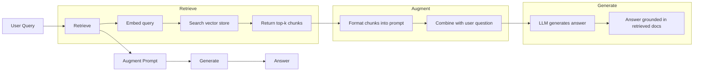
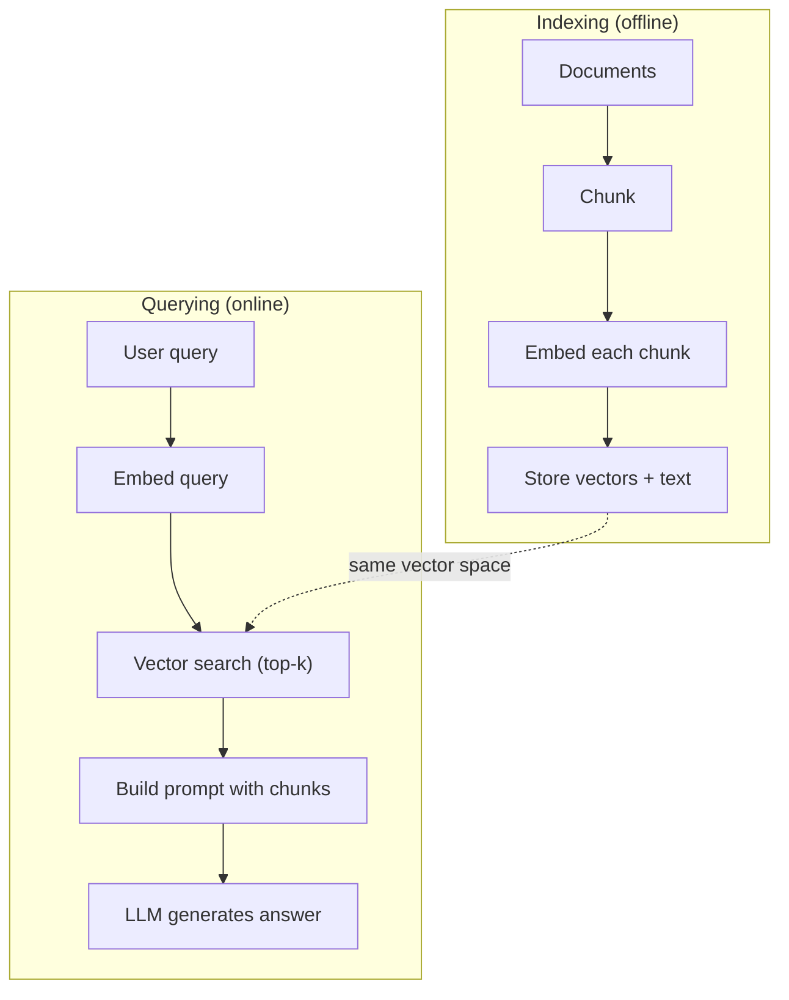

# RAG (Retrieval-Augmented Generation)

> LLM của bạn biết mọi thứ đến thời điểm chốt dữ liệu huấn luyện. Nó không biết gì về tài liệu công ty, cơ sở mã hay ghi chú cuộc họp tuần trước của bạn. RAG giải quyết điều này bằng cách truy xuất tài liệu liên quan và nhồi chúng vào prompt. Đây là mẫu được triển khai nhiều nhất trong AI sản xuất. Nếu bạn xây một thứ từ khóa học này, hãy xây một pipeline RAG.

**Type:** Build
**Languages:** Python
**Prerequisites:** Phase 10 (LLMs from Scratch), Phase 11 Lessons 01-05
**Time:** ~90 minutes
**Liên quan:** Giai đoạn 5 · 23 (Chunking Strategies for RAG) về sáu thuật toán chia chunk và khi nào mỗi thuật toán thắng. Giai đoạn 5 · 22 (Embedding Models Deep Dive) về chọn bộ nhúng. Giai đoạn 11 · 07 (Advanced RAG) về tìm kiếm lai, xếp hạng lại và biến đổi truy vấn.

## Learning Objectives

- Xây dựng một pipeline RAG hoàn chỉnh: nạp tài liệu, chia chunk, embedding, lưu trữ vector, truy xuất và sinh
- Triển khai tìm kiếm ngữ nghĩa bằng cơ sở dữ liệu vector (ChromaDB, FAISS hoặc Pinecone) với lập chỉ mục thích hợp
- Giải thích tại sao RAG được ưu tiên hơn fine-tuning cho các ứng dụng dựa trên kiến thức (chi phí, độ mới, quy nguồn)
- Đánh giá chất lượng RAG bằng các thước đo truy xuất (precision, recall) và thước đo sinh (độ trung thực, độ liên quan)

## The Problem

Bạn xây một chatbot cho công ty. Một khách hàng hỏi "Chính sách hoàn tiền cho gói doanh nghiệp là gì?" LLM phản hồi bằng câu trả lời chung về chính sách hoàn tiền SaaS điển hình. Chính sách thực tế, chôn trong wiki nội bộ 200 trang, nói khách hàng doanh nghiệp có thời hạn 60 ngày với hoàn tiền theo tỷ lệ. LLM chưa bao giờ thấy tài liệu này. Nó không thể biết điều chưa được huấn luyện.

Fine-tuning là một giải pháp. Lấy LLM, huấn luyện trên tài liệu nội bộ và triển khai mô hình cập nhật. Điều này có tác dụng nhưng có vấn đề nghiêm trọng. Fine-tuning tốn hàng nghìn đô la tính toán. Mô hình lỗi thời ngay khi một tài liệu thay đổi. Bạn không có cách biết mô hình lấy từ nguồn nào. Và nếu công ty mua thêm một dòng sản phẩm vào tháng sau, bạn lại fine-tune.

RAG là giải pháp còn lại. Giữ mô hình nguyên vẹn. Khi một câu hỏi đến, tìm các đoạn liên quan trong kho tài liệu, dán chúng vào prompt trước câu hỏi và để mô hình trả lời bằng các đoạn đó làm ngữ cảnh. Kho tài liệu có thể được cập nhật trong vài phút. Bạn có thể thấy chính xác tài liệu nào đã được truy xuất. Bản thân mô hình không bao giờ thay đổi. Đây là lý do RAG là mẫu thống trị trong sản xuất: nó rẻ hơn, mới hơn, dễ kiểm toán hơn và hoạt động với bất kỳ LLM nào.

## The Concept

### The RAG Pattern

Toàn bộ mẫu vừa trong bốn bước:



Truy vấn -> Truy xuất -> Bổ sung prompt -> Sinh. Mọi hệ thống RAG tuân mẫu này. Khác biệt giữa các hệ thống RAG sản xuất nằm ở chi tiết từng bước: cách chia chunk, cách nhúng, cách tìm kiếm và cách xây dựng prompt.

### Why RAG Beats Fine-Tuning

| Mối quan tâm | Fine-tuning | RAG |
|---------|------------|-----|
| Chi phí | $1,000-$100,000+ mỗi lượt huấn luyện | $0.01-$0.10 mỗi truy vấn (embedding + LLM) |
| Độ mới | Lỗi thời đến khi huấn luyện lại | Cập nhật trong vài phút bằng lập chỉ mục lại tài liệu |
| Khả năng kiểm toán | Không thể truy câu trả lời về nguồn | Có thể hiển thị chính xác các đoạn được truy xuất |
| Ảo giác | Vẫn ảo giác tự do | Dựa trên tài liệu được truy xuất |
| Quyền riêng tư dữ liệu | Dữ liệu huấn luyện được tích hợp vào trọng số | Tài liệu ở lại kho vector của bạn |

Fine-tuning thay đổi trọng số mô hình vĩnh viễn. RAG thay đổi ngữ cảnh mô hình tạm thời. Với hầu hết ứng dụng, ngữ cảnh tạm thời là thứ bạn muốn.

Trường hợp duy nhất fine-tuning thắng: khi bạn cần mô hình tiếp nhận một phong cách, giọng điệu hoặc mẫu suy luận cụ thể không thể đạt được chỉ bằng prompting. Với truy xuất kiến thức sự kiện, RAG thắng mọi lần.

### Embedding Models

Một mô hình embedding chuyển văn bản thành vector dày đặc. Văn bản tương tự tạo vector gần nhau trong không gian nhiều chiều này. "Làm thế nào để tôi đặt lại mật khẩu?" và "Tôi cần đổi mật khẩu" tạo các vector gần như giống hệt dù có ít từ chung. "Con mèo ngồi trên tấm thảm" tạo một vector rất khác.

Các mô hình embedding phổ biến (danh sách năm 2026 — xem Giai đoạn 5 · 22 để có phân tích đầy đủ):

| Mô hình | Số chiều | Nhà cung cấp | Ghi chú |
|-------|-----------|----------|-------|
| text-embedding-3-small | 1536 (Matryoshka) | OpenAI | Giá/hiệu năng tốt nhất cho hầu hết trường hợp sử dụng |
| text-embedding-3-large | 3072 (Matryoshka) | OpenAI | Độ chính xác cao hơn, có thể cắt ngắn xuống 256/512/1024 |
| Gemini Embedding 2 | 3072 (Matryoshka) | Google | Truy xuất MTEB hàng đầu; ngữ cảnh 8K |
| voyage-4 | 1024/2048 (Matryoshka) | Voyage AI | Biến thể miền (mã, tài chính, luật) |
| Cohere embed-v4 | 1024 (Matryoshka) | Cohere | Đa ngôn ngữ mạnh, ngữ cảnh 128K |
| BGE-M3 | 1024 (dense + sparse + ColBERT) | BAAI (trọng số mở) | Ba góc nhìn từ một mô hình |
| Qwen3-Embedding | 4096 (Matryoshka) | Alibaba (trọng số mở) | Điểm truy xuất trọng số mở hàng đầu |
| all-MiniLM-L6-v2 | 384 | Trọng số mở (Sentence Transformers) | Baseline tạo mẫu |

Với bài học này, chúng ta xây embedding đơn giản riêng bằng TF-IDF. Không phải vì TF-IDF là thứ hệ thống sản xuất dùng, mà vì nó làm khái niệm trở nên cụ thể: văn bản đi vào, vector đi ra, văn bản tương tự tạo vector tương tự.

### Vector Similarity

Với hai vector, bạn đo độ tương đồng thế nào? Ba lựa chọn:

**Cosine similarity**: cosin của góc giữa hai vector. Từ -1 (đối nhau) đến 1 (giống hệt). Bỏ qua độ lớn, chỉ quan tâm hướng. Đây là mặc định cho RAG.

```math
\mathop{\mathrm{cosine\_sim}}(a, b) = \frac{\mathop{\mathrm{dot}}(a, b)}{\lVert a \rVert \cdot \lVert b \rVert}
```

**Tích vô hướng**: tích trong thô. Vector lớn hơn nhận điểm cao hơn. Hữu ích khi độ lớn mang thông tin (tài liệu dài hơn có thể liên quan hơn).

```math
\mathop{\mathrm{dot}}(a, b) = \sum_i a_i b_i
```

**Khoảng cách L2 (Euclid)**: khoảng cách đường thẳng trong không gian vector. Khoảng cách nhỏ hơn = tương tự hơn. Nhạy với khác biệt độ lớn.

```math
\mathop{\mathrm{L2}}(a, b) = \sqrt{\sum_i (a_i - b_i)^2}
```

Cosine similarity là tiêu chuẩn. Nó xử lý tốt tài liệu độ dài khác nhau vì chuẩn hóa theo độ lớn. Khi ai đó nói "tìm kiếm vector", họ gần như luôn muốn nói cosine similarity.

### Chunking Strategies

Tài liệu quá dài để nhúng thành vector đơn. Một PDF 50 trang có thể tạo embedding tệ vì chứa hàng chục chủ đề. Thay vào đó, bạn chia tài liệu thành chunk và nhúng riêng từng chunk.

**Chia chunk kích thước cố định**: chia mỗi N token. Đơn giản và có thể dự đoán. Chunk 512 token với chồng lấp 50 token nghĩa là chunk 1 là token 0-511, chunk 2 là token 462-973 và cứ thế. Chồng lấp bảo đảm bạn không chia một câu tại ranh giới không may.

**Chia chunk ngữ nghĩa**: chia tại ranh giới tự nhiên. Đoạn văn, phần hoặc tiêu đề markdown. Mỗi chunk là một đơn vị ý nghĩa mạch lạc. Triển khai phức tạp hơn nhưng tạo truy xuất tốt hơn.

**Chia chunk đệ quy**: thử chia tại ranh giới lớn nhất trước (tiêu đề phần). Nếu một phần vẫn quá lớn, chia tại ranh giới đoạn văn. Nếu một đoạn văn vẫn quá lớn, chia tại ranh giới câu. Đây là cách tiếp cận RecursiveCharacterTextSplitter của LangChain và hoạt động tốt trong thực tế.

Kích thước chunk quan trọng hơn mọi người nghĩ:

- Quá nhỏ (64-128 token): mỗi chunk thiếu ngữ cảnh. "Nó tăng 15% quý trước" không có nghĩa gì nếu không biết "nó" chỉ gì.
- Quá lớn (2048+ token): mỗi chunk bao quát nhiều chủ đề, làm loãng mức liên quan. Khi tìm dữ liệu doanh thu, bạn nhận một chunk có 10% về doanh thu và 90% về số nhân sự.
- Điểm tối ưu (256-512 token): đủ ngữ cảnh để tự chứa ý nghĩa, đủ tập trung để liên quan.

Hầu hết hệ thống RAG sản xuất dùng chunk 256-512 token với chồng lấp 50 token. Hướng dẫn RAG của Anthropic khuyến nghị phạm vi này.

### Vector Databases

Khi đã có embedding, bạn cần nơi để lưu và tìm kiếm chúng. Các lựa chọn:

| Cơ sở dữ liệu | Loại | Tốt nhất cho |
|----------|------|----------|
| FAISS | Thư viện (trong tiến trình) | Tạo mẫu, bộ dữ liệu nhỏ đến trung bình |
| Chroma | Cơ sở dữ liệu nhẹ | Phát triển cục bộ, triển khai nhỏ |
| Pinecone | Dịch vụ được quản lý | Sản xuất không có chi phí vận hành bổ sung |
| Weaviate | Cơ sở dữ liệu mã nguồn mở | Sản xuất tự lưu trữ |
| pgvector | Phần mở rộng Postgres | Đã dùng Postgres |
| Qdrant | Cơ sở dữ liệu mã nguồn mở | Tự lưu trữ hiệu năng cao |

Với bài học này, chúng ta xây một kho vector đơn giản trong bộ nhớ. Nó lưu vector trong danh sách và tìm kiếm cosine similarity vét cạn. Điều này tương đương FAISS với chỉ mục phẳng. Nó mở rộng đến có lẽ 100,000 vector trước khi chậm. Hệ thống sản xuất dùng các thuật toán láng giềng gần nhất xấp xỉ (ANN) như HNSW để tìm hàng triệu vector trong mili giây.

### The Full Pipeline



Giai đoạn lập chỉ mục chạy một lần mỗi tài liệu (hoặc khi tài liệu cập nhật). Giai đoạn truy vấn chạy trên mỗi yêu cầu người dùng. Trong sản xuất, lập chỉ mục có thể xử lý hàng triệu tài liệu trong nhiều giờ. Truy vấn phải phản hồi dưới một giây.

### Real Numbers

Hầu hết hệ thống RAG sản xuất dùng các tham số này:

- **k = 5 đến 10** chunk truy xuất mỗi truy vấn
- **Kích thước chunk = 256 đến 512 token** với chồng lấp 50 token
- **Ngân sách ngữ cảnh**: 2,500-5,000 token nội dung truy xuất mỗi truy vấn
- **Tổng prompt**: ~8,000-16,000 token (system prompt + chunk truy xuất + lịch sử hội thoại + truy vấn người dùng)
- **Chiều embedding**: 384-3072 tùy mô hình
- **Thông lượng lập chỉ mục**: 100-1,000 tài liệu mỗi giây với embedding API
- **Độ trễ truy vấn**: 50-200ms cho truy xuất, 500-3000ms cho sinh

```figure
rag-chunking
```

## Build It

### Step 1: Document Chunking

```python
def chunk_text(text, chunk_size=200, overlap=50):
    words = text.split()
    chunks = []
    start = 0
    while start < len(words):
        end = start + chunk_size
        chunk = " ".join(words[start:end])
        chunks.append(chunk)
        start += chunk_size - overlap
    return chunks
```

### Step 2: TF-IDF Embeddings

Chúng ta xây một hàm embedding đơn giản. TF-IDF (Term Frequency-Inverse Document Frequency) không phải embedding nơ-ron, nhưng chuyển văn bản thành vector theo cách nắm bắt tầm quan trọng của từ. Từ thường gặp trong một tài liệu có TF cao hơn. Từ hiếm trên toàn ngữ liệu có IDF cao hơn. Tích cho một vector mà các từ quan trọng, đặc trưng có giá trị cao.

```python
import math
from collections import Counter

def build_vocabulary(documents):
    vocab = set()
    for doc in documents:
        vocab.update(doc.lower().split())
    return sorted(vocab)

def compute_tf(text, vocab):
    words = text.lower().split()
    count = Counter(words)
    total = len(words)
    return [count.get(word, 0) / total for word in vocab]

def compute_idf(documents, vocab):
    n = len(documents)
    idf = []
    for word in vocab:
        doc_count = sum(1 for doc in documents if word in doc.lower().split())
        idf.append(math.log((n + 1) / (doc_count + 1)) + 1)
    return idf

def tfidf_embed(text, vocab, idf):
    tf = compute_tf(text, vocab)
    return [t * i for t, i in zip(tf, idf)]
```

### Step 3: Cosine Similarity Search

```python
def cosine_similarity(a, b):
    dot = sum(x * y for x, y in zip(a, b))
    norm_a = math.sqrt(sum(x * x for x in a))
    norm_b = math.sqrt(sum(x * x for x in b))
    if norm_a == 0 or norm_b == 0:
        return 0.0
    return dot / (norm_a * norm_b)

def search(query_embedding, stored_embeddings, top_k=5):
    scores = []
    for i, emb in enumerate(stored_embeddings):
        sim = cosine_similarity(query_embedding, emb)
        scores.append((i, sim))
    scores.sort(key=lambda x: x[1], reverse=True)
    return scores[:top_k]
```

### Step 4: Prompt Construction

Đây là nơi phần "tăng cường" trong RAG xảy ra. Lấy các chunk truy xuất, định dạng chúng thành prompt và yêu cầu LLM trả lời dựa trên ngữ cảnh được cung cấp.

```python
def build_rag_prompt(query, retrieved_chunks):
    context = "\n\n---\n\n".join(
        f"[Source {i+1}]\n{chunk}"
        for i, chunk in enumerate(retrieved_chunks)
    )
    return f"""Answer the question based ONLY on the following context.
If the context doesn't contain enough information, say "I don't have enough information to answer that."

Context:
{context}

Question: {query}

Answer:"""
```

### Step 5: The Complete RAG Pipeline

```python
class RAGPipeline:
    def __init__(self):
        self.chunks = []
        self.embeddings = []
        self.vocab = []
        self.idf = []

    def index(self, documents):
        all_chunks = []
        for doc in documents:
            all_chunks.extend(chunk_text(doc))
        self.chunks = all_chunks
        self.vocab = build_vocabulary(all_chunks)
        self.idf = compute_idf(all_chunks, self.vocab)
        self.embeddings = [
            tfidf_embed(chunk, self.vocab, self.idf)
            for chunk in all_chunks
        ]

    def query(self, question, top_k=5):
        query_emb = tfidf_embed(question, self.vocab, self.idf)
        results = search(query_emb, self.embeddings, top_k)
        retrieved = [(self.chunks[i], score) for i, score in results]
        prompt = build_rag_prompt(
            question, [chunk for chunk, _ in retrieved]
        )
        return prompt, retrieved
```

### Step 6: Generation (simulated)

Trong sản xuất, đây là nơi bạn gọi API LLM. Với bài học này, chúng ta mô phỏng sinh bằng cách trích xuất câu liên quan nhất từ ngữ cảnh truy xuất.

```python
def simple_generate(prompt, retrieved_chunks):
    query_words = set(prompt.lower().split("question:")[-1].split())
    best_sentence = ""
    best_score = 0
    for chunk in retrieved_chunks:
        for sentence in chunk.split("."):
            sentence = sentence.strip()
            if not sentence:
                continue
            words = set(sentence.lower().split())
            overlap = len(query_words & words)
            if overlap > best_score:
                best_score = overlap
                best_sentence = sentence
    return best_sentence if best_sentence else "I don't have enough information."
```

## Use It

Với một mô hình embedding và LLM thực, mã hầu như không thay đổi:

```python
from openai import OpenAI

client = OpenAI()

def embed(text):
    response = client.embeddings.create(
        model="text-embedding-3-small",
        input=text
    )
    return response.data[0].embedding

def generate(prompt):
    response = client.chat.completions.create(
        model="gpt-4o-mini",
        messages=[{"role": "user", "content": prompt}],
        temperature=0
    )
    return response.choices[0].message.content
```

Hoặc với Anthropic:

```python
import anthropic

client = anthropic.Anthropic()

def generate(prompt):
    response = client.messages.create(
        model="claude-sonnet-5",
        max_tokens=1024,
        messages=[{"role": "user", "content": prompt}]
    )
    return response.content[0].text
```

Pipeline giống nhau. Thay hàm embedding. Thay hàm sinh. Logic truy xuất, chia chunk, xây dựng prompt -- tất cả giống hệt bất kể mô hình bạn dùng.

Để lưu vector ở quy mô lớn, thay tìm kiếm vét cạn bằng một cơ sở dữ liệu vector thích hợp:

```python
import chromadb

client = chromadb.Client()
collection = client.create_collection("my_docs")

collection.add(
    documents=chunks,
    ids=[f"chunk_{i}" for i in range(len(chunks))]
)

results = collection.query(
    query_texts=["What is the refund policy?"],
    n_results=5
)
```

Chroma xử lý embedding nội bộ (mặc định dùng all-MiniLM-L6-v2) và lưu vector trong cơ sở dữ liệu cục bộ. Cùng mẫu, phần kết nối khác.

## Ship It

Bài học này tạo ra:
- `outputs/prompt-rag-architect.md` -- một prompt để thiết kế hệ thống RAG cho các trường hợp sử dụng cụ thể
- `outputs/skill-rag-pipeline.md` -- một skill dạy tác tử cách xây dựng và gỡ lỗi pipeline RAG

## Exercises

1. Thay embedding TF-IDF bằng cách tiếp cận bag-of-words đơn giản (nhị phân: 1 nếu từ có mặt, 0 nếu không). So sánh chất lượng truy xuất trên các tài liệu mẫu. TF-IDF phải vượt trội hơn vì gán trọng số cao hơn cho từ hiếm.

2. Thử nghiệm kích thước chunk: thử 50, 100, 200 và 500 từ trên cùng tập tài liệu. Với mỗi kích thước, chạy cùng 5 truy vấn và đếm bao nhiêu truy vấn trả về chunk liên quan trong top-3. Tìm điểm tối ưu nơi chất lượng truy xuất đạt đỉnh.

3. Thêm metadata vào mỗi chunk (tên tài liệu nguồn, vị trí chunk). Sửa khuôn mẫu prompt để bao gồm quy nguồn nhằm để LLM trích dẫn nguồn.

4. Triển khai một đánh giá đơn giản: với 10 cặp câu hỏi-câu trả lời, chạy mỗi câu hỏi qua pipeline RAG và đo phần trăm chunk truy xuất chứa câu trả lời. Đây là recall truy xuất tại k.

5. Xây dựng một pipeline RAG nhận biết hội thoại: duy trì lịch sử 3 lần trao đổi cuối và đưa chúng vào prompt cùng các chunk truy xuất. Kiểm thử với câu hỏi tiếp nối như "Còn doanh nghiệp thì sao?" sau khi hỏi về giá.

## Key Terms

| Thuật ngữ | Mọi người nói gì | Ý nghĩa thực sự |
|------|----------------|----------------------|
| RAG | "AI đọc tài liệu của bạn" | Truy xuất tài liệu liên quan, dán vào prompt và sinh câu trả lời dựa trên các tài liệu đó |
| Embedding (Biểu diễn nhúng) | "Chuyển văn bản thành số" | Một biểu diễn vector dày đặc của văn bản trong đó ý nghĩa tương tự tạo vector tương tự |
| Vector database (Cơ sở dữ liệu vector) | "Bộ máy tìm kiếm cho AI" | Kho dữ liệu tối ưu để lưu vector và tìm láng giềng gần nhất theo độ tương đồng |
| Chunking (Chia đoạn) | "Chia tài liệu thành các phần" | Chia tài liệu thành các đoạn nhỏ hơn (thường 256-512 token) để mỗi đoạn có thể được nhúng và truy xuất độc lập |
| Cosine similarity (Độ tương đồng cosin) | "Hai vector tương tự đến mức nào" | Cosin của góc giữa hai vector; 1 = cùng hướng, 0 = trực giao, -1 = đối nhau |
| Top-k retrieval (Truy xuất top-k) | "Lấy k kết quả khớp tốt nhất" | Trả về k chunk tương tự truy vấn nhất từ kho vector |
| Context window (Cửa sổ ngữ cảnh) | "LLM có thể thấy bao nhiêu văn bản" | Số token tối đa LLM có thể xử lý trong một yêu cầu duy nhất; chunk truy xuất phải vừa trong đó |
| Augmented generation (Sinh tăng cường) | "Trả lời bằng ngữ cảnh đã cho" | Sinh phản hồi bằng tài liệu truy xuất làm ngữ cảnh thay vì chỉ dựa vào kiến thức đã huấn luyện |
| TF-IDF | "Chấm điểm tầm quan trọng từ" | Term Frequency nhân Inverse Document Frequency; gán trọng số từ theo độ đặc trưng trong một ngữ liệu |
| Indexing (Lập chỉ mục) | "Chuẩn bị tài liệu cho tìm kiếm" | Quá trình ngoại tuyến chia chunk, nhúng và lưu tài liệu để có thể tìm ở thời điểm truy vấn |

## Further Reading

- Lewis và cộng sự, "Retrieval-Augmented Generation for Knowledge-Intensive NLP Tasks" (2020) -- bài báo RAG gốc từ Facebook AI Research hình thức hóa mẫu truy xuất rồi sinh
- Anthropic's RAG documentation (docs.anthropic.com) -- hướng dẫn thực hành cho kích thước chunk, xây dựng prompt và đánh giá
- Pinecone Learning Center, "What is RAG?" -- giải thích trực quan rõ ràng về pipeline RAG với các cân nhắc sản xuất
- Sentence-BERT: Reimers & Gurevych (2019) -- bài báo đằng sau các mô hình embedding all-MiniLM, cho thấy cách huấn luyện bi-encoder cho tương đồng ngữ nghĩa
- [Karpukhin et al., "Dense Passage Retrieval for Open-Domain Question Answering" (EMNLP 2020)](https://arxiv.org/abs/2004.04906) -- bài báo DPR chứng minh truy xuất bi-encoder dense vượt BM25 trên hỏi đáp miền mở và thiết lập mẫu cho các bộ truy xuất RAG hiện đại.
- [LlamaIndex High-Level Concepts](https://docs.llamaindex.ai/en/stable/getting_started/concepts.html) -- các khái niệm chính cần biết khi xây pipeline RAG: bộ nạp dữ liệu, bộ phân tích node, chỉ mục, bộ truy xuất, bộ tổng hợp phản hồi.
- [LangChain RAG tutorial](https://python.langchain.com/docs/tutorials/rag/) -- bộ điều phối theo phong cách đối lập; góc nhìn chuỗi runnable của cùng mẫu truy xuất rồi sinh.
