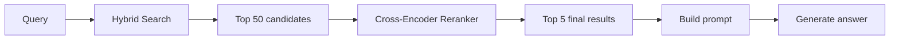
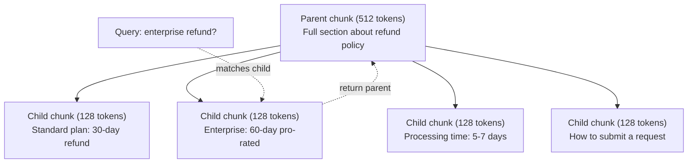
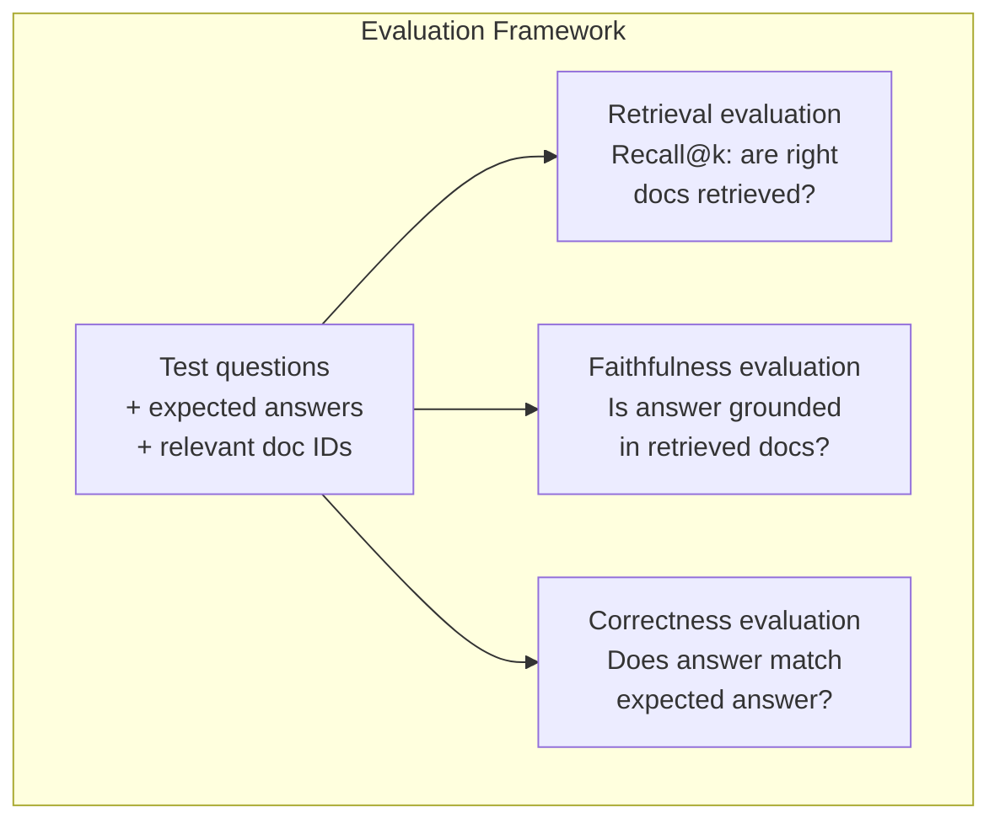

# Advanced RAG (Chunking, Reranking, Hybrid Search)

> RAG cơ bản truy xuất top-k chunk tương tự nhất. Điều đó hoạt động cho câu hỏi đơn giản. Nó sụp đổ với suy luận nhiều bước nối, truy vấn mơ hồ và ngữ liệu lớn. RAG nâng cao là khác biệt giữa một demo hoạt động trên 10 tài liệu và một hệ thống hoạt động trên 10 triệu.

**Type:** Build
**Languages:** Python
**Prerequisites:** Phase 11, Lesson 06 (RAG)
**Time:** ~90 minutes
**Liên quan:** Giai đoạn 5 · 23 (Chunking Strategies for RAG) trình bày cả sáu thuật toán chia chunk — đệ quy, ngữ nghĩa, câu, tài liệu cha, late chunking, truy xuất theo ngữ cảnh — với benchmark Vectara/Anthropic. Bài học này xây tiếp bên trên: tìm kiếm lai, xếp hạng lại, biến đổi truy vấn.

## Learning Objectives

- Triển khai các chiến lược chia chunk nâng cao (ngữ nghĩa, đệ quy, cha-con) giữ cấu trúc tài liệu và ngữ cảnh
- Xây dựng pipeline tìm kiếm lai kết hợp khớp từ khóa BM25 với tìm kiếm vector ngữ nghĩa và bộ xếp hạng lại cross-encoder
- Áp dụng các kỹ thuật biến đổi truy vấn (HyDE, đa truy vấn, lùi bước) để cải thiện truy xuất trên câu hỏi mơ hồ hoặc phức tạp
- Chẩn đoán và sửa các thất bại RAG phổ biến: truy xuất sai chunk, câu trả lời không trong ngữ cảnh, suy luận nhiều bước nối bị đổ vỡ

## The Problem

Bạn đã xây một pipeline RAG cơ bản trong Bài 06. Nó hoạt động với câu hỏi đơn giản trên ngữ liệu nhỏ. Giờ thử những câu này:

**Truy vấn mơ hồ**: "Doanh thu quý trước là bao nhiêu?" Tìm kiếm ngữ nghĩa trả về chunk về chiến lược doanh thu, dự báo doanh thu và suy nghĩ của CFO về tăng trưởng doanh thu. Tất cả tương tự về ngữ nghĩa với từ "doanh thu." Không chunk nào chứa con số thực tế. Chunk đúng nói "$47.2M trong Q3 2025" nhưng dùng từ "thu nhập" thay vì "doanh thu." Mô hình embedding nghĩ "chiến lược doanh thu" gần truy vấn hơn "Thu nhập Q3 là $47.2M."

**Câu hỏi nhiều bước nối**: "Nhóm nào có mức cải thiện điểm hài lòng khách hàng cao nhất?" Điều này cần tìm điểm hài lòng cho mỗi nhóm, so sánh chúng và xác định giá trị lớn nhất. Không một chunk đơn lẻ nào chứa câu trả lời. Thông tin phân tán trên các báo cáo nhóm.

**Vấn đề ngữ liệu lớn**: Bạn có 2 triệu chunk. Câu trả lời đúng ở chunk #1,847,293. Truy xuất top-5 kéo về các chunk #14, #89,201, #1,200,000, #44 và #901,333. Gần trong không gian embedding, nhưng không chunk nào chứa câu trả lời. Ở quy mô này, tìm kiếm láng giềng gần nhất xấp xỉ đưa vào đủ sai số để kết quả liên quan bị đẩy khỏi top-k.

RAG cơ bản thất bại vì tương đồng vector không giống mức liên quan. Một chunk có thể tương tự về ngữ nghĩa với truy vấn mà không hữu ích để trả lời nó. RAG nâng cao xử lý điều này bằng bốn kỹ thuật: tìm kiếm lai (thêm khớp từ khóa), xếp hạng lại (chấm ứng viên cẩn thận hơn), biến đổi truy vấn (sửa truy vấn trước tìm kiếm) và chia chunk tốt hơn (truy xuất ở mức hạt phù hợp).

## The Concept

### Hybrid Search: Semantic + Keyword

Tìm kiếm ngữ nghĩa (tương đồng vector) giỏi hiểu ý nghĩa. "Làm thế nào để tôi hủy đăng ký?" khớp "Các bước chấm dứt gói của bạn" dù không có từ chung. Nhưng nó bỏ lỡ khớp chính xác. "Mã lỗi E-4021" có thể không khớp chunk chứa "E-4021" nếu mô hình embedding xem nó là nhiễu.

Tìm kiếm từ khóa (BM25) thì ngược lại. Nó xuất sắc ở khớp chính xác. "E-4021" khớp hoàn hảo. Nhưng "hủy đăng ký của tôi" trả về không kết quả nếu tài liệu nói "chấm dứt gói của bạn."

Tìm kiếm lai chạy cả hai, rồi gộp kết quả.

**BM25** (Best Matching 25) là thuật toán tìm kiếm từ khóa tiêu chuẩn. Nó là xương sống của các bộ máy tìm kiếm từ thập niên 1990. Công thức:

```
BM25(q, d) = sum over terms t in q:
    IDF(t) * (tf(t,d) * (k1 + 1)) / (tf(t,d) + k1 * (1 - b + b * |d| / avgdl))
```

Trong đó tf(t,d) là tần suất từ t trong tài liệu d, IDF(t) là nghịch đảo tần suất tài liệu, |d| là độ dài tài liệu, avgdl là độ dài tài liệu trung bình, k1 kiểm soát bão hòa tần suất từ (mặc định 1.2) và b kiểm soát chuẩn hóa độ dài (mặc định 0.75).

Nói đơn giản: BM25 chấm tài liệu cao hơn khi chúng chứa từ truy vấn (đặc biệt từ hiếm), nhưng lợi ích giảm dần cho từ lặp lại. Một tài liệu có từ "doanh thu" 50 lần không liên quan hơn 50x so với tài liệu có từ đó một lần.

### Reciprocal Rank Fusion (RRF)

Bạn có hai danh sách được xếp hạng: một từ tìm kiếm vector, một từ BM25. Kết hợp chúng thế nào? Reciprocal Rank Fusion là cách tiếp cận tiêu chuẩn.

```
RRF_score(d) = sum over rankings R:
    1 / (k + rank_R(d))
```

Trong đó k là hằng số (thường 60) ngăn kết quả đứng đầu thống trị.

Một tài liệu xếp #1 trong tìm kiếm vector và #5 trong BM25 nhận: 1/(60+1) + 1/(60+5) = 0.0164 + 0.0154 = 0.0318

Một tài liệu xếp #3 trong tìm kiếm vector và #2 trong BM25 nhận: 1/(60+3) + 1/(60+2) = 0.0159 + 0.0161 = 0.0320

RRF cân bằng tự nhiên hai tín hiệu. Một tài liệu xếp cao trong cả hai danh sách nhận điểm tốt nhất. Một tài liệu xếp #1 trong một danh sách nhưng vắng ở danh sách kia nhận điểm trung bình. Điều này vững chắc vì dùng thứ hạng, không phải điểm thô, nên khác biệt phân phối điểm giữa hai hệ thống không quan trọng.

### Reranking

Truy xuất (dù vector, từ khóa hay lai) nhanh nhưng thiếu chính xác. Nó dùng bi-encoder: truy vấn và mỗi tài liệu được nhúng độc lập, rồi so sánh. Embedding được tính một lần và cache. Điều này mở rộng đến hàng triệu tài liệu.

Xếp hạng lại dùng cross-encoder: truy vấn và một tài liệu ứng viên được đưa cùng nhau vào mô hình xuất điểm liên quan. Mô hình thấy cả hai văn bản đồng thời và có thể nắm tương tác chi tiết giữa chúng. Một cross-encoder có thể hiểu "Thu nhập Q3 là bao nhiêu?" rất liên quan đến chunk chứa "$47.2M trong Q3" ngay cả khi bi-encoder bỏ lỡ liên hệ.

Sự đánh đổi: cross-encoder chậm hơn bi-encoder 100-1000x vì xử lý cặp truy vấn-tài liệu đồng thời. Bạn không thể tính trước điểm cross-encoder cho một triệu tài liệu. Giải pháp: truy xuất tập ứng viên lớn hơn (top-50 từ tìm kiếm lai), rồi xếp hạng lại bằng cross-encoder để lấy top-5 cuối.



Các mô hình xếp hạng lại phổ biến (danh sách năm 2026):
- Cohere Rerank 3.5: API được quản lý, đa ngôn ngữ, mức tăng recall tốt nhất trên ngữ liệu hỗn hợp
- Voyage rerank-2.5: API được quản lý, độ trễ thấp nhất trong các lựa chọn được lưu trữ
- Jina-Reranker-v2 Multilingual: trọng số mở, 100+ ngôn ngữ
- bge-reranker-v2-m3: trọng số mở, baseline mạnh
- cross-encoder/ms-marco-MiniLM-L-6-v2: trọng số mở, chạy trên CPU để tạo mẫu
- ColBERTv2 / Jina-ColBERT-v2: bộ xếp hạng lại đa vector tương tác muộn — $O(\text{tokens})$ không phải $O(\text{docs})$ ở thời điểm chấm điểm

### Query Transformation

Đôi khi vấn đề không phải truy xuất mà là chính truy vấn. "Cái chuyện về thay đổi chính sách mới đó là gì?" là một truy vấn tìm kiếm tệ. Nó không chứa từ cụ thể. Embedding mơ hồ. Không hệ thống truy xuất nào có thể tìm đúng tài liệu từ đó.

**Viết lại truy vấn**: diễn đạt lại truy vấn người dùng thành truy vấn tìm kiếm tốt hơn. Một LLM có thể làm điều này:

```
User: "What was that thing about the new policy change?"
Rewritten: "Recent policy changes and updates"
```

**HyDE (Hypothetical Document Embeddings)**: thay vì tìm bằng truy vấn, sinh một câu trả lời giả định, nhúng nó và tìm tài liệu thực tương tự.

```
Query: "What is the refund policy for enterprise?"
Hypothetical answer: "Enterprise customers are eligible for a full refund
within 60 days of purchase. Refunds are pro-rated based on the remaining
subscription period and processed within 5-7 business days."
```

Nhúng câu trả lời giả định và tìm tài liệu thực tương tự nó. Trực giác: câu trả lời giả định nằm gần câu trả lời thực trong không gian embedding hơn câu hỏi gốc. Câu hỏi và câu trả lời có cấu trúc ngôn ngữ khác nhau. Bằng cách sinh câu trả lời giả định, bạn nối khoảng cách giữa "không gian câu hỏi" và "không gian câu trả lời" trong embedding.

HyDE thêm một lệnh gọi LLM trước truy xuất. Điều này tăng độ trễ 500-2000ms. Đáng dùng khi chất lượng truy xuất kém trên truy vấn thô.

### Parent-Child Chunking

Chia chunk tiêu chuẩn buộc một đánh đổi: chunk nhỏ cho truy xuất chính xác, chunk lớn cho đủ ngữ cảnh. Chia chunk cha-con loại bỏ đánh đổi này.

Lập chỉ mục chunk nhỏ (128 token) cho truy xuất. Khi một chunk nhỏ được truy xuất, trả về chunk cha (512 token) cho prompt. Chunk nhỏ khớp truy vấn chính xác. Chunk cha cung cấp đủ ngữ cảnh để LLM sinh câu trả lời tốt.



Truy vấn "hoàn tiền doanh nghiệp?" khớp chính xác chunk con C2. Nhưng prompt nhận toàn bộ chunk cha P, gồm ngữ cảnh xung quanh về thời gian xử lý và quy trình gửi.

### Metadata Filtering

Trước khi chạy tìm kiếm vector, lọc ngữ liệu theo metadata: ngày, nguồn, loại, tác giả, ngôn ngữ. Điều này giảm không gian tìm kiếm và ngăn kết quả không liên quan.

"Điều gì thay đổi trong chính sách bảo mật tháng trước?" chỉ nên tìm tài liệu từ 30 ngày qua trong loại bảo mật. Không lọc metadata, bạn tìm toàn ngữ liệu và có thể truy xuất một tài liệu bảo mật 2 năm tuổi tình cờ tương tự về ngữ nghĩa.

Hệ thống RAG sản xuất lưu metadata cùng mỗi chunk: tài liệu nguồn, ngày tạo, loại, tác giả, phiên bản. Cơ sở dữ liệu vector hỗ trợ lọc trước theo metadata trước tìm kiếm độ tương đồng, điều then chốt cho hiệu năng ở quy mô lớn.

### Evaluation

Bạn đã xây hệ thống RAG. Làm sao biết nó hoạt động? Ba thước đo:

**Mức liên quan truy xuất (Recall@k)**: với tập câu hỏi kiểm thử có tài liệu liên quan đã biết, bao nhiêu phần trăm tài liệu liên quan xuất hiện trong kết quả top-k? Nếu câu trả lời ở chunk #47, chunk #47 có xuất hiện trong top-5 không?

**Độ trung thực**: câu trả lời được sinh có dựa trên tài liệu truy xuất không? Nếu các chunk truy xuất nói "thời hạn hoàn tiền 60 ngày" và mô hình nói "thời hạn hoàn tiền 90 ngày", đó là thất bại về độ trung thực. Mô hình ảo giác dù có ngữ cảnh đúng.

**Tính đúng đắn câu trả lời**: câu trả lời được sinh có khớp câu trả lời kỳ vọng không? Đây là thước đo từ đầu đến cuối. Nó kết hợp chất lượng truy xuất và chất lượng sinh.

Một kiểm tra độ trung thực đơn giản: lấy từng khẳng định trong câu trả lời được sinh và xác minh nó xuất hiện (về nội dung) trong các chunk truy xuất. Nếu câu trả lời chứa sự kiện không nằm trong bất kỳ chunk truy xuất nào, có khả năng đó là ảo giác.



```figure
agentic-rag-loop
```

## Build It

### Step 1: BM25 Implementation

```python
import math
from collections import Counter

class BM25:
    def __init__(self, k1=1.2, b=0.75):
        self.k1 = k1
        self.b = b
        self.docs = []
        self.doc_lengths = []
        self.avg_dl = 0
        self.doc_freqs = {}
        self.n_docs = 0

    def index(self, documents):
        self.docs = documents
        self.n_docs = len(documents)
        self.doc_lengths = []
        self.doc_freqs = {}

        for doc in documents:
            words = doc.lower().split()
            self.doc_lengths.append(len(words))
            unique_words = set(words)
            for word in unique_words:
                self.doc_freqs[word] = self.doc_freqs.get(word, 0) + 1

        self.avg_dl = sum(self.doc_lengths) / self.n_docs if self.n_docs else 1

    def score(self, query, doc_idx):
        query_words = query.lower().split()
        doc_words = self.docs[doc_idx].lower().split()
        doc_len = self.doc_lengths[doc_idx]
        word_counts = Counter(doc_words)
        score = 0.0

        for term in query_words:
            if term not in word_counts:
                continue
            tf = word_counts[term]
            df = self.doc_freqs.get(term, 0)
            idf = math.log((self.n_docs - df + 0.5) / (df + 0.5) + 1)
            numerator = tf * (self.k1 + 1)
            denominator = tf + self.k1 * (1 - self.b + self.b * doc_len / self.avg_dl)
            score += idf * numerator / denominator

        return score

    def search(self, query, top_k=10):
        scores = [(i, self.score(query, i)) for i in range(self.n_docs)]
        scores.sort(key=lambda x: x[1], reverse=True)
        return scores[:top_k]
```

### Step 2: Reciprocal Rank Fusion

```python
def reciprocal_rank_fusion(ranked_lists, k=60):
    scores = {}
    for ranked_list in ranked_lists:
        for rank, (doc_id, _) in enumerate(ranked_list):
            if doc_id not in scores:
                scores[doc_id] = 0.0
            scores[doc_id] += 1.0 / (k + rank + 1)
    fused = sorted(scores.items(), key=lambda x: x[1], reverse=True)
    return fused
```

### Step 3: Hybrid Search Pipeline

```python
def hybrid_search(query, chunks, vector_embeddings, vocab, idf, bm25_index, top_k=5, fusion_k=60):
    query_emb = tfidf_embed(query, vocab, idf)
    vector_results = search(query_emb, vector_embeddings, top_k=top_k * 3)
    bm25_results = bm25_index.search(query, top_k=top_k * 3)
    fused = reciprocal_rank_fusion([vector_results, bm25_results], k=fusion_k)
    return fused[:top_k]
```

### Step 4: Simple Reranker

Trong sản xuất, bạn sẽ dùng mô hình cross-encoder. Ở đây chúng ta xây bộ xếp hạng lại chấm mức liên quan truy vấn-tài liệu bằng chồng lấp từ, tầm quan trọng từ và khớp cụm từ.

```python
def rerank(query, candidates, chunks):
    query_words = set(query.lower().split())
    stop_words = {"the", "a", "an", "is", "are", "was", "were", "what", "how",
                  "why", "when", "where", "do", "does", "for", "of", "in", "to",
                  "and", "or", "on", "at", "by", "it", "its", "this", "that",
                  "with", "from", "be", "has", "have", "had", "not", "but"}
    query_terms = query_words - stop_words

    scored = []
    for doc_id, initial_score in candidates:
        chunk = chunks[doc_id].lower()
        chunk_words = set(chunk.split())

        term_overlap = len(query_terms & chunk_words)

        query_bigrams = set()
        q_list = [w for w in query.lower().split() if w not in stop_words]
        for i in range(len(q_list) - 1):
            query_bigrams.add(q_list[i] + " " + q_list[i + 1])
        bigram_matches = sum(1 for bg in query_bigrams if bg in chunk)

        position_boost = 0
        for term in query_terms:
            pos = chunk.find(term)
            if pos != -1 and pos < len(chunk) // 3:
                position_boost += 0.5

        rerank_score = (
            term_overlap * 1.0
            + bigram_matches * 2.0
            + position_boost
            + initial_score * 5.0
        )
        scored.append((doc_id, rerank_score))

    scored.sort(key=lambda x: x[1], reverse=True)
    return scored
```

### Step 5: HyDE (Hypothetical Document Embeddings)

```python
def hyde_generate_hypothesis(query):
    templates = {
        "what": "The answer to '{query}' is as follows: Based on our documentation, {topic} involves specific policies and procedures that define how the process works.",
        "how": "To address '{query}': The process involves several steps. First, you need to initiate the request. Then, the system processes it according to the defined rules.",
        "default": "Regarding '{query}': Our records indicate specific details and policies related to this topic that provide a comprehensive answer."
    }
    query_lower = query.lower()
    if query_lower.startswith("what"):
        template = templates["what"]
    elif query_lower.startswith("how"):
        template = templates["how"]
    else:
        template = templates["default"]

    topic_words = [w for w in query.lower().split()
                   if w not in {"what", "is", "the", "how", "do", "does", "a", "an",
                                "for", "of", "to", "in", "on", "at", "by", "and", "or"}]
    topic = " ".join(topic_words) if topic_words else "this topic"

    return template.format(query=query, topic=topic)


def hyde_search(query, chunks, vector_embeddings, vocab, idf, top_k=5):
    hypothesis = hyde_generate_hypothesis(query)
    hypothesis_emb = tfidf_embed(hypothesis, vocab, idf)
    results = search(hypothesis_emb, vector_embeddings, top_k)
    return results, hypothesis
```

### Step 6: Parent-Child Chunking

```python
def create_parent_child_chunks(text, parent_size=200, child_size=50):
    words = text.split()
    parents = []
    children = []
    child_to_parent = {}

    parent_idx = 0
    start = 0
    while start < len(words):
        parent_end = min(start + parent_size, len(words))
        parent_text = " ".join(words[start:parent_end])
        parents.append(parent_text)

        child_start = start
        while child_start < parent_end:
            child_end = min(child_start + child_size, parent_end)
            child_text = " ".join(words[child_start:child_end])
            child_idx = len(children)
            children.append(child_text)
            child_to_parent[child_idx] = parent_idx
            child_start += child_size

        parent_idx += 1
        start += parent_size

    return parents, children, child_to_parent
```

### Step 7: Faithfulness Evaluation

```python
def evaluate_faithfulness(answer, retrieved_chunks):
    answer_sentences = [s.strip() for s in answer.split(".") if len(s.strip()) > 10]
    if not answer_sentences:
        return 1.0, []

    grounded = 0
    ungrounded = []
    context = " ".join(retrieved_chunks).lower()

    for sentence in answer_sentences:
        words = set(sentence.lower().split())
        stop_words = {"the", "a", "an", "is", "are", "was", "were", "and", "or",
                      "to", "of", "in", "for", "on", "at", "by", "it", "this", "that"}
        content_words = words - stop_words
        if not content_words:
            grounded += 1
            continue

        matched = sum(1 for w in content_words if w in context)
        ratio = matched / len(content_words) if content_words else 0

        if ratio >= 0.5:
            grounded += 1
        else:
            ungrounded.append(sentence)

    score = grounded / len(answer_sentences) if answer_sentences else 1.0
    return score, ungrounded


def evaluate_retrieval_recall(queries_with_relevant, retrieval_fn, k=5):
    total_recall = 0.0
    results = []

    for query, relevant_indices in queries_with_relevant:
        retrieved = retrieval_fn(query, k)
        retrieved_indices = set(idx for idx, _ in retrieved)
        relevant_set = set(relevant_indices)
        hits = len(retrieved_indices & relevant_set)
        recall = hits / len(relevant_set) if relevant_set else 1.0
        total_recall += recall
        results.append({
            "query": query,
            "recall": recall,
            "hits": hits,
            "total_relevant": len(relevant_set)
        })

    avg_recall = total_recall / len(queries_with_relevant) if queries_with_relevant else 0
    return avg_recall, results
```

## Use It

Với cross-encoder thực để xếp hạng lại:

```python
from sentence_transformers import CrossEncoder

reranker = CrossEncoder("cross-encoder/ms-marco-MiniLM-L-6-v2")

def rerank_with_cross_encoder(query, candidates, chunks, top_k=5):
    pairs = [(query, chunks[doc_id]) for doc_id, _ in candidates]
    scores = reranker.predict(pairs)
    scored = list(zip([doc_id for doc_id, _ in candidates], scores))
    scored.sort(key=lambda x: x[1], reverse=True)
    return scored[:top_k]
```

Với bộ xếp hạng lại được quản lý của Cohere:

```python
import cohere

co = cohere.Client()

def rerank_with_cohere(query, candidates, chunks, top_k=5):
    docs = [chunks[doc_id] for doc_id, _ in candidates]
    response = co.rerank(
        model="rerank-english-v3.0",
        query=query,
        documents=docs,
        top_n=top_k
    )
    return [(candidates[r.index][0], r.relevance_score) for r in response.results]
```

Cho HyDE với LLM thực:

```python
import anthropic

client = anthropic.Anthropic()

def hyde_with_llm(query):
    response = client.messages.create(
        model="claude-sonnet-5",
        max_tokens=256,
        messages=[{
            "role": "user",
            "content": f"Write a short paragraph that would be a good answer to this question. Do not say you don't know. Just write what the answer would look like.\n\nQuestion: {query}"
        }]
    )
    return response.content[0].text
```

Cho tìm kiếm lai sản xuất với Weaviate:

```python
import weaviate

client = weaviate.connect_to_local()

collection = client.collections.get("Documents")
response = collection.query.hybrid(
    query="enterprise refund policy",
    alpha=0.5,
    limit=10
)
```

Tham số alpha kiểm soát cân bằng: 0.0 = từ khóa thuần (BM25), 1.0 = vector thuần, 0.5 = trọng số bằng nhau. Hầu hết hệ thống sản xuất dùng alpha từ 0.3 đến 0.7.

## Ship It

Bài học này tạo ra:
- `outputs/prompt-advanced-rag-debugger.md` -- một prompt để chẩn đoán và sửa vấn đề chất lượng RAG
- `outputs/skill-advanced-rag.md` -- một skill xây RAG cấp sản xuất với tìm kiếm lai và xếp hạng lại

## Exercises

1. So sánh BM25 với tìm kiếm vector với tìm kiếm lai trên các tài liệu mẫu. Với mỗi trong 5 truy vấn kiểm thử, ghi cách nào trả về chunk liên quan nhất ở vị trí #1. Tìm kiếm lai phải thắng ít nhất 3 trong 5.

2. Triển khai một bộ lọc metadata. Thêm trường "category" vào mỗi tài liệu (security, billing, api, product). Trước khi chạy tìm kiếm vector, lọc chunk chỉ còn loại liên quan. Kiểm thử với "Mã hóa nào được dùng?" và xác minh nó chỉ tìm chunk loại bảo mật.

3. Xây một pipeline HyDE đầy đủ bằng hàm sinh đơn giản từ Bài 06. So sánh chất lượng truy xuất (mức liên quan top-3) giữa tìm trực tiếp truy vấn và tìm HyDE trên cả 5 truy vấn kiểm thử. HyDE phải cải thiện kết quả cho truy vấn mơ hồ.

4. Triển khai chiến lược chia chunk cha-con trên các tài liệu mẫu. Dùng child_size=30 và parent_size=100. Tìm bằng chunk con nhưng trả chunk cha trong prompt. So sánh câu trả lời được sinh với chia chunk tiêu chuẩn có chunk_size=50.

5. Tạo một bộ dữ liệu đánh giá: 10 câu hỏi có chunk câu trả lời đã biết. Đo Recall@3, Recall@5 và Recall@10 cho (a) chỉ tìm vector, (b) chỉ BM25, (c) tìm kiếm lai, (d) lai + xếp hạng lại. Vẽ kết quả và xác định nơi xếp hạng lại giúp nhiều nhất.

## Key Terms

| Thuật ngữ | Mọi người nói gì | Ý nghĩa thực sự |
|------|----------------|----------------------|
| BM25 | "Tìm kiếm từ khóa" | Thuật toán xếp hạng xác suất chấm tài liệu theo tần suất từ, nghịch đảo tần suất tài liệu và chuẩn hóa độ dài tài liệu |
| Hybrid search (Tìm kiếm lai) | "Điều tốt nhất của cả hai thế giới" | Chạy tìm kiếm ngữ nghĩa (vector) và từ khóa (BM25) song song, rồi gộp kết quả bằng hợp nhất thứ hạng |
| Reciprocal Rank Fusion (Hợp nhất thứ hạng nghịch đảo) | "Gộp danh sách được xếp hạng" | Kết hợp nhiều danh sách được xếp hạng bằng cách cộng 1/(k + rank) cho mỗi tài liệu trên mọi danh sách |
| Reranking (Xếp hạng lại) | "Chấm điểm lượt hai" | Dùng mô hình cross-encoder đắt hơn để chấm lại tập ứng viên từ truy xuất ban đầu |
| Cross-encoder (Bộ mã hóa chéo) | "Mô hình truy vấn-tài liệu kết hợp" | Mô hình nhận truy vấn và tài liệu làm một đầu vào, tạo điểm liên quan; chính xác hơn bi-encoder nhưng quá chậm cho tìm kiếm toàn ngữ liệu |
| Bi-encoder (Bộ mã hóa đôi) | "Mô hình embedding độc lập" | Mô hình nhúng truy vấn và tài liệu độc lập; nhanh vì embedding được tính trước, nhưng kém chính xác hơn cross-encoder |
| HyDE | "Tìm bằng câu trả lời giả" | Sinh câu trả lời giả định cho truy vấn, nhúng nó và tìm tài liệu thực tương tự |
| Parent-child chunking (Chia chunk cha-con) | "Tìm nhỏ, ngữ cảnh lớn" | Lập chỉ mục chunk nhỏ để truy xuất chính xác nhưng trả chunk cha lớn hơn để cung cấp đủ ngữ cảnh |
| Metadata filtering (Lọc metadata) | "Thu hẹp trước tìm kiếm" | Lọc tài liệu theo thuộc tính (ngày, nguồn, loại) trước chạy tìm kiếm vector để giảm không gian tìm kiếm |
| Faithfulness (Độ trung thực) | "Nó có giữ căn cứ không" | Liệu câu trả lời được sinh có được tài liệu truy xuất hỗ trợ, thay vì ảo giác từ dữ liệu huấn luyện của mô hình |

## Further Reading

- Robertson & Zaragoza, "The Probabilistic Relevance Framework: BM25 and Beyond" (2009) -- tài liệu tham chiếu có tính quyết định về BM25, giải thích nền tảng xác suất đằng sau công thức
- Cormack và cộng sự, "Reciprocal Rank Fusion Outperforms Condorcet and Individual Rank Learning Methods" (2009) -- bài báo RRF gốc cho thấy nó vượt các phương pháp hợp nhất phức tạp hơn
- Gao và cộng sự, "Precise Zero-Shot Dense Retrieval without Relevance Labels" (2022) -- bài báo HyDE cho thấy embedding tài liệu giả định cải thiện truy xuất mà không có dữ liệu huấn luyện
- Nogueira & Cho, "Passage Re-ranking with BERT" (2019) -- cho thấy xếp hạng lại cross-encoder trên BM25 cải thiện đáng kể chất lượng truy xuất
- [Khattab et al., "DSPy: Compiling Declarative Language Model Calls into Self-Improving Pipelines" (2023)](https://arxiv.org/abs/2310.03714) -- xem xây dựng prompt và lựa chọn trọng số là bài toán tối ưu trên pipeline truy xuất; đọc để "lập trình LLM" thay vì "prompt LLM."
- [Edge et al., "From Local to Global: A Graph RAG Approach to Query-Focused Summarization" (Microsoft Research 2024)](https://arxiv.org/abs/2404.16130) -- bài báo GraphRAG: trích xuất thực thể-quan hệ + phát hiện cộng đồng Leiden để tóm tắt tập trung truy vấn; phân biệt truy xuất toàn cục và cục bộ.
- [Asai et al., "Self-RAG: Learning to Retrieve, Generate, and Critique through Self-Reflection" (ICLR 2024)](https://arxiv.org/abs/2310.11511) -- RAG tự đánh giá với token phản tư; tuyến đầu tác tử vượt truy xuất rồi sinh tĩnh.
- [LangChain Query Construction blog](https://blog.langchain.dev/query-construction/) -- cách chuyển truy vấn ngôn ngữ tự nhiên thành truy vấn cơ sở dữ liệu có cấu trúc (Text-to-SQL, Cypher) làm bước trước truy xuất.
