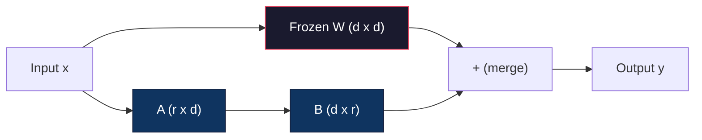
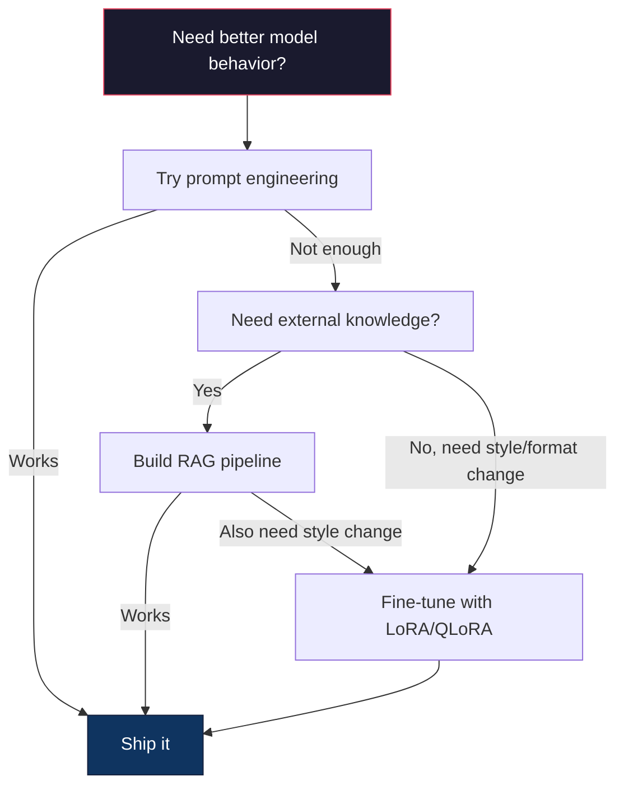

# Fine-Tuning with LoRA & QLoRA

> Fine-tuning toàn phần một mô hình 7B cần 56GB VRAM. Bạn không có chừng đó. Hầu hết công ty cũng không. LoRA cho phép bạn fine-tune cùng mô hình trong 6GB bằng cách huấn luyện dưới 1% tham số. Đây không phải thỏa hiệp -- nó ngang chất lượng fine-tuning toàn phần trên hầu hết tác vụ. Toàn bộ hệ sinh thái fine-tuning mã nguồn mở chạy trên một thủ thuật này.

**Type:** Build
**Languages:** Python
**Prerequisites:** Phase 10, Lesson 06 (Instruction Tuning / SFT)
**Time:** ~75 minutes
**Liên quan:** Giai đoạn 10 trình bày các vòng lặp SFT/DPO từ đầu. Bài học này cắm chúng vào các bộ công cụ PEFT năm 2026 (PEFT, TRL, Unsloth, Axolotl, LLaMA-Factory).

## Learning Objectives

- Triển khai LoRA bằng cách đưa các ma trận adapter hạng thấp (A và B) vào các lớp attention của mô hình đã tiền huấn luyện
- Tính mức tiết kiệm tham số của LoRA so với fine-tuning toàn phần: hạng r với d_model chiều huấn luyện 2*r*d tham số thay vì d^2
- Fine-tune một mô hình bằng QLoRA (mô hình cơ sở lượng tử hóa 4 bit + adapter LoRA) để vừa bộ nhớ GPU tiêu dùng
- Gộp trọng số LoRA trở lại mô hình cơ sở để triển khai và so sánh tốc độ suy luận có và không có adapter

## The Problem

Bạn có một mô hình cơ sở. Llama 3 8B. Bạn muốn nó trả lời phiếu hỗ trợ khách hàng bằng giọng điệu của công ty. SFT là câu trả lời. Nhưng SFT có vấn đề chi phí.

Fine-tuning toàn phần cập nhật mọi tham số trong mô hình. Llama 3 8B có 8 tỷ tham số. Ở fp16, mỗi tham số chiếm 2 byte. Đó là 16GB chỉ để nạp trọng số. Trong huấn luyện, bạn cũng cần gradient (16GB), trạng thái bộ tối ưu Adam (32GB cho động lượng + phương sai) và activation. Tổng: khoảng 56GB VRAM cho một mô hình 8B duy nhất.

Một A100 80GB chỉ vừa đủ chứa điều này. Hai A100 tốn $3-4/giờ trên các nhà cung cấp đám mây. Huấn luyện 3 epoch trên 50,000 ví dụ mất 6-10 giờ. Đó là $30-40 mỗi thí nghiệm. Chạy 10 thí nghiệm để có siêu tham số đúng và bạn đã tiêu $400 trước khi triển khai bất kỳ thứ gì.

Mở rộng điều này lên Llama 3 70B và các con số trở nên vô lý. 140GB chỉ cho trọng số. Bạn cần một cụm. $100+ mỗi thí nghiệm.

Cũng có vấn đề sâu hơn. Fine-tuning toàn phần sửa mọi trọng số trong mô hình. Nếu fine-tune trên dữ liệu hỗ trợ khách hàng, bạn có thể làm giảm các năng lực tổng quát của mô hình. Nó được gọi là quên thảm khốc. Mô hình tốt hơn ở tác vụ của bạn và kém hơn ở mọi thứ khác.

Bạn cần một phương pháp huấn luyện ít tham số hơn, dùng ít bộ nhớ hơn và không phá hủy kiến thức hiện có của mô hình.

## The Concept

### LoRA: Low-Rank Adaptation

Edward Hu và các đồng nghiệp tại Microsoft công bố LoRA vào tháng 6 năm 2021. Nhận thức của bài báo: cập nhật trọng số trong fine-tuning có hạng nội tại thấp. Bạn không cần cập nhật cả 16.7 triệu tham số trong ma trận trọng số 4096x4096. Thông tin hữu ích trong cập nhật có thể được nắm bằng một ma trận hạng 16 hoặc 32.

Đây là phần toán. Một lớp tuyến tính tiêu chuẩn tính:

```
y = Wx
```

Trong đó W là ma trận d_out x d_in. Với phép chiếu attention 4096x4096, đó là 16,777,216 tham số.

LoRA đóng băng W và thêm phân rã hạng thấp:

```
y = Wx + BAx
```

Trong đó B là (d_out x r) và A là (r x d_in). Hạng r nhỏ hơn d rất nhiều -- thường 8, 16 hoặc 32.

Với r=16 trên lớp 4096x4096:
- Tham số gốc: 4096 x 4096 = 16,777,216
- Tham số LoRA: (4096 x 16) + (16 x 4096) = 65,536 + 65,536 = 131,072
- Mức giảm: 131,072 / 16,777,216 = 0.78%

Bạn đang huấn luyện 0.78% tham số và nhận 95-100% chất lượng.



A được khởi tạo bằng Gaussian ngẫu nhiên. B được khởi tạo bằng không. Điều này nghĩa là đóng góp LoRA bắt đầu bằng không -- mô hình bắt đầu huấn luyện từ hành vi gốc và dần học sự thích nghi.

### The Scaling Factor: Alpha

LoRA đưa vào hệ số tỷ lệ alpha kiểm soát mức cập nhật hạng thấp ảnh hưởng đầu ra:

```
y = Wx + (alpha / r) * BAx
```

Khi alpha = r, tỷ lệ là 1x. Khi alpha = 2r (mặc định phổ biến), tỷ lệ là 2x. Siêu tham số này kiểm soát tốc độ học của nhánh LoRA độc lập với tốc độ học cơ sở.

Hướng dẫn thực hành:
- alpha = 2 * rank là quy ước cộng đồng phổ biến (bài báo gốc dùng alpha = rank trong hầu hết thí nghiệm)
- alpha = rank cho tỷ lệ 1x, thận trọng nhưng ổn định
- Alpha cao hơn nghĩa là cập nhật lớn hơn mỗi bước, có thể tăng tốc hội tụ hoặc gây bất ổn

### Where to Apply LoRA

Một transformer có nhiều lớp tuyến tính. Bạn không cần thêm LoRA vào tất cả. Bài báo gốc kiểm thử các tổ hợp khác nhau:

| Lớp đích | Tham số có thể huấn luyện (7B) | Chất lượng |
|--------------|----------------------|---------|
| chỉ q_proj | 4.7M | Tốt |
| q_proj + v_proj | 9.4M | Tốt hơn |
| q_proj + k_proj + v_proj + o_proj | 18.9M | Tốt nhất cho attention |
| Mọi lớp tuyến tính (attention + MLP) | 37.7M | Lợi ích nhỏ, tham số 2x |

Điểm tối ưu cho hầu hết tác vụ: q_proj + v_proj. Điều này nhắm vào phép chiếu query và value trong self-attention, kiểm soát những gì mô hình attend đến và thông tin nó trích xuất. Thêm các lớp MLP giúp cho tác vụ phức tạp như sinh mã nhưng tăng gấp đôi số tham số với lợi ích giảm dần trên tác vụ đơn giản hơn.

### Rank Selection

Hạng r kiểm soát khả năng biểu đạt của sự thích nghi:

| Hạng | Tham số có thể huấn luyện (mỗi lớp) | Tốt nhất cho |
|------|---------------------------|----------|
| 4 | 32,768 | Phân loại đơn giản, cảm xúc |
| 8 | 65,536 | Hỏi đáp một miền, tóm tắt |
| 16 | 131,072 | Tác vụ đa miền, làm theo chỉ dẫn |
| 32 | 262,144 | Suy luận phức tạp, sinh mã |
| 64 | 524,288 | Lợi ích giảm dần cho hầu hết tác vụ |
| 128 | 1,048,576 | Hiếm khi có cơ sở |

Hu và cộng sự cho thấy r=4 đã nắm phần lớn sự thích nghi cho tác vụ đơn giản. r=8 và r=16 là lựa chọn phổ biến nhất trong thực tế. Vượt r=64 hiếm khi cải thiện chất lượng và bắt đầu mất lợi thế bộ nhớ của LoRA.

### QLoRA: 4-Bit Quantization + LoRA

Tim Dettmers và các đồng nghiệp tại Đại học Washington công bố QLoRA vào tháng 5 năm 2023. Ý tưởng: lượng tử hóa mô hình cơ sở đã đóng băng xuống độ chính xác 4 bit, rồi gắn adapter LoRA fp16 bên trên.

Điều này thay đổi phương trình bộ nhớ đáng kể:

| Phương pháp | Bộ nhớ trọng số (7B) | Bộ nhớ huấn luyện (7B) | GPU cần thiết |
|--------|-------------------|---------------------|-------------|
| Fine-tune toàn phần (fp16) | 14GB | ~56GB | 1x A100 80GB |
| LoRA (cơ sở fp16) | 14GB | ~18GB | 1x A100 40GB |
| QLoRA (cơ sở 4 bit) | 3.5GB | ~6GB | 1x RTX 3090 24GB |

QLoRA có ba đóng góp kỹ thuật:

**NF4 (Normal Float 4-bit)**: Một kiểu dữ liệu mới được thiết kế riêng cho trọng số mạng nơ-ron. Trọng số mạng nơ-ron theo phân phối gần chuẩn. NF4 đặt 16 mức lượng tử hóa ở các phân vị của phân phối chuẩn tắc. Điều này tối ưu theo lý thuyết thông tin cho dữ liệu phân phối chuẩn. Nó mất ít thông tin hơn lượng tử hóa 4 bit đồng đều (INT4) hoặc Float4 tiêu chuẩn.

**Lượng tử hóa kép**: Bản thân các hằng số lượng tử hóa tốn bộ nhớ. Mỗi khối 64 trọng số cần hệ số tỷ lệ fp32 (4 byte). Với mô hình 7B, đó là thêm 0.4GB. Lượng tử hóa kép lượng tử hóa các hằng số này sang fp8, giảm chi phí bổ sung còn 0.1GB. Nhỏ nhưng cộng dồn.

**Bộ tối ưu phân trang**: Trong huấn luyện, trạng thái bộ tối ưu (động lượng và phương sai Adam) có thể vượt bộ nhớ GPU trên chuỗi dài. Bộ tối ưu phân trang dùng bộ nhớ hợp nhất của NVIDIA để tự động chuyển trang trạng thái bộ tối ưu sang RAM CPU khi bộ nhớ GPU cạn, và chuyển lại khi cần. Điều này ngăn lỗi OOM với chi phí một phần thông lượng.

### The Quality Question

Giảm tham số hoặc lượng tử hóa mô hình cơ sở có hại chất lượng không? Kết quả từ nhiều bài báo:

| Phương pháp | MMLU (5-shot) | MT-Bench | HumanEval |
|--------|--------------|----------|-----------|
| Fine-tune toàn phần (Llama 2 7B) | 48.3 | 6.72 | 14.6 |
| LoRA r=16 | 47.9 | 6.68 | 14.0 |
| QLoRA r=16 (NF4) | 47.5 | 6.61 | 13.4 |
| QLoRA r=64 (NF4) | 48.1 | 6.70 | 14.2 |

LoRA ở r=16 nằm trong khoảng 1% so với fine-tuning toàn phần trên hầu hết benchmark. QLoRA ở r=16 mất thêm một phần của một phần trăm. QLoRA ở r=64 về cơ bản ngang fine-tuning toàn phần trong khi dùng ít bộ nhớ hơn 90%.

### Real-World Costs

Fine-tuning Llama 3 8B trên 50,000 ví dụ (3 epoch):

| Phương pháp | GPU | Thời gian | Chi phí |
|--------|-----|------|------|
| Fine-tune toàn phần | 2x A100 80GB | 8 giờ | ~$32 |
| LoRA r=16 | 1x A100 40GB | 4 giờ | ~$8 |
| QLoRA r=16 | 1x RTX 4090 24GB | 6 giờ | ~$5 |
| QLoRA r=16 (Unsloth) | 1x RTX 4090 24GB | 2.5 giờ | ~$2 |
| QLoRA r=16 | 1x T4 16GB | 12 giờ | ~$4 |

QLoRA trên một GPU tiêu dùng duy nhất tốn ít hơn một bữa trưa. Đây là lý do cộng đồng fine-tuning trọng số mở bùng nổ năm 2023 và tại sao mọi framework huấn luyện bên dưới cung cấp QLoRA mặc định năm 2026.

### The 2026 PEFT stack

| Framework | Nó là gì | Chọn khi |
|-----------|-----------|-----------|
| **Hugging Face PEFT** | Thư viện chuẩn cho LoRA/QLoRA/DoRA/IA3 | Bạn muốn kiểm soát trực tiếp và vòng lặp huấn luyện đã trên `transformers.Trainer` |
| **TRL** | Các trainer học tăng cường từ phản hồi của HF (SFT, DPO, GRPO, PPO, ORPO) | Bạn cần DPO/GRPO sau SFT; xây trên PEFT |
| **Unsloth** | Bản viết lại forward/backward pass bằng kernel Triton | Bạn muốn tăng tốc 2-5x + một nửa VRAM không mất độ chính xác; họ Llama/Mistral/Qwen |
| **Axolotl** | Wrapper cấu hình YAML trên PEFT + TRL + DeepSpeed + Unsloth | Bạn muốn lượt huấn luyện có thể tái lập, được quản lý phiên bản |
| **LLaMA-Factory** | GUI/CLI/API trên PEFT + TRL | Bạn muốn fine-tuning không mã; hỗ trợ 100+ họ mô hình |
| **torchtune** | Công thức PyTorch nguyên bản, không phụ thuộc `transformers` | Bạn muốn ít phụ thuộc và tổ chức đã chuẩn hóa trên PyTorch |

Quy tắc kinh nghiệm: nghiên cứu hoặc thí nghiệm một lần → PEFT. Pipeline sản xuất lặp lại được → Axolotl với kernel Unsloth bật. Tạo mẫu dùng rồi bỏ → LLaMA-Factory.

### Merging Adapters

Sau huấn luyện, bạn có hai thứ: mô hình cơ sở đã đóng băng và một adapter LoRA nhỏ (thường 10-100MB). Bạn có thể:

1. **Giữ riêng chúng**: Nạp mô hình cơ sở, nạp adapter bên trên. Đổi adapter cho tác vụ khác nhau. Đây là cách phục vụ nhiều biến thể fine-tuned từ một mô hình cơ sở.

2. **Gộp chúng vĩnh viễn**: Tính W' = W + (alpha/r) * BA và lưu kết quả thành mô hình đầy đủ mới. Mô hình đã gộp có cùng kích thước như bản gốc. Không chi phí suy luận bổ sung. Không adapter cần quản lý.

Để phục vụ nhiều tác vụ (adapter hỗ trợ khách hàng, adapter mã, adapter dịch), giữ riêng chúng. Để triển khai một mô hình chuyên biệt duy nhất, gộp.

Các kỹ thuật gộp nâng cao để kết hợp nhiều adapter:

- **TIES-Merging** (Yadav và cộng sự 2023): Cắt các tham số độ lớn nhỏ, giải quyết xung đột dấu, rồi gộp. Giảm nhiễu giữa adapter.
- **DARE** (Yu và cộng sự 2023): Bỏ ngẫu nhiên tham số adapter trước khi gộp và đổi tỷ lệ phần còn lại. Hiệu quả đến ngạc nhiên trong kết hợp năng lực.
- **Số học tác vụ**: Chỉ cộng hoặc trừ trọng số adapter. Thêm adapter "mã" và adapter "toán" thường tạo mô hình giỏi cả hai.

### When NOT to Fine-Tune

Fine-tuning là lựa chọn thứ ba, không phải đầu tiên.

**Đầu tiên: prompt engineering.** Viết system prompt tốt hơn. Thêm ví dụ few-shot. Dùng chain-of-thought. Điều này không tốn gì và mất vài phút. Nếu prompting đưa bạn đi được 80% quãng đường, có lẽ bạn không cần fine-tune.

**Thứ hai: RAG.** Nếu mô hình cần biết dữ liệu riêng của bạn (tài liệu, cơ sở kiến thức, danh mục sản phẩm), truy xuất rẻ hơn và dễ bảo trì hơn tích hợp vào trọng số. Xem Bài 06.

**Thứ ba: fine-tuning.** Dùng khi bạn cần mô hình tiếp nhận phong cách, định dạng hoặc mẫu suy luận cụ thể không thể đạt chỉ bằng prompting. Khi cần đầu ra có cấu trúc nhất quán. Khi cần chưng cất mô hình lớn thành mô hình nhỏ. Khi độ trễ quan trọng và không đủ chi phí token bổ sung từ few-shot prompting.



```figure
lora-params
```

## Build It

Chúng ta triển khai LoRA từ đầu bằng PyTorch thuần. Không thư viện. Không phép thuật. Bạn sẽ xây lớp LoRA, đưa vào mô hình, huấn luyện và gộp trọng số trở lại.

### Step 1: The LoRA Layer

```python
import torch
import torch.nn as nn
import math

class LoRALayer(nn.Module):
    def __init__(self, in_features, out_features, rank=8, alpha=16):
        super().__init__()
        self.rank = rank
        self.alpha = alpha
        self.scaling = alpha / rank

        self.A = nn.Parameter(torch.randn(in_features, rank) * (1 / math.sqrt(rank)))
        self.B = nn.Parameter(torch.zeros(rank, out_features))

    def forward(self, x):
        return (x @ self.A @ self.B) * self.scaling
```

A được khởi tạo với giá trị ngẫu nhiên được co giãn. B được khởi tạo bằng không. Tích BA bắt đầu bằng không, nên mô hình bắt đầu với hành vi gốc.

### Step 2: LoRA-Wrapped Linear Layer

```python
class LinearWithLoRA(nn.Module):
    def __init__(self, linear, rank=8, alpha=16):
        super().__init__()
        self.linear = linear
        self.lora = LoRALayer(
            linear.in_features, linear.out_features, rank, alpha
        )

        for param in self.linear.parameters():
            param.requires_grad = False

    def forward(self, x):
        return self.linear(x) + self.lora(x)
```

Lớp tuyến tính gốc được đóng băng. Chỉ tham số LoRA (A và B) có thể huấn luyện.

### Step 3: Inject LoRA into a Model

```python
def inject_lora(model, target_modules, rank=8, alpha=16):
    for param in model.parameters():
        param.requires_grad = False

    lora_layers = {}
    for name, module in model.named_modules():
        if isinstance(module, nn.Linear):
            if any(t in name for t in target_modules):
                parent_name = ".".join(name.split(".")[:-1])
                child_name = name.split(".")[-1]
                parent = dict(model.named_modules())[parent_name]
                lora_linear = LinearWithLoRA(module, rank, alpha)
                setattr(parent, child_name, lora_linear)
                lora_layers[name] = lora_linear
    return lora_layers
```

Đầu tiên, đóng băng mọi tham số trong mô hình. Rồi duyệt cây mô hình, tìm các lớp tuyến tính khớp tên đích và thay bằng phiên bản bọc LoRA. Các ma trận LoRA A và B là tham số có thể huấn luyện duy nhất trong toàn mô hình.

### Step 4: Count Parameters

```python
def count_parameters(model):
    total = sum(p.numel() for p in model.parameters())
    trainable = sum(p.numel() for p in model.parameters() if p.requires_grad)
    frozen = total - trainable
    return {
        "total": total,
        "trainable": trainable,
        "frozen": frozen,
        "trainable_pct": 100 * trainable / total if total > 0 else 0
    }
```

### Step 5: Merge Weights Back

```python
def merge_lora_weights(model):
    for name, module in model.named_modules():
        if isinstance(module, LinearWithLoRA):
            with torch.no_grad():
                merged = (
                    module.lora.A @ module.lora.B
                ) * module.lora.scaling
                module.linear.weight.data += merged.T
            parent_name = ".".join(name.split(".")[:-1])
            child_name = name.split(".")[-1]
            if parent_name:
                parent = dict(model.named_modules())[parent_name]
            else:
                parent = model
            setattr(parent, child_name, module.linear)
```

Sau khi gộp, các lớp LoRA không còn. Mô hình có cùng kích thước như bản gốc với sự thích nghi được tích hợp vào trọng số. Không chi phí suy luận bổ sung.

### Step 6: Simulated QLoRA Quantization

```python
def quantize_to_nf4(tensor, block_size=64):
    blocks = tensor.reshape(-1, block_size)
    scales = blocks.abs().max(dim=1, keepdim=True).values / 7.0
    scales = torch.clamp(scales, min=1e-8)
    quantized = torch.round(blocks / scales).clamp(-8, 7).to(torch.int8)
    return quantized, scales

def dequantize_from_nf4(quantized, scales, original_shape):
    dequantized = quantized.float() * scales
    return dequantized.reshape(original_shape)
```

Điều này mô phỏng lượng tử hóa 4 bit bằng cách ánh xạ trọng số vào 16 mức rời rạc trong các khối 64. QLoRA sản xuất dùng thư viện bitsandbytes cho NF4 thực trên GPU.

### Step 7: Training Loop

```python
def train_lora(model, data, epochs=5, lr=1e-3, batch_size=4):
    optimizer = torch.optim.AdamW(
        [p for p in model.parameters() if p.requires_grad], lr=lr
    )
    criterion = nn.MSELoss()

    losses = []
    for epoch in range(epochs):
        epoch_loss = 0.0
        n_batches = 0
        indices = torch.randperm(len(data["inputs"]))

        for i in range(0, len(indices), batch_size):
            batch_idx = indices[i:i + batch_size]
            x = data["inputs"][batch_idx]
            y = data["targets"][batch_idx]

            output = model(x)
            loss = criterion(output, y)

            optimizer.zero_grad()
            loss.backward()
            optimizer.step()

            epoch_loss += loss.item()
            n_batches += 1

        avg_loss = epoch_loss / n_batches
        losses.append(avg_loss)

    return losses
```

### Step 8: Full Demo

```python
def demo():
    torch.manual_seed(42)
    d_model = 256
    n_classes = 10

    model = nn.Sequential(
        nn.Linear(d_model, 512),
        nn.ReLU(),
        nn.Linear(512, 512),
        nn.ReLU(),
        nn.Linear(512, n_classes),
    )

    n_samples = 500
    x = torch.randn(n_samples, d_model)
    y = torch.randint(0, n_classes, (n_samples,))
    y_onehot = torch.zeros(n_samples, n_classes).scatter_(1, y.unsqueeze(1), 1.0)

    data = {"inputs": x, "targets": y_onehot}

    params_before = count_parameters(model)

    lora_layers = inject_lora(
        model, target_modules=["0", "2"], rank=8, alpha=16
    )

    params_after = count_parameters(model)

    losses = train_lora(model, data, epochs=20, lr=1e-3)

    merge_lora_weights(model)
    params_merged = count_parameters(model)

    return {
        "params_before": params_before,
        "params_after": params_after,
        "params_merged": params_merged,
        "losses": losses,
    }
```

Demo tạo một mô hình nhỏ, đưa LoRA vào hai lớp, huấn luyện và gộp trọng số trở lại. Số tham số giảm từ toàn bộ có thể huấn luyện xuống ~1% có thể huấn luyện trong lúc huấn luyện LoRA, rồi trở về kiến trúc gốc sau khi gộp.

## Use It

Với hệ sinh thái Hugging Face, LoRA trên một mô hình thực mất khoảng 20 dòng:

```python
from transformers import AutoModelForCausalLM, AutoTokenizer
from peft import LoraConfig, get_peft_model, TaskType

model = AutoModelForCausalLM.from_pretrained("meta-llama/Llama-3.1-8B")
tokenizer = AutoTokenizer.from_pretrained("meta-llama/Llama-3.1-8B")

lora_config = LoraConfig(
    task_type=TaskType.CAUSAL_LM,
    r=16,
    lora_alpha=32,
    lora_dropout=0.05,
    target_modules=["q_proj", "v_proj"],
)

model = get_peft_model(model, lora_config)
model.print_trainable_parameters()
```

Với QLoRA, thêm lượng tử hóa bitsandbytes:

```python
from transformers import BitsAndBytesConfig

bnb_config = BitsAndBytesConfig(
    load_in_4bit=True,
    bnb_4bit_quant_type="nf4",
    bnb_4bit_compute_dtype=torch.bfloat16,
    bnb_4bit_use_double_quant=True,
)

model = AutoModelForCausalLM.from_pretrained(
    "meta-llama/Llama-3.1-8B",
    quantization_config=bnb_config,
    device_map="auto",
)

model = get_peft_model(model, lora_config)
```

Chỉ vậy thôi. Cùng vòng lặp huấn luyện. Cùng pipeline dữ liệu. Mô hình cơ sở giờ nằm ở 4 bit, adapter LoRA huấn luyện ở fp16 và toàn bộ vừa trong 6GB.

Để huấn luyện bằng Hugging Face Trainer:

```python
from transformers import TrainingArguments, Trainer
from datasets import load_dataset

dataset = load_dataset("tatsu-lab/alpaca", split="train[:5000]")

training_args = TrainingArguments(
    output_dir="./lora-llama",
    num_train_epochs=3,
    per_device_train_batch_size=4,
    gradient_accumulation_steps=4,
    learning_rate=2e-4,
    fp16=True,
    logging_steps=10,
    save_strategy="epoch",
    optim="paged_adamw_8bit",
)

trainer = Trainer(
    model=model,
    args=training_args,
    train_dataset=dataset,
)

trainer.train()

model.save_pretrained("./lora-adapter")
```

Adapter được lưu có kích thước 10-100MB. Mô hình cơ sở giữ nguyên vẹn. Bạn có thể chia sẻ adapter trên Hugging Face Hub mà không phân phối lại mô hình đầy đủ.

## Ship It

Bài học này tạo ra:
- `outputs/prompt-lora-advisor.md` -- một prompt giúp bạn quyết định hạng LoRA, mô-đun đích và siêu tham số cho tác vụ cụ thể
- `outputs/skill-fine-tuning-guide.md` -- một skill dạy tác tử cây quyết định về khi nào và cách fine-tune

## Exercises

1. **Nghiên cứu loại bỏ thành phần về hạng.** Chạy demo với hạng 2, 4, 8, 16, 32 và 64. Vẽ loss cuối theo hạng. Tìm điểm lợi ích giảm dần nơi tăng gấp đôi hạng không còn giảm một nửa loss. Với tác vụ phân loại đơn giản trên đặc trưng 256 chiều, điểm này phải quanh r=8-16.

2. **So sánh mô-đun đích.** Sửa inject_lora để chỉ nhắm lớp "0", chỉ lớp "2", chỉ lớp "4" và cả ba. Huấn luyện mỗi biến thể 20 epoch. So sánh tốc độ hội tụ và loss cuối. Điều này phản chiếu quyết định thực tế nhắm q_proj so với v_proj so với mọi lớp tuyến tính.

3. **Phân tích sai số lượng tử hóa.** Lấy các ma trận trọng số mô hình đã huấn luyện trước và sau quantize_to_nf4 / dequantize_from_nf4. Tính sai số bình phương trung bình, sai số tuyệt đối lớn nhất và tương quan giữa trọng số gốc và tái dựng. Thử nghiệm các giá trị block_size 32, 64, 128 và 256.

4. **Phục vụ nhiều adapter.** Huấn luyện hai adapter LoRA trên các tập con dữ liệu khác nhau (chỉ số chẵn so với lẻ). Lưu cả hai adapter. Nạp mô hình cơ sở một lần, rồi đổi adapter và xác minh mỗi adapter tạo đầu ra khác nhau trên cùng đầu vào. Đây là cách hệ thống sản xuất phục vụ nhiều mô hình fine-tuned từ một cơ sở.

5. **Suy luận đã gộp so với chưa gộp.** So sánh đầu ra mô hình LoRA trước và sau merge_lora_weights trên cùng 100 đầu vào. Xác minh đầu ra giống hệt nhau (trong dung sai dấu phẩy động 1e-5). Rồi benchmark tốc độ suy luận cho cả hai -- bản gộp phải nhanh hơn chút vì là một phép nhân ma trận thay vì hai.

## Key Terms

| Thuật ngữ | Mọi người nói gì | Ý nghĩa thực sự |
|------|----------------|----------------------|
| LoRA | "Fine-tuning hiệu quả" | Low-Rank Adaptation: đóng băng trọng số cơ sở, huấn luyện hai ma trận nhỏ A và B có tích xấp xỉ cập nhật trọng số đầy đủ |
| QLoRA | "Fine-tune trên laptop" | Quantized LoRA: nạp mô hình cơ sở ở NF4 4 bit, huấn luyện adapter LoRA fp16 bên trên, cho phép fine-tuning 7B trong 6GB VRAM |
| Rank (r) (Hạng) | "Mô hình học được bao nhiêu" | Chiều bên trong của các ma trận A và B; kiểm soát khả năng biểu đạt so với số tham số |
| Alpha | "Tốc độ học LoRA" | Hệ số tỷ lệ áp dụng cho đầu ra LoRA; alpha/r co giãn đóng góp của sự thích nghi vào đầu ra cuối |
| NF4 | "Lượng tử hóa 4 bit" | Normal Float 4: kiểu dữ liệu 4 bit có mức lượng tử hóa ở phân vị phân phối chuẩn, tối ưu cho trọng số mạng nơ-ron |
| Adapter (Bộ thích nghi) | "Phần nhỏ được huấn luyện" | Các ma trận LoRA A và B lưu thành file riêng (10-100MB), có thể nạp trên bất kỳ bản sao mô hình cơ sở nào |
| Target modules (Mô-đun đích) | "LoRA vào lớp nào" | Các lớp tuyến tính cụ thể (q_proj, v_proj, v.v.) nơi adapter LoRA được đưa vào |
| Merging (Gộp) | "Tích hợp vào" | Tính W + (alpha/r) * BA và thay trọng số gốc, loại bỏ chi phí adapter bổ sung khi suy luận |
| Paged optimizers (Bộ tối ưu phân trang) | "Không OOM trong huấn luyện" | Offload trạng thái bộ tối ưu (động lượng, phương sai Adam) sang CPU khi bộ nhớ GPU cạn |
| Catastrophic forgetting (Quên thảm khốc) | "Fine-tuning làm hỏng mọi thứ khác" | Khi cập nhật mọi trọng số khiến mô hình mất các năng lực đã học trước |

## Further Reading

- Hu và cộng sự, "LoRA: Low-Rank Adaptation of Large Language Models" (2021) -- bài báo gốc giới thiệu phương pháp phân rã hạng thấp, được kiểm thử trên GPT-3 175B với hạng thấp đến 4
- Dettmers và cộng sự, "QLoRA: Efficient Finetuning of Quantized Language Models" (2023) -- giới thiệu NF4, lượng tử hóa kép và bộ tối ưu phân trang, cho phép fine-tuning 65B trên một GPU 48GB duy nhất
- PEFT library documentation (huggingface.co/docs/peft) -- thư viện tiêu chuẩn cho LoRA, QLoRA và các phương pháp hiệu quả tham số khác trong hệ sinh thái Hugging Face
- Yadav và cộng sự, "TIES-Merging: Resolving Interference When Merging Models" (2023) -- các kỹ thuật kết hợp nhiều adapter LoRA mà không suy giảm chất lượng
- [Rafailov et al., "Direct Preference Optimization: Your Language Model is Secretly a Reward Model" (NeurIPS 2023)](https://arxiv.org/abs/2305.18290) -- phép suy ra DPO; giai đoạn tinh chỉnh sở thích sau SFT, không cần mô hình phần thưởng.
- [TRL documentation](https://huggingface.co/docs/trl/) -- tài liệu tham chiếu chính thức cho `SFTTrainer`, `DPOTrainer`, `KTOTrainer` và giao diện tích hợp với PEFT/bitsandbytes/Unsloth.
- [Unsloth documentation](https://docs.unsloth.ai/) -- kernel hợp nhất tăng gấp đôi thông lượng fine-tuning và giảm nửa bộ nhớ; lớp hiệu năng bên dưới TRL.
- [Axolotl documentation](https://axolotl-ai-cloud.github.io/axolotl/) -- trainer SFT/DPO/QLoRA nhiều GPU cấu hình YAML; phương án cấu hình dưới dạng mã thay cho script viết tay.
