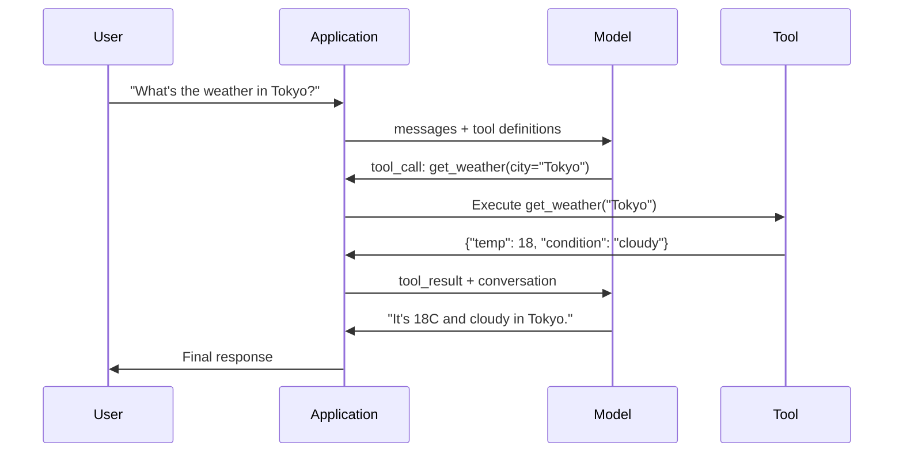

# Function Calling & Tool Use

> LLM không thể làm bất kỳ điều gì. Chúng sinh văn bản. Đó là toàn bộ năng lực. Chúng không thể kiểm tra thời tiết, truy vấn cơ sở dữ liệu, gửi email, chạy mã hay đọc file. Mọi "tác tử AI" bạn từng thấy đều là một LLM sinh JSON nói hàm nào cần gọi -- rồi mã của bạn thực sự gọi nó. Mô hình là bộ não. Công cụ là đôi tay. Function calling là hệ thần kinh kết nối chúng.

**Type:** Build
**Languages:** Python
**Prerequisites:** Phase 11 Lesson 03 (Structured Outputs)
**Time:** ~75 minutes
**Liên quan:** Giai đoạn 11 · 14 (Model Context Protocol) — khi một công cụ được chia sẻ giữa các host, chuyển từ function-calling nội tuyến sang máy chủ MCP. Bài học này trình bày trường hợp nội tuyến; MCP trình bày trường hợp giao thức.

## Learning Objectives

- Triển khai vòng lặp function calling: định nghĩa schema công cụ, phân tích JSON tool-call của mô hình, thực thi hàm và trả kết quả
- Thiết kế schema công cụ với mô tả rõ ràng và tham số có kiểu mà mô hình có thể gọi đáng tin cậy
- Xây dựng vòng lặp tác tử nhiều lượt nối nhiều lệnh gọi hàm để trả lời truy vấn phức tạp
- Xử lý các trường hợp biên function calling: gọi công cụ song song, lan truyền lỗi và ngăn vòng lặp công cụ vô hạn

## The Problem

Bạn xây một chatbot. Người dùng hỏi: "Thời tiết ở Tokyo ngay bây giờ thế nào?"

Mô hình phản hồi: "Tôi không có quyền truy cập dữ liệu thời tiết thời gian thực, nhưng dựa vào mùa, Tokyo có lẽ khoảng 15 độ C..."

Đó là một ảo giác khoác lời tuyên bố giới hạn. Mô hình không biết thời tiết. Nó sẽ không bao giờ biết. Thời tiết thay đổi mỗi giờ. Dữ liệu huấn luyện của mô hình đã cũ hàng tháng.

Câu trả lời đúng cần gọi API OpenWeatherMap, lấy nhiệt độ hiện tại và trả về con số thật. Mô hình không thể gọi API. Mã của bạn có thể. Mảnh còn thiếu: một giao thức có cấu trúc cho phép mô hình nói "Tôi cần gọi API thời tiết với các đối số này" và cho phép mã của bạn thực thi rồi đưa kết quả trở lại.

Đây là function calling. Mô hình xuất JSON có cấu trúc mô tả hàm nào cần gọi với đối số gì. Ứng dụng của bạn thực thi hàm. Kết quả đi trở lại hội thoại. Mô hình dùng kết quả để tạo câu trả lời cuối.

Không có function calling, LLM là bách khoa toàn thư. Có nó, chúng trở thành tác tử.

## The Concept

### The Function Calling Loop

Mọi tương tác dùng công cụ tuân cùng vòng lặp 5 bước.



Bước 1: người dùng gửi thông điệp. Bước 2: mô hình nhận thông điệp cùng định nghĩa công cụ (JSON Schema mô tả các hàm sẵn có). Bước 3: thay vì phản hồi bằng văn bản, mô hình xuất lệnh gọi công cụ -- một đối tượng JSON có cấu trúc với tên hàm và đối số. Bước 4: mã của bạn thực thi hàm và ghi nhận kết quả. Bước 5: kết quả trở lại mô hình, giờ có dữ liệu thực để tạo câu trả lời cuối.

Mô hình không bao giờ thực thi bất kỳ thứ gì. Nó chỉ quyết định gọi gì và với đối số nào. Mã của bạn là bộ thực thi.

### Tool Definitions: The JSON Schema Contract

Mỗi công cụ được định nghĩa bằng một JSON Schema cho mô hình biết hàm làm gì, nhận đối số gì và kiểu các đối số đó phải là gì.

```json
{
  "type": "function",
  "function": {
    "name": "get_weather",
    "description": "Get current weather for a city. Returns temperature in Celsius and conditions.",
    "parameters": {
      "type": "object",
      "properties": {
        "city": {
          "type": "string",
          "description": "City name, e.g. 'Tokyo' or 'San Francisco'"
        },
        "units": {
          "type": "string",
          "enum": ["celsius", "fahrenheit"],
          "description": "Temperature units"
        }
      },
      "required": ["city"]
    }
  }
}
```

Các trường `description` rất quan trọng. Mô hình đọc chúng để quyết định khi nào và cách dùng công cụ. Một mô tả mơ hồ như "lấy thời tiết" tạo lựa chọn công cụ kém hơn "Lấy thời tiết hiện tại cho một thành phố. Trả về nhiệt độ theo độ C và tình trạng thời tiết." Mô tả là prompt để chọn công cụ.

### Provider Comparison

Mọi nhà cung cấp lớn hỗ trợ function calling, nhưng giao diện API khác nhau.

| Nhà cung cấp | Tham số API | Định dạng lệnh gọi công cụ | Gọi song song | Gọi bắt buộc |
|----------|--------------|-----------------|---------------|----------------|
| OpenAI (GPT-5, o4) | `tools` | `tool_calls[].function` | Có (nhiều mỗi lượt) | `tool_choice="required"` |
| Anthropic (Claude 4.6/4.7) | `tools` | `content[].type="tool_use"` | Có (nhiều khối) | `tool_choice={"type":"any"}` |
| Google (Gemini 3) | `function_declarations` | `functionCall` | Có | `function_calling_config` |
| Trọng số mở (Llama 4, Qwen3, DeepSeek-V3) | `tools` nguyên bản trên Llama 4; Hermes hoặc ChatML trên mô hình khác | Hỗn hợp | Phụ thuộc mô hình | Dựa trên prompt hoặc `tool_choice` nếu được hỗ trợ |

Đến năm 2026, ba nhà cung cấp đóng đã hội tụ về các định dạng dựa trên JSON Schema gần như giống hệt. Llama 4 cung cấp trường `tools` nguyên bản khớp hình dạng của OpenAI. Các bản fine-tune trọng số mở vẫn khác nhau — định dạng Hermes (NousResearch) phổ biến nhất cho fine-tune bên thứ ba. Với công cụ chia sẻ giữa các host, ưu tiên MCP (Giai đoạn 11 · 14) hơn function-calling nội tuyến — máy chủ giống nhau cho tất cả.

### Tool Choice: Auto, Required, Specific

Bạn kiểm soát khi nào mô hình dùng công cụ.

**Auto** (mặc định): mô hình quyết định gọi công cụ hay phản hồi trực tiếp. "2+2 là gì?" -- phản hồi trực tiếp. "Thời tiết thế nào?" -- gọi công cụ.

**Required**: mô hình phải gọi ít nhất một công cụ. Dùng khi bạn biết ý định người dùng cần công cụ. Ngăn mô hình đoán thay vì tra dữ liệu thực.

**Hàm cụ thể**: buộc mô hình gọi một hàm nhất định. `tool_choice={"type":"function", "function": {"name": "get_weather"}}` bảo đảm công cụ thời tiết được gọi, bất kể truy vấn. Dùng cho định tuyến -- khi logic phía trước đã xác định cần công cụ nào.

### Parallel Function Calling

GPT-4o và Claude có thể gọi nhiều hàm trong một lượt. Người dùng hỏi: "Thời tiết ở Tokyo và New York thế nào?" Mô hình xuất đồng thời hai lệnh gọi công cụ:

```json
[
  {"name": "get_weather", "arguments": {"city": "Tokyo"}},
  {"name": "get_weather", "arguments": {"city": "New York"}}
]
```

Mã của bạn thực thi cả hai (lý tưởng là đồng thời), trả cả hai kết quả và mô hình tổng hợp một phản hồi. Điều này giảm lượt đi-về từ 2 xuống 1. Với tác tử có 5-10 lệnh gọi công cụ mỗi truy vấn, gọi song song giảm độ trễ 60-80%.

### Structured Outputs vs Function Calling

Bài 03 trình bày đầu ra có cấu trúc. Function calling dùng cùng cơ chế JSON Schema, nhưng cho mục đích khác.

**Đầu ra có cấu trúc**: buộc mô hình tạo dữ liệu theo hình dạng cụ thể. Đầu ra là sản phẩm cuối. Ví dụ: trích xuất thông tin sản phẩm từ văn bản thành `{name, price, in_stock}`.

**Function calling**: mô hình tuyên bố ý định thực thi hành động. Đầu ra là bước trung gian. Ví dụ: `get_weather(city="Tokyo")` -- mô hình đang yêu cầu hành động, không tạo câu trả lời cuối.

Dùng đầu ra có cấu trúc khi muốn trích xuất dữ liệu. Dùng function calling khi muốn mô hình tương tác với hệ thống bên ngoài.

### Security: The Non-Negotiable Rules

Function calling là năng lực nguy hiểm nhất bạn có thể trao cho LLM. Mô hình chọn thứ để thực thi. Nếu tập công cụ có truy vấn cơ sở dữ liệu, mô hình xây truy vấn. Nếu có lệnh shell, mô hình viết chúng.

**Quy tắc 1: Không bao giờ truyền SQL do mô hình sinh trực tiếp vào cơ sở dữ liệu.** Mô hình có thể và sẽ sinh DROP TABLE, chèn UNION hoặc truy vấn trả mọi hàng. Luôn tham số hóa. Luôn xác thực. Luôn dùng danh sách thao tác cho phép.

**Quy tắc 2: Đưa hàm vào danh sách cho phép.** Mô hình chỉ có thể gọi hàm bạn định nghĩa rõ ràng. Không bao giờ xây công cụ chung "thực thi bất kỳ hàm nào theo tên." Nếu có 50 hàm nội bộ, chỉ mở 5 hàm người dùng cần.

**Quy tắc 3: Xác thực đối số.** Mô hình có thể truyền tên thành phố `"; DROP TABLE users; --"`. Xác thực mọi đối số theo kiểu, phạm vi và định dạng kỳ vọng trước thực thi.

**Quy tắc 4: Làm sạch kết quả công cụ.** Nếu công cụ trả dữ liệu nhạy cảm (khóa API, PII, lỗi nội bộ), lọc trước khi gửi lại mô hình. Mô hình sẽ đưa nguyên văn kết quả công cụ vào phản hồi.

**Quy tắc 5: Giới hạn tần suất gọi công cụ.** Một mô hình trong vòng lặp có thể gọi công cụ hàng trăm lần. Đặt tối đa (10-20 lệnh gọi mỗi hội thoại là hợp lý). Ngắt vòng lặp vô hạn.

### Error Handling

Công cụ thất bại. API hết thời gian chờ. Cơ sở dữ liệu ngừng hoạt động. File không tồn tại. Mô hình cần biết khi công cụ thất bại và tại sao.

Trả lỗi dưới dạng kết quả công cụ có cấu trúc, không phải ngoại lệ:

```json
{
  "error": true,
  "message": "City 'Toky' not found. Did you mean 'Tokyo'?",
  "code": "CITY_NOT_FOUND"
}
```

Mô hình đọc điều này, điều chỉnh đối số và thử lại. Mô hình giỏi tự sửa từ thông điệp lỗi có cấu trúc. Chúng kém phục hồi từ phản hồi rỗng hoặc lỗi chung "đã xảy ra sự cố."

### MCP: Model Context Protocol

MCP là tiêu chuẩn mở của Anthropic cho khả năng tương tác công cụ. Thay vì mỗi ứng dụng định nghĩa công cụ riêng, MCP cung cấp giao thức phổ quát: công cụ được phục vụ bởi máy chủ MCP, được tiêu thụ bởi client MCP (như Claude Code, Cursor hoặc ứng dụng của bạn).

Một máy chủ MCP có thể mở công cụ cho bất kỳ client tương thích nào. Máy chủ Postgres MCP cho bất kỳ tác tử tương thích MCP nào truy cập cơ sở dữ liệu. Máy chủ GitHub MCP cho bất kỳ tác tử nào truy cập kho mã. Công cụ được định nghĩa một lần, dùng mọi nơi.

MCP đối với function calling giống như HTTP đối với kết nối mạng. Nó chuẩn hóa lớp truyền tải để công cụ trở nên có thể chuyển dùng.

```figure
mx-tool-call-loop
```

## Build It

### Step 1: Define the Tool Registry

Xây một registry lưu định nghĩa công cụ và triển khai của chúng. Mỗi công cụ có định nghĩa JSON Schema (thứ mô hình thấy) và hàm Python (thứ mã của bạn thực thi).

```python
import ast
import json
import math
import time
import hashlib


TOOL_REGISTRY = {}


def register_tool(name, description, parameters, function):
    TOOL_REGISTRY[name] = {
        "definition": {
            "type": "function",
            "function": {
                "name": name,
                "description": description,
                "parameters": parameters,
            },
        },
        "function": function,
    }
```

### Step 2: Implement 5 Tools

Xây một máy tính, tra cứu thời tiết, bộ mô phỏng tìm kiếm web, bộ đọc file và bộ chạy mã.

```python
def calculator(expression, precision=2):
    allowed = set("0123456789+-*/.() ")
    if not all(c in allowed for c in expression):
        return {"error": True, "message": f"Invalid characters in expression: {expression}"}
    try:
        result = eval(expression, {"__builtins__": {}}, {"math": math})
        return {"result": round(float(result), precision), "expression": expression}
    except Exception as e:
        return {"error": True, "message": str(e)}


WEATHER_DB = {
    "tokyo": {"temp_c": 18, "condition": "cloudy", "humidity": 72, "wind_kph": 14},
    "new york": {"temp_c": 22, "condition": "sunny", "humidity": 45, "wind_kph": 8},
    "london": {"temp_c": 12, "condition": "rainy", "humidity": 88, "wind_kph": 22},
    "san francisco": {"temp_c": 16, "condition": "foggy", "humidity": 80, "wind_kph": 18},
    "sydney": {"temp_c": 25, "condition": "sunny", "humidity": 55, "wind_kph": 10},
}


def get_weather(city, units="celsius"):
    key = city.lower().strip()
    if key not in WEATHER_DB:
        suggestions = [c for c in WEATHER_DB if c.startswith(key[:3])]
        return {
            "error": True,
            "message": f"City '{city}' not found.",
            "suggestions": suggestions,
            "code": "CITY_NOT_FOUND",
        }
    data = WEATHER_DB[key].copy()
    if units == "fahrenheit":
        data["temp_f"] = round(data["temp_c"] * 9 / 5 + 32, 1)
        del data["temp_c"]
    data["city"] = city
    return data


SEARCH_DB = {
    "python function calling": [
        {"title": "OpenAI Function Calling Guide", "url": "https://platform.openai.com/docs/guides/function-calling", "snippet": "Learn how to connect LLMs to external tools."},
        {"title": "Anthropic Tool Use", "url": "https://docs.anthropic.com/en/docs/tool-use", "snippet": "Claude can interact with external tools and APIs."},
    ],
    "MCP protocol": [
        {"title": "Model Context Protocol", "url": "https://modelcontextprotocol.io", "snippet": "An open standard for connecting AI models to data sources."},
    ],
    "weather API": [
        {"title": "OpenWeatherMap API", "url": "https://openweathermap.org/api", "snippet": "Free weather API with current, forecast, and historical data."},
    ],
}


def web_search(query, max_results=3):
    key = query.lower().strip()
    for db_key, results in SEARCH_DB.items():
        if db_key in key or key in db_key:
            return {"query": query, "results": results[:max_results], "total": len(results)}
    return {"query": query, "results": [], "total": 0}


FILE_SYSTEM = {
    "data/config.json": '{"model": "gpt-4o", "temperature": 0.7, "max_tokens": 4096}',
    "data/users.csv": "name,email,role\nAlice,alice@example.com,admin\nBob,bob@example.com,user",
    "README.md": "# My Project\nA tool-use agent built from scratch.",
}


def read_file(path):
    if ".." in path or path.startswith("/"):
        return {"error": True, "message": "Path traversal not allowed.", "code": "FORBIDDEN"}
    if path not in FILE_SYSTEM:
        available = list(FILE_SYSTEM.keys())
        return {"error": True, "message": f"File '{path}' not found.", "available_files": available, "code": "NOT_FOUND"}
    content = FILE_SYSTEM[path]
    return {"path": path, "content": content, "size_bytes": len(content), "lines": content.count("\n") + 1}


def run_code(code, language="python"):
    if language != "python":
        return {"error": True, "message": f"Language '{language}' not supported. Only 'python' is available."}
    try:
        tree = ast.parse(code)
    except SyntaxError as e:
        return {"error": True, "message": f"SyntaxError: {e}", "code": "SYNTAX_ERROR"}
    unsafe_names = {"exec", "eval", "compile", "__import__", "open", "globals", "locals", "vars", "getattr", "setattr", "delattr"}
    for node in ast.walk(tree):
        if isinstance(node, (ast.Import, ast.ImportFrom)):
            return {"error": True, "message": "Forbidden operation: import is not allowed", "code": "SECURITY_VIOLATION"}
        if isinstance(node, ast.Attribute) and node.attr.startswith("__") and node.attr.endswith("__"):
            return {"error": True, "message": "Forbidden operation: dunder attribute access is not allowed", "code": "SECURITY_VIOLATION"}
        if isinstance(node, ast.Name) and node.id in unsafe_names:
            return {"error": True, "message": f"Forbidden operation: {node.id} is not allowed", "code": "SECURITY_VIOLATION"}
    try:
        local_vars = {}
        exec(code, {"__builtins__": {"print": print, "range": range, "len": len, "str": str, "int": int, "float": float, "list": list, "dict": dict, "sum": sum, "min": min, "max": max, "abs": abs, "round": round, "sorted": sorted, "enumerate": enumerate, "zip": zip, "map": map, "filter": filter, "math": math}}, local_vars)
        result = local_vars.get("result", None)
        return {"success": True, "result": result, "variables": {k: str(v) for k, v in local_vars.items() if not k.startswith("_")}}
    except Exception as e:
        return {"error": True, "message": f"{type(e).__name__}: {e}"}
```

Danh sách chặn chuỗi con đọc mã như văn bản, nên bỏ lỡ mọi thứ mà phép khớp chuỗi không viết ra theo nghĩa đen. Phân tích mã thành cây cú pháp và duyệt nó cho phép bộ bảo vệ từ chối câu lệnh `import`, truy cập thuộc tính dunder (các chuỗi `__class__` và `__globals__` chạm ngược về trình thông dịch thực) và tên builtin không an toàn theo cấu trúc thay vì cách viết. Dù vậy, xem đây là bộ lọc giảng dạy, không phải ranh giới thực. Mọi bộ bảo vệ trong tiến trình đều chia sẻ trình thông dịch với mã nó chạy, và người gọi quyết tâm vẫn có thể tìm các đối tượng có thể chạm tới. Hệ thống sản xuất chạy mã không đáng tin trong tiến trình hoặc container riêng (tiến trình con đã giảm quyền, gVisor, Firecracker hoặc bộ chạy mã được lưu trữ), nơi việc thoát đưa kẻ tấn công vào một hộp dùng rồi bỏ thay vì dịch vụ của bạn.

### Step 3: Register All Tools

```python
def register_all_tools():
    register_tool(
        "calculator", "Evaluate a mathematical expression. Supports +, -, *, /, parentheses, and decimals. Returns the numeric result.",
        {"type": "object", "properties": {"expression": {"type": "string", "description": "Math expression, e.g. '(10 + 5) * 3'"}, "precision": {"type": "integer", "description": "Decimal places in result", "default": 2}}, "required": ["expression"]},
        calculator,
    )
    register_tool(
        "get_weather", "Get current weather for a city. Returns temperature, condition, humidity, and wind speed.",
        {"type": "object", "properties": {"city": {"type": "string", "description": "City name, e.g. 'Tokyo' or 'San Francisco'"}, "units": {"type": "string", "enum": ["celsius", "fahrenheit"], "description": "Temperature units, defaults to celsius"}}, "required": ["city"]},
        get_weather,
    )
    register_tool(
        "web_search", "Search the web for information. Returns a list of results with title, URL, and snippet.",
        {"type": "object", "properties": {"query": {"type": "string", "description": "Search query"}, "max_results": {"type": "integer", "description": "Maximum results to return", "default": 3}}, "required": ["query"]},
        web_search,
    )
    register_tool(
        "read_file", "Read the contents of a file. Returns the file content, size, and line count.",
        {"type": "object", "properties": {"path": {"type": "string", "description": "Relative file path, e.g. 'data/config.json'"}}, "required": ["path"]},
        read_file,
    )
    register_tool(
        "run_code", "Run a small Python snippet behind a static-analysis guard and a restricted interpreter. This is a teaching filter, not real isolation. Set a 'result' variable to return output.",
        {"type": "object", "properties": {"code": {"type": "string", "description": "Python code to execute"}, "language": {"type": "string", "enum": ["python"], "description": "Programming language"}}, "required": ["code"]},
        run_code,
    )
```

### Step 4: Build the Function Calling Loop

Đây là bộ máy cốt lõi. Nó mô phỏng mô hình quyết định gọi công cụ nào, thực thi công cụ và đưa kết quả trở lại.

```python
def simulate_model_decision(user_message, tools, conversation_history):
    msg = user_message.lower()

    if any(word in msg for word in ["weather", "temperature", "forecast"]):
        cities = []
        for city in WEATHER_DB:
            if city in msg:
                cities.append(city)
        if not cities:
            for word in msg.split():
                if word.capitalize() in [c.title() for c in WEATHER_DB]:
                    cities.append(word)
        if not cities:
            cities = ["tokyo"]
        calls = []
        for city in cities:
            calls.append({"name": "get_weather", "arguments": {"city": city.title()}})
        return calls

    if any(word in msg for word in ["calculate", "compute", "math", "what is", "how much"]):
        for token in msg.split():
            if any(c in token for c in "+-*/"):
                return [{"name": "calculator", "arguments": {"expression": token}}]
        if "+" in msg or "-" in msg or "*" in msg or "/" in msg:
            expr = "".join(c for c in msg if c in "0123456789+-*/.() ")
            if expr.strip():
                return [{"name": "calculator", "arguments": {"expression": expr.strip()}}]
        return [{"name": "calculator", "arguments": {"expression": "0"}}]

    if any(word in msg for word in ["search", "find", "look up", "google"]):
        query = msg.replace("search for", "").replace("look up", "").replace("find", "").strip()
        return [{"name": "web_search", "arguments": {"query": query}}]

    if any(word in msg for word in ["read", "file", "open", "cat", "show"]):
        for path in FILE_SYSTEM:
            if path.split("/")[-1].split(".")[0] in msg:
                return [{"name": "read_file", "arguments": {"path": path}}]
        return [{"name": "read_file", "arguments": {"path": "README.md"}}]

    if any(word in msg for word in ["run", "execute", "code", "python"]):
        return [{"name": "run_code", "arguments": {"code": "result = 'Hello from the sandbox!'", "language": "python"}}]

    return []


def execute_tool_call(tool_call):
    name = tool_call["name"]
    args = tool_call["arguments"]

    if name not in TOOL_REGISTRY:
        return {"error": True, "message": f"Unknown tool: {name}", "code": "UNKNOWN_TOOL"}

    tool = TOOL_REGISTRY[name]
    func = tool["function"]
    start = time.time()

    try:
        result = func(**args)
    except TypeError as e:
        result = {"error": True, "message": f"Invalid arguments: {e}"}

    elapsed_ms = round((time.time() - start) * 1000, 2)
    return {"tool": name, "result": result, "execution_time_ms": elapsed_ms}


def run_function_calling_loop(user_message, max_iterations=5):
    conversation = [{"role": "user", "content": user_message}]
    tool_definitions = [t["definition"] for t in TOOL_REGISTRY.values()]
    all_tool_results = []

    for iteration in range(max_iterations):
        tool_calls = simulate_model_decision(user_message, tool_definitions, conversation)

        if not tool_calls:
            break

        results = []
        for call in tool_calls:
            result = execute_tool_call(call)
            results.append(result)

        conversation.append({"role": "assistant", "content": None, "tool_calls": tool_calls})

        for result in results:
            conversation.append({"role": "tool", "content": json.dumps(result["result"]), "tool_name": result["tool"]})

        all_tool_results.extend(results)
        break

    return {"conversation": conversation, "tool_results": all_tool_results, "iterations": iteration + 1 if tool_calls else 0}
```

### Step 5: Argument Validation

Xây một bộ xác thực kiểm tra đối số lệnh gọi công cụ theo JSON Schema trước thực thi.

```python
def validate_tool_arguments(tool_name, arguments):
    if tool_name not in TOOL_REGISTRY:
        return [f"Unknown tool: {tool_name}"]

    schema = TOOL_REGISTRY[tool_name]["definition"]["function"]["parameters"]
    errors = []

    if not isinstance(arguments, dict):
        return [f"Arguments must be an object, got {type(arguments).__name__}"]

    for required_field in schema.get("required", []):
        if required_field not in arguments:
            errors.append(f"Missing required argument: {required_field}")

    properties = schema.get("properties", {})
    for arg_name, arg_value in arguments.items():
        if arg_name not in properties:
            errors.append(f"Unknown argument: {arg_name}")
            continue

        prop_schema = properties[arg_name]
        expected_type = prop_schema.get("type")

        type_checks = {"string": str, "integer": int, "number": (int, float), "boolean": bool, "array": list, "object": dict}
        if expected_type in type_checks:
            if not isinstance(arg_value, type_checks[expected_type]):
                errors.append(f"Argument '{arg_name}': expected {expected_type}, got {type(arg_value).__name__}")

        if "enum" in prop_schema and arg_value not in prop_schema["enum"]:
            errors.append(f"Argument '{arg_name}': '{arg_value}' not in {prop_schema['enum']}")

    return errors
```

### Step 6: Run the Demo

```python
def run_demo():
    register_all_tools()

    print("=" * 60)
    print("  Function Calling & Tool Use Demo")
    print("=" * 60)

    print("\n--- Registered Tools ---")
    for name, tool in TOOL_REGISTRY.items():
        desc = tool["definition"]["function"]["description"][:60]
        params = list(tool["definition"]["function"]["parameters"].get("properties", {}).keys())
        print(f"  {name}: {desc}...")
        print(f"    params: {params}")

    print(f"\n--- Argument Validation ---")
    validation_tests = [
        ("get_weather", {"city": "Tokyo"}, "Valid call"),
        ("get_weather", {}, "Missing required arg"),
        ("get_weather", {"city": "Tokyo", "units": "kelvin"}, "Invalid enum value"),
        ("calculator", {"expression": 123}, "Wrong type (int for string)"),
        ("unknown_tool", {"x": 1}, "Unknown tool"),
    ]
    for tool_name, args, label in validation_tests:
        errors = validate_tool_arguments(tool_name, args)
        status = "VALID" if not errors else f"ERRORS: {errors}"
        print(f"  {label}: {status}")

    print(f"\n--- Tool Execution ---")
    direct_tests = [
        {"name": "calculator", "arguments": {"expression": "(10 + 5) * 3 / 2"}},
        {"name": "get_weather", "arguments": {"city": "Tokyo"}},
        {"name": "get_weather", "arguments": {"city": "Mars"}},
        {"name": "web_search", "arguments": {"query": "python function calling"}},
        {"name": "read_file", "arguments": {"path": "data/config.json"}},
        {"name": "read_file", "arguments": {"path": "../etc/passwd"}},
        {"name": "run_code", "arguments": {"code": "result = sum(range(1, 101))"}},
        {"name": "run_code", "arguments": {"code": "import os; os.system('rm -rf /')"}},
    ]
    for call in direct_tests:
        result = execute_tool_call(call)
        print(f"\n  {call['name']}({json.dumps(call['arguments'])})")
        print(f"    -> {json.dumps(result['result'], indent=None)[:100]}")
        print(f"    time: {result['execution_time_ms']}ms")

    print(f"\n--- Full Function Calling Loop ---")
    test_queries = [
        "What's the weather in Tokyo?",
        "Calculate (100 + 250) * 0.15",
        "Search for MCP protocol",
        "Read the config file",
        "Run some Python code",
        "Tell me a joke",
    ]
    for query in test_queries:
        print(f"\n  User: {query}")
        result = run_function_calling_loop(query)
        if result["tool_results"]:
            for tr in result["tool_results"]:
                print(f"    Tool: {tr['tool']} ({tr['execution_time_ms']}ms)")
                print(f"    Result: {json.dumps(tr['result'], indent=None)[:90]}")
        else:
            print(f"    [No tool called -- direct response]")
        print(f"    Iterations: {result['iterations']}")

    print(f"\n--- Parallel Tool Calls ---")
    multi_city_query = "What's the weather in tokyo and london?"
    print(f"  User: {multi_city_query}")
    result = run_function_calling_loop(multi_city_query)
    print(f"  Tool calls made: {len(result['tool_results'])}")
    for tr in result["tool_results"]:
        city = tr["result"].get("city", "unknown")
        temp = tr["result"].get("temp_c", "N/A")
        print(f"    {city}: {temp}C, {tr['result'].get('condition', 'N/A')}")

    print(f"\n--- Security Checks ---")
    security_tests = [
        ("read_file", {"path": "../../etc/passwd"}),
        ("run_code", {"code": "import subprocess; subprocess.run(['ls'])"}),
        ("calculator", {"expression": "__import__('os').system('ls')"}),
    ]
    for tool_name, args in security_tests:
        result = execute_tool_call({"name": tool_name, "arguments": args})
        blocked = result["result"].get("error", False)
        print(f"  {tool_name}({list(args.values())[0][:40]}): {'BLOCKED' if blocked else 'ALLOWED'}")
```

## Use It

### OpenAI Function Calling

```python
# from openai import OpenAI
#
# client = OpenAI()
#
# tools = [{
#     "type": "function",
#     "function": {
#         "name": "get_weather",
#         "description": "Get current weather for a city",
#         "parameters": {
#             "type": "object",
#             "properties": {
#                 "city": {"type": "string"},
#                 "units": {"type": "string", "enum": ["celsius", "fahrenheit"]}
#             },
#             "required": ["city"]
#         }
#     }
# }]
#
# response = client.chat.completions.create(
#     model="gpt-4o",
#     messages=[{"role": "user", "content": "Weather in Tokyo?"}],
#     tools=tools,
#     tool_choice="auto",
# )
#
# tool_call = response.choices[0].message.tool_calls[0]
# args = json.loads(tool_call.function.arguments)
# result = get_weather(**args)
#
# final = client.chat.completions.create(
#     model="gpt-4o",
#     messages=[
#         {"role": "user", "content": "Weather in Tokyo?"},
#         response.choices[0].message,
#         {"role": "tool", "tool_call_id": tool_call.id, "content": json.dumps(result)},
#     ],
# )
# print(final.choices[0].message.content)
```

OpenAI trả lệnh gọi công cụ dưới dạng `response.choices[0].message.tool_calls`. Mỗi lệnh gọi có `id` bạn phải bao gồm khi trả kết quả. Mô hình dùng ID này để khớp kết quả với lệnh gọi. GPT-4o có thể trả nhiều lệnh gọi công cụ trong một phản hồi -- lặp và thực thi tất cả.

### Anthropic Tool Use

```python
# import anthropic
#
# client = anthropic.Anthropic()
#
# response = client.messages.create(
#     model="claude-sonnet-5",
#     max_tokens=1024,
#     tools=[{
#         "name": "get_weather",
#         "description": "Get current weather for a city",
#         "input_schema": {
#             "type": "object",
#             "properties": {
#                 "city": {"type": "string"},
#                 "units": {"type": "string", "enum": ["celsius", "fahrenheit"]}
#             },
#             "required": ["city"]
#         }
#     }],
#     messages=[{"role": "user", "content": "Weather in Tokyo?"}],
# )
#
# tool_block = next(b for b in response.content if b.type == "tool_use")
# result = get_weather(**tool_block.input)
#
# final = client.messages.create(
#     model="claude-sonnet-5",
#     max_tokens=1024,
#     tools=[...],
#     messages=[
#         {"role": "user", "content": "Weather in Tokyo?"},
#         {"role": "assistant", "content": response.content},
#         {"role": "user", "content": [{"type": "tool_result", "tool_use_id": tool_block.id, "content": json.dumps(result)}]},
#     ],
# )
```

Anthropic trả lệnh gọi công cụ dưới dạng khối nội dung có `type: "tool_use"`. Kết quả công cụ đi vào thông điệp người dùng với `type: "tool_result"`. Lưu ý khác biệt chính: Anthropic dùng `input_schema` cho định nghĩa tham số công cụ, còn OpenAI dùng `parameters`.

### MCP Integration

```python
# MCP servers expose tools over a standardized protocol.
# Any MCP-compatible client can discover and call these tools.
#
# Example: connecting to a Postgres MCP server
#
# from mcp import ClientSession, StdioServerParameters
# from mcp.client.stdio import stdio_client
#
# server_params = StdioServerParameters(
#     command="npx",
#     args=["-y", "@modelcontextprotocol/server-postgres", "postgresql://localhost/mydb"],
# )
#
# async with stdio_client(server_params) as (read, write):
#     async with ClientSession(read, write) as session:
#         await session.initialize()
#         tools = await session.list_tools()
#         result = await session.call_tool("query", {"sql": "SELECT count(*) FROM users"})
```

MCP tách triển khai công cụ khỏi việc sử dụng công cụ. Máy chủ Postgres biết SQL. Máy chủ GitHub biết API. Tác tử của bạn chỉ khám phá và gọi công cụ -- không cần mã riêng của nhà cung cấp cho mỗi tích hợp.

## Ship It

Bài học này tạo ra `outputs/prompt-tool-designer.md` -- một khuôn mẫu prompt tái sử dụng để thiết kế định nghĩa công cụ. Đưa mô tả điều bạn muốn công cụ làm, và nó tạo định nghĩa JSON Schema hoàn chỉnh với mô tả, kiểu và ràng buộc.

Nó cũng tạo ra `outputs/skill-function-calling-patterns.md` -- khung quyết định triển khai function calling trong sản xuất, bao quát thiết kế công cụ, xử lý lỗi, bảo mật và mẫu riêng nhà cung cấp.

## Exercises

1. **Thêm công cụ thứ 6: truy vấn cơ sở dữ liệu.** Triển khai công cụ SQL mô phỏng với bảng trong bộ nhớ. Công cụ nhận tên bảng và điều kiện lọc (không phải SQL thô). Xác thực tên bảng nằm trong danh sách cho phép và toán tử lọc bị giới hạn ở `=`, `>`, `<`, `>=`, `<=`. Trả các hàng khớp dưới dạng JSON.

2. **Triển khai thử lại với phản hồi lỗi.** Khi lệnh gọi công cụ thất bại (ví dụ không tìm thấy thành phố), đưa thông điệp lỗi trở lại hàm quyết định mô hình và để nó sửa đối số. Theo dõi mỗi lệnh gọi mất bao nhiêu lần thử lại. Đặt tối đa 3 lần thử lại mỗi lệnh gọi công cụ.

3. **Xây một tác tử nhiều bước.** Một số truy vấn cần nối lệnh gọi công cụ: "Đọc file cấu hình và cho tôi biết mô hình nào được cấu hình, rồi tìm web về giá của mô hình đó." Triển khai vòng lặp chạy đến khi mô hình quyết định không cần thêm công cụ, truyền kết quả tích lũy vào mỗi bước quyết định. Giới hạn 10 vòng để ngăn vòng lặp vô hạn.

4. **Đo độ chính xác lựa chọn công cụ.** Tạo 30 truy vấn kiểm thử với tên công cụ kỳ vọng. Chạy hàm quyết định trên cả 30 và đo phần trăm số lần chọn công cụ đúng. Xác định truy vấn nào gây nhầm lẫn nhiều nhất giữa các công cụ.

5. **Triển khai cache lệnh gọi công cụ.** Nếu cùng công cụ được gọi với đối số giống hệt trong 60 giây, trả kết quả cache thay vì thực thi lại. Dùng từ điển có khóa `(tool_name, frozenset(args.items()))`. Đo tỷ lệ cache hit qua một hội thoại 20 truy vấn.

## Key Terms

| Thuật ngữ | Mọi người nói gì | Ý nghĩa thực sự |
|------|----------------|----------------------|
| Function calling (Gọi hàm) | "Sử dụng công cụ" | Mô hình xuất JSON có cấu trúc mô tả hàm cần gọi với đối số cụ thể -- mã của bạn thực thi, không phải mô hình |
| Tool definition (Định nghĩa công cụ) | "Schema hàm" | Đối tượng JSON Schema mô tả tên, mục đích, tham số và kiểu của công cụ -- mô hình đọc để quyết định khi nào và cách dùng công cụ |
| Tool choice (Lựa chọn công cụ) | "Chế độ gọi" | Kiểm soát liệu mô hình phải gọi công cụ (required), có thể gọi công cụ (auto), hay phải gọi công cụ cụ thể (named) |
| Parallel calling (Gọi song song) | "Đa công cụ" | Mô hình xuất nhiều lệnh gọi công cụ trong một lượt, giảm lượt đi-về -- cả GPT-4o và Claude đều hỗ trợ |
| Tool result (Kết quả công cụ) | "Đầu ra hàm" | Giá trị trả về từ thực thi công cụ, gửi lại mô hình làm thông điệp để nó dùng dữ liệu thực trong phản hồi |
| Argument validation (Xác thực đối số) | "Kiểm tra đầu vào" | Xác minh đối số do mô hình sinh khớp kiểu, phạm vi và ràng buộc kỳ vọng trước khi thực thi công cụ |
| MCP | "Giao thức công cụ" | Model Context Protocol -- tiêu chuẩn mở của Anthropic để mở công cụ qua máy chủ mà bất kỳ client tương thích nào có thể khám phá và gọi |
| Agent loop (Vòng lặp tác tử) | "Vòng lặp ReAct" | Chu kỳ lặp mô hình quyết định công cụ, mã thực thi công cụ, kết quả đưa trở lại đến khi mô hình có đủ thông tin phản hồi |
| Tool poisoning (Đầu độc công cụ) | "Prompt injection qua công cụ" | Tấn công mà kết quả công cụ chứa chỉ dẫn thao túng hành vi mô hình -- làm sạch mọi đầu ra công cụ |
| Rate limiting (Giới hạn tần suất) | "Ngân sách gọi" | Đặt số lệnh gọi công cụ tối đa mỗi hội thoại để ngăn vòng lặp vô hạn và chi phí API mất kiểm soát |

## Further Reading

- [OpenAI Function Calling Guide](https://platform.openai.com/docs/guides/function-calling) -- tài liệu tham chiếu có tính quyết định cho tool use với GPT-4o, gồm gọi song song, gọi bắt buộc và đối số có cấu trúc
- [Anthropic Tool Use Guide](https://docs.anthropic.com/en/docs/tool-use) -- triển khai tool use của Claude với input_schema, phản hồi đa công cụ và cấu hình tool_choice
- [Model Context Protocol Specification](https://modelcontextprotocol.io) -- tiêu chuẩn mở cho khả năng tương tác công cụ giữa các ứng dụng AI, với kiến trúc máy chủ/client
- [Schick et al., 2023 -- "Toolformer: Language Models Can Teach Themselves to Use Tools"](https://arxiv.org/abs/2302.04761) -- bài báo nền tảng về huấn luyện LLM quyết định khi nào và cách gọi công cụ bên ngoài
- [Patil et al., 2023 -- "Gorilla: Large Language Model Connected with Massive APIs"](https://arxiv.org/abs/2305.15334) -- fine-tuning LLM để gọi API chính xác trên 1,645 API với giảm ảo giác
- [Berkeley Function Calling Leaderboard](https://gorilla.cs.berkeley.edu/leaderboard.html) -- benchmark thời gian thực so sánh độ chính xác function calling giữa GPT-4o, Claude, Gemini và mô hình mở
- [Yao et al., "ReAct: Synergizing Reasoning and Acting in Language Models" (ICLR 2023)](https://arxiv.org/abs/2210.03629) -- vòng lặp Suy nghĩ-Hành động-Quan sát là vòng lặp tác tử bên ngoài quanh mọi lệnh gọi công cụ; nơi bài học này kết thúc, Giai đoạn 14 tiếp nối.
- [Anthropic — Building effective agents (Dec 2024)](https://www.anthropic.com/research/building-effective-agents) -- năm mẫu có thể kết hợp (nối chuỗi prompt, định tuyến, song song hóa, bộ điều phối-worker, bộ đánh giá-bộ tối ưu) xây từ một thành phần cơ bản tool-use duy nhất.
