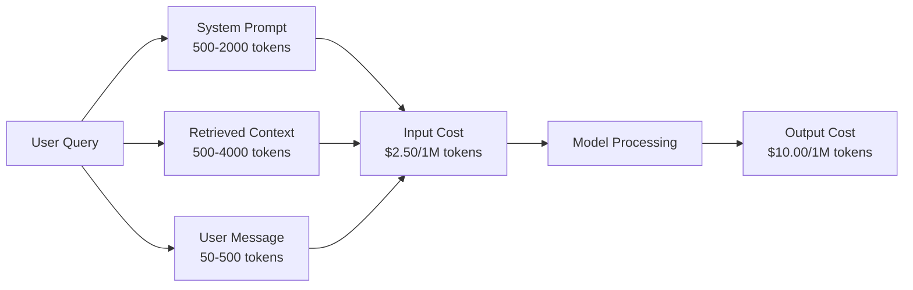
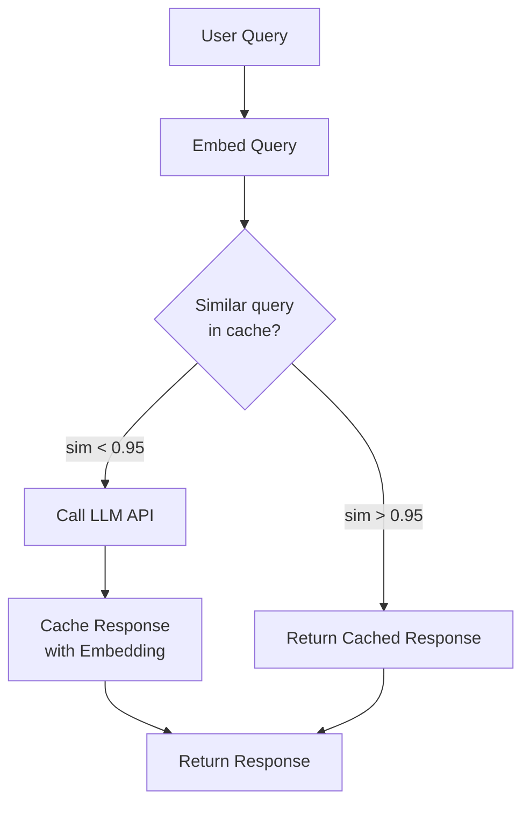
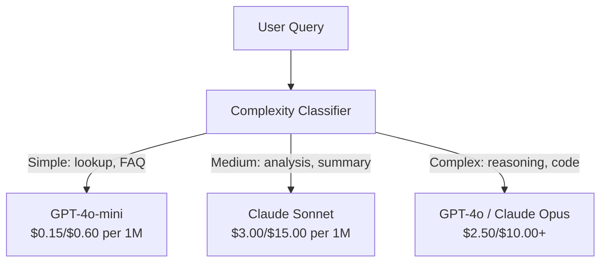

# Caching, Rate Limiting & Cost Optimization

> Hầu hết startup AI không chết vì mô hình kém. Họ chết vì kinh tế đơn vị kém. Một lệnh gọi GPT-4o tốn một phần của một xu. Mười nghìn người dùng thực hiện mười lệnh gọi mỗi ngày tốn $250 chỉ cho token đầu vào -- trước khi bạn thu một đô la nào. Những công ty sống sót là những công ty xem mỗi lệnh gọi API như giao dịch tài chính, không phải lệnh gọi hàm.

**Type:** Build
**Languages:** Python
**Prerequisites:** Phase 11 Lesson 09 (Function Calling)
**Time:** ~45 minutes
**Liên quan:** Giai đoạn 11 · 15 (Prompt Caching) — bài học này trình bày cache lớp ứng dụng (cache ngữ nghĩa, cache hash chính xác, định tuyến mô hình). Bài 15 trình bày cache prompt lớp nhà cung cấp (cache_control của Anthropic, tự động của OpenAI, CachedContent của Gemini). Kết hợp cả hai để giảm chi phí 50-95%.

## Learning Objectives

- Triển khai cache ngữ nghĩa phục vụ truy vấn lặp hoặc tương tự từ cache thay vì gọi API mới
- Tính chi phí mỗi yêu cầu giữa các nhà cung cấp và triển khai giới hạn tần suất nhận biết token cùng cảnh báo ngân sách
- Xây lớp tối ưu chi phí với nén prompt, định tuyến mô hình (đắt so với rẻ) và cache phản hồi
- Thiết kế chiến lược cache phân tầng dùng khớp chính xác, tương đồng ngữ nghĩa và cache tiền tố cho các loại truy vấn khác nhau

## The Problem

Bạn xây chatbot RAG. Nó hoạt động tuyệt vời. Người dùng yêu thích.

Rồi hóa đơn đến.

GPT-5 tốn $5 mỗi triệu token đầu vào và $15 mỗi triệu đầu ra. Claude Opus 4.7 tốn $15 đầu vào / $75 đầu ra. Gemini 3 Pro tốn $1.25 đầu vào / $5 đầu ra. GPT-5-mini là $0.25/$2. Giá bên dưới là minh họa; luôn kiểm tra trang giá hiện tại của nhà cung cấp.

Đây là phép tính giết startup:

- 10,000 người dùng hoạt động hằng ngày
- 10 truy vấn mỗi người dùng mỗi ngày
- 1,000 token đầu vào mỗi truy vấn (system prompt + ngữ cảnh + thông điệp người dùng)
- 500 token đầu ra mỗi phản hồi

**Chi phí đầu vào hằng ngày:** 10,000 x 10 x 1,000 / 1,000,000 x $2.50 = **$250/ngày**
**Chi phí đầu ra hằng ngày:** 10,000 x 10 x 500 / 1,000,000 x $10.00 = **$500/ngày**
**Tổng hằng tháng:** **$22,500/tháng**

Đó chỉ là LLM. Thêm embedding, lưu trữ cơ sở dữ liệu vector, hạ tầng. Bạn đang nhìn vào $30,000/tháng cho một chatbot.

Phần khắc nghiệt: 40-60% truy vấn đó gần trùng lặp. Người dùng hỏi cùng câu hỏi với từ ngữ khác đôi chút. System prompt của bạn -- giống hệt trên mọi yêu cầu -- bị tính tiền mỗi lần. Tài liệu ngữ cảnh do RAG truy xuất lặp lại giữa người dùng hỏi cùng chủ đề.

Bạn đang trả đủ giá cho tính toán dư thừa.

## The Concept

### The Cost Anatomy of an LLM Call

Mọi lệnh gọi API có năm thành phần chi phí.



System prompt là sát thủ thầm lặng. System prompt 1,500 token gửi với mọi yêu cầu tốn $3.75 mỗi triệu yêu cầu chỉ cho tiền tố đó. Ở 100K yêu cầu mỗi ngày, đó là $375/ngày -- $11,250/tháng -- cho văn bản không bao giờ thay đổi.

### Provider Caching: Built-in Discounts

Cả ba nhà cung cấp lớn cung cấp cache prompt phía nhà cung cấp năm 2026, nhưng cơ chế khác nhau. Xem Giai đoạn 11 · 15 để tìm hiểu sâu.

| Nhà cung cấp | Cơ chế | Giảm giá | Tối thiểu | Thời hạn cache |
|----------|-----------|----------|---------|----------------|
| Anthropic | Dấu cache_control rõ ràng | 90% trên cache hit (trả thêm 25% khi ghi) | 1,024 token (Sonnet/Opus), 2,048 (Haiku) | Mặc định 5 phút; mở rộng 1h (phụ phí ghi 2x) |
| OpenAI | Khớp tiền tố tự động | 50% trên cache hit | 1,024 token | Cố gắng tối đa đến 1 giờ |
| Google Gemini | API CachedContent rõ ràng | Giảm ~75% (cộng lưu trữ) | 4,096 (Flash) / 32,768 (Pro) | TTL do người dùng cấu hình |

**Cách tiếp cận Anthropic** là rõ ràng. Bạn đánh dấu các phần prompt bằng `cache_control: {"type": "ephemeral"}`. Yêu cầu đầu trả phụ phí ghi 25%. Các yêu cầu sau cùng tiền tố được giảm 90%. System prompt 2,000 token thường tốn $0.005 thì tốn $0.000625 trên cache hit. Trên 100K yêu cầu, tiết kiệm $437.50/ngày.

**Cách tiếp cận OpenAI** là tự động. Bất kỳ tiền tố prompt khớp yêu cầu trước đều được giảm 50%. Không cần dấu. Đánh đổi: giảm ít hơn, kiểm soát ít hơn, nhưng không công sức triển khai.

### Semantic Caching: Your Custom Layer

Cache nhà cung cấp chỉ hoạt động với tiền tố giống hệt. Cache ngữ nghĩa xử lý trường hợp khó hơn: truy vấn khác nhau cùng ý nghĩa.

"Chính sách trả hàng là gì?" và "Làm thế nào để tôi trả một món hàng?" là các chuỗi khác nhau nhưng cùng ý định. Cache ngữ nghĩa nhúng cả hai truy vấn, tính cosine similarity và trả phản hồi cache nếu độ tương đồng vượt ngưỡng (thường 0.92-0.95).



Chi phí embedding không đáng kể. text-embedding-3-small của OpenAI tốn $0.02 mỗi triệu token. Kiểm tra cache gần như không tốn gì so với lệnh gọi LLM đầy đủ.

### Exact Caching: Hash and Match

Với lệnh gọi tất định (temperature=0, cùng mô hình, cùng prompt), cache chính xác đơn giản và nhanh hơn. Hash toàn prompt, kiểm tra cache, trả về nếu tìm thấy.

Điều này hoạt động hoàn hảo cho:
- System prompt + ngữ cảnh cố định + truy vấn người dùng giống hệt
- Function calling với định nghĩa công cụ giống hệt
- Xử lý batch mà cùng tài liệu được xử lý nhiều lần

### Rate Limiting: Protecting Your Budget

Giới hạn tần suất không chỉ về công bằng. Nó là về sống sót.

**Thuật toán token bucket:** mỗi người dùng có xô N token được nạp lại ở tốc độ R mỗi giây. Yêu cầu tiêu thụ token từ xô. Nếu xô rỗng, yêu cầu bị từ chối. Điều này cho phép đột biến (dùng toàn xô cùng lúc) trong khi cưỡng chế tốc độ trung bình.

**Hạn mức mỗi người dùng:** đặt giới hạn token hằng ngày/tháng theo hạng người dùng.

| Hạng | Giới hạn token hằng ngày | Yêu cầu tối đa/phút | Truy cập mô hình |
|------|------------------|------------------|-------------|
| Miễn phí | 50,000 | 10 | Chỉ GPT-4o-mini |
| Pro | 500,000 | 60 | GPT-4o, Claude Sonnet |
| Doanh nghiệp | 5,000,000 | 300 | Mọi mô hình |

### Model Routing: Right Model for the Right Job

Không phải mọi truy vấn cần GPT-4o.

"Cửa hàng đóng lúc mấy giờ?" không cần mô hình $10/M đầu ra. GPT-4o-mini ở $0.60/M đầu ra xử lý hoàn hảo. Claude Haiku ở $1.25/M đầu ra xử lý được. Bộ phân loại đơn giản định tuyến truy vấn rẻ đến mô hình rẻ và truy vấn phức tạp đến mô hình đắt.



Router được tinh chỉnh tốt tiết kiệm 40-70% chỉ riêng chi phí mô hình.

### Cost Tracking: Know Where the Money Goes

Bạn không thể tối ưu thứ không đo. Ghi log mọi lệnh gọi API với:

- Dấu thời gian
- Tên mô hình
- Token đầu vào
- Token đầu ra
- Độ trễ (ms)
- Chi phí tính được ($)
- ID người dùng
- Cache hit/miss
- Loại yêu cầu

Dữ liệu này cho thấy tính năng nào đắt, người dùng nào tiêu thụ nhiều và nơi cache tác động lớn nhất.

### Batching: Bulk Discounts

Batch API của OpenAI xử lý yêu cầu bất đồng bộ với giảm giá 50%. Bạn gửi batch tối đa 50,000 yêu cầu và kết quả trở lại trong 24 giờ.

Dùng batching cho:
- Xử lý tài liệu hằng đêm
- Phân loại hàng loạt
- Lượt đánh giá
- Pipeline làm giàu dữ liệu

Không dùng cho: truy vấn thời gian thực tiếp xúc người dùng (độ trễ quan trọng).

### Budget Alerts and Circuit Breakers

Circuit breaker dừng chi tiêu khi chạm giới hạn. Không có nó, lỗi hoặc lạm dụng có thể đốt hết ngân sách tháng trong vài giờ.

Đặt ba ngưỡng:
1. **Cảnh báo** (70% ngân sách): gửi cảnh báo
2. **Hạn chế** (85% ngân sách): chuyển sang chỉ mô hình rẻ hơn
3. **Dừng** (95% ngân sách): từ chối yêu cầu mới, chỉ trả phản hồi cache

### The Optimization Stack

Áp dụng các kỹ thuật này theo thứ tự. Mỗi lớp cộng dồn trên các lớp trước.

| Lớp | Kỹ thuật | Tiết kiệm điển hình | Công sức triển khai |
|-------|-----------|----------------|----------------------|
| 1 | Cache prompt nhà cung cấp | 30-50% | Thấp (thêm dấu cache) |
| 2 | Cache chính xác | 10-20% | Thấp (hash + dict) |
| 3 | Cache ngữ nghĩa | 15-30% | Trung bình (embedding + tương đồng) |
| 4 | Định tuyến mô hình | 40-70% | Trung bình (bộ phân loại) |
| 5 | Giới hạn tần suất | Bảo vệ ngân sách | Thấp (token bucket) |
| 6 | Nén prompt | 10-30% | Trung bình (viết lại prompt) |
| 7 | Batching | 50% trên phần đủ điều kiện | Thấp (batch API) |

Ứng dụng RAG áp dụng các lớp 1-5 thường giảm chi phí từ $22,500/tháng xuống $4,000-6,000/tháng. Đó là khác biệt giữa đốt thời gian sống còn và xây doanh nghiệp.

### Real Savings: Before and After

Đây là phân tích thực cho chatbot RAG phục vụ 10,000 DAU.

| Thước đo | Trước tối ưu | Sau tối ưu | Tiết kiệm |
|--------|--------------------|--------------------|---------|
| Chi phí LLM hằng tháng | $22,500 | $5,200 | 77% |
| Chi phí trung bình mỗi truy vấn | $0.0075 | $0.0017 | 77% |
| Tỷ lệ cache hit | 0% | 52% | -- |
| Truy vấn định tuyến đến mini | 0% | 65% | -- |
| Độ trễ P95 | 2,800ms | 900ms (cache hit: 50ms) | 68% |
| Chi phí embedding hằng tháng | $0 | $180 | (chi phí mới) |
| Tổng chi phí hằng tháng | $22,500 | $5,380 | 76% |

Chi phí embedding cho cache ngữ nghĩa ($180/tháng) tự hoàn vốn trong giờ cache hit đầu tiên.

```figure
semantic-cache
```

## Build It

### Step 1: Cost Calculator

Xây bộ tính chi phí token biết giá hiện tại cho các mô hình lớn.

```python
import hashlib
import time
import json
import math
from dataclasses import dataclass, field


MODEL_PRICING = {
    "gpt-4o": {"input": 2.50, "output": 10.00, "cached_input": 1.25},
    "gpt-4o-mini": {"input": 0.15, "output": 0.60, "cached_input": 0.075},
    "gpt-4.1": {"input": 2.00, "output": 8.00, "cached_input": 0.50},
    "gpt-4.1-mini": {"input": 0.40, "output": 1.60, "cached_input": 0.10},
    "gpt-4.1-nano": {"input": 0.10, "output": 0.40, "cached_input": 0.025},
    "o3": {"input": 2.00, "output": 8.00, "cached_input": 0.50},
    "o3-mini": {"input": 1.10, "output": 4.40, "cached_input": 0.55},
    "o4-mini": {"input": 1.10, "output": 4.40, "cached_input": 0.275},
    "claude-opus-4": {"input": 15.00, "output": 75.00, "cached_input": 1.50},
    "claude-sonnet-4": {"input": 3.00, "output": 15.00, "cached_input": 0.30},
    "claude-haiku-3.5": {"input": 0.80, "output": 4.00, "cached_input": 0.08},
    "gemini-2.5-pro": {"input": 1.25, "output": 10.00, "cached_input": 0.3125},
    "gemini-2.5-flash": {"input": 0.15, "output": 0.60, "cached_input": 0.0375},
}


def calculate_cost(model, input_tokens, output_tokens, cached_input_tokens=0):
    if model not in MODEL_PRICING:
        return {"error": f"Unknown model: {model}"}
    pricing = MODEL_PRICING[model]
    non_cached = input_tokens - cached_input_tokens
    input_cost = (non_cached / 1_000_000) * pricing["input"]
    cached_cost = (cached_input_tokens / 1_000_000) * pricing["cached_input"]
    output_cost = (output_tokens / 1_000_000) * pricing["output"]
    total = input_cost + cached_cost + output_cost
    return {
        "model": model,
        "input_tokens": input_tokens,
        "output_tokens": output_tokens,
        "cached_input_tokens": cached_input_tokens,
        "input_cost": round(input_cost, 6),
        "cached_input_cost": round(cached_cost, 6),
        "output_cost": round(output_cost, 6),
        "total_cost": round(total, 6),
    }
```

### Step 2: Exact Cache

Hash toàn prompt và trả phản hồi cache cho yêu cầu giống hệt.

```python
class ExactCache:
    def __init__(self, max_size=1000, ttl_seconds=3600):
        self.cache = {}
        self.max_size = max_size
        self.ttl = ttl_seconds
        self.hits = 0
        self.misses = 0

    def _hash(self, model, messages, temperature):
        key_data = json.dumps({"model": model, "messages": messages, "temperature": temperature}, sort_keys=True)
        return hashlib.sha256(key_data.encode()).hexdigest()

    def get(self, model, messages, temperature=0.0):
        if temperature > 0:
            self.misses += 1
            return None
        key = self._hash(model, messages, temperature)
        if key in self.cache:
            entry = self.cache[key]
            if time.time() - entry["timestamp"] < self.ttl:
                self.hits += 1
                entry["access_count"] += 1
                return entry["response"]
            del self.cache[key]
        self.misses += 1
        return None

    def put(self, model, messages, temperature, response):
        if temperature > 0:
            return
        if len(self.cache) >= self.max_size:
            oldest_key = min(self.cache, key=lambda k: self.cache[k]["timestamp"])
            del self.cache[oldest_key]
        key = self._hash(model, messages, temperature)
        self.cache[key] = {
            "response": response,
            "timestamp": time.time(),
            "access_count": 1,
        }

    def stats(self):
        total = self.hits + self.misses
        return {
            "hits": self.hits,
            "misses": self.misses,
            "hit_rate": round(self.hits / total, 4) if total > 0 else 0,
            "cache_size": len(self.cache),
        }
```

### Step 3: Semantic Cache

Nhúng truy vấn và trả phản hồi cache khi độ tương đồng vượt ngưỡng.

```python
def simple_embed(text):
    words = text.lower().split()
    vocab = {}
    for w in words:
        vocab[w] = vocab.get(w, 0) + 1
    norm = math.sqrt(sum(v * v for v in vocab.values()))
    if norm == 0:
        return {}
    return {k: v / norm for k, v in vocab.items()}


def cosine_similarity(a, b):
    if not a or not b:
        return 0.0
    all_keys = set(a) | set(b)
    dot = sum(a.get(k, 0) * b.get(k, 0) for k in all_keys)
    return dot


class SemanticCache:
    def __init__(self, similarity_threshold=0.85, max_size=500, ttl_seconds=3600):
        self.entries = []
        self.threshold = similarity_threshold
        self.max_size = max_size
        self.ttl = ttl_seconds
        self.hits = 0
        self.misses = 0

    def get(self, query):
        query_embedding = simple_embed(query)
        now = time.time()
        best_match = None
        best_sim = 0.0
        for entry in self.entries:
            if now - entry["timestamp"] > self.ttl:
                continue
            sim = cosine_similarity(query_embedding, entry["embedding"])
            if sim > best_sim:
                best_sim = sim
                best_match = entry
        if best_match and best_sim >= self.threshold:
            self.hits += 1
            best_match["access_count"] += 1
            return {"response": best_match["response"], "similarity": round(best_sim, 4), "original_query": best_match["query"]}
        self.misses += 1
        return None

    def put(self, query, response):
        if len(self.entries) >= self.max_size:
            self.entries.sort(key=lambda e: e["timestamp"])
            self.entries.pop(0)
        self.entries.append({
            "query": query,
            "embedding": simple_embed(query),
            "response": response,
            "timestamp": time.time(),
            "access_count": 1,
        })

    def stats(self):
        total = self.hits + self.misses
        return {
            "hits": self.hits,
            "misses": self.misses,
            "hit_rate": round(self.hits / total, 4) if total > 0 else 0,
            "cache_size": len(self.entries),
        }
```

### Step 4: Rate Limiter

Bộ giới hạn tần suất token bucket với hạn mức mỗi người dùng.

```python
class TokenBucketRateLimiter:
    def __init__(self):
        self.buckets = {}
        self.tiers = {
            "free": {"capacity": 50_000, "refill_rate": 500, "max_requests_per_min": 10},
            "pro": {"capacity": 500_000, "refill_rate": 5_000, "max_requests_per_min": 60},
            "enterprise": {"capacity": 5_000_000, "refill_rate": 50_000, "max_requests_per_min": 300},
        }

    def _get_bucket(self, user_id, tier="free"):
        if user_id not in self.buckets:
            tier_config = self.tiers.get(tier, self.tiers["free"])
            self.buckets[user_id] = {
                "tokens": tier_config["capacity"],
                "capacity": tier_config["capacity"],
                "refill_rate": tier_config["refill_rate"],
                "last_refill": time.time(),
                "request_timestamps": [],
                "max_rpm": tier_config["max_requests_per_min"],
                "tier": tier,
                "total_tokens_used": 0,
            }
        return self.buckets[user_id]

    def _refill(self, bucket):
        now = time.time()
        elapsed = now - bucket["last_refill"]
        refill = int(elapsed * bucket["refill_rate"])
        if refill > 0:
            bucket["tokens"] = min(bucket["capacity"], bucket["tokens"] + refill)
            bucket["last_refill"] = now

    def check(self, user_id, tokens_needed, tier="free"):
        bucket = self._get_bucket(user_id, tier)
        self._refill(bucket)
        now = time.time()
        bucket["request_timestamps"] = [t for t in bucket["request_timestamps"] if now - t < 60]
        if len(bucket["request_timestamps"]) >= bucket["max_rpm"]:
            return {"allowed": False, "reason": "rate_limit", "retry_after_seconds": 60 - (now - bucket["request_timestamps"][0])}
        if bucket["tokens"] < tokens_needed:
            deficit = tokens_needed - bucket["tokens"]
            wait = deficit / bucket["refill_rate"]
            return {"allowed": False, "reason": "token_limit", "tokens_available": bucket["tokens"], "retry_after_seconds": round(wait, 1)}
        return {"allowed": True, "tokens_available": bucket["tokens"]}

    def consume(self, user_id, tokens_used, tier="free"):
        bucket = self._get_bucket(user_id, tier)
        bucket["tokens"] -= tokens_used
        bucket["request_timestamps"].append(time.time())
        bucket["total_tokens_used"] += tokens_used

    def get_usage(self, user_id):
        if user_id not in self.buckets:
            return {"error": "User not found"}
        b = self.buckets[user_id]
        return {
            "user_id": user_id,
            "tier": b["tier"],
            "tokens_remaining": b["tokens"],
            "capacity": b["capacity"],
            "total_tokens_used": b["total_tokens_used"],
            "utilization": round(b["total_tokens_used"] / b["capacity"], 4) if b["capacity"] else 0,
        }
```

### Step 5: Cost Tracker

Ghi log mọi lệnh gọi và tính tổng lũy kế.

```python
class CostTracker:
    def __init__(self, monthly_budget=1000.0):
        self.logs = []
        self.monthly_budget = monthly_budget
        self.alerts = []

    def log_call(self, model, input_tokens, output_tokens, cached_input_tokens=0, latency_ms=0, user_id="anonymous", cache_status="miss"):
        cost = calculate_cost(model, input_tokens, output_tokens, cached_input_tokens)
        entry = {
            "timestamp": time.time(),
            "model": model,
            "input_tokens": input_tokens,
            "output_tokens": output_tokens,
            "cached_input_tokens": cached_input_tokens,
            "latency_ms": latency_ms,
            "cost": cost["total_cost"],
            "user_id": user_id,
            "cache_status": cache_status,
        }
        self.logs.append(entry)
        self._check_budget()
        return entry

    def _check_budget(self):
        total = self.total_cost()
        pct = total / self.monthly_budget if self.monthly_budget > 0 else 0
        if pct >= 0.95 and not any(a["level"] == "stop" for a in self.alerts):
            self.alerts.append({"level": "stop", "message": f"Budget 95% consumed: ${total:.2f}/${self.monthly_budget:.2f}", "timestamp": time.time()})
        elif pct >= 0.85 and not any(a["level"] == "throttle" for a in self.alerts):
            self.alerts.append({"level": "throttle", "message": f"Budget 85% consumed: ${total:.2f}/${self.monthly_budget:.2f}", "timestamp": time.time()})
        elif pct >= 0.70 and not any(a["level"] == "warning" for a in self.alerts):
            self.alerts.append({"level": "warning", "message": f"Budget 70% consumed: ${total:.2f}/${self.monthly_budget:.2f}", "timestamp": time.time()})

    def total_cost(self):
        return round(sum(e["cost"] for e in self.logs), 6)

    def cost_by_model(self):
        by_model = {}
        for e in self.logs:
            m = e["model"]
            if m not in by_model:
                by_model[m] = {"calls": 0, "cost": 0, "input_tokens": 0, "output_tokens": 0}
            by_model[m]["calls"] += 1
            by_model[m]["cost"] = round(by_model[m]["cost"] + e["cost"], 6)
            by_model[m]["input_tokens"] += e["input_tokens"]
            by_model[m]["output_tokens"] += e["output_tokens"]
        return by_model

    def cache_savings(self):
        cache_hits = [e for e in self.logs if e["cache_status"] == "hit"]
        if not cache_hits:
            return {"saved": 0, "cache_hits": 0}
        saved = 0
        for e in cache_hits:
            full_cost = calculate_cost(e["model"], e["input_tokens"], e["output_tokens"])
            saved += full_cost["total_cost"]
        return {"saved": round(saved, 4), "cache_hits": len(cache_hits)}

    def summary(self):
        if not self.logs:
            return {"total_calls": 0, "total_cost": 0}
        total_latency = sum(e["latency_ms"] for e in self.logs)
        cache_hits = sum(1 for e in self.logs if e["cache_status"] == "hit")
        return {
            "total_calls": len(self.logs),
            "total_cost": self.total_cost(),
            "avg_cost_per_call": round(self.total_cost() / len(self.logs), 6),
            "avg_latency_ms": round(total_latency / len(self.logs), 1),
            "cache_hit_rate": round(cache_hits / len(self.logs), 4),
            "cost_by_model": self.cost_by_model(),
            "cache_savings": self.cache_savings(),
            "budget_remaining": round(self.monthly_budget - self.total_cost(), 2),
            "budget_utilization": round(self.total_cost() / self.monthly_budget, 4) if self.monthly_budget > 0 else 0,
            "alerts": self.alerts,
        }
```

### Step 6: Model Router

Định tuyến truy vấn đến mô hình rẻ nhất có thể xử lý chúng.

```python
SIMPLE_KEYWORDS = ["what time", "hours", "address", "phone", "price", "return policy", "hello", "hi", "thanks", "yes", "no"]
COMPLEX_KEYWORDS = ["analyze", "compare", "explain why", "write code", "debug", "architect", "design", "trade-off", "evaluate"]


def classify_complexity(query):
    q = query.lower()
    if len(q.split()) <= 5 or any(kw in q for kw in SIMPLE_KEYWORDS):
        return "simple"
    if any(kw in q for kw in COMPLEX_KEYWORDS):
        return "complex"
    return "medium"


def route_model(query, tier="pro"):
    complexity = classify_complexity(query)
    routing_table = {
        "simple": {"free": "gpt-4.1-nano", "pro": "gpt-4o-mini", "enterprise": "gpt-4o-mini"},
        "medium": {"free": "gpt-4o-mini", "pro": "claude-sonnet-4", "enterprise": "claude-sonnet-4"},
        "complex": {"free": "gpt-4o-mini", "pro": "gpt-4o", "enterprise": "claude-opus-4"},
    }
    model = routing_table[complexity].get(tier, "gpt-4o-mini")
    return {"query": query, "complexity": complexity, "model": model, "tier": tier}
```

### Step 7: Run the Demo

```python
def simulate_llm_call(model, query):
    input_tokens = len(query.split()) * 4 + 500
    output_tokens = 150 + (len(query.split()) * 2)
    latency = 200 + (output_tokens * 2)
    return {
        "model": model,
        "response": f"[Simulated {model} response to: {query[:50]}...]",
        "input_tokens": input_tokens,
        "output_tokens": output_tokens,
        "latency_ms": latency,
    }


def run_demo():
    print("=" * 60)
    print("  Caching, Rate Limiting & Cost Optimization Demo")
    print("=" * 60)

    print("\n--- Model Pricing ---")
    for model, pricing in list(MODEL_PRICING.items())[:6]:
        cost_1k = calculate_cost(model, 1000, 500)
        print(f"  {model}: ${cost_1k['total_cost']:.6f} per 1K in + 500 out")

    print("\n--- Cost Comparison: 100K Requests ---")
    for model in ["gpt-4o", "gpt-4o-mini", "claude-sonnet-4", "claude-haiku-3.5"]:
        cost = calculate_cost(model, 1000 * 100_000, 500 * 100_000)
        print(f"  {model}: ${cost['total_cost']:.2f}")

    print("\n--- Anthropic Cache Savings ---")
    no_cache = calculate_cost("claude-sonnet-4", 2000, 500, 0)
    with_cache = calculate_cost("claude-sonnet-4", 2000, 500, 1500)
    saving = no_cache["total_cost"] - with_cache["total_cost"]
    print(f"  Without cache: ${no_cache['total_cost']:.6f}")
    print(f"  With 1500 cached tokens: ${with_cache['total_cost']:.6f}")
    print(f"  Savings per call: ${saving:.6f} ({saving/no_cache['total_cost']*100:.1f}%)")

    exact_cache = ExactCache(max_size=100, ttl_seconds=300)
    semantic_cache = SemanticCache(similarity_threshold=0.75, max_size=100)
    rate_limiter = TokenBucketRateLimiter()
    tracker = CostTracker(monthly_budget=100.0)

    print("\n--- Exact Cache ---")
    messages_1 = [{"role": "user", "content": "What is the return policy?"}]
    result = exact_cache.get("gpt-4o-mini", messages_1, 0.0)
    print(f"  First lookup: {'HIT' if result else 'MISS'}")
    exact_cache.put("gpt-4o-mini", messages_1, 0.0, "You can return items within 30 days.")
    result = exact_cache.get("gpt-4o-mini", messages_1, 0.0)
    print(f"  Second lookup: {'HIT' if result else 'MISS'} -> {result}")
    result = exact_cache.get("gpt-4o-mini", messages_1, 0.7)
    print(f"  With temp=0.7: {'HIT' if result else 'MISS (non-deterministic, skip cache)'}")
    print(f"  Stats: {exact_cache.stats()}")

    print("\n--- Semantic Cache ---")
    test_queries = [
        ("What is the return policy?", "Items can be returned within 30 days with receipt."),
        ("How do I return an item?", None),
        ("What are your store hours?", "We are open 9am-9pm Monday through Saturday."),
        ("When does the store open?", None),
        ("Tell me about quantum computing", "Quantum computers use qubits..."),
        ("Explain quantum mechanics", None),
    ]
    for query, response in test_queries:
        cached = semantic_cache.get(query)
        if cached:
            print(f"  '{query[:40]}' -> CACHE HIT (sim={cached['similarity']}, original='{cached['original_query'][:40]}')")
        elif response:
            semantic_cache.put(query, response)
            print(f"  '{query[:40]}' -> MISS (stored)")
        else:
            print(f"  '{query[:40]}' -> MISS (no match)")
    print(f"  Stats: {semantic_cache.stats()}")

    print("\n--- Rate Limiting ---")
    for i in range(12):
        check = rate_limiter.check("user_1", 1000, "free")
        if check["allowed"]:
            rate_limiter.consume("user_1", 1000, "free")
        status = "OK" if check["allowed"] else f"BLOCKED ({check['reason']})"
        if i < 5 or not check["allowed"]:
            print(f"  Request {i+1}: {status}")
    print(f"  Usage: {rate_limiter.get_usage('user_1')}")

    print("\n--- Model Routing ---")
    routing_queries = [
        "What time do you close?",
        "Summarize this quarterly earnings report",
        "Analyze the trade-offs between microservices and monoliths",
        "Hello",
        "Write code for a binary search tree with deletion",
    ]
    for q in routing_queries:
        route = route_model(q, "pro")
        print(f"  '{q[:50]}' -> {route['model']} ({route['complexity']})")

    print("\n--- Full Pipeline: Before vs After Optimization ---")
    queries = [
        "What is the return policy?",
        "How do I return something?",
        "What are your hours?",
        "When do you open?",
        "Explain the difference between TCP and UDP",
        "Compare TCP vs UDP protocols",
        "Hello",
        "What is your phone number?",
        "Write a Python function to sort a list",
        "Analyze the pros and cons of serverless architecture",
    ]

    print("\n  [Before: no caching, single model (gpt-4o)]")
    tracker_before = CostTracker(monthly_budget=1000.0)
    for q in queries:
        result = simulate_llm_call("gpt-4o", q)
        tracker_before.log_call("gpt-4o", result["input_tokens"], result["output_tokens"], latency_ms=result["latency_ms"], cache_status="miss")
    before = tracker_before.summary()
    print(f"  Total cost: ${before['total_cost']:.6f}")
    print(f"  Avg cost/call: ${before['avg_cost_per_call']:.6f}")
    print(f"  Avg latency: {before['avg_latency_ms']}ms")

    print("\n  [After: caching + routing + rate limiting]")
    exact_c = ExactCache()
    semantic_c = SemanticCache(similarity_threshold=0.75)
    tracker_after = CostTracker(monthly_budget=1000.0)

    for q in queries:
        messages = [{"role": "user", "content": q}]
        cached = exact_c.get("gpt-4o", messages, 0.0)
        if cached:
            tracker_after.log_call("gpt-4o-mini", 0, 0, latency_ms=5, cache_status="hit")
            continue
        sem_cached = semantic_c.get(q)
        if sem_cached:
            tracker_after.log_call("gpt-4o-mini", 0, 0, latency_ms=15, cache_status="hit")
            continue
        route = route_model(q)
        result = simulate_llm_call(route["model"], q)
        tracker_after.log_call(route["model"], result["input_tokens"], result["output_tokens"], latency_ms=result["latency_ms"], cache_status="miss")
        exact_c.put(route["model"], messages, 0.0, result["response"])
        semantic_c.put(q, result["response"])

    after = tracker_after.summary()
    print(f"  Total cost: ${after['total_cost']:.6f}")
    print(f"  Avg cost/call: ${after['avg_cost_per_call']:.6f}")
    print(f"  Avg latency: {after['avg_latency_ms']}ms")
    print(f"  Cache hit rate: {after['cache_hit_rate']:.0%}")

    if before["total_cost"] > 0:
        savings_pct = (1 - after["total_cost"] / before["total_cost"]) * 100
        print(f"\n  SAVINGS: {savings_pct:.1f}% cost reduction")
        print(f"  Latency improvement: {(1 - after['avg_latency_ms'] / before['avg_latency_ms']) * 100:.1f}% faster")

    print("\n--- Budget Alerts Demo ---")
    alert_tracker = CostTracker(monthly_budget=0.01)
    for i in range(5):
        alert_tracker.log_call("gpt-4o", 5000, 2000, latency_ms=500)
    print(f"  Total spent: ${alert_tracker.total_cost():.6f} / ${alert_tracker.monthly_budget}")
    for alert in alert_tracker.alerts:
        print(f"  ALERT [{alert['level'].upper()}]: {alert['message']}")

    print("\n--- Cost Breakdown by Model ---")
    multi_tracker = CostTracker(monthly_budget=500.0)
    for _ in range(50):
        multi_tracker.log_call("gpt-4o-mini", 800, 200, latency_ms=150)
    for _ in range(30):
        multi_tracker.log_call("claude-sonnet-4", 1500, 500, latency_ms=400)
    for _ in range(10):
        multi_tracker.log_call("gpt-4o", 2000, 800, latency_ms=600)
    for _ in range(10):
        multi_tracker.log_call("claude-opus-4", 3000, 1000, latency_ms=1200)
    breakdown = multi_tracker.cost_by_model()
    for model, data in sorted(breakdown.items(), key=lambda x: x[1]["cost"], reverse=True):
        print(f"  {model}: {data['calls']} calls, ${data['cost']:.6f}, {data['input_tokens']:,} in / {data['output_tokens']:,} out")
    print(f"  Total: ${multi_tracker.total_cost():.6f}")

    print("\n" + "=" * 60)
    print("  Demo complete.")
    print("=" * 60)


if __name__ == "__main__":
    run_demo()
```

## Use It

### Anthropic Prompt Caching

```python
# import anthropic
#
# client = anthropic.Anthropic()
#
# response = client.messages.create(
#     model="claude-sonnet-5",
#     max_tokens=1024,
#     system=[
#         {
#             "type": "text",
#             "text": "You are a helpful customer support agent for Acme Corp...",
#             "cache_control": {"type": "ephemeral"},
#         }
#     ],
#     messages=[{"role": "user", "content": "What is the return policy?"}],
# )
#
# print(f"Input tokens: {response.usage.input_tokens}")
# print(f"Cache creation tokens: {response.usage.cache_creation_input_tokens}")
# print(f"Cache read tokens: {response.usage.cache_read_input_tokens}")
```

Lệnh gọi đầu ghi vào cache (phụ phí 25%). Mỗi lệnh gọi sau với cùng tiền tố system prompt đọc từ cache (giảm 90%). Cache tồn tại 5 phút và đặt lại bộ đếm thời gian trên mỗi hit.

### OpenAI Automatic Caching

```python
# from openai import OpenAI
#
# client = OpenAI()
#
# response = client.chat.completions.create(
#     model="gpt-4o",
#     messages=[
#         {"role": "system", "content": "You are a helpful customer support agent..."},
#         {"role": "user", "content": "What is the return policy?"},
#     ],
# )
#
# print(f"Prompt tokens: {response.usage.prompt_tokens}")
# print(f"Cached tokens: {response.usage.prompt_tokens_details.cached_tokens}")
# print(f"Completion tokens: {response.usage.completion_tokens}")
```

OpenAI cache tự động. Mọi tiền tố prompt 1,024+ token khớp yêu cầu gần đây được giảm 50%. Không cần đổi mã -- chỉ kiểm tra `prompt_tokens_details.cached_tokens` trong phản hồi để xác minh nó hoạt động.

### OpenAI Batch API

```python
# import json
# from openai import OpenAI
#
# client = OpenAI()
#
# requests = []
# for i, query in enumerate(queries):
#     requests.append({
#         "custom_id": f"request-{i}",
#         "method": "POST",
#         "url": "/v1/chat/completions",
#         "body": {
#             "model": "gpt-4o-mini",
#             "messages": [{"role": "user", "content": query}],
#         },
#     })
#
# with open("batch_input.jsonl", "w") as f:
#     for r in requests:
#         f.write(json.dumps(r) + "\n")
#
# batch_file = client.files.create(file=open("batch_input.jsonl", "rb"), purpose="batch")
# batch = client.batches.create(input_file_id=batch_file.id, endpoint="/v1/chat/completions", completion_window="24h")
# print(f"Batch ID: {batch.id}, Status: {batch.status}")
```

Batch API giảm cố định 50% trên mọi token. Kết quả đến trong 24 giờ. Hoàn hảo cho khối lượng công việc không thời gian thực: đánh giá, gán nhãn dữ liệu, tóm tắt hàng loạt.

### Production Semantic Cache with Redis

```python
# import redis
# import numpy as np
# from openai import OpenAI
#
# r = redis.Redis()
# client = OpenAI()
#
# def get_embedding(text):
#     response = client.embeddings.create(model="text-embedding-3-small", input=text)
#     return response.data[0].embedding
#
# def semantic_cache_lookup(query, threshold=0.95):
#     query_emb = np.array(get_embedding(query))
#     keys = r.keys("cache:emb:*")
#     best_sim, best_key = 0, None
#     for key in keys:
#         stored_emb = np.frombuffer(r.get(key), dtype=np.float32)
#         sim = np.dot(query_emb, stored_emb) / (np.linalg.norm(query_emb) * np.linalg.norm(stored_emb))
#         if sim > best_sim:
#             best_sim, best_key = sim, key
#     if best_sim >= threshold and best_key:
#         response_key = best_key.decode().replace("cache:emb:", "cache:resp:")
#         return r.get(response_key).decode()
#     return None
```

Trong sản xuất, thay quét tuyến tính bằng chỉ mục vector (Redis Vector Search, Pinecone hoặc pgvector). Quét tuyến tính hoạt động cho <1,000 mục. Vượt mức đó, dùng ANN (láng giềng gần nhất xấp xỉ) để tra cứu O(log n).

## Ship It

Bài học này tạo ra `outputs/prompt-cost-optimizer.md` -- một prompt tái sử dụng phân tích ứng dụng LLM và khuyến nghị tối ưu chi phí cụ thể với tiết kiệm dự kiến.

Nó cũng tạo ra `outputs/skill-cost-patterns.md` -- khung quyết định chọn chiến lược cache, cấu hình giới hạn tần suất và quy tắc định tuyến mô hình phù hợp cho trường hợp sử dụng.

## Exercises

1. **Triển khai loại bỏ LRU cho cache ngữ nghĩa.** Thay loại bỏ cũ nhất trước bằng ít được dùng gần đây nhất. Theo dõi thời gian truy cập cuối của mỗi mục và loại mục có thời gian truy cập cũ nhất khi cache đầy. So tỷ lệ hit giữa hai chiến lược trên 100 truy vấn.

2. **Xây công cụ dự báo chi phí.** Với log lệnh gọi API (log CostTracker), dự báo chi phí tháng theo trung bình 7 ngày gần nhất. Tính mẫu ngày thường/cuối tuần. Kích hoạt cảnh báo nếu chi phí tháng dự báo vượt ngân sách hơn 20%.

3. **Triển khai cache ngữ nghĩa phân tầng.** Dùng hai ngưỡng tương đồng: 0.98 cho hit độ tin cậy cao (trả ngay) và 0.90 cho hit độ tin cậy trung bình (trả với lời lưu ý: "Dựa trên một câu hỏi tương tự trước đây..."). Theo dõi mỗi hit đến từ tầng nào và đo khác biệt mức hài lòng người dùng.

4. **Xây bộ phân loại định tuyến mô hình.** Thay bộ phân loại theo từ khóa bằng bộ theo embedding. Nhúng 50 truy vấn gán nhãn (đơn giản/trung bình/phức tạp), rồi phân loại truy vấn mới bằng tìm ví dụ gán nhãn gần nhất. Đo độ chính xác phân loại so với tập kiểm thử 20 truy vấn.

5. **Triển khai circuit breaker với các mức suy giảm.** Ở 70% ngân sách, ghi cảnh báo. Ở 85%, tự chuyển mọi định tuyến sang mô hình rẻ nhất (gpt-4o-mini). Ở 95%, chỉ phục vụ phản hồi cache và từ chối truy vấn mới. Kiểm thử bằng mô phỏng 1,000 yêu cầu với ngân sách $1.00 và xác minh mỗi ngưỡng kích hoạt đúng.

## Key Terms

| Thuật ngữ | Mọi người nói gì | Ý nghĩa thực sự |
|------|----------------|----------------------|
| Prompt caching (Cache prompt) | "Cache system prompt" | Cache cấp nhà cung cấp nơi tiền tố prompt lặp được giảm giá (90% Anthropic, 50% OpenAI) -- không đổi mã với OpenAI, dấu rõ ràng với Anthropic |
| Semantic caching (Cache ngữ nghĩa) | "Cache thông minh" | Nhúng truy vấn, tính tương đồng với truy vấn quá khứ và trả phản hồi cache nếu vượt ngưỡng -- bắt cách diễn đạt lại mà khớp chính xác bỏ lỡ |
| Exact caching (Cache chính xác) | "Cache hash" | Hash toàn prompt (mô hình + thông điệp + temperature) và trả phản hồi cache cho đầu vào giống hệt -- chỉ hoạt động cho lệnh gọi tất định temperature=0 |
| Token bucket (Xô token) | "Bộ giới hạn tần suất" | Thuật toán mỗi người dùng có xô N token được nạp ở tốc độ R mỗi giây -- cho phép đột biến đến N trong khi cưỡng chế tốc độ trung bình R |
| Model routing (Định tuyến mô hình) | "Định tuyến hà tiện" | Dùng bộ phân loại gửi truy vấn đơn giản đến mô hình rẻ (GPT-4o-mini, Haiku) và truy vấn phức tạp đến mô hình đắt (GPT-4o, Opus) -- tiết kiệm 40-70% chi phí mô hình |
| Cost tracking (Theo dõi chi phí) | "Đo mức dùng" | Ghi log mọi lệnh gọi API với mô hình, token, độ trễ, chi phí và ID người dùng để biết chính xác tiền đi đâu và tính năng nào đắt |
| Circuit breaker (Bộ ngắt mạch) | "Công tắc ngắt" | Tự giảm dịch vụ (mô hình rẻ hơn, chỉ cache) hoặc dừng yêu cầu hoàn toàn khi chi tiêu gần giới hạn ngân sách |
| Batch API | "Giảm giá hàng loạt" | Xử lý bất đồng bộ của OpenAI giảm 50% -- gửi tối đa 50,000 yêu cầu, nhận kết quả trong 24 giờ |
| Prompt compression (Nén prompt) | "Ăn kiêng token" | Viết lại system prompt và ngữ cảnh để dùng ít token hơn nhưng giữ ý nghĩa -- prompt ngắn hơn tốn ít hơn và thường hoạt động tốt hơn |
| Cache hit rate (Tỷ lệ cache hit) | "Hiệu suất cache" | Phần trăm yêu cầu được phục vụ từ cache thay vì gọi LLM -- 40-60% điển hình cho chatbot sản xuất, tiết kiệm chi phí tương ứng |

## Further Reading

- [Anthropic Prompt Caching Guide](https://docs.anthropic.com/en/docs/build-with-claude/prompt-caching) -- tài liệu chính thức cho dấu cache_control rõ ràng của Anthropic, giá và hành vi thời hạn cache
- [OpenAI Prompt Caching](https://platform.openai.com/docs/guides/prompt-caching) -- cache tự động của OpenAI, cách xác minh cache hit qua trường usage và độ dài tiền tố tối thiểu
- [OpenAI Batch API](https://platform.openai.com/docs/guides/batch) -- giảm 50% cho xử lý bất đồng bộ, định dạng JSONL, thời hạn hoàn thành 24 giờ và giới hạn 50K yêu cầu
- [GPTCache](https://github.com/zilliztech/GPTCache) -- thư viện cache ngữ nghĩa mã nguồn mở hỗ trợ nhiều backend embedding, kho vector và chính sách loại bỏ
- [Martian Model Router](https://docs.withmartian.com) -- định tuyến mô hình sản xuất tự chọn mô hình rẻ nhất có khả năng xử lý mỗi truy vấn
- [Not Diamond](https://www.notdiamond.ai) -- router mô hình dựa trên ML học từ mẫu lưu lượng để tối ưu đánh đổi chi phí/chất lượng giữa các nhà cung cấp
- [Helicone](https://www.helicone.ai) -- nền tảng khả năng quan sát LLM với theo dõi chi phí, cache, giới hạn tần suất và cảnh báo ngân sách dưới dạng lớp proxy
- [Dean & Barroso, "The Tail at Scale" (CACM 2013)](https://research.google/pubs/the-tail-at-scale/) -- độ trễ, thông lượng, phân vị TTFT/TPOT và yêu cầu dự phòng; mô hình chi phí đằng sau "chọn mô hình rẻ nhất vẫn đáp ứng P95."
- [Kwon et al., "Efficient Memory Management for Large Language Model Serving with PagedAttention" (SOSP 2023)](https://arxiv.org/abs/2309.06180) -- bài báo vLLM; tại sao KV-cache phân trang + batching liên tục vượt máy chủ đơn giản 24× về thông lượng, lớp hạ tầng bên dưới "cache và chi phí."
- [Dao et al., "FlashAttention-2: Faster Attention with Better Parallelism and Work Partitioning" (ICLR 2024)](https://arxiv.org/abs/2307.08691) -- giảm chi phí cấp kernel trực giao với cache prompt; đọc cùng speculative decoding và GQA để có bức tranh đầy đủ đường cong chi phí.
