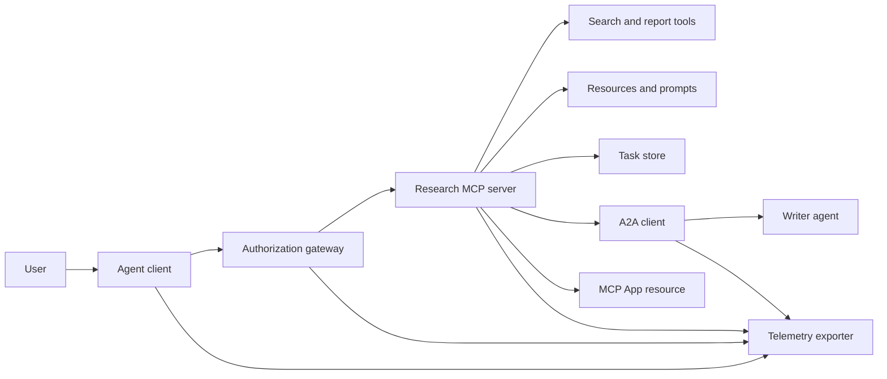
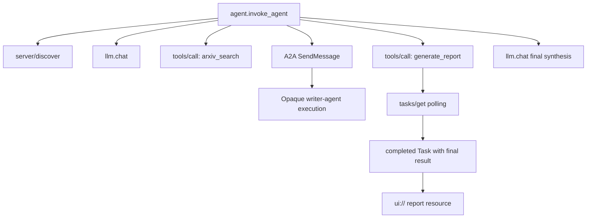
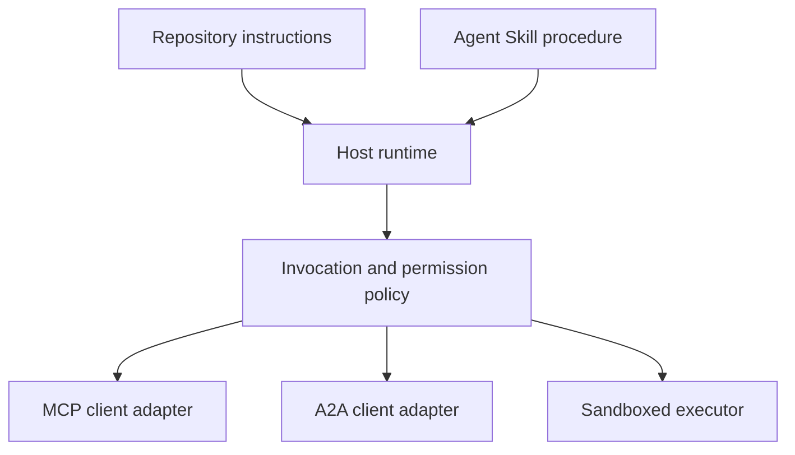

# Capstone: Stateless Tool Ecosystem

> Hệ thống agent sản xuất là tập ranh giới, không phải đống tính năng. Bài tổng kết này tách mô phỏng trong tiến trình dễ đọc khỏi client giao thức, máy chủ cấp quyền, sandbox và exporter telemetry mà triển khai thật vẫn cần.

**Type:** Build
**Languages:** Python (stdlib, in-process simulation)
**Prerequisites:** Phase 13 · 01 through 22, using MCP revision `2026-07-28`
**Time:** ~120 minutes

## Learning Objectives

- Kết hợp lời gọi công cụ, kết quả hình dạng tác vụ, công việc ủy nhiệm, tài nguyên UI, chính sách cấp quyền và bản ghi trace thành một luồng.
- Mang phiên bản giao thức, danh tính client và khả năng trên mọi yêu cầu MCP thay dựa phiên kết nối.
- Khám phá máy chủ trước dùng và điều khiển công việc dài qua phần mở rộng Tasks chính thức.
- Phân biệt mô phỏng hình dạng giao thức với triển khai MCP, A2A, OAuth hoặc OpenTelemetry.
- Ánh xạ mỗi ranh giới mô phỏng đến thành phần sản xuất phải thay.
- Giữ `AGENTS.md`, Agent Skill, adapter runtime, công cụ và chính sách bảo mật đúng vai trò.
- Giải thích tuyên bố nào xác minh được từ đầu ra cục bộ và cái nào cần kiểm thử tích hợp trực tiếp.

## The Problem

Thiết kế hệ thống nghiên cứu-và-báo-cáo. Người dùng yêu cầu bài báo về giao thức agent. Hệ thống tìm danh mục bài báo, ủy nhiệm tóm tắt, tạo báo cáo, trả tài nguyên UI và ghi đường đi qua hệ thống.

Câu đó giấu nhiều hợp đồng độc lập:

- lược đồ công cụ hướng mô hình;
- vỏ yêu cầu không trạng thái và hợp đồng khám phá máy chủ;
- quyết định gateway cho tác nhân, phạm vi và danh tính công cụ;
- hợp đồng thao tác chạy lâu;
- giao thức ủy nhiệm;
- bridge host-sang-app;
- lan truyền và xuất trace;
- thủ tục vận hành tái sử dụng.

`code/main.py` giữ ranh giới rõ bằng hàm và từ điển Python thường. Không mở vận chuyển, liên hệ arXiv, thực hiện OAuth, gọi máy chủ A2A, kết xuất MCP App hoặc xuất telemetry. Điều này làm luồng điều khiển dễ kiểm tra không trình bày mô phỏng là dịch vụ tuân thủ.

## The Concept

### Target architecture



Kiến trúc là kết hợp khái niệm các mẫu giao thức công khai. Không phải tuyên bố nội bộ riêng của sản phẩm nào.

### Target trace



Trong triển khai thật, mọi bước chuyển lan truyền ngữ cảnh trace. Tên và thuộc tính span phải theo quy ước ngữ nghĩa OpenTelemetry phiên bản gắn đo chọn hỗ trợ. Chỉ định danh trace dùng chung không chứng minh quan hệ cha đúng, xuất hoặc backend tiếp nhận.

### Current protocol surfaces

Dùng tên phương thức giao thức hiện tại định nghĩa, không phải tên nhớ từ dự thảo cũ:

| Ranh giới | Bề mặt hiện tại | Bài tổng kết mô phỏng gì |
|---|---|---|
| Khám phá MCP | `server/discover` bắt buộc | Hàm trực tiếp trả phiên bản, khả năng và danh tính máy chủ |
| Ngữ cảnh yêu cầu MCP | Phiên bản, khả năng và danh tính client trong mọi `params._meta` | Siêu dữ liệu yêu cầu mới truyền vào mọi lời gọi mô phỏng |
| Lời gọi công cụ MCP | `tools/call` | Phân phối hàm Python trực tiếp |
| Thăm dò tác vụ MCP | `io.modelcontextprotocol/tasks` với `tasks/get` | Handle đang làm theo sau tác vụ hoàn tất mang kết quả cuối |
| Ủy nhiệm A2A | `SendMessage` trong gRPC và JSON-RPC; `POST /message:send` trong HTTP+JSON | Một span lồng không lời gọi từ xa hoặc độ trễ nhân tạo |
| MCP App gọi công cụ máy chủ | `app.callServerTool({ name, arguments })` | Chuỗi HTML không bridge trực tiếp |
| Cấp quyền OAuth | Máy chủ cấp quyền, siêu dữ liệu tài nguyên được bảo vệ, xác thực đối tượng nhận và phạm vi | Tra cứu token tĩnh và thuộc phạm vi |
| OpenTelemetry | SDK, propagator, exporter và collector hoặc backend | Từ điển span trong bộ nhớ |

Tên giao thức chỉ là tầng đầu. Kiểm thử sản xuất phải thực hành tuần tự hóa, thất bại xác thực, hủy, hết thời gian, thử lại và tương thích phiên bản qua đường truyền thật.

### Stateless MCP changes the integration boundary

Bản sửa đổi `2026-07-28` bỏ phiên giao thức và bắt tay `initialize` / `notifications/initialized`. Cũng bỏ `Mcp-Session-Id`. Mọi yêu cầu mang các trường `_meta` có không gian tên này:

```json
{
  "io.modelcontextprotocol/protocolVersion": "2026-07-28",
  "io.modelcontextprotocol/clientCapabilities": {
    "extensions": {
      "io.modelcontextprotocol/tasks": {}
    }
  },
  "io.modelcontextprotocol/clientInfo": {
    "name": "capstone-client",
    "version": "1.0.0"
  }
}
```

Máy chủ phải triển khai `server/discover`. Kết quả thường dùng `resultType: "complete"`; handle tác vụ dùng `resultType: "task"`. Mỗi kết quả nên định danh máy chủ trong `_meta.io.modelcontextprotocol/serverInfo`.

Phần mở rộng tác vụ có `tasks/get`, `tasks/update` và `tasks/cancel`. Công cụ có thể trả `resultType: "task"` trước; bản thân `tasks/get` trả `resultType: "complete"` và `Task` hoàn tất chứa kết quả cuối. Phương thức `tasks/result` và `tasks/list` cũ không thuộc phần mở rộng hiện tại. Client phải công bố `io.modelcontextprotocol/tasks` trong cùng yêu cầu có thể nhận handle tác vụ. Nếu không, máy chủ trả `-32021` với `requiredCapabilities` hình dạng đối tượng khả năng client thiếu, gồm `extensions.io.modelcontextprotocol/tasks`.

### Security posture

Triển khai dự định dùng phòng vệ nhiều lớp:

- cấp quyền OAuth với PKCE nơi loại client cần;
- gắn tài nguyên và đối tượng nhận cho token truy cập cấp;
- RBAC gateway kiểm tra công cụ và phạm vi yêu cầu;
- thông tin xác thực phía trước giữ ngoài ngữ cảnh mô hình thấy;
- manifest mô tả công cụ ghim hoặc đã xem xét;
- đánh giá Quy tắc Hai cho đầu vào không đáng tin, dữ liệu nhạy cảm và hành động có hệ quả;
- sandbox thực thi có giới hạn hệ thống file, tiến trình, mạng, thông tin xác thực và tài nguyên thực thi ngoài skill.

Demo chỉ triển khai token tĩnh, kiểm tra phạm vi và hash mô tả. Hữu ích cho luồng chính sách, không phải xác thực bảo mật.

### Skills are procedure, not transport

Agent Skill có thể nói runtime cách thực hiện quy trình nghiên cứu, hợp đồng công cụ nào kỳ vọng, bằng chứng gì lưu và khi nào dừng. Không thể làm máy chủ MCP tồn tại, thiết lập tương thích A2A, cấp phạm vi hoặc tạo sandbox.



Cung cấp toàn thư mục skill khi thủ tục tham chiếu file đồng hành. Sản phẩm phẳng trong bài tổng kết cũ này là bản thiết kế khóa học, không phải bằng chứng host giữ bundle có thể chuyển. Bài 24 đến 27 xây và kiểm thử toàn vòng đời bundle.

### Course artifact metadata is a local adapter

Danh mục và trình cài khóa học nhận file phẳng tên `skill-*.md`, nhưng đó là quy ước repo thay vì hợp đồng gói Agent Skills có thể chuyển. Bộ phân tích frontmatter tối thiểu chỉ đọc khóa cấp cao nhất. Vì vậy bài giữ trường danh tính có thể chuyển và trường danh mục khóa học cùng cấp:

```yaml
---
name: ecosystem-blueprint
description: Produce a full Phase 13 ecosystem architecture for a product need.
version: "1.0.0"
phase: "13"
lesson: "23"
tags: [mcp, capstone, ecosystem, architecture, a2a, otel]
---
```

`name` và `description` là trường danh tính có thể chuyển. `version`, `phase`, `lesson` và `tags` là phần mở rộng danh mục riêng khóa học. Bộ phân tích khóa học yêu cầu `tags` là danh sách nội tuyến để `--tag capstone` khớp.

Skill thư mục có thể chuyển có thể dùng ánh xạ `metadata` tùy chọn cho dữ liệu mở rộng giá trị chuỗi. Không làm `metadata` hoán đổi được với lược đồ danh mục repo này. Nếu file phẳng lồng `version` hoặc `tags` dưới `metadata`, bộ phân tích tối thiểu bỏ khóa thụt đó, danh mục ghi phiên bản rỗng và lọc tag không tìm được sản phẩm. Host sản xuất nên dùng bộ phân tích YAML an toàn và xác thực lược đồ đã ghi riêng.

### Simulation versus production

| Tầng | `code/main.py` | Thay thế sản xuất | Bằng chứng bắt buộc |
|---|---|---|---|
| Khám phá | `server_discover()` cộng `TOOLS` tĩnh | `server/discover` theo sau `tools/list` nhận biết bộ đệm | Bản ghi đường truyền, thứ tự tất định và xác thực lược đồ |
| Xác thực | Từ điển khóa token | Cấp quyền OAuth và xác thực máy chủ tài nguyên | Kiểm thử bên phát hành, đối tượng nhận, phạm vi, hết hạn và thất bại |
| Cấp quyền | Thuộc phạm vi | Chính sách gateway gắn tác nhân, công cụ, đích và tenant | Ca kiểm toán cho phép và từ chối |
| Tìm kiếm | Fixture bài báo tĩnh | API tìm kiếm hoặc máy chủ MCP | Xuất xứ nguồn, xếp hạng và kiểm thử lỗi |
| Tasks | Handle cục bộ cộng `tasks/get` ngay | Kho `io.modelcontextprotocol/tasks` bền vững với `tasks/get`, `tasks/update`, `tasks/cancel` và TTL | Kiểm thử chuyển trạng thái, đầu vào, hủy và phục hồi |
| Ủy nhiệm | Ngủ cộng span lồng | Client A2A và Agent Card từ xa | Kiểm thử hợp đồng, hết thời gian, thử lại và tính mờ |
| App | Chuỗi HTML và URI | Tài nguyên MCP Apps và bridge `App` | Kiểm thử CSP, quyền, lời gọi công cụ và trình duyệt |
| Telemetry | Danh sách trong bộ nhớ | SDK OTel và exporter | Xác nhận collector nhận và quan hệ trace-cha |
| Sandbox | Không | Bộ thực thi cô lập do host cưỡng chế | Kiểm thử thoát, lưu lượng đi ra, bí mật và giới hạn tài nguyên |

Bảng này là ranh giới bàn giao. Lần chạy cục bộ xanh chỉ xác thực mô phỏng.

### Phase 13 map

| Bài | Đóng góp |
|---|---|
| 01-05 | Giao diện công cụ, lời gọi, lược đồ, kết quả có cấu trúc và xác thực tất định |
| 06-14 | Vỏ yêu cầu MCP không trạng thái, khám phá, vận chuyển, tài nguyên, prompt, phần mở rộng và Apps |
| 15-18 | Phòng vệ đầu độc, OAuth, gateway, registry và xác thực sản xuất |
| 19 | Thông điệp A2A và ủy nhiệm tác vụ |
| 20 | Thiết kế trace OpenTelemetry GenAI |
| 21 | Định tuyến nhà cung cấp mô hình |
| 22 | Hợp đồng skill có thể chuyển và ranh giới runtime |

```figure
t3-capstone-chain
```

## Build It

Chạy bộ khung trong tiến trình:

```bash
cd phases/13-tools-and-protocols/23-capstone-tool-ecosystem
python3 code/main.py
```

Kiểm tra năm thứ:

1. `server/discover` công bố bản sửa đổi `2026-07-28` và phần mở rộng Tasks.
2. Alice đọc và tạo báo cáo được, trong khi lời gọi phạm vi ghi của Bob bị từ chối.
3. Mọi span cục bộ trong một lần chạy bộ điều phối dùng chung một định danh trace và ghi định danh span cha.
4. Báo cáo bắt đầu như handle tác vụ. `tasks/get` trả tác vụ hoàn tất có kết quả cuối chứa văn bản và tham chiếu `ui://`.
5. Agent viết được ủy nhiệm vẫn mờ vì bộ điều phối chỉ ghi span ranh giới.
6. Không đầu ra nào khẳng định kết nối mạng, trao đổi OAuth, xuất collector, kết xuất trình duyệt hoặc thực thi sandbox đã xảy ra.

Script chạy hai lần nên tạo hai trace gốc. Mục kiểm toán cục bộ tiến trình và đặt lại ở lần chạy tiếp.

## Use It

Nâng từng tầng một:

1. Thay `server_discover()` và danh sách công cụ tĩnh bằng lời gọi `server/discover` và `tools/list` thật. Gửi phiên bản, danh tính và khả năng trong mọi yêu cầu.
2. Thay token tĩnh bằng máy chủ cấp quyền và xác thực tài nguyên được bảo vệ.
3. Triển khai phần mở rộng `io.modelcontextprotocol/tasks` và kiểm thử `tasks/get`, `tasks/update`, `tasks/cancel`, hết thời gian, TTL và phục hồi khởi động lại. Không thêm `tasks/result` hoặc `tasks/list`.
4. Thay stub ủy nhiệm bằng client A2A phân giải Agent Card và gửi thông điệp.
5. Xây App bằng SDK chính thức và gọi công cụ máy chủ qua `app.callServerTool`.
6. Xuất span đến collector kiểm thử và xác nhận quan hệ cha ở bên nhận.
7. Chạy thực thi công cụ và script trong hợp đồng sandbox từ Bài 26.
8. Đóng gói thủ tục thành bundle thư mục đầy đủ và qua cổng phát hành Bài 27.

Mỗi lần nâng cần kiểm thử tích hợp đi qua ranh giới mới. Không xóa kiểm thử chính sách cấp thấp khi đường truyền thành thật.

## Ship It

Bài này tạo `outputs/skill-ecosystem-blueprint.md`, sản phẩm khóa học một file cũ. Nó yêu cầu kiến trúc một trang bao phủ thành phần cơ bản, bảo mật, ủy nhiệm, telemetry, đóng gói và rủi ro vận hành khó nhất. Trường danh mục cấp cao nhất được bộ phân tích danh mục và trình cài thật của repo thực hành.

Vì không phải bundle thư mục, không thể mang tham chiếu, script, asset hoặc fixture đánh giá. Dùng định dạng gói từ Bài 22 và 24 đến 27 khi công bố skill tái sử dụng ngoài khóa học này.

## Exercises

1. Chạy `code/main.py`. Tách sự thật đầu ra chứng minh khỏi tuyên bố sản xuất còn cần bằng chứng tích hợp.
2. Thêm backend tĩnh thứ hai và định nghĩa quy tắc xung đột cho hai công cụ cùng tên. Rồi thay cả hai danh sách bằng lời gọi `tools/list` thật.
3. Thay stub viết bằng máy chủ kiểm thử A2A. Ghi Agent Card, yêu cầu thông điệp, nhánh hết thời gian và sản phẩm trả về.
4. Thêm kho tác vụ sống qua khởi động lại tiến trình. Chứng minh client có thể tiếp tục bằng `tasks/get`, tôn trọng `pollIntervalMs` và đọc kết quả cuối tác vụ hoàn tất không `tasks/result`.
5. Xây MCP App tối thiểu và xác minh `app.callServerTool` trong trình duyệt với CSP hạn chế và quyền tường minh.
6. Xuất span mô phỏng qua SDK OTel đến collector cục bộ. Xác nhận nhận, định danh trace, quan hệ cha và trạng thái lỗi.
7. Viết `AGENTS.md` cho quy tắc bảo trì toàn repo và bundle skill riêng cho thủ tục nghiên cứu tái sử dụng. Giải thích tại sao không file nào cấp thẩm quyền công cụ.

## Key Terms

| Thuật ngữ | Cách mọi người nói | Ý nghĩa thực sự |
|---|---|---|
| Capstone (Bài tổng kết) | "Mọi thứ nối với nhau" | Tích hợp theo giai đoạn có ranh giới mô phỏng và trực tiếp giữ tường minh |
| Protocol-shaped simulation (Mô phỏng hình dạng giao thức) | "Về cơ bản là MCP" | Dữ liệu và lời gọi cục bộ giống giao thức không triển khai hợp đồng đường truyền |
| Tasks extension (Phần mở rộng Tasks) | "Lời gọi công cụ dài" | Vòng đời `io.modelcontextprotocol/tasks` tùy chọn với danh tính bền vững, thăm dò, đầu vào client, kết quả cuối và ngữ nghĩa hủy |
| Opacity boundary (Ranh giới tính mờ) | "Agent kia xử lý" | Bên gọi thấy giao diện và sản phẩm khai báo, không suy luận riêng hoặc trạng thái nội bộ |
| Runtime adapter (Adapter runtime) | "Tích hợp skill" | Mã host ánh xạ thủ tục có thể chuyển đến khám phá, gọi, công cụ, chính sách và ngữ cảnh |
| Integration evidence (Bằng chứng tích hợp) | "Đã đạt" | Bản ghi, sản phẩm hoặc quan sát phía nhận chứng minh ranh giới thật đã đi qua |

## Further Reading

- [MCP specification 2026-07-28](https://modelcontextprotocol.io/specification/2026-07-28) cho yêu cầu không trạng thái, khám phá, công cụ, cấp quyền và hành vi vận chuyển.
- [MCP 2026-07-28 key changes](https://modelcontextprotocol.io/specification/2026-07-28/changelog) cho bỏ phiên, siêu dữ liệu mỗi yêu cầu, MRTR, phần mở rộng và ngừng khuyến nghị.
- [MCP Tasks extension](https://tasks.extensions.modelcontextprotocol.io/specification/draft/tasks) cho `tasks/get`, `tasks/update`, `tasks/cancel` và kết quả cuối mang bởi tác vụ kết thúc.
- [MCP Apps SDK](https://github.com/modelcontextprotocol/ext-apps/blob/main/docs/overview.md) cho `App` và `app.callServerTool`.
- [A2A protocol](https://a2a-protocol.org/latest/) cho Agent Card, gửi thông điệp, tác vụ, sản phẩm và liên kết vận chuyển.
- [OpenTelemetry GenAI semantic conventions](https://opentelemetry.io/docs/specs/semconv/gen-ai/) cho quy ước trace và thuộc tính.
- [Agent Skills specification](https://agentskills.io/specification) cho hợp đồng gói có thể chuyển tầng thủ tục dùng.
