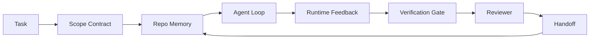

# Agent Workbench Engineering: Why Capable Models Still Fail

> Một mô hình có năng lực là chưa đủ. Các agent đáng tin cậy cần một workbench: chỉ dẫn, trạng thái, phạm vi, phản hồi, xác minh, đánh giá và bàn giao. Loại bỏ những thứ đó và ngay cả một mô hình tiên tiến nhất cũng tạo ra công việc không an toàn để phát hành.

**Type:** Learn + Build
**Languages:** Python (stdlib)
**Prerequisites:** Phase 14 · 01 (Agent Loop), Phase 14 · 26 (Failure Modes)
**Time:** ~45 minutes

## Learning Objectives

- Tách biệt năng lực mô hình với độ tin cậy thực thi.
- Nêu tên bảy bề mặt workbench quyết định liệu một agent có phát hành hay không.
- So sánh một lần chạy chỉ có prompt với một lần chạy được workbench hướng dẫn trên một tác vụ repo nhỏ.
- Tạo một báo cáo chế độ lỗi ánh xạ mỗi bề mặt bị thiếu đến triệu chứng mà nó gây ra.

## The Problem

Bạn thả một mô hình tiên tiến nhất vào một repo thực và yêu cầu nó thêm xác thực đầu vào. Nó mở bốn file, viết mã có vẻ hợp lý, tuyên bố thành công và dừng. Bạn chạy các kiểm thử. Hai kiểm thử thất bại. Một file thứ ba bị chạm đến không liên quan gì đến xác thực. Không có bản ghi về điều agent đã giả định, điều nó thử trước hoặc điều còn phải làm.

Mô hình không sai về Python. Nó sai về công việc. Nó không biết điều gì được tính là xong, nó được phép ghi ở đâu, những kiểm thử nào có thẩm quyền hoặc phiên tiếp theo phải tiếp nối như thế nào.

Đây không phải lỗi mô hình. Đó là lỗi workbench. Bề mặt quanh agent thiếu những phần biến một lần tạo đơn lẻ thành công việc kỹ thuật đáng tin cậy, có thể tiếp tục.

## The Concept

Một workbench là môi trường vận hành bao quanh mô hình trong một tác vụ. Nó có bảy bề mặt:

| Bề mặt | Nó mang gì | Lỗi khi thiếu |
|---------|-----------------|----------------------|
| Chỉ dẫn | Các quy tắc khởi động, hành động bị cấm, định nghĩa hoàn thành | Agent đoán phát hành có nghĩa gì |
| Trạng thái | Tác vụ hiện tại, các file đã chạm, trở ngại, hành động tiếp theo | Mỗi phiên khởi động lại từ số không |
| Phạm vi | Các file được phép, file bị cấm, tiêu chí nghiệm thu | Các chỉnh sửa rò sang mã không liên quan |
| Phản hồi | Đầu ra lệnh thực được ghi vào vòng lặp | Agent tuyên bố thành công trên một lỗi 400 |
| Xác minh | Kiểm thử, lint, chạy smoke, kiểm tra phạm vi | "Trông ổn" đi tới main |
| Đánh giá | Một lượt thứ hai với một vai trò khác | Bên xây dựng tự chấm bài của mình |
| Bàn giao | Điều gì thay đổi, vì sao, điều gì còn lại | Phiên tiếp theo khám phá lại mọi thứ |

Workbench độc lập với mô hình. Bạn có thể thay mô hình và giữ các bề mặt. Bạn không thể thay các bề mặt và giữ độ tin cậy.



Vòng lặp khép lại trên file trạng thái, không phải trên lịch sử trò chuyện. Trò chuyện dễ mất. Repo là hệ thống ghi nhận chính thức.

### Workbench versus prompt engineering

Prompting cho mô hình biết bạn muốn gì ở lượt này. Một workbench cho mô hình biết cách làm việc xuyên các lượt và xuyên các phiên. Hầu hết các câu chuyện thất bại agent là các lỗi workbench khoác áo kỹ thuật prompt.

### Workbench versus framework

Một framework cho bạn một runtime (LangGraph, AutoGen, Agents SDK). Một workbench cho agent một nơi làm việc bên trong runtime đó. Bạn cần cả hai. Chuỗi học nhỏ này nói về cái thứ hai.

### Reasoning from primitives, not from vendor taxonomies

Hiện có rất nhiều bài viết về "kỹ thuật harness." Addy Osmani, OpenAI, Anthropic, LangChain, Martin Fowler, MongoDB, HumanLayer, Augment Code, Thoughtworks, danh sách awesome của walkinglabs và một dòng đều đặn các bài Medium và Hacker News đều đang nói về nó. Họ bất đồng về ranh giới của một harness là gì, những gì nằm trong phạm vi và sử dụng từ vựng nào. Chúng ta không cần chọn phe. Bảy bề mặt là một lớp UX; bên dưới mọi workbench là cùng tập các thành phần nguyên thủy hệ thống phân tán nâng đỡ bất kỳ backend đáng tin cậy nào.

Tạm bỏ nhãn agent đi. Một lần chạy agent là tính toán vượt thời gian, các tiến trình và các máy. Để làm điều đó đáng tin cậy bạn cần cùng các thành phần nguyên thủy mà bất kỳ hệ thống sản xuất nào cũng cần.

| Thành phần nguyên thủy | Nó là gì | Nó mang gì cho một agent |
|-----------|------------|------------------------------|
| Hàm | Bộ xử lý có kiểu. Thuần khi có thể. Sở hữu các đầu vào và đầu ra của nó. | Một lời gọi công cụ, một kiểm tra quy tắc, một bước xác minh, một lần gọi mô hình |
| Worker | Tiến trình sống lâu sở hữu một hoặc nhiều hàm và một vòng đời | Bên xây dựng, bên đánh giá, bên xác minh, một máy chủ MCP |
| Kích hoạt | Nguồn sự kiện gọi một hàm | Nhịp vòng lặp agent, yêu cầu HTTP, thông điệp hàng đợi, cron, thay đổi file, hook |
| Runtime | Ranh giới quyết định thứ gì chạy ở đâu, với thời gian chờ và tài nguyên nào | Tiến trình của Claude Code, runtime của LangGraph, một container worker |
| HTTP / RPC | Đường truyền giữa bên gọi và worker | Giao thức lời gọi công cụ, yêu cầu MCP, API mô hình |
| Hàng đợi | Bộ đệm bền vững giữa kích hoạt và worker; áp lực ngược, thử lại, tính lũy đẳng | Bảng tác vụ, log phản hồi, hộp thư đến đánh giá |
| Lưu giữ phiên | Trạng thái sống sót qua các lần sập, khởi động lại, thay mô hình | `agent_state.json`, các checkpoint, các kho KV, chính repo |
| Chính sách cấp quyền | Ai có thể gọi hàm nào với phạm vi nào | Các file được phép/bị cấm, các ranh giới phê duyệt, các danh sách khả năng MCP |

Bây giờ ánh xạ bảy bề mặt workbench lên các thành phần nguyên thủy đó.

- **Chỉ dẫn** — chính sách + siêu dữ liệu hàm. Các quy tắc là các kiểm tra (các hàm). Bộ định tuyến (`AGENTS.md`) là chính sách được gắn vào khởi động của runtime.
- **Trạng thái** — lưu giữ phiên. Một kho có khóa mà runtime đọc ở mỗi bước. File, KV hoặc cơ sở dữ liệu; ngữ nghĩa lưu giữ quan trọng, backend lưu trữ thì không.
- **Phạm vi** — chính sách cấp quyền cho từng tác vụ. Các glob được phép/bị cấm là một ACL. Các phê duyệt được yêu cầu là một dàn quyền.
- **Phản hồi** — log gọi được ghi vào một hàng đợi. Mỗi lời gọi shell là một bản ghi, bền vững, có thể phát lại.
- **Xác minh** — một hàm. Mang tính xác định trên các đầu vào. Được kích hoạt khi đóng tác vụ. Thất bại theo hướng đóng.
- **Đánh giá** — một worker riêng với quyền chỉ đọc trên các sản phẩm của bên xây dựng và quyền chỉ ghi trên các báo cáo đánh giá.
- **Bàn giao** — một bản ghi bền vững được phát ra bởi một kích hoạt kết thúc phiên. Kích hoạt khởi động của phiên tiếp theo đọc nó.

Chính vòng lặp agent là một worker tiêu thụ các sự kiện (thông điệp người dùng, kết quả công cụ, nhịp hẹn giờ), gọi các hàm (mô hình, rồi các công cụ mà mô hình chọn), ghi các bản ghi (trạng thái, phản hồi) và phát ra các kích hoạt (xác minh, đánh giá, bàn giao). Không có bí ẩn; cùng hình dạng như một bộ xử lý job.

### Patterns in circulation, translated to primitives

Mọi mẫu harness phổ biến đều quy về tám thành phần nguyên thủy. Bảng chuyển đổi.

| Mẫu nhà cung cấp hoặc cộng đồng | Nó thực sự là gì |
|------------------------------|--------------------|
| Ralph Loop (Claude Code, Codex, sách agentic_harness) — đưa lại ý định gốc vào một cửa sổ ngữ cảnh mới khi agent cố dừng sớm | Một kích hoạt đưa lại một tác vụ vào hàng đợi với một ngữ cảnh sạch; lưu giữ phiên mang mục tiêu về phía trước |
| Lập kế hoạch / Thực thi / Xác minh (PEV) | Ba worker, một cho mỗi vai trò, giao tiếp qua trạng thái và một hàng đợi giữa các pha |
| Tách biệt harness-tính toán (OpenAI Agents SDK, tháng 4 năm 2026) — tách mặt phẳng điều khiển khỏi mặt phẳng thực thi | Phát biểu lại mặt phẳng điều khiển / mặt phẳng dữ liệu. Có trước nhãn agent hàng thập kỷ |
| Open Agent Passport (OAP, tháng 3 năm 2026) — ký và kiểm toán mọi lời gọi công cụ đối với một chính sách khai báo trước khi thực thi | Một chính sách cấp quyền được thực thi bởi một worker trước hành động, với một hàng đợi kiểm toán có chữ ký |
| Guides and Sensors (Birgitta Böckeler / Thoughtworks) — các quy tắc truyền tới + khả năng quan sát phản hồi | Chính sách cấp quyền + các hàm xác minh + các trace khả năng quan sát |
| Cô đọng dần, 5 giai đoạn (kỹ thuật đảo ngược Claude Code, tháng 4 năm 2026) | Một worker quản lý trạng thái chạy kiểu cron trên lưu giữ phiên để giữ nó trong một ngân sách |
| Các hook / middleware (LangChain, Claude Code) — chặn các lời gọi mô hình và công cụ | Các kích hoạt + các hàm bọc quanh đường gọi của runtime |
| Các skill dưới dạng Markdown với tiết lộ dần (Anthropic, Flue) | Một sổ đăng ký hàm nơi siêu dữ liệu hàm được tải vào ngữ cảnh đúng lúc |
| Các agent sandbox (Codex, Sandcastle, Vercel Sandbox) | Mặt phẳng tính toán: một runtime với hệ thống file, mạng và vòng đời cô lập |
| Các máy chủ MCP | Các worker cung cấp các hàm qua một RPC ổn định, với các danh sách khả năng làm cấp quyền |

Mỗi mục trong bảng đó là cộng đồng agent đi đến một thành phần nguyên thủy đã có tên trong các hệ thống phân tán và đặt cho nó một tên mới. Các nhãn hữu ích cho tiếp thị; không hữu ích làm từ vựng kỹ thuật.

### What the receipts actually say

Tuyên bố harness hơn mô hình hiện có các con số đằng sau nó. Đáng biết, vì chúng cũng là lập luận trung thực duy nhất chống lại "chỉ cần chờ một mô hình thông minh hơn."

- Terminal Bench 2.0 — cùng mô hình, thay đổi harness chuyển một agent lập trình từ ngoài top 30 lên hạng năm (LangChain, *Anatomy of an Agent Harness*).
- Vercel — xóa 80% công cụ của agent; tỷ lệ thành công nhảy từ 80% lên 100% (MongoDB).
- Harvey — các agent pháp lý tăng hơn gấp đôi độ chính xác chỉ qua tối ưu hóa harness (MongoDB).
- 88% dự án agent AI doanh nghiệp không đến được sản xuất. Các thất bại tập trung quanh runtime, không phải suy luận (preprints.org, *Harness Engineering for Language Agents*, tháng 3 năm 2026).
- Một nghiên cứu benchmark năm 2025 xuyên ba framework mã nguồn mở phổ biến báo cáo hoàn thành tác vụ ~50%; WebAgent ngữ cảnh dài sụp từ 40-50% xuống dưới 10% trong các điều kiện ngữ cảnh dài, chủ yếu từ các vòng lặp vô hạn và mất mục tiêu (được bao phủ rộng rãi trong các bài viết đầu năm 2026).

Điều rút ra không phải "harness thắng mãi mãi." Các mô hình quả có hấp thụ các thủ thuật harness theo thời gian. Điều rút ra là ngày nay, phần kỹ thuật trụ cột nằm quanh mô hình, không phải bên trong nó, và các thành phần nguyên thủy mang tải đó là những thứ mà mọi hệ thống sản xuất luôn cần.

### Where vendor writeups stop short

Đây là phần mà bạn không cần lịch sự.

- *Anatomy of an Agent Harness* của LangChain trình bày các thành phần harness cốt lõi: prompt, công cụ, hook, sandbox, điều phối, bộ nhớ, skill, subagent và một runtime "vòng lặp ngốc". Nó không nêu tên hàng đợi, worker như một đơn vị triển khai, ngữ nghĩa trigger, tính bền vững của phiên như một mối quan tâm riêng biệt, hay chính sách ủy quyền. Nó coi harness là một đối tượng bạn cấu hình, không phải một hệ thống bạn triển khai.
- *Agent Harness Engineering* của Addy Osmani đưa ra cách định khung `Agent = Model + Harness` và mẫu bánh cóc, nhưng dừng trước khi nói một harness được xây từ gì. Nó đọc như một lập trường, không phải một đặc tả.
- Anthropic và OpenAI đi sâu nhất vào các bề mặt nhưng vẫn ở trong các runtime riêng. Công bố "tách biệt harness-tính toán" trong Agents SDK tháng 4 năm 2026 là bài viết nhà cung cấp đầu tiên tán thành rõ ràng sự phân tách mặt phẳng điều khiển / mặt phẳng dữ liệu. Đó là một ý tưởng nguyên thủy, không phải một ý tưởng mới.
- Sách agentic_harness coi harness như một đối tượng cấu hình (*Agentic Engineering* của Jaymin West, chương 6) và câu mạnh nhất trong đó là "harness là ranh giới bảo mật chính trong một hệ thống agentic." Đó chỉ là chính sách cấp quyền, được phát biểu lại.
- Các luồng Hacker News liên tục đi đến cùng một nơi. Luồng tháng 4 năm 2026 *The agent harness belongs outside the sandbox* lập luận harness nên nằm "giống một hypervisor hơn, nằm ngoài mọi thứ và cấp quyền truy cập dựa trên ngữ cảnh và người dùng." Một lần nữa, đó là chính sách cấp quyền như một mặt phẳng riêng.

Bạn không cần bất đồng với bất kỳ bài viết nào trong số này để nhận thấy khoảng trống. Họ đang viết các mô tả UX của một hệ thống đã tồn tại. Chúng ta đang viết hệ thống. Khi hệ thống được xây đúng, bảy bề mặt phát sinh từ các thành phần nguyên thủy. Khi nó được xây sai, không lượng trau chuốt `AGENTS.md` nào khắc phục được hàng đợi bị thiếu.

Vì vậy khi bạn nghe "kỹ thuật harness" ở nơi khác, chuyển sang các thành phần nguyên thủy. Các prompt và quy tắc là chính sách và các hàm. Khung là runtime. Các chốt bảo vệ là cấp quyền + xác minh. Các hook là các kích hoạt. Bộ nhớ là lưu giữ phiên. Ralph Loop là đưa lại vào hàng đợi. Các agent phụ là các worker. Các sandbox là các mặt phẳng tính toán. Từ vựng thay đổi; kỹ thuật thì không. Workbench là UX đối diện agent; harness, theo nghĩa sống sót qua lần định khung lại tiếp theo của nhà cung cấp, là các hàm, worker, kích hoạt, runtime, hàng đợi, lưu giữ và chính sách được nối đúng với nhau.

```figure
wb-seven-surfaces
```

## Build It

`code/main.py` chạy một tác vụ repo nhỏ hai lần. Đầu tiên chỉ có prompt, rồi với bảy bề mặt được nối vào. Cùng mô hình, cùng tác vụ. Script đếm những bề mặt nào bị thiếu trên lần chạy thất bại và in một báo cáo chế độ lỗi.

Tác vụ repo nhỏ có chủ ý: thêm xác thực đầu vào vào một bộ xử lý kiểu FastAPI một file và viết một kiểm thử đạt.

Chạy nó:

```
python3 code/main.py
```

Đầu ra: một log đặt cạnh nhau của hai lần chạy, một `failure_modes.json` tóm tắt lần chạy chỉ có prompt và một phán quyết một dòng cho lần chạy workbench.

Agent là một stub dựa trên quy tắc nhỏ; mục đích là các bề mặt, không phải mô hình. Xuyên phần còn lại của chuỗi học nhỏ này bạn sẽ xây dựng lại mỗi bề mặt như một sản phẩm thực, tái sử dụng.

## Use It

Ba nơi các bề mặt workbench đã tồn tại trong thực tế, ngay cả khi không ai gọi chúng như vậy:

- **Claude Code, Codex, Cursor.** `AGENTS.md` và `CLAUDE.md` là bề mặt chỉ dẫn. Các lệnh slash là phạm vi. Các hook là xác minh.
- **LangGraph, OpenAI Agents SDK.** Các checkpoint và kho phiên là bề mặt trạng thái. Các bàn giao là bề mặt bàn giao.
- **CI trên một repo thực.** Kiểm thử, lint và kiểm tra kiểu là xác minh. Mẫu PR là bàn giao. CODEOWNERS là đánh giá.

Kỹ thuật workbench là lĩnh vực làm cho các bề mặt đó tường minh và tái sử dụng, thay vì để mỗi nhóm khám phá lại chúng.

## Ship It

`outputs/skill-workbench-audit.md` là một skill có tính di động kiểm toán một repo hiện có về bảy bề mặt workbench và báo cáo những bề mặt nào bị thiếu, những bề mặt nào một phần và những bề mặt nào tốt. Đặt nó cạnh bất kỳ thiết lập agent nào; nó cho bạn biết cần sửa gì trước.

## Exercises

1. Chọn một repo nơi bạn đã chạy một agent. Chấm điểm bảy bề mặt từ 0 (thiếu) đến 2 (tốt). Bề mặt yếu nhất của bạn là gì?
2. Mở rộng `main.py` để lần chạy chỉ có prompt cũng tạo ra một tuyên bố "thành công" giả. Xác minh cổng xác minh sẽ bắt được nó.
3. Thêm một bề mặt thứ tám cho sản phẩm riêng của bạn. Biện minh vì sao nó không quy về một trong bảy bề mặt hiện có.
4. Chạy lại script với một agent stub khác ảo giác một lần ghi file bổ sung. Bề mặt nào bắt nó trước?
5. Ánh xạ năm chế độ lỗi tái diễn trong ngành từ Giai đoạn 14 · 26 lên bảy bề mặt. Mỗi bề mặt được thiết kế để hấp thụ chế độ nào?

## Key Terms

| Thuật ngữ | Mọi người nói gì | Nó thực sự có nghĩa gì |
|------|----------------|------------------------|
| Workbench (Bàn làm việc) | "Thiết lập" | Các bề mặt được thiết kế quanh mô hình làm công việc đáng tin cậy |
| Surface (Bề mặt) | "Một tài liệu" hoặc "một script" | Một đầu vào có tên, máy đọc được mà agent đọc hoặc ghi mỗi lượt |
| System of record (Hệ thống ghi nhận chính thức) | "Các ghi chú" | File mà agent coi là sự thật khi lịch sử trò chuyện không còn |
| Definition of done (Định nghĩa hoàn thành) | "Nghiệm thu" | Một danh sách kiểm tra khách quan, dựa trên file mà agent không thể giả mạo |
| Workbench audit (Kiểm toán workbench) | "Kiểm tra sự sẵn sàng repo" | Một lượt qua bảy bề mặt gắn cờ các phần bị thiếu trước khi công việc bắt đầu |

## Further Reading

Đọc những bài này như các điểm dữ liệu, không phải như các thẩm quyền. Mỗi bài là một hệ phân loại một phần. Chuyển mọi khái niệm trở lại một thành phần nguyên thủy (hàm, worker, kích hoạt, runtime, HTTP/RPC, hàng đợi, lưu giữ, chính sách) trước khi quyết định có áp dụng nó không.

Các cách định khung nhà cung cấp:

- [Addy Osmani, Agent Harness Engineering](https://addyosmani.com/blog/agent-harness-engineering/) — `Agent = Model + Harness` và mẫu bánh cóc; ít về hạ tầng
- [LangChain, The Anatomy of an Agent Harness](https://blog.langchain.com/the-anatomy-of-an-agent-harness/) — các thành phần harness cốt lõi: prompt, công cụ, hook, điều phối, sandbox, bộ nhớ, skill, subagent, runtime; bỏ qua hàng đợi, triển khai, authz
- [OpenAI, Harness engineering: leveraging Codex in an agent-first world](https://openai.com/index/harness-engineering/) — góc nhìn của nhóm Codex về các bề mặt quanh runtime của họ
- [OpenAI, Unrolling the Codex agent loop](https://openai.com/index/unrolling-the-codex-agent-loop/) — vòng lặp agent được rút về một `while` trên các lời gọi hàm
- [Anthropic, Effective harnesses for long-running agents](https://www.anthropic.com/engineering/effective-harnesses-for-long-running-agents) — các bề mặt tầm dài bên trong một runtime cụ thể
- [Anthropic, Harness design for long-running application development](https://www.anthropic.com/engineering/harness-design-long-running-apps) — các ghi chú thiết kế áp dụng
- [LangChain Deep Agents harness capabilities](https://docs.langchain.com/oss/python/deepagents/harness) — bề mặt cấu hình runtime

Các bài viết của người thực hành với chi tiết dùng được:

- [Martin Fowler / Birgitta Böckeler, Harness engineering for coding agent users](https://martinfowler.com/articles/harness-engineering.html) — các hướng dẫn (truyền tới) + các cảm biến (phản hồi); cách định khung lý thuyết điều khiển rõ ràng nhất
- [HumanLayer, Skill Issue: Harness Engineering for Coding Agents](https://www.humanlayer.dev/blog/skill-issue-harness-engineering-for-coding-agents) — "đó không phải vấn đề mô hình, đó là vấn đề cấu hình"
- [MongoDB, The Agent Harness: Why the LLM Is the Smallest Part of Your Agent System](https://www.mongodb.com/company/blog/technical/agent-harness-why-llm-is-smallest-part-of-your-agent-system) — bằng chứng: Vercel 80% lên 100%, Harvey độ chính xác gấp 2 lần, Terminal Bench Top 30 lên Top 5
- [Augment Code, Harness Engineering for AI Coding Agents](https://www.augmentcode.com/guides/harness-engineering-ai-coding-agents) — hướng dẫn ưu tiên ràng buộc
- [Sequoia podcast, Harrison Chase on Context Engineering Long-Horizon Agents](https://sequoiacap.com/podcast/context-engineering-our-way-to-long-horizon-agents-langchains-harrison-chase/) — các mối quan tâm runtime trên các mối quan tâm mô hình

Sách, bài báo và các triển khai tham chiếu:

- [Jaymin West, Agentic Engineering — Chapter 6: Harnesses](https://www.jayminwest.com/agentic-engineering-book/6-harnesses) — trình bày dài cỡ sách, coi harness là ranh giới bảo mật chính
- [preprints.org, Harness Engineering for Language Agents (March 2026)](https://www.preprints.org/manuscript/202603.1756) — cách định khung học thuật như điều khiển / năng lực hành động / runtime
- [walkinglabs/awesome-harness-engineering](https://github.com/walkinglabs/awesome-harness-engineering) — danh sách đọc được tuyển chọn xuyên ngữ cảnh, đánh giá, khả năng quan sát, điều phối
- [ai-boost/awesome-harness-engineering](https://github.com/ai-boost/awesome-harness-engineering) — danh sách tuyển chọn thay thế (công cụ, đánh giá, bộ nhớ, MCP, quyền)
- [HKUDS/OpenHarness](https://github.com/HKUDS/OpenHarness) — harness agent mở với agent cá nhân tích hợp sẵn

Các luồng Hacker News đáng đọc vì các bất đồng, không phải sự đồng thuận:

- [HN: Effective harnesses for long-running agents](https://news.ycombinator.com/item?id=46081704)
- [HN: Improving 15 LLMs at Coding in One Afternoon. Only the Harness Changed](https://news.ycombinator.com/item?id=46988596)
- [HN: The agent harness belongs outside the sandbox](https://news.ycombinator.com/item?id=47990675) — lập luận cho cấp quyền như một mặt phẳng riêng

Các tham chiếu chéo bên trong chương trình học này:

- Giai đoạn 14 · 23 — Các quy ước OpenTelemetry GenAI: lớp khả năng quan sát mà tài liệu về cảm biến chỉ tới
- Giai đoạn 14 · 26 — Danh mục các chế độ lỗi mà bảy bề mặt được thiết kế để hấp thụ
- Giai đoạn 14 · 27 — Các biện pháp phòng vệ prompt injection nằm ở thành phần nguyên thủy chính sách cấp quyền
- Giai đoạn 14 · 29 — Các runtime sản xuất (hàng đợi, sự kiện, cron): nơi các thành phần nguyên thủy trong bài này tồn tại khi triển khai
