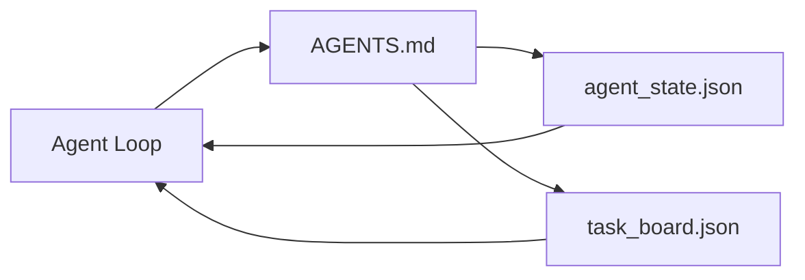

# The Minimal Agent Workbench

> Workbench hữu ích nhỏ nhất là ba file: một bộ định tuyến chỉ dẫn gốc, một file trạng thái và một bảng tác vụ. Mọi thứ khác được xếp lớp lên trên. Nếu một repo không thể mang ba file này, không mô hình nào sẽ cứu được nó.

**Type:** Build
**Languages:** Python (stdlib)
**Prerequisites:** Phase 14 · 31 (Why Capable Models Still Fail)
**Time:** ~45 minutes

## Learning Objectives

- Định nghĩa ba file tạo thành workbench khả dụng tối thiểu.
- Giải thích vì sao một bộ định tuyến gốc ngắn thắng một `AGENTS.md` nguyên khối dài.
- Xây một file trạng thái mà agent có thể đọc ở mỗi lượt và ghi ở cuối.
- Xây một bảng tác vụ sống sót qua công việc nhiều phiên mà không có lịch sử trò chuyện.

## The Problem

Hầu hết các nhóm tiếp cận một workbench bằng cách viết một `AGENTS.md` 3000 dòng và gọi là xong. Mô hình tải nó, bỏ qua các phần nó không thể tóm tắt và vẫn thất bại trên cùng các bề mặt mà nó luôn thất bại.

Bạn cần điều ngược lại. Một file gốc nhỏ định tuyến agent vào các file sâu hơn chỉ khi liên quan. Trạng thái bền vững mà agent đọc trước khi hành động và ghi sau đó. Một bảng tác vụ nói điều gì đang thực hiện, điều gì bị chặn và điều gì tiếp theo.

Ba file. Mỗi file với một công việc. Mỗi file đủ máy đọc được để tiến hóa thành một hệ thống thực sau này.

## The Concept



### AGENTS.md is a router, not a manual

Một `AGENTS.md` tốt thì ngắn. Nó chỉ agent đến:

- File trạng thái (bạn đang ở đâu).
- Bảng tác vụ (điều gì còn lại).
- Các quy tắc sâu hơn (dưới `docs/agent-rules.md`).
- Lệnh xác minh (cách biết nó hoạt động).

Bất cứ thứ gì dài hơn đi vào các tài liệu sâu hơn, chỉ được tải khi cần. Các sổ tay dài bị bỏ qua. Các bộ định tuyến ngắn được tuân theo.

### agent_state.json is the system of record

Trạng thái mang: id tác vụ hoạt động, các file đã chạm, các giả định đã đưa ra, các trở ngại và hành động tiếp theo. Agent đọc nó ở mỗi lượt. Phiên tiếp theo đọc nó thay vì phát lại trò chuyện.

Trạng thái nằm trong một file vì lịch sử trò chuyện không đáng tin cậy. Các phiên chết. Các hội thoại bị cắt bớt. File thì không.

### task_board.json is the queue

Bảng tác vụ mang mọi tác vụ với trạng thái `todo | in_progress | done | blocked`. Đó là hàng đợi mà agent lấy từ khi trạng thái rỗng, và hàng đợi bạn đọc khi bạn muốn biết liệu agent có đang đi đúng hướng không.

Một tác vụ trên bảng có một id, một mục tiêu, một bên chịu trách nhiệm (`builder`, `reviewer` hoặc `human`) và các tiêu chí nghiệm thu. Bảng nhỏ có chủ ý: khi nó tăng quá một màn hình, bạn có một vấn đề lập kế hoạch, không phải vấn đề bảng.

### Three files is the floor, not the ceiling

Các bài học sau thêm các hợp đồng phạm vi, trình chạy phản hồi, cổng xác minh, danh sách kiểm tra của bên đánh giá và gói bàn giao. Ba file ở đây là điều tất cả chúng giả định.

```figure
wb-three-files
```

## Build It

`code/main.py` ghi workbench tối thiểu vào một repo rỗng và minh họa một lượt agent duy nhất:

1. Đọc `agent_state.json`.
2. Lấy tác vụ tiếp theo từ `task_board.json` nếu trạng thái rỗng.
3. Chạm một file duy nhất bên trong phạm vi.
4. Ghi lại trạng thái đã cập nhật.

Chạy nó:

```
python3 code/main.py
```

Script tạo `workdir/` cạnh chính nó, đặt ba file, chạy một lượt và in diff. Chạy lại nó để xem lượt thứ hai tiếp nối nơi lượt đầu dừng lại như thế nào.

## Use It

Bên trong các sản phẩm agent sản xuất, cùng ba file xuất hiện dưới các tên khác nhau:

- **Claude Code:** `AGENTS.md` hoặc `CLAUDE.md` cho bộ định tuyến, các kho kiểu `.claude/state.json` cho trạng thái, các hook cho bảng.
- **Codex / Cursor:** các quy tắc workspace cho bộ định tuyến, bộ nhớ phiên cho trạng thái, các tác vụ được xếp hàng trong thanh bên trò chuyện cho bảng.
- **Agent Python tùy chỉnh:** cùng các file bạn vừa viết.

Các tên thay đổi. Hình dạng thì không.

## Production patterns in the wild

Workbench tối thiểu sống sót khi tiếp xúc các monorepo thực khi ba mẫu được xếp lớp lên nó. Chúng độc lập; chọn những mẫu repo của bạn thực sự cần.

**`AGENTS.md` lồng nhau với thứ tự ưu tiên gần nhất thắng.** OpenAI cung cấp 88 file `AGENTS.md` xuyên repo chính của họ, một cho mỗi thành phần con. Codex, Cursor, Claude Code và Copilot đều đi từ file đang làm việc về phía gốc repo và nối mọi `AGENTS.md` chúng tìm thấy trên đường. Các file thư mục con mở rộng file gốc. Codex thêm `AGENTS.override.md` để thay thế thay vì mở rộng; cơ chế override dành riêng cho Codex và tránh nó cho công việc xuyên công cụ. Phép đo của Augment Code là câu quan trọng: các file `AGENTS.md` tốt nhất cho một bước nhảy chất lượng tương đương nâng cấp từ Haiku lên Opus; những file tệ nhất làm đầu ra tệ hơn hoàn toàn không có file.

**Các phản mẫu cần từ chối, ngay cả khi chúng trông như độ bao phủ.** Các chỉ dẫn xung đột âm thầm thả agent từ chế độ tương tác sang chế độ tham lam (ICLR 2026 AMBIG-SWE: tỷ lệ giải quyết 48.8% → 28%); đánh số các ưu tiên thay vì xếp phẳng chúng. Các quy tắc phong cách không thể xác minh ("tuân theo Google Python Style Guide") không có lệnh thực thi cho phép agent bịa sự tuân thủ; ghép mỗi quy tắc phong cách với lệnh lint chính xác. Dẫn đầu bằng phong cách thay vì các lệnh chôn vùi đường xác minh; các lệnh trước, phong cách cuối. Viết cho con người thay vì agent lãng phí ngân sách ngữ cảnh; tính ngắn gọn là một tính năng.

**Các symlink xuyên công cụ.** Một file gốc duy nhất với các symlink (`ln -s AGENTS.md CLAUDE.md`, `ln -s AGENTS.md .github/copilot-instructions.md`, `ln -s AGENTS.md .cursorrules`) giữ mọi agent lập trình trên cùng nguồn sự thật. `nx ai-setup` của Nx tự động hóa điều này xuyên Claude Code, Cursor, Copilot, Gemini, Codex và OpenCode từ một cấu hình duy nhất.

## Ship It

`outputs/skill-minimal-workbench.md` tạo workbench ba file cho bất kỳ repo mới nào: một bộ định tuyến `AGENTS.md` được điều chỉnh cho dự án, một `agent_state.json` với các khóa đúng và một `task_board.json` được khởi tạo bằng backlog hiện tại.

## Exercises

1. Thêm một dấu thời gian `last_run` vào `agent_state.json`. Từ chối chạy nếu file cũ hơn 24 giờ trừ khi một người vận hành xác nhận.
2. Thêm một trường `priority` vào bảng tác vụ và thay đổi bộ lấy để luôn chọn `todo` ưu tiên cao nhất.
3. Chuyển `task_board.json` sang JSON Lines để mỗi tác vụ là một dòng và các diff rõ ràng trong quản lý phiên bản.
4. Viết một `lint_workbench.py` thất bại nếu `AGENTS.md` vượt 80 dòng hoặc tham chiếu một file không tồn tại.
5. Quyết định mất file nào trong ba file sẽ gây hại nhất. Bảo vệ lựa chọn đó.

## Key Terms

| Thuật ngữ | Mọi người nói gì | Nó thực sự có nghĩa gì |
|------|----------------|------------------------|
| Router (Bộ định tuyến) | `AGENTS.md` | File gốc ngắn chỉ agent đến các tài liệu và file sâu hơn |
| State file (File trạng thái) | "Các ghi chú" | Bản ghi máy đọc được về nơi agent đang ở, được ghi mỗi lượt |
| Task board (Bảng tác vụ) | "Backlog" | Hàng đợi công việc JSON với trạng thái, bên chịu trách nhiệm, nghiệm thu |
| System of record (Hệ thống ghi nhận chính thức) | "Nguồn sự thật" | File mà workbench coi là có thẩm quyền khi trò chuyện không còn |

## Further Reading

- [agents.md — the open spec](https://agents.md/) — được áp dụng bởi Cursor, Codex, Claude Code, Copilot, Gemini, OpenCode
- [Augment Code, A good AGENTS.md is a model upgrade. A bad one is worse than no docs at all](https://www.augmentcode.com/blog/how-to-write-good-agents-dot-md-files) — các bước nhảy chất lượng được đo
- [Blake Crosley, AGENTS.md Patterns: What Actually Changes Agent Behavior](https://blakecrosley.com/blog/agents-md-patterns) — điều gì hoạt động theo thực nghiệm, điều gì không
- [Datadog Frontend, Steering AI Agents in Monorepos with AGENTS.md](https://dev.to/datadog-frontend-dev/steering-ai-agents-in-monorepos-with-agentsmd-13g0) — thứ tự ưu tiên lồng nhau trong thực tế
- [Nx Blog, Teach Your AI Agent How to Work in a Monorepo](https://nx.dev/blog/nx-ai-agent-skills) — tạo từ một nguồn xuyên sáu công cụ
- [The Prompt Shelf, AGENTS.md Best Practices: Structure, Scope, and Real Examples](https://thepromptshelf.dev/blog/agents-md-best-practices/) — thứ tự phần sống sót qua đánh giá
- [Anthropic, Claude Code subagents](https://code.claude.com/docs/en/sub-agents)
- Giai đoạn 14 · 31 — các chế độ lỗi mà mức tối thiểu này hấp thụ
- Giai đoạn 14 · 34 — schema trạng thái bền vững mà bài này xem trước
