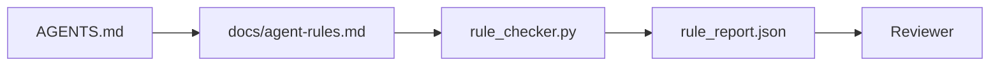

# Agent Instructions as Executable Constraints

> Các chỉ dẫn được viết như văn xuôi là những mong muốn. Các chỉ dẫn được viết như các ràng buộc là các kiểm thử. Workbench biến mỗi quy tắc thành thứ mà một agent có thể kiểm tra khi chạy và một bên đánh giá có thể xác minh sau đó.

**Type:** Build
**Languages:** Python (stdlib)
**Prerequisites:** Phase 14 · 32 (Minimal Workbench)
**Time:** ~50 minutes

## Learning Objectives

- Tách biệt văn xuôi định tuyến khỏi các quy tắc vận hành.
- Biểu đạt các quy tắc khởi động, hành động bị cấm, định nghĩa hoàn thành, xử lý bất định và các ranh giới phê duyệt thành các ràng buộc có thể kiểm tra bằng máy.
- Triển khai một bộ kiểm tra quy tắc chấm điểm một lần chạy đối với tập quy tắc.
- Làm tập quy tắc thân thiện với diff để đánh giá có thể nhìn thấy điều gì thay đổi.

## The Problem

Một `AGENTS.md` điển hình đọc như tài liệu nhập môn. Nó bảo agent "cẩn thận" và "kiểm thử kỹ" và "hỏi nếu không chắc." Ba ngày sau, agent phát hành một thay đổi không có kiểm thử, ghi vào một thư mục bị cấm và không bao giờ hỏi vì nó chưa bao giờ biết ranh giới ở đâu.

Các chỉ dẫn mạnh khi chúng mang tính vận hành và yếu khi chúng mang tính nguyện vọng. Cách khắc phục là viết các quy tắc mà workbench có thể diễn giải và bên đánh giá có thể chấm điểm.

## The Concept

Các quy tắc thuộc về `docs/agent-rules.md`, cách xa bộ định tuyến gốc ngắn. Mỗi quy tắc có một tên, một hạng mục và một kiểm tra.



### Five categories that cover most rules

| Hạng mục | Câu hỏi mà quy tắc trả lời | Ví dụ |
|----------|---------------------------|---------|
| Khởi động | Điều gì phải đúng trước khi công việc bắt đầu? | "file trạng thái tồn tại và còn mới" |
| Bị cấm | Điều gì không bao giờ được xảy ra? | "không chỉnh sửa `scripts/release.sh`" |
| Định nghĩa hoàn thành | Điều gì chứng minh tác vụ đã hoàn tất? | "pytest thoát 0 và dòng nghiệm thu đạt" |
| Bất định | Agent làm gì khi không chắc? | "mở một ghi chú câu hỏi thay vì đoán" |
| Phê duyệt | Điều gì yêu cầu phê duyệt của con người? | "bất kỳ phụ thuộc mới nào, bất kỳ lần ghi sản xuất nào" |

Một quy tắc không phù hợp một trong năm hạng mục này thường muốn là hai quy tắc. Buộc phân tách.

### Rules are machine-readable

Mỗi quy tắc có một slug, một hạng mục, một mô tả một dòng và một trường `check` nêu tên một hàm trong `rule_checker.py`. Thêm một quy tắc có nghĩa là thêm một kiểm tra; bộ kiểm tra phát triển cùng workbench.

### Rules are diff-friendly

Các quy tắc nằm mỗi quy tắc dưới một tiêu đề trong một file markdown duy nhất. Các lần đổi tên nhìn thấy được trong diff. Các quy tắc mới nằm ở đầu hạng mục của chúng. Các quy tắc cũ bị xóa, không bị chú thích hóa, vì workbench là nguồn sự thật, không phải log trò chuyện về cảm nhận của nhóm quý trước.

### Rules versus framework guardrails

Các chốt bảo vệ framework (các chốt bảo vệ OpenAI Agents SDK, các ngắt LangGraph) thực thi các quy tắc ở cấp runtime. Tập quy tắc trong bài này là hợp đồng cho con người đọc, có thể đánh giá mà các chốt bảo vệ đó triển khai. Bạn cần cả hai: runtime bắt các vi phạm trong một lượt, tập quy tắc chứng minh runtime đang làm đúng việc.

### Progressive disclosure: a map, not an encyclopedia

Lý do `AGENTS.md` tiếp tục tăng là mỗi sự cố thêm một quy tắc và không sự cố nào loại bỏ một quy tắc. Sau một năm, file dài hai nghìn dòng, và agent đọc màn hình đầu tiên, cạn ngân sách chú ý và hành động trên một phần nhỏ những gì nó được bảo. Một file chỉ dẫn khổng lồ thất bại vì cùng lý do mà một tài liệu nhập môn bốn mươi trang thất bại: người đọc lướt nó một lần và không bao giờ quay lại phần quan trọng.

Cách khắc phục không phải một file ngắn hơn. Đó là một file có lớp. Bộ định tuyến gốc vẫn đủ nhỏ để đọc mỗi phiên và không giữ gì ngoài các con trỏ. Độ sâu nằm trong các file chủ đề mà agent chỉ tải khi tác vụ chạm đến chúng. Cho agent một bản đồ, không phải toàn bộ bách khoa toàn thư, và để nó đi đến trang nó cần.

```
AGENTS.md                  # router, < 50 lines: what this repo is, where to look, the 5 hard rules
docs/
  agent-rules.md           # the full rule set (this lesson)
  architecture.md          # loaded when the task touches module boundaries
  testing.md               # loaded when the task writes or runs tests
  deploy.md                # loaded only for release work, gated behind an approval rule
feature_list.json          # the backlog (Phase 14 · 36)
```

| Tầng | Nằm trong | Đọc khi | Ngân sách kích thước |
|------|----------|-----------|-------------|
| Bộ định tuyến | `AGENTS.md` | Mỗi phiên, luôn luôn | Dưới ~50 dòng |
| Các quy tắc | `docs/agent-rules.md` | Mỗi phiên, khi khởi động | Một màn hình cho mỗi hạng mục |
| Các tài liệu chủ đề | `docs/<topic>.md` | Chỉ khi tác vụ chạm đến chủ đề đó | Sâu theo nhu cầu |

Hai kiểm thử giữ việc phân lớp trung thực. Kiểm thử khả năng tiếp cận: một agent nên tiếp cận bất kỳ quy tắc nào trong tối đa hai chặng từ bộ định tuyến, nên bộ định tuyến phải liên kết mọi tài liệu chủ đề bằng đường dẫn, không mô tả nó bằng văn xuôi. Kiểm thử độ mới: bộ định tuyến đủ ngắn để một bên đánh giá đọc lại nó trên mỗi PR, là thứ duy nhất ngăn nó âm thầm tăng trở lại thành bách khoa toàn thư mà nó đã thay thế. Một con trỏ không còn phân giải được là một lỗi tệ hơn một quy tắc bị thiếu, nên một liên kết hỏng trong bộ định tuyến tự nó là một vi phạm kiểm tra khởi động.

```figure
wb-rule-checkoff
```

## Build It

`code/main.py` cung cấp:

- Bộ phân tích `agent-rules.md` tải các quy tắc vào một dataclass.
- Các hàm kiểm tra kiểu `rule_checker.py`, một cho mỗi tham chiếu `check`.
- Một lần chạy agent demo vi phạm hai quy tắc và một lượt kiểm tra bắt được chúng.

Chạy nó:

```
python3 code/main.py
```

Đầu ra: tập quy tắc đã phân tích, trace lần chạy, đạt/không đạt cho từng quy tắc và một `rule_report.json` được lưu cạnh script.

## Production patterns in the wild

Ba mẫu phân biệt một tập quy tắc tồn tại một quý với một tập suy tàn trong một tuần.

**Gắn thẻ mức độ nghiêm trọng tại thời điểm ghi.** Mỗi quy tắc mang `severity`: `block`, `warn` hoặc `info`. Bộ kiểm tra báo cáo cả ba; runtime chỉ từ chối trên `block`. Hầu hết các nhóm nói quá mức độ nghiêm trọng ban đầu rồi âm thầm làm yếu nó dưới áp lực hạn chót; gắn thẻ tại thời điểm ghi buộc hiệu chỉnh từ đầu. Kết hợp với cổng xác minh (Giai đoạn 14 · 38), ký bất kỳ override nào của một quy tắc `block` vào một log kiểm toán `overrides.jsonl`.

**Hết hạn quy tắc như một yếu tố thúc đẩy.** Mỗi quy tắc mang một ngày `expires_at` (mặc định 90 ngày từ khi soạn). Bộ kiểm tra phát ra một cảnh báo khi một quy tắc chưa hết hạn không có vi phạm nào trong 60 ngày liên tiếp; đánh giá hàng quý tiếp theo hoặc biện minh việc giữ nó, làm yếu nó thành `info` hoặc xóa nó. Dữ liệu AI Code Review sản xuất của Cloudflare (tháng 4 năm 2026, 131,246 lần đánh giá xuyên 5,169 repo trong 30 ngày) cho thấy các tập quy tắc có hết hạn tường minh giữ dưới 30 quy tắc cho mỗi repo; các tập không có tăng lên 80+ với hầu hết không bao giờ kích hoạt.

**Markdown làm nguồn, JSON làm bộ nhớ đệm.** `agent-rules.md` là file được soạn; `agent-rules.lock.json` là một bộ nhớ đệm mà bộ kiểm tra đọc trong đường xử lý chính. File lock được tạo lại bởi một hook trước commit. Các diff Markdown có thể đánh giá; phân tích JSON nằm ngoài mỗi lượt. Cùng hình dạng như `package.json` / `package-lock.json` và `Cargo.toml` / `Cargo.lock`.

## Use It

Trong sản xuất:

- Claude Code, Codex, Cursor đọc các quy tắc lúc bắt đầu phiên và trích dẫn chúng khi từ chối các hành động. Bộ kiểm tra chạy lại chúng trong CI để bắt trôi dạt âm thầm.
- Các chốt bảo vệ OpenAI Agents SDK đăng ký cùng các kiểm tra làm chốt bảo vệ đầu vào và đầu ra. Markdown là bề mặt tài liệu; SDK là bề mặt runtime.
- Các ngắt LangGraph kích hoạt khi một nút đang chạy vi phạm một quy tắc. Bộ xử lý ngắt đọc quy tắc, hỏi con người và tiếp tục.

Tập quy tắc có tính di động xuyên cả ba vì nó chỉ là markdown cộng các tên hàm.

## Ship It

`outputs/skill-rule-set-builder.md` phỏng vấn một chủ dự án, phân loại các chỉ dẫn văn xuôi hiện có của họ vào năm hạng mục và phát ra một `agent-rules.md` có phiên bản cộng một stub bộ kiểm tra.

## Exercises

1. Thêm một hạng mục thứ sáu nếu sản phẩm của bạn thực sự cần nó. Bảo vệ vì sao nó không quy về một trong năm hạng mục.
2. Mở rộng bộ kiểm tra để một quy tắc có thể mang một mức độ nghiêm trọng (`block`, `warn`, `info`) và báo cáo tổng hợp tương ứng.
3. Nối bộ kiểm tra vào CI: làm bản dựng thất bại nếu một quy tắc mức độ block thất bại trên lần chạy agent mới nhất.
4. Thêm một trường "hết hạn" cho mỗi quy tắc. Sau 90 ngày không có một lần kiểm tra thất bại, quy tắc được đưa ra đánh giá.
5. Tìm một `AGENTS.md` thực và viết lại nó thành các quy tắc năm hạng mục. Bao nhiêu dòng của nó mang tính vận hành? Bao nhiêu mang tính nguyện vọng?

## Key Terms

| Thuật ngữ | Mọi người nói gì | Nó thực sự có nghĩa gì |
|------|----------------|------------------------|
| Operational rule (Quy tắc vận hành) | "Một chỉ dẫn thực" | Một quy tắc mà workbench có thể kiểm tra khi chạy |
| Aspirational rule (Quy tắc nguyện vọng) | "Cẩn thận" | Một quy tắc không có kiểm tra; hoặc xóa hoặc nâng cấp |
| Definition of done (Định nghĩa hoàn thành) | "Nghiệm thu" | Một bằng chứng khách quan, dựa trên file rằng tác vụ đã hoàn tất |
| Block severity (Mức độ chặn) | "Quy tắc cứng" | Vi phạm dừng lần chạy; không thể bị làm im mà không có một người vận hành |
| Rule expiry (Hết hạn quy tắc) | "Quét quy tắc cũ" | Một quy tắc không có thất bại trong N ngày được đưa ra để loại bỏ |

## Further Reading

- [OpenAI Agents SDK guardrails](https://openai.github.io/openai-agents-python/guardrails/)
- [LangGraph interrupts](https://langchain-ai.github.io/langgraph/how-tos/human_in_the_loop/breakpoints/)
- [Anthropic, Building Effective Agents](https://www.anthropic.com/research/building-effective-agents)
- [Rick Hightower, Agent RuleZ: A Deterministic Policy Engine](https://medium.com/@richardhightower/agent-rulez-a-deterministic-policy-engine-for-ai-coding-agents-9489e0561edf) — mức độ block/warn/info trong sản xuất
- [Cloudflare, Orchestrating AI Code Review at Scale](https://blog.cloudflare.com/ai-code-review/) — 131k lần đánh giá, các bài học kết hợp quy tắc
- [microservices.io, GenAI development platform — part 1: guardrails](https://microservices.io/post/architecture/2026/03/09/genai-development-platform-part-1-development-guardrails.html) — phòng thủ nhiều lớp giữa các quy tắc và CI
- [Type-Checked Compliance: Deterministic Guardrails (arXiv 2604.01483)](https://arxiv.org/pdf/2604.01483) — Lean 4 như cận trên của quy tắc như kiểm tra
- [logi-cmd/agent-guardrails](https://github.com/logi-cmd/agent-guardrails) — triển khai cổng hợp nhất: phạm vi, kiểm thử đột biến, các ngân sách vi phạm
- Giai đoạn 14 · 32 — workbench tối thiểu mà tập quy tắc này được đưa vào
- Giai đoạn 14 · 38 — cổng xác minh tiêu thụ báo cáo quy tắc
- Giai đoạn 14 · 39 — agent đánh giá chấm điểm tuân thủ quy tắc
