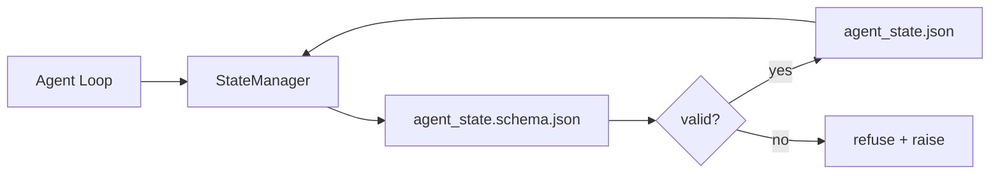

# Repo Memory and Durable State

> Lịch sử trò chuyện dễ mất. Repo bền vững. Workbench lưu trạng thái agent trong các file có phiên bản để phiên tiếp theo, agent tiếp theo và bên đánh giá tiếp theo đều đọc từ cùng nguồn sự thật.

**Type:** Build
**Languages:** Python (stdlib + `jsonschema` optional)
**Prerequisites:** Phase 14 · 32 (Minimal Workbench)
**Time:** ~60 minutes

## Learning Objectives

- Định nghĩa điều gì thuộc về bộ nhớ repo và điều gì thuộc về lịch sử trò chuyện.
- Soạn các JSON Schema cho `agent_state.json` và `task_board.json`.
- Xây một bộ quản lý trạng thái tải, xác thực, thay đổi và lưu giữ trạng thái một cách nguyên tử.
- Sử dụng schema để từ chối các lần ghi xấu trước khi chúng làm hỏng workbench.

## The Problem

Agent kết thúc một phiên. Trò chuyện đóng. Phiên tiếp theo mở và hỏi bắt đầu ở đâu. Mô hình nói "để tôi kiểm tra các file," đọc các ghi chú cũ và làm lại công việc đã hoàn tất. Hoặc tệ hơn, nó viết lại một file đã hoàn thành vì không ai bảo nó file đã hoàn thành.

Cách khắc phục của workbench là bộ nhớ repo: trạng thái nằm trong các file JSON trong repo, được ghi theo một schema, được lưu giữ nguyên tử, thân thiện với diff trong đánh giá mã. Trò chuyện là một luồng tạm thời; repo là hệ thống ghi nhận chính thức.

## The Concept



### What belongs in repo memory

| Thuộc về | Không thuộc về |
|---------|-----------------|
| Id tác vụ hoạt động | Các bản ghi trò chuyện thô |
| Các file đã chạm trong phiên này | Các trace suy luận cấp token |
| Các giả định agent đã đưa ra | "Người dùng có vẻ bực bội" |
| Các trở ngại đang mở | Các kết quả hoàn thành được lấy mẫu |
| Hành động tiếp theo | Các id mô hình dành riêng cho nhà cung cấp |

Phép thử là tính bền vững: điều này có hữu ích sau ba tháng trong một lần chạy lại CI không? Nếu có, repo. Nếu không, telemetry.

### Schema-first state

JSON Schema là hợp đồng. Không có nó, mỗi agent bịa các trường mới, mỗi bên đánh giá học một hình dạng mới và mỗi script CI phải xử lý đặc biệt các phiên bản quá khứ. Có nó, một lần ghi xấu là một lần ghi bị từ chối.

Schema bao phủ:

- Các khóa bắt buộc.
- Các giá trị `status` được phép.
- Các giá trị bị cấm (ví dụ `null` cho các mảng).
- Các ràng buộc mẫu (các id tác vụ khớp `T-\d{3,}`).
- Trường phiên bản cho các lần di chuyển.

### Atomic writes

Các lần ghi trạng thái cần sống sót qua các lỗi một phần: ghi vào một file tạm, fsync, đổi tên đè lên đích. File trạng thái là nguồn sự thật; một file ghi dở tệ hơn hoàn toàn không có file.

### Migrations

Khi schema thay đổi, cung cấp một script di chuyển cạnh lần tăng schema. File trạng thái mang một trường `schema_version`; bộ quản lý từ chối tải một file từ một phiên bản mà nó không thể di chuyển.

```figure
wb-state-persist
```

## Build It

`code/main.py` triển khai:

- `agent_state.schema.json` và `task_board.schema.json`.
- Một bộ xác thực chỉ dùng thư viện chuẩn (tập con JSON Schema: required, type, enum, pattern, items).
- `StateManager.load`, `StateManager.update`, `StateManager.commit` với các lần ghi tạm-và-đổi tên nguyên tử.
- Một demo thay đổi trạng thái, lưu giữ, tải lại và chứng minh vòng đi-về.

Chạy nó:

```
python3 code/main.py
```

Script ghi `workdir/agent_state.json` và `workdir/task_board.json`, thay đổi chúng qua hai lượt và in trạng thái đã xác thực ở mỗi bước.

## Production patterns in the wild

Bốn mẫu biến mức tối thiểu của bài học thành thứ mà một monorepo nhiều agent có thể sống sót với nó.

**Tạm-và-đổi tên nguyên tử không phải tùy chọn.** Một báo cáo lỗi dự án Hive tháng 3 năm 2026 tài liệu hóa chế độ lỗi rõ ràng: `state.json` được ghi qua `write_text()` và các ngoại lệ bị bắt rồi làm im. Các lần ghi một phần khiến các phiên tiếp tục trên trạng thái hỏng mà không có tín hiệu. Cách khắc phục luôn là: `tempfile.mkstemp` trong cùng thư mục với đích, ghi, `fsync`, `os.replace` (đổi tên nguyên tử trên POSIX và Windows). `atomic_write` của bài này làm chính xác điều đó.

**Các khóa lũy đẳng trên mọi lời gọi công cụ không lũy đẳng.** Nếu một agent sập sau khi gọi một công cụ nhưng trước khi tạo checkpoint kết quả, phục hồi thử lại lời gọi công cụ. An toàn cho đọc; nguy hiểm cho email, các lần chèn cơ sở dữ liệu, tải file lên. Mẫu: ghi log mọi ID lời gọi công cụ trước thực thi vào một `pending_calls.jsonl`. Khi thử lại, kiểm tra ID; nếu hiện diện, bỏ qua lời gọi và sử dụng kết quả được lưu đệm. Anthropic và LangChain đều nêu điều này trong hướng dẫn năm 2026; bộ tạo checkpoint của LangGraph lưu giữ các lần ghi đang chờ vì cùng lý do.

**Tách các sản phẩm lớn khỏi trạng thái.** Đừng lưu các CSV, bản ghi dài hoặc file được tạo trong `agent_state.json`. Lưu sản phẩm thành một file riêng (hoặc tải lên lưu trữ đối tượng) và chỉ giữ đường dẫn trong trạng thái. Các checkpoint vẫn nhỏ và nhanh; các sản phẩm tăng độc lập.

**Event sourcing cho kiểm toán, các ảnh chụp cho tiếp tục.** Thêm vào một log sự kiện (`state.events.jsonl`) trên mọi thay đổi; định kỳ chụp vào `state.json`. Tiếp tục đọc ảnh chụp, rồi phát lại bất kỳ sự kiện nào sau dấu thời gian của ảnh chụp. Điều này tốn nhiều đĩa hơn nhưng cho phép bạn phát lại các quyết định agent nguyên văn — thiết yếu khi gỡ lỗi các lần chạy tầm dài. Cùng hình dạng mà Postgres sử dụng nội bộ cho WAL.

**Các lần di chuyển schema hoặc từ chối tải.** Số nguyên `schema_version` là hợp đồng. Khi bộ quản lý tải một file ở một phiên bản không xác định, nó từ chối đọc. Cung cấp một script di chuyển cạnh lần tăng schema; `tools/migrate_state.py` chạy lũy đẳng trên mỗi lần khởi động.

## Use It

Trong sản xuất:

- **Các bộ tạo checkpoint LangGraph.** Cùng ý tưởng, lưu trữ khác. Bộ tạo checkpoint lưu giữ trạng thái đồ thị vào SQLite, Postgres hoặc một backend tùy chỉnh. Schema mà bài này dạy là thứ bạn chọn khi bộ tạo checkpoint chết và bạn cần đọc trạng thái bằng tay.
- **Các khối bộ nhớ Letta.** Các khối lưu giữ với các schema có cấu trúc (Giai đoạn 14 · 08). Cùng kỷ luật được giới hạn phạm vi vào các nhân cách chạy lâu.
- **Kho phiên OpenAI Agents SDK.** Các backend có thể cắm, nhận biết schema. File trạng thái trong bài này là backend file cục bộ.

## Ship It

`outputs/skill-state-schema.md` tạo một cặp JSON Schema dành riêng cho dự án (trạng thái + bảng), một `StateManager` Python được nối với các lần ghi nguyên tử và một khung di chuyển để lần tăng schema tiếp theo không phá vỡ workbench.

## Exercises

1. Thêm một dấu thời gian `last_human_touch`. Từ chối bất kỳ lần ghi agent nào trong vòng năm giây sau một chỉnh sửa của con người.
2. Mở rộng bộ xác thực để hỗ trợ `oneOf` để một tác vụ có thể là một tác vụ xây dựng hoặc một tác vụ đánh giá với các trường bắt buộc khác nhau.
3. Thêm một trường `schema_version` và viết di chuyển từ v1 sang v2 (đổi tên `blockers` thành `risks`).
4. Chuyển backend lưu trữ từ một file cục bộ sang SQLite. Giữ API `StateManager` giống hệt.
5. Chạy hai agent đối với cùng file trạng thái với một cuộc đua ghi 50 ms. Điều gì sai và đổi tên nguyên tử cứu bạn như thế nào?

## Key Terms

| Thuật ngữ | Mọi người nói gì | Nó thực sự có nghĩa gì |
|------|----------------|------------------------|
| Repo memory (Bộ nhớ repo) | "File ghi chú" | Trạng thái được lưu trong các file được theo dõi trong repo, theo schema |
| Schema-first (Schema trước) | "Xác thực các đầu vào" | Định nghĩa hợp đồng trước bên ghi, từ chối trôi dạt |
| Atomic write (Ghi nguyên tử) | "Chỉ đổi tên" | Ghi vào tạm, fsync, đổi tên, để các lỗi một phần không thể làm hỏng |
| Migration (Di chuyển) | "Tăng schema" | Một script biến trạng thái vN thành trạng thái v(N+1) |
| System of record (Hệ thống ghi nhận chính thức) | "Nguồn sự thật" | Sản phẩm mà workbench coi là có thẩm quyền |

## Further Reading

- [JSON Schema specification](https://json-schema.org/specification.html)
- [LangGraph checkpointers](https://langchain-ai.github.io/langgraph/concepts/persistence/)
- [Letta memory blocks](https://docs.letta.com/v1-sdk/memory/memory-blocks)
- [Fast.io, AI Agent State Checkpointing: A Practical Guide](https://fast.io/resources/ai-agent-state-checkpointing/) — tạo checkpoint theo schema trước với tính lũy đẳng
- [Fast.io, AI Agent Workflow State Persistence: Best Practices 2026](https://fast.io/resources/ai-agent-workflow-state-persistence/) — kiểm soát đồng thời, TTL, event sourcing
- [Hive Issue #6263 — non-atomic state.json writes silently ignored](https://github.com/aden-hive/hive/issues/6263) — chế độ lỗi trong một dự án thực
- [eunomia, Checkpoint/Restore Systems: Evolution, Techniques, Applications](https://eunomia.dev/blog/2025/05/11/checkpointrestore-systems-evolution-techniques-and-applications-in-ai-agents/) — các thành phần nguyên thủy CR từ lịch sử hệ điều hành được áp dụng cho agent
- [Indium, 7 State Persistence Strategies for Long-Running AI Agents in 2026](https://www.indium.tech/blog/7-state-persistence-strategies-ai-agents-2026/)
- [Microsoft Agent Framework, Compaction](https://learn.microsoft.com/en-us/agent-framework/agents/conversations/compaction) — bộ quản lý checkpoint của nhà cung cấp
- Giai đoạn 14 · 08 — các khối bộ nhớ và tính toán lúc ngủ
- Giai đoạn 14 · 32 — mức tối thiểu ba file mà bài này định schema
- Giai đoạn 14 · 40 — các gói bàn giao đọc từ cùng schema
