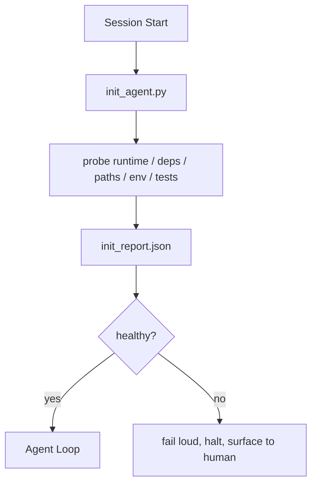

# Initialization Scripts for Agents

> Mỗi phiên khởi động nguội trả một khoản chi phí. Agent đọc cùng các file, thử lại cùng các thăm dò và khám phá lại cùng các đường dẫn. Một script khởi tạo trả khoản chi phí một lần và ghi các câu trả lời vào trạng thái.

**Type:** Build
**Languages:** Python (stdlib)
**Prerequisites:** Phase 14 · 32 (Minimal Workbench), Phase 14 · 34 (Repo Memory)
**Time:** ~45 minutes

## Learning Objectives

- Nhận diện công việc mà một agent không bao giờ nên phải làm lại cho mỗi phiên.
- Xây một script khởi tạo mang tính xác định thăm dò runtime, các phụ thuộc và tình trạng repo.
- Lưu giữ kết quả thăm dò để agent đọc nó thay vì chạy lại các kiểm tra.
- Báo lỗi rõ ràng, nhanh và với một nơi duy nhất để xem khi khởi tạo thất bại.

## The Problem

Mở một phiên. Agent đoán phiên bản Python. Đoán lệnh kiểm thử. Liệt kê gốc repo năm lần để tìm điểm vào. Cố import một gói không được cài. Hỏi người dùng file cấu hình nằm ở đâu. Đến lúc nó thực hiện một chỉnh sửa thực, mười nghìn token đã đi vào công việc thiết lập lẽ ra nên là một script duy nhất.

Cách khắc phục là một script khởi tạo chạy trước khi agent làm bất cứ thứ gì khác và ghi một `init_report.json` mà agent đọc khi khởi động.

## The Concept



### What the init script probes

| Thăm dò | Vì sao nó quan trọng |
|-------|----------------|
| Các phiên bản runtime | Phiên bản Python hoặc Node sai có nghĩa là các lỗi sai phiên bản âm thầm |
| Sự khả dụng của phụ thuộc | Một gói bị thiếu sau này tốn gấp mười lần chi phí bắt nó bây giờ |
| Lệnh kiểm thử | Agent phải biết cách xác minh; nếu lệnh bị thiếu thì workbench hỏng |
| Các đường dẫn repo | Các đường dẫn mã hóa cứng trôi dạt; phân giải chúng một lần và ghim |
| Các biến môi trường | Thiếu `OPENAI_API_KEY` là một bề mặt lỗi, không phải một bí ẩn runtime |
| Độ mới trạng thái + bảng | Trạng thái cũ từ một phiên bị sập là một cách tự gây hại |
| Commit tốt cuối cùng đã biết | Mỏ neo cho diff bàn giao ở cuối phiên |

### Fail loud, fail fast, fail in one place

Một thăm dò thất bại có nghĩa là dừng và hiển thị cho con người. Không "agent sẽ tự tìm ra." Toàn bộ mục đích của khởi tạo là từ chối bắt đầu khi workbench hỏng.

### Idempotent

Chạy nó hai lần liên tiếp. Lần chạy thứ hai nên không làm gì ngoại trừ một dấu thời gian mới. Tính lũy đẳng là thứ cho phép bạn nối script vào CI, các hook hoặc một lệnh slash trước tác vụ.

### Init versus startup rules

Các quy tắc (Giai đoạn 14 · 33) mô tả điều gì phải đúng để hành động. Khởi tạo là script thiết lập rằng các quy tắc đó có thể được kiểm tra. Các quy tắc không có khởi tạo trở thành "cẩn thận." Khởi tạo không có quy tắc trở thành một thất bại được trau chuốt.

```figure
wb-init-probes
```

## Build It

`code/main.py` triển khai `init_agent.py`:

- Năm thăm dò: phiên bản Python, các phụ thuộc được liệt kê qua `importlib.util.find_spec`, khả năng phân giải lệnh kiểm thử, các biến môi trường bắt buộc, độ mới file trạng thái.
- Mỗi thăm dò trả về `(name, status, detail)`.
- Script ghi `init_report.json` với toàn bộ tập thăm dò và thoát khác không nếu bất kỳ thăm dò mức độ block nào thất bại.

Chạy nó:

```
python3 code/main.py
```

Script in bảng các thăm dò, ghi `init_report.json` và thoát với mã không trên luồng thành công hoặc khác không với một danh sách các thăm dò thất bại.

## Production patterns in the wild

Ba mẫu phân biệt một script khởi tạo hữu ích với một nghi lễ.

**Neo commit tốt cuối cùng đã biết.** Thăm dò commit hiện tại đối với một file `LKG` được ghi ở lần hợp nhất thành công cuối cùng. Nếu diff vượt một ngân sách (mặc định 50 file), từ chối bắt đầu và yêu cầu một con người phê chuẩn đường cơ sở mới. Đây là điều AI Code Review của Cloudflare sử dụng để giới hạn phạm vi các agent đánh giá: mỗi phiên đánh giá neo vào cùng trạng thái tốt cuối cùng đã biết và không bao giờ dồn trôi dạt xuyên các phiên.

**Các file khóa với TTL.** Ghi một `prereqs.lock` sau lượt thăm dò thành công đầu tiên. Các lần chạy sau tin khóa trong N giờ (mặc định 24 giờ) và bỏ qua các thăm dò tốn kém. Script khởi tạo đọc khóa trước; nếu nó còn mới và hash bảng kê phụ thuộc khớp, nó dừng sớm. Đây là cùng mẫu mà Docker sử dụng cho các bộ nhớ đệm lớp: thăm dò lũy đẳng + hash nội dung = bỏ qua.

**Không mạng, không LLM, không bất ngờ trong đường xử lý chính.** Các thăm dò khởi tạo là phần kết nối mang tính xác định. Một thăm dò gọi một LLM để phân loại một lỗi hoặc chạm một dịch vụ bên ngoài để kiểm tra một giấy phép không phải một thăm dò; đó là một workflow. Nếu một thăm dò mất hơn ba giây trong một lần chạy thử, coi đó là một dấu hiệu bất ổn workbench và hoặc chuyển nó ra khỏi khởi tạo hoặc lưu đệm kết quả của nó.

## Use It

Trong sản xuất:

- **Các hook Claude Code.** Hook `pre-task` gọi script khởi tạo và từ chối khởi chạy agent nếu nó thất bại.
- **GitHub Actions.** Một job `setup-agent` chạy script khởi tạo; job agent phụ thuộc nó.
- **Điểm vào Docker.** Container agent chạy script khởi tạo trước khi exec runtime agent; các log được hiển thị khi thất bại.

Script khởi tạo có tính di động vì nó không gọi một framework cụ thể nào. Bash, Make hoặc một file tác vụ đều có thể bọc nó.

## Ship It

`outputs/skill-init-script.md` phỏng vấn dự án, phân loại công việc thiết lập của nó thành các thăm dò và phát ra một `init_agent.py` dành riêng cho dự án cộng một workflow CI chạy nó trước bất kỳ bước agent nào.

## Exercises

1. Thêm một thăm dò diff commit hiện tại với commit tốt cuối cùng đã biết và từ chối bắt đầu nếu hơn 50 file thay đổi.
2. Nối script để ghi một file `prereqs.lock` và từ chối bắt đầu nếu khóa cũ hơn bảy ngày.
3. Thêm một cờ `--fix` tự cài các phụ thuộc phát triển bị thiếu nhưng không bao giờ sửa các phụ thuộc runtime mà không có phê duyệt.
4. Chuyển các thăm dò từ các hàm mã hóa cứng sang một sổ đăng ký YAML. Bảo vệ đánh đổi.
5. Thêm một ngân sách thời gian cho mỗi thăm dò. Một thăm dò chạy lâu hơn ba giây là một dấu hiệu bất ổn workbench.

## Key Terms

| Thuật ngữ | Mọi người nói gì | Nó thực sự có nghĩa gì |
|------|----------------|------------------------|
| Probe (Thăm dò) | "Một kiểm tra" | Một hàm mang tính xác định trả về `(name, status, detail)` |
| Init report (Báo cáo khởi tạo) | "Đầu ra thiết lập" | JSON được ghi cạnh trạng thái với các kết quả thăm dò |
| Idempotent (Lũy đẳng) | "An toàn để chạy lại" | Hai lần chạy liên tiếp tạo các báo cáo giống hệt ngoại trừ dấu thời gian |
| Fail loud (Báo lỗi rõ ràng) | "Đừng nuốt" | Dừng và hiển thị cho con người; không có phương án dự phòng âm thầm |
| Setup tax (Chi phí thiết lập) | "Chi phí khởi động" | Các token mà agent tiêu mỗi phiên để khám phá lại điều hiển nhiên |

## Further Reading

- [Anthropic, Effective harnesses for long-running agents](https://www.anthropic.com/engineering/effective-harnesses-for-long-running-agents)
- [GitHub Actions, composite actions for setup](https://docs.github.com/en/actions/sharing-automations/creating-actions/creating-a-composite-action)
- [microservices.io, GenAI dev platform: guardrails](https://microservices.io/post/architecture/2026/03/09/genai-development-platform-part-1-development-guardrails.html) — trước commit + các kiểm tra CI như khởi tạo
- [Augment Code, How to Build Your AGENTS.md (2026)](https://www.augmentcode.com/guides/how-to-build-agents-md) — các kỳ vọng khởi tạo
- [Codex Blog, Codex CLI Context Compaction](https://codex.danielvaughan.com/2026/03/31/codex-cli-context-compaction-architecture/) — bắt đầu phiên như khởi tạo nhận biết cô đọng
- Giai đoạn 14 · 33 — tập quy tắc mà script này cho phép
- Giai đoạn 14 · 34 — file trạng thái mà script này khởi tạo
- Giai đoạn 14 · 38 — cổng xác minh mà script khởi tạo cung cấp đầu vào
- Giai đoạn 14 · 40 — bàn giao tiêu thụ trạng thái tốt cuối cùng đã biết của báo cáo khởi tạo
