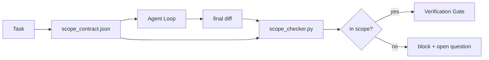

# Scope Contracts and Task Boundaries

> Mô hình không biết công việc kết thúc ở đâu. Một hợp đồng phạm vi là một file cho từng tác vụ nói công việc bắt đầu ở đâu, kết thúc ở đâu và cách khôi phục nếu nó tràn ra. Hợp đồng biến "ở trong phạm vi" từ một mong muốn thành một kiểm tra.

**Type:** Build
**Languages:** Python (stdlib)
**Prerequisites:** Phase 14 · 32 (Minimal Workbench), Phase 14 · 33 (Rules as Constraints)
**Time:** ~50 minutes

## Learning Objectives

- Viết một hợp đồng phạm vi mà một agent đọc lúc bắt đầu tác vụ và một bộ xác minh đọc lúc kết thúc tác vụ.
- Chỉ rõ các file được phép, các file bị cấm, tiêu chí nghiệm thu, kế hoạch khôi phục và các ranh giới phê duyệt.
- Triển khai một bộ kiểm tra phạm vi so sánh một diff với hợp đồng và gắn cờ các vi phạm.
- Làm cho mở rộng phạm vi trở nên nhìn thấy được, tự động và có thể đánh giá.

## The Problem

Các agent mở rộng dần. Tác vụ là "sửa lỗi đăng nhập." Diff chạm tuyến đăng nhập, hàm trợ giúp email, trình điều khiển cơ sở dữ liệu, README và script phát hành. Mỗi lần chạm đều có một lý do có vẻ hợp lý tại thời điểm đó. Cùng nhau chúng là một thay đổi khác với thay đổi đã được đánh giá.

Mở rộng phạm vi là chế độ lỗi bị giám sát thiếu nhất trong công việc agent vì agent thuật lại mỗi bước với thiện chí. Cách khắc phục không phải một prompt nghiêm ngặt hơn. Cách khắc phục là một hợp đồng trên đĩa nói điều gì đã được hứa và một kiểm tra so sánh kết quả với lời hứa.

## The Concept



### What goes in a scope contract

| Trường | Mục đích |
|-------|---------|
| `task_id` | Liên kết đến tác vụ trên bảng |
| `goal` | Một câu mà bên đánh giá có thể xác minh |
| `allowed_files` | Các glob mà agent có thể ghi |
| `forbidden_files` | Các glob mà agent không được chạm ngay cả vô tình |
| `acceptance_criteria` | Các lệnh kiểm thử hoặc dòng khẳng định chứng minh hoàn thành |
| `rollback_plan` | Một đoạn mà người vận hành có thể thực hiện nếu cần dừng |
| `approvals_required` | Các hành động ngoài phạm vi cần con người ký duyệt rõ ràng |

Một hợp đồng không có `forbidden_files` là không hoàn chỉnh. Không gian âm là một nửa hợp đồng.

### Globs, not raw paths

Các repo thực di chuyển file. Ghim các hợp đồng vào các glob (`app/**/*.py`, `tests/test_signup*.py`) để một lần tái cấu trúc giữa các phiên không làm mất hiệu lực hợp đồng.

### Rollback is part of scope

Liệt kê cách khôi phục buộc người soạn hợp đồng suy nghĩ về điều gì có thể sai. Một hợp đồng mà bạn không thể khôi phục từ đó là một hợp đồng không nên được phê duyệt.

### Scope check is a diff check

Agent viết một diff. Bộ kiểm tra đọc diff, các glob được phép, các glob bị cấm và một danh sách bất kỳ lệnh nghiệm thu nào đã chạy. Mỗi vi phạm là một phát hiện có thẻ mà cổng xác minh có thể từ chối.

### Two altitudes of scope: the feature list and the task contract

Hợp đồng phạm vi giới hạn một tác vụ. Nó không giới hạn dự án. Một agent có thể ở hoàn hảo bên trong một hợp đồng sửa đăng nhập và vẫn, ở lượt tiếp theo, quyết định dự án cũng cần một trang thiết lập, một nút chuyển chế độ tối và viết lại bộ định tuyến. Hợp đồng chưa bao giờ được hỏi công việc nào nằm trong phạm vi dự án, chỉ những file nào nằm trong phạm vi tác vụ.

Độ cao thứ hai đó cần thành phần nguyên thủy riêng: một `feature_list.json` mà agent đọc lúc bắt đầu phiên. Đó là backlog dự án dưới dạng một file có thứ tự, máy đọc được. Agent chọn chính xác một tính năng có `status` là `todo`, ghi `id` của nó vào hợp đồng phạm vi hoạt động và bị cấm bắt đầu một tính năng thứ hai trong cùng phiên. "Mỗi lần một tính năng" ngừng là một dòng trong prompt mà agent có thể hợp lý hóa để vượt qua và trở thành một giá trị nó đọc từ đĩa và một kiểm tra mà cổng thực thi.

```json
{
  "project": "knowledge-base",
  "active": "import-pdf",
  "features": [
    { "id": "import-pdf",   "status": "in_progress", "goal": "import a PDF into the library",        "done_when": "pytest tests/test_import.py && a sample PDF appears in the library view" },
    { "id": "full-text-search", "status": "todo",     "goal": "search document text and rank hits",   "done_when": "query returns ranked results with snippets" },
    { "id": "cite-answers", "status": "todo",         "goal": "answers carry source citations",        "done_when": "every answer renders at least one clickable citation" }
  ]
}
```

| Trường | Mục đích |
|-------|---------|
| `active` | Tính năng duy nhất mà phiên hiện tại có thể chạm; rỗng nghĩa là chọn một và đặt nó |
| `features[].id` | Slug ổn định mà `task_id` của hợp đồng phạm vi chỉ tới |
| `features[].status` | `todo`, `in_progress`, `done`, `blocked`; chỉ một `in_progress` tại một thời điểm |
| `features[].goal` | Một câu mà bên đánh giá có thể xác minh |
| `features[].done_when` | Dòng nghiệm thu đảo `in_progress` thành `done` |

Hai quy tắc làm danh sách thành trụ cột thay vì trang trí. Thứ nhất, bất biến "tối đa một `in_progress`" tự nó là một kiểm tra khởi động (Giai đoạn 14 · 33): nếu danh sách cho thấy hai, phiên từ chối bắt đầu cho đến khi một con người giải quyết. Thứ hai, danh sách tính năng là một file, không phải một thông điệp trò chuyện, vì trò chuyện cuộn ra khỏi ngữ cảnh và file lưu giữ xuyên các phiên và xuyên các agent. Bàn giao (Giai đoạn 14 · 40) ghi trạng thái tính năng đã hoàn thành trở lại `done` để phiên tiếp theo mở ra một bảng chính xác thay vì suy ra lại điều gì còn lại.

Hợp đồng và danh sách kết hợp theo đặc quyền tối thiểu, cùng phép hợp nhất được mô tả bên dưới: `allowed_files` của hợp đồng tác vụ phải nằm trong bất cứ thứ gì tính năng hoạt động chạm đến, không bao giờ ở ngoài nó.

```figure
wb-scope-bounce
```

## Build It

`code/main.py` triển khai:

- Schema `scope_contract.json` (tập con JSON Schema, các mảng glob).
- Một bộ phân tích diff biến một danh sách các file đã chạm cộng một danh sách các lệnh đã chạy thành một `RunSummary`.
- Một `scope_check` trả về `(violations, in_scope, off_scope)` đối với hợp đồng.
- Hai lần chạy demo: một lần ở trong phạm vi, một lần mở rộng dần. Bộ kiểm tra gắn cờ sự mở rộng với file và lý do chính xác.

Chạy nó:

```
python3 code/main.py
```

Đầu ra: hợp đồng, hai lần chạy, các phán quyết cho từng lần chạy và một `scope_report.json` được lưu.

## Production patterns in the wild

Một người thực hành chạy "specsmaxxing" (các hợp đồng phạm vi bằng YAML trước khi gọi agent) báo cáo tỷ lệ sa vào ngõ ngách giảm từ 52% xuống 21% trong ba tuần mà không thay đổi agent. Hợp đồng đã làm công việc, không phải mô hình. Ba mẫu làm mức tăng bền vững.

**Các ngân sách vi phạm, không phải các thất bại nhị phân.** `agent-guardrails` (cổng hợp nhất OSS được Claude Code, Cursor, Windsurf, Codex sử dụng qua MCP) cung cấp một `violationBudget` cho mỗi tác vụ: các lần lệch phạm vi nhỏ trong ngân sách được hiển thị như cảnh báo; chỉ khi ngân sách bị vượt cổng hợp nhất mới từ chối. Kết hợp với `violationSeverity: "error" | "warning"`. Ngân sách là khác biệt giữa một cổng phát hành được và một cổng bị nhóm ghét nó vô hiệu hóa.

**Bất đối xứng mức độ nghiêm trọng theo họ đường dẫn.** Các lần ghi ngoài phạm vi vào `docs/**` thường là `warn`; các lần ghi ngoài phạm vi vào `scripts/**`, `migrations/**`, `config/prod/**` luôn là `block`. Sự bất đối xứng này phải nằm trong hợp đồng, không phải trong runtime, vì nó dành riêng cho dự án và thay đổi theo tác vụ.

**Các ngân sách thời gian và mạng cạnh các ngân sách file.** Một trường `time_budget_minutes` giới hạn thời gian đồng hồ; runtime từ chối tiếp tục vượt nó mà không phê duyệt lại. Một danh sách cho phép `network_egress` trên các tên host ngăn agent âm thầm chạm một API bên ngoài không phải một phần tác vụ. Đây cũng là các chiều phạm vi; các glob file là cần thiết, chưa đủ.

**Ngữ nghĩa hợp nhất nhiều hợp đồng (đặc quyền tối thiểu).** Khi hai hợp đồng phạm vi áp dụng (ví dụ một hợp đồng toàn dự án cộng một hợp đồng dành riêng cho tác vụ), phép hợp nhất là: **giao** `allowed_files` (cả hai hợp đồng phải cho phép đường dẫn), **hợp** `forbidden_files` (một trong hai có thể cấm), `time_budget_minutes` là hạn chế nhất (min), `approvals_required` tích lũy. `network_egress` là `None` cho không thực thi, `[]` cho từ chối tất cả, `[...]` như một danh sách cho phép; khi hợp nhất, `None` nhường cho phía kia, hai danh sách lấy giao và từ chối tất cả vẫn từ chối tất cả. Nêu điều này trong schema hợp đồng để phép hợp nhất mang tính cơ học và có thể đánh giá.

## Use It

Các mẫu sản xuất:

- **Các lệnh slash Claude Code.** Một lệnh `/scope` ghi hợp đồng và ghim nó làm ngữ cảnh phiên. Các agent phụ đọc hợp đồng trước khi hành động.
- **Các PR GitHub.** Đẩy hợp đồng dưới dạng một file JSON trong body PR hoặc như một sản phẩm được đưa vào quản lý phiên bản. CI chạy bộ kiểm tra phạm vi đối với diff hợp nhất.
- **Các ngắt LangGraph.** Một vi phạm phạm vi kích hoạt một ngắt; bộ xử lý hỏi con người liệu hợp đồng cần mở rộng hay agent cần lùi lại.

Hợp đồng đi cùng tác vụ. Khi tác vụ đóng, hợp đồng được lưu trữ dưới `outputs/scope/closed/`.

## Ship It

`outputs/skill-scope-contract.md` tạo một hợp đồng phạm vi cho một mô tả tác vụ và một bộ kiểm tra nhận biết glob chạy trong CI trên mỗi diff agent.

## Exercises

1. Thêm một trường `network_egress` liệt kê các host bên ngoài được phép. Từ chối các lần chạy chạm các host khác.
2. Mở rộng bộ kiểm tra để thất bại mềm trên `docs/**` và cứng trên `scripts/**`. Biện minh sự bất đối xứng.
3. Làm hợp đồng suy ra `allowed_files` từ một trường `goal` bằng một tập quy tắc tĩnh (không LLM). Điều gì sai ở trường hợp biên đầu tiên?
4. Thêm một `time_budget_minutes` và từ chối tiếp tục khi thời gian đồng hồ vượt nó.
5. Chạy hai hợp đồng đối với cùng diff. Ngữ nghĩa hợp nhất đúng là gì khi cả hai áp dụng?

## Key Terms

| Thuật ngữ | Mọi người nói gì | Nó thực sự có nghĩa gì |
|------|----------------|------------------------|
| Scope contract (Hợp đồng phạm vi) | "Bản mô tả tác vụ" | JSON cho từng tác vụ liệt kê các file được phép/bị cấm, nghiệm thu, khôi phục |
| Scope creep (Mở rộng phạm vi) | "Nó cũng chạm..." | Các file ngoài hợp đồng thay đổi trong cùng tác vụ |
| Rollback plan (Kế hoạch khôi phục) | "Chúng ta có thể hoàn tác" | Sổ tay vận hành một đoạn cho việc dừng |
| Approval boundary (Ranh giới phê duyệt) | "Cần ký duyệt" | Một hành động được liệt kê trong hợp đồng là yêu cầu phê duyệt rõ ràng của con người |
| Diff check (Kiểm tra diff) | "Kiểm toán đường dẫn" | So sánh các file đã chạm với các glob hợp đồng |

## Further Reading

- [LangGraph human-in-the-loop interrupts](https://langchain-ai.github.io/langgraph/concepts/human_in_the_loop/)
- [OpenAI Agents SDK tool approval policies](https://platform.openai.com/docs/guides/agents-sdk)
- [logi-cmd/agent-guardrails — merge gates and scope validation](https://github.com/logi-cmd/agent-guardrails) — các ngân sách vi phạm, các tầng mức độ nghiêm trọng
- [Dev|Journal, Preventing AI Agent Configuration Drift with Agent Contract Testing](https://earezki.com/ai-news/2026-05-05-i-built-a-tiny-ci-tool-to-keep-ai-agent-configs-from-drifting-in-my-repo/) — chế độ `--strict` không có các phụ thuộc bên ngoài
- [Agentic Coding Is Not a Trap (production logs)](https://dev.to/jtorchia/agentic-coding-is-not-a-trap-i-answered-the-viral-hn-post-with-my-own-production-logs-33d9) — các bằng chứng specsmaxxing: 52% → 21%
- [OpenCode permission globs](https://opencode.ai/docs/agents/) — phạm vi chi tiết cho từng quyền
- [Knostic, AI Coding Agent Security: Threat Models and Protection Strategies](https://www.knostic.ai/blog/ai-coding-agent-security) — phạm vi như một phần đặc quyền tối thiểu
- [Augment Code, AI Spec Template](https://www.augmentcode.com/guides/ai-spec-template) — hệ thống ranh giới ba tầng (phải/hỏi/không bao giờ)
- Giai đoạn 14 · 27 — các biện pháp phòng vệ prompt injection kết hợp với các khóa phạm vi
- Giai đoạn 14 · 33 — tập quy tắc mà hợp đồng này chuyên biệt hóa cho từng tác vụ
- Giai đoạn 14 · 38 — cổng xác minh mà bộ kiểm tra báo cáo vào
