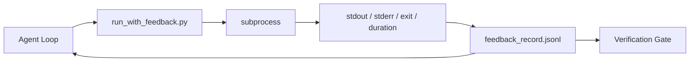

# Runtime Feedback Loops

> Các agent không nhìn thấy đầu ra lệnh thực thì đoán. Một trình chạy phản hồi ghi stdout, stderr, mã thoát và thời gian vào một bản ghi có cấu trúc mà lượt tiếp theo có thể đọc. Khi đó agent phản ứng với các sự thật thay vì với dự đoán của chính nó về các sự thật.

**Type:** Build
**Languages:** Python (stdlib)
**Prerequisites:** Phase 14 · 32 (Minimal Workbench), Phase 14 · 35 (Init Script)
**Time:** ~50 minutes

## Learning Objectives

- Phân biệt phản hồi runtime với telemetry khả năng quan sát.
- Xây một trình chạy phản hồi bọc các lệnh shell và lưu giữ các bản ghi có cấu trúc.
- Cắt ngắn các đầu ra lớn một cách xác định để vòng lặp vẫn trong ngân sách token.
- Từ chối tiến vòng lặp khi thiếu phản hồi.

## The Problem

Agent nói "đang chạy các kiểm thử." Thông điệp tiếp theo nói "mọi kiểm thử đều đạt." Thực tế là không kiểm thử nào chạy. Agent tưởng tượng đầu ra, hoặc nó chạy lệnh và không bao giờ đọc kết quả, hoặc nó đọc kết quả và âm thầm cắt ngắn dòng thất bại.

Một trình chạy phản hồi loại bỏ khoảng trống đó. Mỗi lệnh đi qua trình chạy. Mỗi bản ghi mang lệnh, stdout và stderr được ghi lại, mã thoát, thời lượng theo đồng hồ và một ghi chú agent một dòng. Agent đọc bản ghi ở lượt tiếp theo. Cổng xác minh đọc các bản ghi ở cuối tác vụ.

## The Concept



### What goes in a feedback record

| Trường | Vì sao nó quan trọng |
|-------|----------------|
| `command` | Argv chính xác, không bất ngờ mở rộng shell |
| `stdout_tail` | N dòng cuối, cắt ngắn mang tính xác định |
| `stderr_tail` | N dòng cuối, tách khỏi stdout |
| `exit_code` | Tín hiệu thành công không mơ hồ |
| `duration_ms` | Phơi bày các thăm dò chậm và tiến trình chạy mất kiểm soát |
| `started_at` | Dấu thời gian để phát lại |
| `agent_note` | Một dòng agent viết về điều nó mong đợi |

### Truncation is deterministic

Một log 50 MB phá hủy vòng lặp. Trình chạy cắt ngắn đầu và đuôi với một dấu hiệu `...truncated N lines...`, mang tính xác định để cùng đầu ra luôn tạo cùng bản ghi. Không lấy mẫu; các phần mà agent cần nhìn thấy (lỗi cuối, tóm tắt cuối) nằm ở đuôi.

### Feedback versus telemetry

Telemetry (Giai đoạn 14 · 23, các quy ước OTel GenAI) dành cho người vận hành đánh giá các lần chạy theo thời gian. Phản hồi dành cho lượt tiếp theo của lần chạy này. Chúng chia sẻ các trường nhưng nằm trong các file khác nhau với lưu giữ khác nhau.

### Refuse to advance without feedback

Nếu trình chạy lỗi trước khi ghi mã thoát, bản ghi mang `exit_code: null` và `error: <reason>`. Vòng lặp agent phải từ chối tuyên bố thành công trên một mã thoát `null`. Không mã thoát, không tiến triển.

```figure
wb-feedback-loop
```

## Build It

`code/main.py` triển khai:

- `run_with_feedback(command, agent_note)` bọc `subprocess.run`, ghi stdout/stderr/mã thoát/thời lượng, cắt ngắn mang tính xác định, thêm vào `feedback_record.jsonl`.
- Một bộ tải nhỏ truyền JSONL vào một danh sách Python.
- Một demo chạy ba lệnh (thành công, thất bại, chậm) và in bản ghi cuối cho mỗi lệnh.

Chạy nó:

```
python3 code/main.py
```

Đầu ra: ba bản ghi phản hồi được thêm vào `feedback_record.jsonl`, bản cuối của mỗi lệnh được in nội tuyến. Theo dõi phần đuôi file xuyên các lần chạy lại để thấy vòng lặp tích lũy.

## Production patterns in the wild

Ba mẫu củng cố trình chạy đủ để phát hành.

**Che dữ liệu khi ghi, không phải khi đọc.** Bất kỳ bản ghi nào chạm stdout hoặc stderr cũng có thể làm rò bí mật. Trình chạy cung cấp một lượt che dữ liệu trước khi thêm JSONL: loại bỏ các dòng khớp `^Bearer `, `password=`, `api[_-]?key=`, `AKIA[0-9A-Z]{16}` (AWS), `xox[baprs]-` (Slack). Che dữ liệu tại thời điểm đọc là một cách tự gây hại; file trên đĩa là thứ kẻ tấn công tiếp cận. Kiểm toán các mẫu che dữ liệu hàng quý đối với các định dạng bí mật được quan sát của runtime sản xuất.

**Chính sách xoay vòng, không phải một file duy nhất.** Giới hạn `feedback_record.jsonl` ở 1 MB cho mỗi file; khi tràn xoay sang `.1`, `.2`, bỏ `.5`. Vòng lặp của agent chỉ đọc file hiện tại, nên chi phí runtime có giới hạn. Lưu trữ sản phẩm CI nhận toàn bộ tập xoay vòng. Không có xoay vòng file trở thành nút thắt trên mỗi lời gọi bộ tải.

**Id lệnh cha cho các chuỗi thử lại.** Mỗi bản ghi nhận `command_id`; các lần thử lại mang `parent_command_id` chỉ đến lần thử trước. Danh sách "các lần thử thất bại" của bên đánh giá (Giai đoạn 14 · 40) và kiểm toán của cổng xác minh đều đi theo chuỗi. Không có liên kết này, các lần thử lại trông như các thành công độc lập và kiểm toán che giấu lịch sử thất bại.

## Use It

Các mẫu sản xuất:

- **Công cụ Bash Claude Code.** Công cụ đã ghi stdout, stderr, mã thoát và thời lượng. Trình chạy trong bài này là tương đương không phụ thuộc framework cho bất kỳ sản phẩm agent nào.
- **Các nút LangGraph.** Bọc bất kỳ nút shell nào trong trình chạy để bản ghi lưu giữ bên ngoài trạng thái đồ thị.
- **Các log CI.** Dẫn JSONL vào kho sản phẩm CI của bạn; các bên đánh giá có thể phát lại bất kỳ lệnh nào mà không chạy lại phiên.

Trình chạy là một lớp bọc mỏng sống sót qua mọi lần di chuyển framework vì nó sở hữu hình dạng bản ghi.

## Ship It

`outputs/skill-feedback-runner.md` tạo một `run_with_feedback.py` dành riêng cho dự án với ngân sách cắt ngắn đúng, một bộ ghi JSONL được nối với workbench và một bộ tải mà agent đọc ở mỗi lượt.

## Exercises

1. Thêm một trường `cwd` cho mỗi bản ghi để cùng lệnh chạy từ các thư mục khác nhau có thể phân biệt.
2. Thêm một bước `redaction` loại bỏ các dòng khớp `^Bearer ` hoặc `password=`. Kiểm thử trên một bản ghi mẫu.
3. Giới hạn tổng kích thước `feedback_record.jsonl` ở 1 MB bằng cách xoay sang các file `.1`, `.2`. Bảo vệ chính sách xoay vòng.
4. Thêm một `parent_command_id` để các chuỗi thử lại nhìn thấy được: lệnh nào tạo đầu vào mà lệnh tiếp theo tiêu thụ.
5. Chuyển JSONL qua pipe vào một TUI nhỏ làm nổi bật mã thoát khác không gần nhất. Liệt kê tám tính năng chính mà TUI phải hiển thị để hữu ích trong một lần xem xét.

## Key Terms

| Thuật ngữ | Mọi người nói gì | Nó thực sự có nghĩa gì |
|------|----------------|------------------------|
| Feedback record (Bản ghi phản hồi) | "Log lần chạy" | Mục JSONL có cấu trúc với lệnh, đầu ra, mã thoát, thời lượng |
| Tail truncation (Cắt ngắn đuôi) | "Cắt log" | Ghi đầu+đuôi mang tính xác định để các bản ghi vừa ngân sách token |
| Refuse-on-null (Từ chối trên null) | "Chặn khi thiếu dữ liệu" | Vòng lặp không được tiến khi `exit_code` là null |
| Agent note (Ghi chú agent) | "Thẻ kỳ vọng" | Dự đoán một dòng mà agent viết trước khi đọc kết quả |
| Telemetry split (Phân tách telemetry) | "Hai file log" | Phản hồi cho lượt tiếp theo, telemetry cho người vận hành |

## Further Reading

- [OpenTelemetry GenAI semantic conventions](https://opentelemetry.io/docs/specs/semconv/gen-ai/)
- [Anthropic, Effective harnesses for long-running agents](https://www.anthropic.com/engineering/effective-harnesses-for-long-running-agents)
- [Guardrails AI x MLflow — deterministic safety, PII, quality validators](https://guardrailsai.com/blog/guardrails-mlflow) — các mẫu che dữ liệu như các kiểm thử hồi quy
- [Aport.io, Best AI Agent Guardrails 2026: Pre-Action Authorization Compared](https://aport.io/blog/best-ai-agent-guardrails-2026-pre-action-authorization-compared/) — ghi trước/sau công cụ
- [Andrii Furmanets, AI Agents in 2026: Practical Architecture for Tools, Memory, Evals, Guardrails](https://andriifurmanets.com/blogs/ai-agents-2026-practical-architecture-tools-memory-evals-guardrails) — các bề mặt khả năng quan sát
- Giai đoạn 14 · 23 — các quy ước OTel GenAI cho phía telemetry
- Giai đoạn 14 · 24 — các nền tảng khả năng quan sát agent (Langfuse, Phoenix, Opik)
- Giai đoạn 14 · 33 — quy tắc đòi hỏi phản hồi trước khi tuyên bố hoàn thành
- Giai đoạn 14 · 38 — cổng xác minh đọc JSONL
