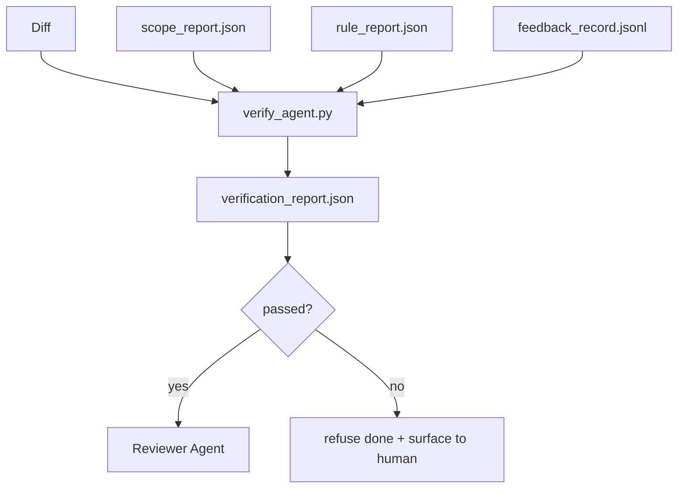

# Verification Gates

> Agent không được tự đánh dấu công việc của mình là hoàn thành. Một cổng xác minh đọc hợp đồng phạm vi, log phản hồi, báo cáo quy tắc và diff, rồi trả lời một câu hỏi duy nhất: tác vụ này thực sự hoàn tất chưa? Nếu cổng nói không, tác vụ chưa xong, bất kể trò chuyện nói gì.

**Type:** Build
**Languages:** Python (stdlib)
**Prerequisites:** Phase 14 · 33 (Rules), Phase 14 · 36 (Scope), Phase 14 · 37 (Feedback)
**Time:** ~55 minutes

## Learning Objectives

- Định nghĩa một cổng xác minh như một hàm mang tính xác định trên các sản phẩm workbench.
- Kết hợp báo cáo quy tắc, báo cáo phạm vi, các bản ghi phản hồi và diff thành một phán quyết duy nhất.
- Phát ra một `verification_report.json` mà agent đánh giá và CI đều có thể đọc.
- Từ chối tiến một tác vụ khi có bất kỳ thất bại mức độ block nào, không có ngoại lệ.

## The Problem

Các agent tuyên bố thành công quá dễ. Ba hình dạng thất bại chiếm ưu thế:

- "Trông ổn." Mô hình đọc diff của chính nó và quyết định nó đúng.
- "Các kiểm thử đã đạt." Được nói với sự tự tin. Không có bản ghi kiểm thử thực sự chạy.
- "Đạt nghiệm thu." Các tiêu chí nghiệm thu được diễn giải đủ lỏng để có nghĩa là "bất cứ thứ gì giống hoàn thành."

Cách khắc phục workbench là một cổng xác minh duy nhất đọc các sản phẩm mà agent đã tạo và đưa ra quyết định. Cổng mang tính xác định. Cổng nằm trong quản lý phiên bản. Cổng được nối vào CI. Agent không thể hối lộ nó.

## The Concept



### What the gate checks

| Kiểm tra | Sản phẩm nguồn | Mức độ nghiêm trọng |
|-------|-----------------|----------|
| Mọi lệnh nghiệm thu đã chạy | `feedback_record.jsonl` | block |
| Mọi lệnh nghiệm thu thoát với mã không | `feedback_record.jsonl` | block |
| Kiểm tra phạm vi không có lần ghi bị cấm | `scope_report.json` | block |
| Kiểm tra phạm vi không có lần ghi ngoài phạm vi | `scope_report.json` | block hoặc warn |
| Mọi quy tắc mức độ block đều đạt | `rule_report.json` | block |
| Không có mã thoát `null` trong phản hồi | `feedback_record.jsonl` | block |
| Các file đã chạm khớp `scope.allowed_files` | cả hai | warn |

Một phát hiện `warn` chú thích phán quyết; một phát hiện `block` ngăn `passed: true`.

### Deterministic, not probabilistic

Cổng phải tạo cùng phán quyết cho cùng tập sản phẩm mỗi lần. Không giám khảo LLM. Các giám khảo LLM thuộc về phía bên đánh giá (Giai đoạn 14 · 39) nơi mục tiêu là đánh giá định tính, không phải trạng thái.

### One report, one path

Cổng phát ra một `verification_report.json` cho mỗi lần đóng tác vụ, được ghi dưới `outputs/verification/<task_id>.json`. CI tiêu thụ cùng đường dẫn. Nhiều cổng với các đường dẫn khác nhau phân nhánh nguồn sự thật.

### Refuse without exception

Các phát hiện mức độ block không thể được agent override. Chúng chỉ có thể được override bởi một con người, với một `override_reason` được ghi lại và một id người dùng `overridden_by`. Override là một thay đổi có chữ ký, không phải một quyết định agent.

```figure
wb-gate-sequence
```

## Build It

`code/main.py` triển khai:

- Một bộ tải cho mỗi sản phẩm đầu vào, tất cả được tạo stub cục bộ để bài học độc lập.
- Một hàm thuần `verify(task_id, artifacts) -> VerdictReport`.
- Một bộ in cho thấy các kết quả cho từng kiểm tra và đạt/không đạt cuối cùng.
- Một demo với ba kịch bản tác vụ: đạt sạch, mở rộng phạm vi, thiếu nghiệm thu.

Chạy nó:

```
python3 code/main.py
```

Đầu ra: ba báo cáo phán quyết, mỗi báo cáo được lưu cạnh script.

## Production patterns in the wild

Năm mẫu nâng cổng từ "một tác vụ lint nữa" thành "cạnh quyết định".

**Phòng vệ nhiều lớp, không phải cổng đơn.** Hook trước commit → kiểm tra trạng thái CI → hook cấp quyền trước công cụ → cổng trước hợp nhất. Mỗi lớp mang tính xác định để một thất bại trong một lớp được lớp tiếp theo bắt. Sổ tay tháng 3 năm 2026 của microservices.io nói rõ: hook trước commit không thể bị vượt qua vì, khác với một skill phía mô hình, nó không phụ thuộc agent làm theo chỉ dẫn. Cổng xác minh nằm ở lớp CI / trước hợp nhất.

**Phòng vệ bằng kiểm tra mang tính xác định, giám khảo mô hình chỉ cho sắc thái.** Cặp Hybrid Norm năm 2026 của Anthropic: các phần thưởng có thể xác minh (kiểm thử đơn vị, kiểm tra schema, mã thoát) trả lời "mã đã giải quyết vấn đề chưa?" — các bảng tiêu chí LLM trả lời "mã có dễ đọc, an toàn, đúng phong cách không?" Cổng chạy lớp đầu; bên đánh giá (Giai đoạn 14 · 39) chạy lớp thứ hai. Trộn chúng làm sụp tín hiệu.

**Log override có chữ ký, không phải các luồng Slack.** Mỗi override phát ra một hàng trong `outputs/verification/overrides.jsonl` với: dấu thời gian, mã phát hiện, lý do, người dùng ký, commit HEAD hiện tại. Runtime từ chối bất kỳ override nào thiếu chữ ký; dấu vết kiểm toán được git theo dõi. Đây là ranh giới giữa một chính sách override và một màn diễn override.

**Sàn độ bao phủ như một kiểm tra hạng nhất.** Một `coverage_report.json` cung cấp cho một kiểm tra `coverage_floor` (mặc định 80%). Cổng thất bại nếu độ bao phủ được đo giảm dưới sàn hoặc dưới sàn của lần hợp nhất trước hơn 1 điểm phần trăm. Không có kiểm tra này, các agent âm thầm xóa các kiểm thử thất bại và các báo cáo xác minh vẫn xanh.

**Chế độ `--strict` nâng các warn thành block.** Với các nhánh phát hành, các PR chặn phát hành hoặc phân loại sau sự cố, `--strict` làm mọi cảnh báo thành một thất bại cứng. Cờ được chọn tham gia theo nhánh; không phải mặc định toàn cục, vì nghiêm ngặt trên mọi thứ bào mòn luồng hằng ngày.

## Use It

Các mẫu sản xuất:

- **Bước CI.** Một job `verify_agent` chạy cổng đối với các sản phẩm cuối cùng của agent. Bảo vệ hợp nhất từ chối nếu không có `passed: true`.
- **Hook trước bàn giao.** Runtime agent gọi cổng trước khi tạo tài liệu bàn giao. Không phán quyết xanh, không bàn giao.
- **Phân loại thủ công.** Người vận hành đọc báo cáo khi một agent tuyên bố thành công và một con người nghi ngờ điều đó.

Cổng là cạnh quyết định trong luồng workbench. Mọi bề mặt khác đều ở thượng nguồn của nó.

## Ship It

`outputs/skill-verification-gate.md` nối cổng vào một dự án cụ thể: những lệnh nghiệm thu nào cung cấp cho nó, những quy tắc nào là mức độ block, những lần ghi ngoài phạm vi nào được dung thứ, cách log kiểm toán override được lưu.

## Exercises

1. Thêm một kiểm tra `coverage_floor`: lệnh kiểm thử phải tạo một báo cáo độ bao phủ với ít nhất 80%. Quyết định sản phẩm nào mang sàn.
2. Hỗ trợ một chế độ `--strict` nâng mọi `warn` thành `block`. Tài liệu hóa các trường hợp mà chế độ nghiêm ngặt là mặc định đúng.
3. Làm cổng tạo một bản tóm tắt Markdown ngoài JSON. Bảo vệ những trường nào thuộc về bản tóm tắt.
4. Thêm một kiểm tra `time_since_last_human_touch`: bất kỳ file nào được chỉnh sửa trong vòng 60 giây sau một lần gõ phím của con người được miễn các cờ ngoài phạm vi.
5. Chạy cổng trên một diff agent thực từ sản phẩm của bạn. Bao nhiêu phát hiện là thực và bao nhiêu là nhiễu? Cổng cần phát triển ở đâu?

## Key Terms

| Thuật ngữ | Mọi người nói gì | Nó thực sự có nghĩa gì |
|------|----------------|------------------------|
| Verification gate (Cổng xác minh) | "Kiểm tra dừng mọi thứ" | Hàm mang tính xác định trên các sản phẩm workbench tạo một phán quyết đạt/không đạt |
| Block severity (Mức độ chặn) | "Thất bại cứng" | Một phát hiện ngăn `passed: true` và yêu cầu một override có chữ ký |
| Override log (Log override) | "Vì sao chúng ta cho nó qua" | Các mục có chữ ký với lý do và id người dùng, được kiểm toán bằng đánh giá |
| Acceptance command (Lệnh nghiệm thu) | "Bằng chứng" | Một lệnh shell mà mã thoát không của nó là ý nghĩa của `done` |
| One report path (Một đường dẫn báo cáo) | "Nguồn sự thật" | `outputs/verification/<task_id>.json`, được CI và con người tiêu thụ như nhau |

## Further Reading

- [Anthropic, Harness design for long-running application development](https://www.anthropic.com/engineering/harness-design-long-running-apps)
- [OpenAI Agents SDK guardrails](https://openai.github.io/openai-agents-python/guardrails/)
- [microservices.io, GenAI dev platform: guardrails](https://microservices.io/post/architecture/2026/03/09/genai-development-platform-part-1-development-guardrails.html) — phòng vệ nhiều lớp giữa trước commit và CI
- [ICMD, The 2026 Playbook for Agentic AI Ops](https://icmd.app/article/the-2026-playbook-for-agentic-ai-ops-guardrails-costs-and-reliability-at-scale-1776661990431) — thang cổng phê duyệt (nháp → phê duyệt → tự động dưới các ngưỡng)
- [Type-Checked Compliance: Deterministic Guardrails (arXiv 2604.01483)](https://arxiv.org/pdf/2604.01483) — Lean 4 như cận trên của kiểm soát mang tính xác định
- [logi-cmd/agent-guardrails — merge gate spec](https://github.com/logi-cmd/agent-guardrails) — các cổng phạm vi + kiểm thử đột biến
- [Guardrails AI x MLflow](https://guardrailsai.com/blog/guardrails-mlflow) — các bộ xác thực mang tính xác định làm bộ chấm điểm CI
- Giai đoạn 14 · 27 — các biện pháp phòng vệ prompt injection (đối tác đối kháng của cổng)
- Giai đoạn 14 · 36 — hợp đồng phạm vi mà cổng này thực thi
- Giai đoạn 14 · 37 — log phản hồi mà cổng này chấm điểm
- Giai đoạn 14 · 39 — agent đánh giá mà cổng bàn giao đến
