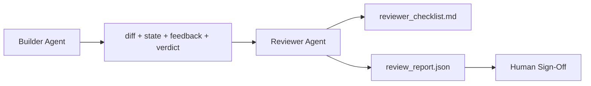

# Reviewer Agent: Separate Builder from Marker

> Agent đã viết mã không thể chấm điểm nó. Một bên đánh giá là một vòng lặp thứ hai với một system prompt khác, một mục tiêu khác và quyền chỉ đọc mọi thứ bên xây dựng đã tạo. Khoảng cách giữa bên xây dựng và bên đánh giá là nơi phần lớn độ tin cậy tồn tại.

**Type:** Build
**Languages:** Python (stdlib)
**Prerequisites:** Phase 14 · 38 (Verification Gate)
**Time:** ~55 minutes

## Learning Objectives

- Nêu vì sao cùng một agent không thể đánh giá công việc của chính nó một cách đáng tin cậy.
- Xây một vòng lặp agent đánh giá tiêu thụ các sản phẩm của bên xây dựng và phát ra một báo cáo đánh giá có cấu trúc.
- Soạn một bảng tiêu chí đánh giá chấm điểm các chiều cụ thể, không phải cảm giác.
- Nối bên đánh giá vào workbench để bước đánh giá của con người bắt đầu từ một sản phẩm thực.

## The Problem

Bạn yêu cầu agent sửa một lỗi. Nó chỉnh sửa bốn file, chạy các kiểm thử và báo cáo hoàn thành. Cổng xác minh (Giai đoạn 14 · 38) xác nhận nghiệm thu đã chạy và phạm vi được giữ. Cổng nói `passed: true`. Bạn hợp nhất. Hai ngày sau bạn phát hiện cách sửa đã giải quyết sai nửa của lỗi.

Nghiệm thu là cần thiết, chưa đủ. Bên đánh giá hỏi những câu mà nghiệm thu không thể hỏi: điều này đã giải quyết đúng vấn đề chưa? Nó có mở rộng phạm vi mà không gắn cờ không? Nó có tài liệu hóa các giả định lẽ ra cần được chất vấn không? Nó có để workbench trong một trạng thái mà phiên tiếp theo có thể tiếp nối không?

## The Concept



### Reviewer rubric

Năm chiều, mỗi chiều được chấm từ 0 đến 2.

| Chiều | Câu hỏi |
|-----------|----------|
| Sự phù hợp vấn đề | Thay đổi có giải quyết tác vụ như được nêu, không phải một tác vụ gần đó không? |
| Kỷ luật phạm vi | Các chỉnh sửa có được giới hạn trong hợp đồng hay hợp đồng được mở rộng có chủ ý? |
| Các giả định | Mọi giả định ẩn có được ghi lại ở đâu đó có thể đánh giá không? |
| Chất lượng xác minh | Lệnh nghiệm thu có thực sự chứng minh mục tiêu, hay nó chứng minh một phiên bản yếu hơn? |
| Sự sẵn sàng bàn giao | Phiên tiếp theo có thể tiếp nối sạch sẽ từ trạng thái hiện tại không? |

Tổng trên 10. Một lần chạy dưới 7 là thất bại mềm; một lần chạy dưới 5, hoặc bất kỳ chiều nào ở mức 0, là thất bại cứng.

### The reviewer is a separate role, not a separate model

Bạn có thể chạy bên đánh giá với cùng mô hình như bên xây dựng. Kỷ luật là sự tách biệt vai trò: system prompt khác, các đầu vào khác, không có quyền ghi vào diff. Thay đổi tư thế là thay đổi tín hiệu.

### The reviewer cannot edit the diff

Bên đánh giá đọc diff, trạng thái, phản hồi, phán quyết. Nó viết một báo cáo. Nó không vá diff. Nếu báo cáo nói "sửa điều này," lượt bên xây dựng tiếp theo thực hiện sửa; bên đánh giá quay lại đánh giá. Trộn vai trò đánh bại khoảng cách.

### Reviewer rubric versus verification gate

Cổng (Giai đoạn 14 · 38) kiểm tra các sự thật mang tính xác định: nghiệm thu có chạy, các quy tắc có đạt, phạm vi có được giữ. Bên đánh giá đưa ra các phán đoán định tính: đây có phải công việc đúng, nó có được tài liệu hóa, bàn giao có dùng được. Cả hai đều bắt buộc.

```figure
wb-builder-marker
```

## Build It

`code/main.py` triển khai:

- Một dataclass `ReviewerInputs` đóng gói các sản phẩm mà bên đánh giá đọc.
- Một bộ chấm điểm theo bảng tiêu chí với một hàm cho mỗi chiều. Mỗi hàm mang tính xác định và ở mức stub cho bài học; các triển khai thực sẽ gọi một LLM.
- Một bộ ghi `review_report.json` với năm điểm, tổng và một phán quyết (`pass`, `soft_fail`, `hard_fail`).
- Hai trường hợp demo: một thay đổi sạch và một thay đổi "đúng kiểm thử, sai vấn đề".

Chạy nó:

```
python3 code/main.py
```

Đầu ra: hai báo cáo đánh giá được ghi vào đĩa và một bảng console các điểm theo chiều.

## Production patterns in the wild

Các bằng chứng: hệ thống AI Code Review tháng 4 năm 2026 của Cloudflare thực hiện 131,246 lần đánh giá xuyên 48,095 yêu cầu hợp nhất trong 5,169 repo trong 30 ngày. Trung vị đánh giá hoàn tất trong 3 phút 39 giây. Tối đa bảy bên đánh giá chuyên gia (bảo mật, hiệu năng, chất lượng mã, tài liệu, quản lý phát hành, tuân thủ, Engineering Codex) chạy song song dưới một Bộ điều phối đánh giá loại trùng các phát hiện và phán xét mức độ nghiêm trọng. Mô hình cấp cao nhất được dành riêng cho bộ điều phối; các chuyên gia chạy trên các cấp rẻ hơn.

Bốn mẫu làm điều này hoạt động ở quy mô lớn.

**Nhóm chuyên gia, không phải một bên đánh giá lớn.** Một bên đánh giá với một bảng tiêu chí 5 chiều hoạt động cho các repo cá nhân. Khi cơ sở mã có các bề mặt then chốt về bảo mật, hiệu năng và tài liệu, chia thành các chuyên gia với các prompt nhỏ hơn. Bộ điều phối làm loại trùng; các chuyên gia không bao giờ chạy toàn bộ bảng tiêu chí. Sự tách biệt cấp mô hình phát sinh: các chuyên gia rẻ, bộ điều phối đắt.

**Giảm thiểu thiên lệch như yêu cầu thiết kế, không phải tối ưu hóa.** Các giám khảo LLM cho thấy bốn thiên lệch đáng tin cậy (Adnan Masood, tháng 4 năm 2026): thiên lệch vị trí (GPT-4 không nhất quán ~40% trên thứ tự (A,B) so với (B,A)), thiên lệch dài dòng (tăng điểm ~15% nghiêng về các đầu ra dài hơn), tự ưu tiên (các giám khảo thích đầu ra từ cùng họ mô hình), thẩm quyền (các giám khảo đánh giá quá cao các tham chiếu đến các tác giả nổi tiếng). Các biện pháp giảm thiểu: đánh giá cả hai thứ tự và chỉ tính các chiến thắng nhất quán; sử dụng các thang 1-4 thưởng rõ ràng tính ngắn gọn; xoay các giám khảo xuyên các họ mô hình; loại bỏ tên tác giả trước khi chấm điểm.

**Tập hiệu chỉnh, không phải cảm giác.** Một tập lịch sử 10-20 tác vụ với các phán quyết đúng đã biết. Chạy bên đánh giá trên nó ở mỗi thay đổi prompt. Nếu mức đồng thuận với hồ sơ lịch sử giảm dưới 80%, bảng tiêu chí cần chỉnh sửa trước khi bên đánh giá được phát hành. Đây là điều mọi nhóm cuối cùng khám phá lại; tốt hơn là bắt đầu với nó.

**Chuẩn lai với cổng.** Cổng xác minh (Giai đoạn 14 · 38) xử lý các kiểm tra mang tính xác định (nghiệm thu có chạy, các kiểm thử có đạt, phạm vi có được giữ). Bên đánh giá xử lý các kiểm tra ngữ nghĩa (đây có phải công việc đúng, các giả định có được tài liệu hóa, bàn giao có dùng được). Hướng dẫn năm 2026 của Anthropic nói rõ về sự phân tách này: đừng yêu cầu bên đánh giá làm lại điều mà cổng đã chứng minh.

## Use It

Các mẫu sản xuất:

- **Các agent phụ Claude Code.** Một agent phụ đánh giá chạy sau khi bên xây dựng đóng một tác vụ. Nó đăng một bình luận trên PR với các điểm theo bảng tiêu chí.
- **Các bàn giao OpenAI Agents SDK.** Bên xây dựng bàn giao cho Bên đánh giá khi hoàn thành tác vụ. Bên đánh giá có thể bàn giao lại với một danh sách các phát hiện hoặc lên một con người.
- **Kết hợp hai mô hình.** Bên xây dựng chạy trên một mô hình nhanh hơn, rẻ hơn. Bên đánh giá chạy trên một mô hình mạnh hơn với ngữ cảnh nhỏ hơn, tập trung vào phán đoán.

Bên đánh giá là đôi mắt thứ hai mà workbench phát triển khi con người không thể tự thực hiện mọi đánh giá.

## Ship It

`outputs/skill-reviewer-agent.md` tạo một bảng tiêu chí đánh giá dành riêng cho dự án, một stub agent đánh giá được nối với các sản phẩm của bên xây dựng và một tích hợp với cổng xác minh để đánh giá của con người bắt đầu từ một báo cáo được viết thay vì một trang trống.

## Exercises

1. Thêm một chiều thứ sáu dành riêng cho miền sản phẩm của bạn. Bảo vệ vì sao nó không được năm chiều hiện có hấp thụ.
2. Chạy bên đánh giá với hai system prompt khác nhau (ngắn gọn, dài dòng). Cái nào tạo một báo cáo mà con người có khả năng đọc hơn?
3. Thêm một trường `confidence` cho mỗi chiều. Từ chối phát hành báo cáo khi độ tin cậy ở chiều thấp nhất dưới 0.6.
4. Xây một tập hiệu chỉnh: 10 lần đóng tác vụ lịch sử với các phán quyết đúng đã biết. Chạy bên đánh giá trên chúng. Nó bất đồng với hồ sơ lịch sử ở đâu?
5. Thêm một khả năng "yêu cầu thêm bằng chứng": bên đánh giá có thể yêu cầu bên xây dựng một lần chạy kiểm thử cụ thể trước khi chấm điểm. Cơ chế lùi lại đúng là gì để điều này không lặp?

## Key Terms

| Thuật ngữ | Mọi người nói gì | Nó thực sự có nghĩa gì |
|------|----------------|------------------------|
| Reviewer rubric (Bảng tiêu chí đánh giá) | "Danh sách kiểm tra" | Chấm điểm 0-2 năm chiều với một câu hỏi được viết cho mỗi chiều |
| Soft fail (Thất bại mềm) | "Cần chỉnh sửa" | Tổng dưới 7; bên xây dựng nhận các phát hiện để xử lý |
| Hard fail (Thất bại cứng) | "Từ chối" | Tổng dưới 5 hoặc bất kỳ chiều nào ở 0; dừng và hiển thị cho con người |
| Role separation (Tách biệt vai trò) | "Prompt khác" | Cùng mô hình có thể là cả hai vai trò; kỷ luật là các đầu vào và tư thế |
| Confidence floor (Sàn độ tin cậy) | "Đừng phát hành các báo cáo tín hiệu thấp" | Từ chối phát ra một phán quyết khi bảng tiêu chí không chắc chắn |

## Further Reading

- [OpenAI Agents SDK handoffs](https://openai.github.io/openai-agents-python/handoffs/)
- [Anthropic Claude Code subagents](https://code.claude.com/docs/en/sub-agents)
- [Cloudflare, Orchestrating AI Code Review at Scale](https://blog.cloudflare.com/ai-code-review/) — kiến trúc 7 chuyên gia + bộ điều phối, 131k lần chạy / 30 ngày
- [Agent-as-a-Judge: Evaluating Agents with Agents (OpenReview / ICLR)](https://openreview.net/forum?id=DeVm3YUnpj) — benchmark DevAI, 366 yêu cầu giải pháp phân cấp
- [Adnan Masood, Rubric-Based Evaluations and LLM-as-a-Judge: Methodologies, Biases, Empirical Validation](https://medium.com/@adnanmasood/rubric-based-evals-llm-as-a-judge-methodologies-and-empirical-validation-in-domain-context-71936b989e80) — 4 thiên lệch và các biện pháp giảm thiểu
- [MLflow, LLM-as-a-Judge Evaluation](https://mlflow.org/llm-as-a-judge) — công cụ sản xuất cho bên xây dựng/bộ đánh giá tách biệt
- [LangChain, How to Calibrate LLM-as-a-Judge with Human Corrections](https://www.langchain.com/articles/llm-as-a-judge) — workflow tập hiệu chỉnh
- [Evidently AI, LLM-as-a-judge: a complete guide](https://www.evidentlyai.com/llm-guide/llm-as-a-judge)
- [Arize, LLM as a Judge — Primer and Pre-Built Evaluators](https://arize.com/llm-as-a-judge/)
- Giai đoạn 14 · 05 — Self-Refine và CRITIC (đường cơ sở tự đánh giá một agent)
- Giai đoạn 14 · 30 — Phát triển agent dựa trên đánh giá (bộ tạo tập hiệu chỉnh)
- Giai đoạn 14 · 38 — cổng xác minh mà bên đánh giá đọc
- Giai đoạn 14 · 40 — gói bàn giao mà báo cáo đánh giá cung cấp đầu vào
