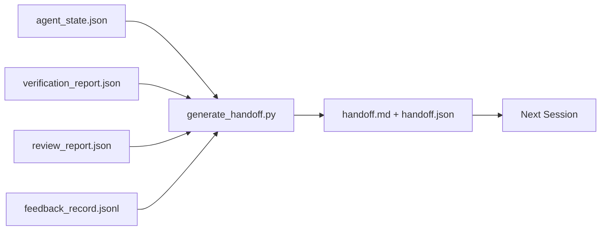

# Multi-Session Handoff

> Phiên sẽ kết thúc. Công việc thì chưa. Gói bàn giao là sản phẩm biến "agent đã làm việc một giờ" thành "phiên tiếp theo hữu ích ngay trong phút đầu." Xây dựng nó có chủ ý, không phải như một ý nghĩ muộn.

**Type:** Build
**Languages:** Python (stdlib)
**Prerequisites:** Phase 14 · 34 (Repo Memory), Phase 14 · 38 (Verification), Phase 14 · 39 (Reviewer)
**Time:** ~50 minutes

## Learning Objectives

- Nhận diện bảy trường mà mọi gói bàn giao cần.
- Tạo một bàn giao từ các sản phẩm workbench mà không viết văn xuôi bằng tay.
- Cắt gọn các log phản hồi lớn thành một bản tóm tắt cỡ bàn giao.
- Làm hành động đầu tiên của phiên tiếp theo mang tính xác định.

## The Problem

Phiên kết thúc. Agent nói "tuyệt, chúng ta đã tiến triển." Phiên tiếp theo mở. Agent tiếp theo hỏi "chúng ta đã dừng ở đâu?" Câu trả lời của agent đầu tiên không còn. Agent tiếp theo khám phá lại, chạy lại cùng các lệnh, hỏi lại con người cùng các câu hỏi và đốt ba mươi phút phục hồi ba mươi giây cuối của phiên trước.

Chi phí của một bàn giao xấu được trả mỗi phiên trong suốt vòng đời tác vụ. Cách khắc phục là một gói được tạo tự động ở cuối phiên: điều gì thay đổi, vì sao, điều gì đã thử, điều gì thất bại, điều gì còn lại, điều gì làm đầu tiên lần sau.

## The Concept



### Seven fields every handoff carries

| Trường | Câu hỏi nó trả lời |
|-------|---------------------|
| `summary` | Một đoạn về điều đã làm |
| `changed_files` | Diff nhìn nhanh |
| `commands_run` | Điều gì thực sự được thực thi |
| `failed_attempts` | Điều gì đã thử và vì sao nó không hoạt động |
| `open_risks` | Điều gì có thể gây hại phiên sau, với mức độ nghiêm trọng |
| `next_action` | Bước cụ thể đầu tiên mà phiên tiếp theo thực hiện |
| `verdict_pointer` | Đường dẫn đến các báo cáo xác minh + đánh giá |

Trường `next_action` là trường trụ cột. Một bàn giao có mọi thứ ngoại trừ `next_action` là một báo cáo trạng thái, không phải một bàn giao.

### Handoffs are generated, not written

Một bàn giao viết tay là một bàn giao bị bỏ qua vào một ngày khó khăn. Bộ tạo đọc các sản phẩm workbench và phát ra gói. Công việc của agent là để workbench trong một trạng thái mà bộ tạo có thể tóm tắt, không phải viết bản tóm tắt.

### Two forms: human-readable and machine-readable

`handoff.md` là thứ con người đọc. `handoff.json` là thứ agent tiếp theo tải. Cả hai đến từ cùng các sản phẩm nguồn. Nếu chúng khác nhau, JSON thắng.

### Feedback log trimming

Toàn bộ `feedback_record.jsonl` có thể là hàng trăm mục. Bàn giao chỉ mang K mục cuối cộng mọi mục có mã thoát khác không. Phiên tiếp theo tải toàn bộ log nếu nó cần, nhưng gói vẫn nhỏ.

### Leave a clean state

Một bàn giao mô tả công việc. Một trạng thái sạch làm công việc có thể tiếp tục. Chúng không phải cùng một thứ. Một `handoff.md` hoàn hảo vô giá trị nếu phiên tiếp theo mở ra một diff áp dụng dở, một file tạm mà agent quên, một nhánh lạc và các kiểm thử lỗi trước khi chúng thậm chí chạy. Agent tiếp theo khi đó dành mười phút đầu dọn dẹp sau agent trước thay vì xây dựng, và chi phí dồn lại mỗi phiên trong suốt vòng đời tác vụ.

Vì vậy phiên không kết thúc khi tính năng hoạt động. Nó kết thúc khi workbench ở một trạng thái mà bộ tạo có thể tóm tắt và phiên tiếp theo có thể tin. Dọn dẹp là một pha riêng, chạy trước bàn giao, và nó là một kiểm tra, không phải một thói quen, vì một thói quen là thứ bị bỏ qua vào một ngày khó khăn.

| Kiểm tra | Sạch có nghĩa | Bẩn chặn vì |
|-------|-------------|----------------------|
| Cây làm việc | Mọi thay đổi được commit hoặc stash tường minh với một ghi chú | Một diff áp dụng dở trông như công việc có chủ ý với agent tiếp theo |
| Các sản phẩm tạm | Không có `*.tmp`, thư mục nháp, lệnh in gỡ lỗi hoặc các khối bị chú thích hóa để lại | Các file lạc làm bẩn diff và mô hình tư duy của agent tiếp theo |
| Các kiểm thử | Xanh, hoặc đỏ với thất bại được nêu tên trong `open_risks` | Một kiểm thử đỏ âm thầm là một cái bẫy mà phiên tiếp theo bước vào |
| Bảng tính năng | Trạng thái `feature_list.json` phản ánh thực tế (Giai đoạn 14 · 36) | Một bảng cũ đưa phiên tiếp theo đến công việc đã hoàn tất |
| Nhánh | Trên nhánh được mong đợi, không detached HEAD, không các nhánh mồ côi | Sai nhánh có nghĩa commit đầu tiên của phiên tiếp theo rơi vào sai chỗ |

Pha dọn dẹp phát ra một `clean_state.json` các vấn đề chặn; một danh sách rỗng là tiền điều kiện mà bộ tạo bàn giao khẳng định trước khi nó ghi một gói. Một bàn giao được xây trên một cây bẩn không phải một bàn giao, đó là một mớ hỗn độn được chuyển tiếp. Hai sản phẩm kết hợp: dọn dẹp chứng minh workbench an toàn để rời đi, bàn giao chứng minh phiên tiếp theo biết bắt đầu ở đâu.

```figure
wb-handoff-packet
```

## Build It

`code/main.py` triển khai:

- Một bộ tải thu thập trạng thái, phán quyết, đánh giá và phản hồi vào một `WorkbenchSnapshot` duy nhất.
- Một hàm `generate_handoff(snapshot) -> (markdown, payload)`.
- Một bộ lọc chọn K mục phản hồi cuối cộng mọi mã thoát khác không.
- Một lần chạy demo ghi `handoff.md` và `handoff.json` cạnh script.

Chạy nó:

```
python3 code/main.py
```

Đầu ra: một body bàn giao được in, cộng cả hai file trên đĩa.

## Production patterns in the wild

Codex CLI, Claude Code và OpenCode mỗi bên cung cấp một câu chuyện cô đọng khác nhau; gói bàn giao có cấu trúc nằm trên cả ba.

**Các chiến lược cô đọng khác nhau; schema gói thì không.** POST /v1/responses/compact của Codex CLI là một blob AES mờ đục phía máy chủ (đường nhanh cho các mô hình OpenAI); phương án dự phòng là một "bản tóm tắt bàn giao" cục bộ được thêm vào như một thông điệp vai trò người dùng `_summary`. Claude Code chạy cô đọng dần năm giai đoạn ở 95% ngữ cảnh. OpenCode làm ẩn thông điệp dựa trên dấu thời gian cộng một bản tóm tắt LLM 5 tiêu đề. Ba cơ chế khác nhau, cùng nhu cầu: tuần tự hóa những gì sống sót qua nén thành một sản phẩm có tính di động. Gói là sản phẩm đó.

**Bàn giao phiên mới không phải cô đọng.** Cô đọng kéo dài một phiên; bàn giao đóng một phiên sạch sẽ và bắt đầu phiên tiếp theo. Cách định khung Hermes Issue #20372 (tháng 4 năm 2026) là đúng: khi nén tại chỗ bắt đầu suy giảm, agent nên ghi một bàn giao gọn, kết thúc phiên và tiếp tục trong ngữ cảnh mới. Gói là thứ làm chuyển tiếp đó rẻ. Sai lầm là tiếp tục nén cho đến khi chất lượng sụp đổ; cách khắc phục là lập ngân sách cho một bàn giao sớm, sạch.

**Một bàn giao hoạt động cho mỗi nhánh và chủ đề.** Phối hợp nhiều agent đổ vỡ vì các bàn giao cũ nhiều hơn vì đầu ra mô hình xấu. Luôn bao gồm `branch`, `last_known_good_commit` và một `status` là `active | superseded | archived`. Các bàn giao cũ được lưu trữ; chỉ bàn giao hoạt động dẫn dắt phiên tiếp theo. Đây là khác biệt giữa bàn giao như ghi chú và bàn giao như trạng thái.

**Kết thúc trước 50-75% ngữ cảnh, không phải tại bức tường.** Sổ tay mẫu viết tay (CLAUDE.md + HANDOVER.md) báo cáo các kết quả tốt nhất khi phiên kết thúc ở 50-75% ngân sách ngữ cảnh thay vì 95%. Bộ tạo gói chạy sạch trước khi các sản phẩm nén làm bẩn trạng thái nguồn. Rẻ để viết khi ngữ cảnh còn nguyên; đắt khi mô hình đã mất vị trí của mình.

## Use It

Các mẫu sản xuất:

- **Hook kết thúc phiên.** Runtime kích hoạt bộ tạo khi người dùng đóng trò chuyện. Gói đi vào `outputs/handoff/<session_id>/`.
- **Mẫu PR.** Markdown của bộ tạo cũng là một body PR. Các bên đánh giá đọc nó mà không mở năm file khác.
- **Bàn giao xuyên agent.** Xây dựng với một sản phẩm (Claude Code), tiếp tục với một sản phẩm khác (Codex). Gói là ngôn ngữ chung.

Gói nhỏ, đều đặn và rẻ để tạo. Tiết kiệm chi phí dồn lại với mỗi phiên.

## Ship It

`outputs/skill-handoff-generator.md` tạo một bộ tạo được điều chỉnh theo các đường dẫn sản phẩm của một dự án, một hook cuối phiên chạy nó và một schema `handoff.json` mà agent tiếp theo đọc khi khởi động.

## Exercises

1. Thêm một trường `assumptions_to_validate` hiển thị mọi giả định mà bên xây dựng ghi log nhưng bên đánh giá không chấm trên 1.
2. Cắt gọn bản tóm tắt phản hồi khác nhau cho các lần chạy thất bại so với các lần đạt. Bảo vệ sự bất đối xứng.
3. Bao gồm một danh sách "các câu hỏi cho con người." Ngưỡng để một câu hỏi đi vào gói thay vì vào một thông điệp trò chuyện là gì?
4. Làm bộ tạo lũy đẳng: chạy nó hai lần tạo cùng gói. Điều gì cần ổn định để điều đó đúng?
5. Thêm một phần "các điều kiện tiên quyết phiên tiếp theo" liệt kê chính xác các sản phẩm mà phiên tiếp theo phải tải trước khi hành động.

## Key Terms

| Thuật ngữ | Mọi người nói gì | Nó thực sự có nghĩa gì |
|------|----------------|------------------------|
| Handoff packet (Gói bàn giao) | "Tóm tắt phiên" | Sản phẩm được tạo mang bảy trường, cả markdown và JSON |
| Next action (Hành động tiếp theo) | "Làm gì đầu tiên" | Một bước cụ thể bắt đầu phiên tiếp theo |
| Feedback trim (Cắt gọn phản hồi) | "Tóm tắt log" | K bản ghi cuối cộng mọi mã thoát khác không |
| Status report (Báo cáo trạng thái) | "Điều chúng ta đã làm" | Một tài liệu thiếu `next_action`; hữu ích, nhưng không phải bàn giao |
| Verdict pointer (Con trỏ phán quyết) | "Biên nhận" | Đường dẫn đến các báo cáo xác minh + đánh giá để có khả năng truy vết |

## Further Reading

- [Anthropic, Effective harnesses for long-running agents](https://www.anthropic.com/engineering/effective-harnesses-for-long-running-agents)
- [OpenAI Agents SDK handoffs](https://openai.github.io/openai-agents-python/handoffs/)
- [Codex Blog, Codex CLI Context Compaction: Architecture, Configuration, Managing Long Sessions](https://codex.danielvaughan.com/2026/03/31/codex-cli-context-compaction-architecture/) — POST /v1/responses/compact và phương án dự phòng cục bộ
- [Justin3go, Shedding Heavy Memories: Context Compaction in Codex, Claude Code, OpenCode](https://justin3go.com/en/posts/2026/04/09-context-compaction-in-codex-claude-code-and-opencode) — so sánh cô đọng ba nhà cung cấp
- [JD Hodges, Claude Handoff Prompt: How to Keep Context Across Sessions (2026)](https://www.jdhodges.com/blog/ai-session-handoffs-keep-context-across-conversations/) — CLAUDE.md + HANDOVER.md, ngân sách ngữ cảnh 50-75%
- [Mervin Praison, Managing Handoffs in Multi-Agent Coding Sessions: Fresh Context Without Losing Continuity](https://mer.vin/2026/04/managing-handoffs-in-multi-agent-coding-sessions-fresh-context-without-losing-continuity/) — cách định khung hệ thống phân tán
- [Hermes Issue #20372 — automatic fresh-session handoff when compression becomes risky](https://github.com/NousResearch/hermes-agent/issues/20372)
- [Hermes Issue #499 — Context Compaction Quality Overhaul](https://github.com/NousResearch/hermes-agent/issues/499) — các prompt hướng bàn giao trong Codex CLI
- [Microsoft Agent Framework, Compaction](https://learn.microsoft.com/en-us/agent-framework/agents/conversations/compaction)
- [OpenCode, Context Management and Compaction](https://deepwiki.com/sst/opencode/2.4-context-management-and-compaction)
- [LangChain, Context Engineering for Agents](https://www.langchain.com/blog/context-engineering-for-agents)
- Giai đoạn 14 · 34 — file trạng thái mà bộ tạo đọc
- Giai đoạn 14 · 38 — phán quyết xác minh mà gói chỉ tới
- Giai đoạn 14 · 39 — báo cáo đánh giá được đóng gói vào gói
