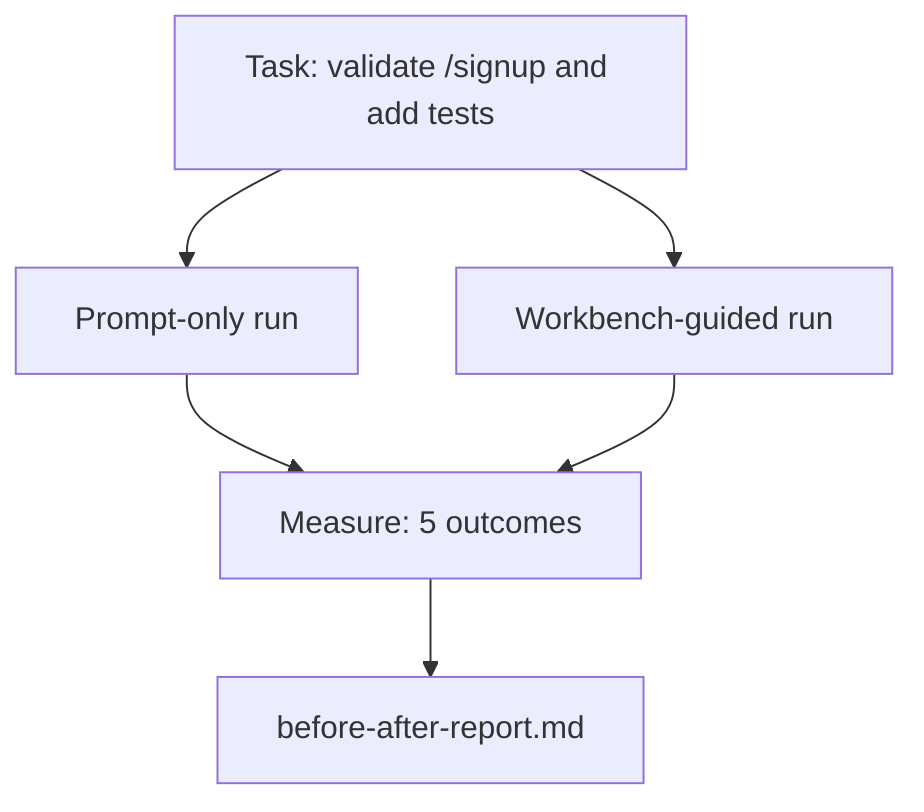

# The Workbench on a Real Repo

> Mười một bài học về các bề mặt không đáng gì nếu chúng không sống sót khi tiếp xúc một cơ sở mã thực. Bài này chạy cùng tác vụ hai lần trên một ứng dụng mẫu nhỏ: chỉ có prompt so với được workbench hướng dẫn. Các con số làm việc tranh luận.

**Type:** Build
**Languages:** Python (stdlib)
**Prerequisites:** Phases 14 · 32 to 14 · 40
**Time:** ~60 minutes

## Learning Objectives

- Kết hợp bảy bề mặt workbench trên một ứng dụng nhỏ.
- Chạy cùng tác vụ hai lần (chỉ có prompt và được workbench hướng dẫn) và đo năm kết quả.
- Đọc báo cáo trước/sau và quyết định những bề mặt nào mang lại tác động lớn nhất.
- Bảo vệ workbench trước một phản biện "nhưng mô hình của tôi đủ tốt."

## The Problem

Một demo trên một tác vụ mô phỏng không thuyết phục ai. Lập luận cho workbench được xác lập khi một tác vụ có cảm giác thực trên một repo có cảm giác thực đi vào sản xuất với ít thất bại hơn, ít hoàn tác hơn và một gói mà phiên tiếp theo có thể sử dụng.

Bài này cung cấp repo có cảm giác thực đó và chạy cùng tác vụ qua cả hai pipeline. Kết quả là một báo cáo trước/sau mà bạn có thể đưa cho một người hoài nghi.

## The Concept



### The sample app

Một bộ xử lý kiểu FastAPI tối thiểu trong `sample_app/`:

- `app.py` với `/signup` (chưa có xác thực).
- `test_app.py` với một kiểm thử luồng thành công.
- `README.md` và `scripts/release.sh` làm mồi vùng cấm.

### The task

> Thêm xác thực đầu vào vào `/signup`: từ chối các mật khẩu ngắn hơn 8 ký tự, trả về 422 với một phong bì lỗi có kiểu. Thêm một kiểm thử chứng minh hành vi mới.

### The two pipelines

Chỉ có prompt:

1. Đọc README.
2. Đọc `app.py`.
3. Chỉnh sửa các file.
4. Tuyên bố hoàn thành.

Được workbench hướng dẫn:

1. Chạy script khởi tạo (Bài 35).
2. Đọc hợp đồng phạm vi (Bài 36).
3. Đọc trạng thái (Bài 34).
4. Chỉ chỉnh sửa các file được phép.
5. Chạy lệnh nghiệm thu qua trình chạy phản hồi (Bài 37).
6. Chạy cổng xác minh (Bài 38).
7. Chạy bên đánh giá (Bài 39).
8. Tạo bàn giao (Bài 40).

### The five outcomes measured

| Kết quả | Vì sao nó quan trọng |
|---------|----------------|
| `tests_actually_run` | Hầu hết các tuyên bố "các kiểm thử đã đạt" không thể xác minh |
| `acceptance_met` | Kiểm thử chứng minh mục tiêu phải là kiểm thử đã chạy |
| `files_outside_scope` | Mở rộng phạm vi là thất bại âm thầm chiếm ưu thế |
| `handoff_quality` | Phiên tiếp theo trả giá hoặc được lợi từ điều này |
| `reviewer_total` | Phán đoán định tính bên trên cổng |

```figure
wb-ab-runs
```

## Build It

`code/main.py` điều phối hai pipeline đối với cùng mẫu ứng dụng. Cả hai pipeline được viết kịch bản (không có LLM trong vòng lặp) để phép đo có thể tái tạo. Script ghi so sánh vào `before-after-report.md` và `comparison.json`.

Chạy nó:

```
python3 code/main.py
```

Đầu ra: một bảng console các kết quả cho từng pipeline, báo cáo markdown được lưu cạnh script và JSON cho bất kỳ ai muốn vẽ biểu đồ nó.

## Production patterns in the wild

Câu hỏi của người hoài nghi là "workbench thực sự giúp bao nhiêu?" Các con số năm 2026 nói nhiều hơn nhiều so với lời giải thích.

**Terminal Bench Top-30 lên Top-5 trên cùng mô hình.** *Anatomy of an Agent Harness* của LangChain (tháng 4 năm 2026): một agent lập trình nhảy từ ngoài top 30 lên hạng năm trên Terminal Bench 2.0 bằng cách chỉ thay harness. Cùng mô hình. Các bề mặt khác nhau. Chênh lệch hai mươi lăm hạng.

**Vercel 80% lên 100% bằng cách xóa các công cụ.** Vercel báo cáo xóa 80% công cụ của agent chuyển tỷ lệ thành công từ 80% lên 100%. Bề mặt công cụ nhỏ hơn, phạm vi sắc hơn, ít cách thất bại hơn. Không gian âm thắng.

**Harvey độ chính xác gấp 2 lần chỉ qua harness.** Các agent pháp lý tăng hơn gấp đôi độ chính xác qua tối ưu hóa harness, không thay đổi mô hình.

**88% dự án agent AI doanh nghiệp không đến được sản xuất.** Bài báo *Harness Engineering for Language Agents* của preprints.org (tháng 3 năm 2026) truy các thất bại về runtime, không phải suy luận: trạng thái cũ, các lần thử lại mong manh, ngữ cảnh phát triển quá mức, phục hồi kém từ các sai lầm trung gian.

**Sụp đổ ngữ cảnh dài.** Đường cơ sở WebAgent thành công 40-50% giảm xuống dưới 10% trong các điều kiện ngữ cảnh dài, chủ yếu từ các vòng lặp vô hạn và mất mục tiêu. Ralph Loop và gói bàn giao tồn tại để hấp thụ điều đó.

**Các âm tính giả vẫn tồn tại.** Các tác vụ sự thật một bước, lint một dòng, các lần chạy bộ định dạng, bất cứ thứ gì mô hình đã ghi nhớ nguyên văn — những thứ này chạy nhanh hơn khi chỉ có prompt. Benchmark nên liệt kê chúng trung thực để workbench không bị định khung là quá mức cần thiết.

Điều rút ra không phải "harness thắng mãi mãi." Các mô hình quả có hấp thụ các thủ thuật harness theo thời gian. Điều rút ra là ngày nay, tải kỹ thuật nằm trong bảy bề mặt, và các con số chứng minh điều đó.

## Use It

Bài này là hồ sơ trường hợp bạn trích dẫn khi:

- Ai đó hỏi vì sao mỗi PR mang một `agent-rules.md` và một hợp đồng phạm vi.
- Một nhóm muốn bỏ cổng xác minh "chỉ cho sprint này."
- Một sản phẩm agent mới ra mắt và bạn cần một benchmark có tính di động để biết liệu nó thực sự tiết kiệm thời gian.

Các con số đi xa hơn lời giải thích.

## Ship It

`outputs/skill-workbench-benchmark.md` là một bộ đánh giá có tính di động chạy bất kỳ sản phẩm agent nào qua cả hai pipeline đối với ứng dụng mẫu riêng của một dự án và báo cáo năm kết quả.

## Exercises

1. Thêm một kết quả thứ sáu: thời gian đến chỉnh sửa có ý nghĩa đầu tiên. Bạn đo nó sạch sẽ như thế nào?
2. Chạy so sánh trên một tác vụ ngày thứ hai thực trong cơ sở mã của bạn. Các con số workbench trượt ở đâu?
3. Thêm một lượt "âm tính giả": các tác vụ mà chỉ có prompt lẽ ra nhanh hơn và chi phí phụ workbench là chi phí thực. Bảo vệ việc vẫn giữ workbench.
4. Thay "agent" được viết kịch bản bằng một lời gọi LLM thực. Những kết quả nào trở nên nhiễu hơn?
5. Soạn một bản tóm tắt một trang hướng đến một người không phải kỹ sư. Điều gì sống sót qua cắt gọn?

## Key Terms

| Thuật ngữ | Mọi người nói gì | Nó thực sự có nghĩa gì |
|------|----------------|------------------------|
| Sample app (Ứng dụng mẫu) | "Repo mô phỏng" | Nhỏ nhưng đủ thực tế để thực hành cả bảy bề mặt |
| Pipeline (Đường ống xử lý) | "Workflow" | Chuỗi có thứ tự các lần đọc/ghi bề mặt mà agent tuân theo |
| Before/after report (Báo cáo trước/sau) | "Các bằng chứng" | Sản phẩm bạn đưa cho một người hoài nghi |
| False negative (Âm tính giả) | "Workbench quá mức" | Các tác vụ mà chỉ có prompt nhanh hơn; hữu ích để liệt kê trung thực |
| Workbench benchmark (Benchmark workbench) | "Điểm độ tin cậy" | Bộ kiểm thử có tính di động chạy so sánh trên cơ sở mã của bạn |

## Further Reading

- [LangChain, The Anatomy of an Agent Harness](https://blog.langchain.com/the-anatomy-of-an-agent-harness/) — bằng chứng Terminal Bench Top-30 lên Top-5
- [MongoDB, The Agent Harness: Why the LLM Is the Smallest Part of Your Agent System](https://www.mongodb.com/company/blog/technical/agent-harness-why-llm-is-smallest-part-of-your-agent-system) — các số liệu Vercel + Harvey
- [preprints.org, Harness Engineering for Language Agents](https://www.preprints.org/manuscript/202603.1756) — tỷ lệ thất bại doanh nghiệp 88%, các nguyên nhân gốc runtime
- [HN: Improving 15 LLMs at Coding in One Afternoon. Only the Harness Changed](https://news.ycombinator.com/item?id=46988596) — được tái tạo xuyên 15 mô hình
- [Cloudflare, Orchestrating AI Code Review at Scale](https://blog.cloudflare.com/ai-code-review/) — 131k lần đánh giá / 30 ngày trong sản xuất
- [Anthropic, Building Effective Agents](https://www.anthropic.com/research/building-effective-agents)
- Các giai đoạn 14 · 32 đến 14 · 40 — các bề mặt mà bài này thực hành từ đầu đến cuối
- Giai đoạn 14 · 19 — SWE-bench, GAIA, AgentBench như các benchmark vĩ mô mà bài này bổ sung
- Giai đoạn 14 · 30 — phát triển agent dựa trên đánh giá mà cùng bộ kiểm thử cắm vào
