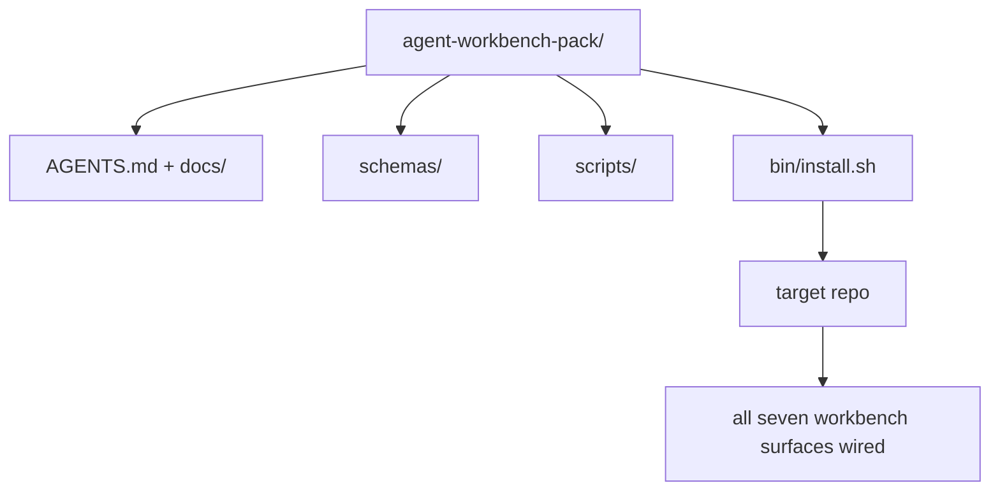

# Capstone: Ship a Reusable Agent Workbench Pack

> Chuỗi học nhỏ kết thúc bằng một bộ bạn thả vào bất kỳ repo nào. Mười một bài học về các bề mặt được nén thành một thư mục mà bạn có thể `cp -r` và có một agent làm việc đáng tin cậy vào sáng hôm sau. Capstone là sản phẩm mà chương trình học này dựa vào.

**Type:** Build
**Languages:** Python (stdlib)
**Prerequisites:** Phases 14 · 31 to 14 · 41
**Time:** ~75 minutes

## Learning Objectives

- Đóng gói bảy bề mặt workbench vào một thư mục có thể đưa vào dùng ngay.
- Ghim các schema, script và mẫu để một repo mới nhận một đường cơ sở tốt đã biết.
- Thêm một script cài đặt duy nhất đặt bộ xuống một cách lũy đẳng.
- Quyết định điều gì ở trong bộ và điều gì ở ngoài, bảo vệ lựa chọn cho mỗi điều.

## The Problem

Một workbench nằm trong một Google Doc, một lịch sử trò chuyện và ba script nhớ mang máng là một workbench được xây lại mỗi quý. Cách chữa là một bộ có phiên bản: một repo hoặc thư mục với các bề mặt, schema, script và một bộ cài một lệnh.

Bạn sẽ kết thúc bài này với `outputs/agent-workbench-pack/` được cung cấp trên đĩa và một `bin/install.sh` đưa nó vào bất kỳ repo đích nào.

## The Concept



### The pack layout

```
outputs/agent-workbench-pack/
├── AGENTS.md
├── docs/
│   ├── agent-rules.md
│   ├── reliability-policy.md
│   ├── handoff-protocol.md
│   └── reviewer-rubric.md
├── schemas/
│   ├── agent_state.schema.json
│   ├── task_board.schema.json
│   └── scope_contract.schema.json
├── scripts/
│   ├── init_agent.py
│   ├── run_with_feedback.py
│   ├── verify_agent.py
│   └── generate_handoff.py
├── bin/
│   └── install.sh
└── README.md
```

### What stays in, what stays out

Bên trong:

- Các schema bề mặt. Chúng là hợp đồng.
- Bốn script ở trên. Chúng là runtime.
- Bốn tài liệu. Chúng là các quy tắc và bảng tiêu chí.

Bên ngoài:

- Các tác vụ dành riêng cho dự án. Các tác vụ thuộc về bảng của repo đích, không phải trong bộ.
- Các lời gọi SDK nhà cung cấp. Bộ không phụ thuộc framework.
- Văn xuôi nhập môn. Bộ nằm cạnh phần nhập môn hiện có của nhóm, không phải bên trong nó.

### The installer

Một `bin/install.sh` ngắn (hoặc `bin/install.py`):

1. Từ chối cài đè lên một bộ hiện có mà không có `--force`.
2. Sao chép bộ vào repo đích.
3. Nối CI nếu một `.github/workflows/` tồn tại.
4. In các bước tiếp theo: điền bảng, đặt các lệnh nghiệm thu, chạy script khởi tạo.

### Versioning

Bộ mang một file `VERSION`. Các lần tăng schema và thay đổi script yêu cầu di chuyển tăng phiên bản chính. Các thay đổi chỉ tài liệu tăng bản vá. `agent_state.json` của repo đích ghi lại nó được khởi tạo đối với phiên bản bộ nào.

```figure
wb-pack-install
```

## Build It

`code/main.py` lắp ráp bộ vào `outputs/agent-workbench-pack/` cạnh bài học, được khởi tạo bằng các schema và script từ các bài trước trong chuỗi học nhỏ này và các tài liệu bạn đã viết.

Chạy nó:

```
python3 code/main.py
```

Script sao chép và ghim các bề mặt, ghi README, in cây bộ và thoát với mã không. Chạy lại là lũy đẳng.

## Production patterns in the wild

Một bộ chỉ có giá trị nếu nó sống sót qua các fork, cập nhật và một thượng nguồn không thân thiện. Bốn mẫu làm điều đó hoạt động.

**`VERSION` là hợp đồng, không phải tiếp thị.** Các lần tăng phiên bản chính yêu cầu một di chuyển trạng thái. Các lần tăng phiên bản phụ yêu cầu chạy lại bộ kiểm tra. Các lần tăng bản vá chỉ là tài liệu. Bộ cài ghi `.workbench-version` vào repo đích trên mỗi lần cài; `lint_pack.py` từ chối phát hành nếu khóa của đích không khớp `VERSION` của bộ. Đây là cách `npm`, `Cargo` và `pyproject.toml` sống sót qua 10 năm biến động; không điều gì về agent thay đổi các quy tắc.

**Một nguồn duy nhất cho phân phối xuyên công cụ.** Nx cung cấp một `nx ai-setup` đặt `AGENTS.md`, `CLAUDE.md`, `.cursor/rules/`, `.github/copilot-instructions.md` và một máy chủ MCP từ một cấu hình duy nhất. Bộ nên làm như vậy; bộ cài phát ra các symlink (`ln -s AGENTS.md CLAUDE.md`) để một nguồn sự thật duy nhất tỏa đến mọi agent lập trình. Fork bộ để hỗ trợ một công cụ thay cho công cụ khác là một chế độ lỗi.

**`uninstall.sh` từ chối khi trạng thái không tầm thường.** Gỡ cài đặt bộ không được xóa `agent_state.json`, `task_board.json` hoặc `outputs/` của người dùng. Bộ gỡ cài đặt loại bỏ các schema, script, tài liệu và `AGENTS.md` (với tùy chọn không tham gia `--keep-agents-md`) và từ chối tiếp tục nếu các file trạng thái có bất kỳ thay đổi chưa commit nào. Trạng thái thuộc về người dùng; bộ không sở hữu nó.

**Skill như thứ có thể xuất bản. Phân phối kiểu SkillKit.** Bộ được cung cấp như một skill SkillKit: `skillkit install agent-workbench-pack` đặt nó xuyên 32 agent AI từ một nguồn duy nhất. Repo bộ là nguồn sự thật; SkillKit là kênh phân phối. Khóa chặt nhà cung cấp sụp đổ; bảy bề mặt vẫn giống nhau.

## Use It

Ba nơi bộ được cung cấp:

- **Như một thư mục bạn thả vào một repo.** `cp -r outputs/agent-workbench-pack /path/to/repo`.
- **Như một repo mẫu công khai.** Fork và tùy chỉnh, với `VERSION` kiểm soát trôi dạt.
- **Như một skill SkillKit.** Được nối vào sản phẩm agent của bạn để một lệnh duy nhất đặt nó xuống.

Bộ là công thức. Mỗi lần cài là một khẩu phần.

## Ship It

`outputs/skill-workbench-pack.md` tạo một bộ được điều chỉnh theo dự án: các quy tắc được làm sắc theo lịch sử nhóm, các glob phạm vi khớp repo, các chiều bảng tiêu chí được mở rộng với một mục dành riêng cho miền.

## Exercises

1. Quyết định tài liệu thứ năm tùy chọn nào xứng đáng được nâng vào bộ chuẩn. Bảo vệ lựa chọn.
2. Viết lại bộ cài bằng Python với một cờ `--dry-run`. So sánh tính thuận tiện với bash.
3. Thêm một `bin/uninstall.sh` loại bỏ bộ an toàn và từ chối nếu các file trạng thái có lịch sử không tầm thường. Điều gì được tính là không tầm thường?
4. Thêm một `lint_pack.py` thất bại khi bộ trôi khỏi `VERSION`. Nối nó vào CI cho repo riêng của bộ.
5. Soạn sổ tay di chuyển từ một workbench tự dựng sang bộ này. Thứ tự thao tác nào giảm thiểu thời gian ngừng hoạt động?

## Key Terms

| Thuật ngữ | Mọi người nói gì | Nó thực sự có nghĩa gì |
|------|----------------|------------------------|
| Workbench pack (Bộ workbench) | "Bộ khởi đầu" | Một thư mục có phiên bản mang cả bảy bề mặt |
| Installer (Bộ cài đặt) | "Script thiết lập" | `bin/install.sh` đặt bộ xuống một cách lũy đẳng |
| Pack version (Phiên bản bộ) | "VERSION" | Tăng phiên bản chính cho các thay đổi schema/script, bản vá cho chỉ tài liệu |
| Drop-in pack (Bộ dùng ngay) | "cp -r rồi chạy" | Bộ hoạt động không cần tùy chỉnh cho từng repo ngay ngày đầu |
| Forkable template (Mẫu có thể fork) | "Mẫu GitHub" | Repo công khai mà "Use this template" của GitHub có thể clone từ đó |

## Further Reading

- Các giai đoạn 14 · 31 đến 14 · 41 — mọi bề mặt mà bộ này đóng gói
- [SkillKit](https://github.com/rohitg00/skillkit) — cài skill này xuyên 32 agent AI
- [Nx Blog, Teach Your AI Agent How to Work in a Monorepo](https://nx.dev/blog/nx-ai-agent-skills) — bộ tạo một nguồn xuyên sáu công cụ
- [agents.md — the open spec](https://agents.md/) — điều bộ định tuyến của bộ phải triển khai
- [HKUDS/OpenHarness](https://github.com/HKUDS/OpenHarness) — triển khai tham chiếu của một thứ tương đương bộ
- [Augment Code, A good AGENTS.md is a model upgrade](https://www.augmentcode.com/blog/how-to-write-good-agents-dot-md-files) — chuẩn chất lượng tài liệu bộ
- [Anthropic, Effective harnesses for long-running agents](https://www.anthropic.com/engineering/effective-harnesses-for-long-running-agents)
- [Anthropic, Harness design for long-running application development](https://www.anthropic.com/engineering/harness-design-long-running-apps)
- Giai đoạn 14 · 30 — phát triển agent dựa trên đánh giá tiêu thụ cổng xác minh của bộ
- Giai đoạn 14 · 41 — benchmark trước/sau mà bộ này cải thiện
