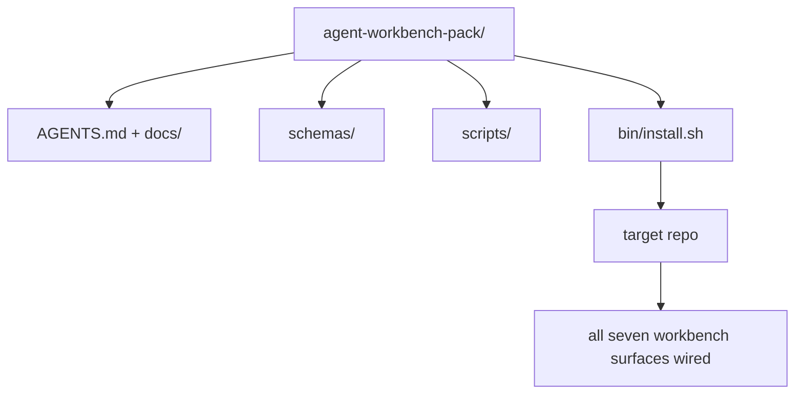

# Capstone: Ship a Reusable Agent Workbench Pack

> Chuỗi học nhỏ kết thúc bằng một bộ bạn thả vào bất kỳ repo nào. Mười một bài học về các bề mặt được nén thành một thư mục mà bạn có thể `cp -r` và có một agent làm việc đáng tin cậy vào sáng hôm sau. Capstone là sản phẩm mà chương trình học này dựa vào.

**Type:** Build
**Languages:** Python (stdlib)
**Prerequisites:** Phases 14 · 31 to 14 · 41
**Time:** ~75 minutes

## Learning Objectives

- Đóng gói bảy bề mặt workbench vào một thư mục có thể đưa vào dùng ngay.
- Ghim các schema, script và mẫu để một repo mới nhận một đường cơ sở tốt đã biết.
- Thêm một script cài đặt duy nhất đặt bộ xuống một cách lũy đẳng.
- Quyết định điều gì ở trong bộ và điều gì ở ngoài, bảo vệ lựa chọn cho mỗi điều.
- Trình diễn một thay đổi kho mã có agent hỗ trợ với bằng chứng mà người xem xét có thể tái tạo.

## The Problem

Một workbench nằm trong một Google Doc, một lịch sử trò chuyện và ba script nhớ mang máng là một workbench được xây lại mỗi quý. Cách chữa là một bộ có phiên bản: một repo hoặc thư mục với các bề mặt, schema, script và một bộ cài một lệnh.

Bạn sẽ kết thúc bài này với `outputs/agent-workbench-pack/` được cung cấp trên đĩa và một `bin/install.sh` đưa nó vào bất kỳ repo đích nào.

## The Concept



### The pack layout

```
outputs/agent-workbench-pack/
├── AGENTS.md
├── docs/
│   ├── agent-rules.md
│   ├── reliability-policy.md
│   ├── handoff-protocol.md
│   └── reviewer-rubric.md
├── schemas/
│   ├── agent_state.schema.json
│   ├── task_board.schema.json
│   └── scope_contract.schema.json
├── scripts/
│   ├── init_agent.py
│   ├── run_with_feedback.py
│   ├── verify_agent.py
│   └── generate_handoff.py
├── bin/
│   └── install.sh
└── README.md
```

### What stays in, what stays out

Bên trong:

- Các schema bề mặt. Chúng là hợp đồng.
- Bốn script ở trên. Chúng là runtime.
- Bốn tài liệu. Chúng là các quy tắc và bảng tiêu chí.

Bên ngoài:

- Các tác vụ dành riêng cho dự án. Các tác vụ thuộc về bảng của repo đích, không phải trong bộ.
- Các lời gọi SDK nhà cung cấp. Bộ không phụ thuộc framework.
- Văn xuôi nhập môn. Bộ nằm cạnh phần nhập môn hiện có của nhóm, không phải bên trong nó.

### The installer

Một `bin/install.sh` ngắn (hoặc `bin/install.py`):

1. Từ chối cài đè lên một bộ hiện có mà không có `--force`.
2. Sao chép bộ vào repo đích.
3. Nối CI nếu một `.github/workflows/` tồn tại.
4. In các bước tiếp theo: điền bảng, đặt các lệnh nghiệm thu, chạy script khởi tạo.

### Versioning

Bộ mang một file `VERSION`. Các lần tăng schema và thay đổi script yêu cầu di chuyển tăng phiên bản chính. Các thay đổi chỉ tài liệu tăng bản vá. `agent_state.json` của repo đích ghi lại nó được khởi tạo đối với phiên bản bộ nào.

```figure
wb-pack-install
```

## Build It

`code/main.py` lắp ráp bộ vào `outputs/agent-workbench-pack/` cạnh bài học, được khởi tạo bằng các schema và script từ các bài trước trong chuỗi học nhỏ này và các tài liệu bạn đã viết.

Chạy nó:

```
python3 code/main.py
```

Script sao chép và ghim các bề mặt, ghi README, in cây bộ và thoát với mã không. Chạy lại là lũy đẳng.

## Production patterns in the wild

Một bộ chỉ có giá trị nếu nó sống sót qua các fork, cập nhật và một thượng nguồn không thân thiện. Bốn mẫu làm điều đó hoạt động.

**`VERSION` là hợp đồng, không phải tiếp thị.** Các lần tăng phiên bản chính yêu cầu một di chuyển trạng thái. Các lần tăng phiên bản phụ yêu cầu chạy lại bộ kiểm tra. Các lần tăng bản vá chỉ là tài liệu. Bộ cài ghi `.workbench-version` vào repo đích trên mỗi lần cài; `lint_pack.py` từ chối phát hành nếu khóa của đích không khớp `VERSION` của bộ. Đây là cách `npm`, `Cargo` và `pyproject.toml` sống sót qua 10 năm biến động; không điều gì về agent thay đổi các quy tắc.

**Một nguồn duy nhất cho phân phối xuyên công cụ.** Nx cung cấp một `nx ai-setup` đặt `AGENTS.md`, `CLAUDE.md`, `.cursor/rules/`, `.github/copilot-instructions.md` và một máy chủ MCP từ một cấu hình duy nhất. Bộ nên làm như vậy; bộ cài phát ra các symlink (`ln -s AGENTS.md CLAUDE.md`) để một nguồn sự thật duy nhất tỏa đến mọi agent lập trình. Fork bộ để hỗ trợ một công cụ thay cho công cụ khác là một chế độ lỗi.

**`uninstall.sh` từ chối khi trạng thái không tầm thường.** Gỡ cài đặt bộ không được xóa `agent_state.json`, `task_board.json` hoặc `outputs/` của người dùng. Bộ gỡ cài đặt loại bỏ các schema, script, tài liệu và `AGENTS.md` (với tùy chọn không tham gia `--keep-agents-md`) và từ chối tiếp tục nếu các file trạng thái có bất kỳ thay đổi chưa commit nào. Trạng thái thuộc về người dùng; bộ không sở hữu nó.

**Skill như thứ có thể xuất bản. Phân phối kiểu SkillKit.** Bộ được cung cấp như một skill SkillKit: `skillkit install agent-workbench-pack` đặt nó xuyên 32 agent AI từ một nguồn duy nhất. Repo bộ là nguồn sự thật; SkillKit là kênh phân phối. Khóa chặt nhà cung cấp sụp đổ; bảy bề mặt vẫn giống nhau.

## Use It

Ba nơi bộ được cung cấp:

- **Như một thư mục bạn thả vào một repo.** `cp -r outputs/agent-workbench-pack /path/to/repo`.
- **Như một repo mẫu công khai.** Fork và tùy chỉnh, với `VERSION` kiểm soát trôi dạt.
- **Như một skill SkillKit.** Được nối vào sản phẩm agent của bạn để một lệnh duy nhất đặt nó xuống.

Bộ là công thức. Mỗi lần cài là một khẩu phần.

## Ship It

`outputs/skill-workbench-pack.md` tạo một bộ được điều chỉnh theo dự án: các quy tắc được làm sắc theo lịch sử nhóm, các glob phạm vi khớp repo, các chiều bảng tiêu chí được mở rộng với một mục dành riêng cho miền.

## Exercises

1. Quyết định tài liệu thứ năm tùy chọn nào xứng đáng được nâng vào bộ chuẩn. Bảo vệ lựa chọn.
2. Viết lại bộ cài bằng Python với một cờ `--dry-run`. So sánh tính thuận tiện với bash.
3. Thêm một `bin/uninstall.sh` loại bỏ bộ an toàn và từ chối nếu các file trạng thái có lịch sử không tầm thường. Điều gì được tính là không tầm thường?
4. Thêm một `lint_pack.py` thất bại khi bộ trôi khỏi `VERSION`. Nối nó vào CI cho repo riêng của bộ.
5. Soạn sổ tay di chuyển từ một workbench tự dựng sang bộ này. Thứ tự thao tác nào giảm thiểu thời gian ngừng hoạt động?

## Career Practice: Prove One Repository Change

Bản demo đóng gói chứng minh rằng trình lắp ráp chạy và tạo ra các tệp. Nó không chứng minh rằng agent của bạn có thể hoàn thành một tác vụ mới, rằng các kiểm tra được tạo ra chứng minh tác vụ đó, hay rằng một hệ thống được triển khai hoạt động. Giữ các khẳng định đó tách biệt.

Chọn một tác vụ thực nhỏ trong một kho mã bạn sở hữu hoặc được phép thay đổi. Sử dụng một coding agent mà bạn đã có quyền truy cập. Một bản sửa lỗi, một tính năng có giới hạn hoặc một cải tiến vận hành là đủ; cài đặt nhiều agent không phải là một phần của bài tập.

Dành ngân sách cho một phiên làm việc riêng ngoài bài thực hành đóng gói. Sao chép mẫu bằng chứng được liên kết bên dưới vào thư mục `learning-artifacts/` của riêng bạn. Giữ nguyên mẫu và gói đã được đưa vào kho mã làm tài liệu tham khảo.

### 1. Frame the task and choose the autonomy

Sử dụng khung tác vụ từ bài 43 và kế hoạch bằng chứng từ bài 44. Ghi lại revision khởi đầu, mục tiêu có thể quan sát, các điều không phải mục tiêu, đường dẫn được phép và bằng chứng nghiệm thu. Xác định người dùng hoặc người vận hành thực sự cần hành vi đó.

Chọn một chế độ làm việc: các bước được hướng dẫn, triển khai có checkpoint hoặc một lần chạy tự chủ có giới hạn. Giải thích vì sao sự không chắc chắn, hậu quả và khả năng đảo ngược biện minh cho lựa chọn đó. Một lần refactor cục bộ nhỏ có thể cần ít checkpoint hơn một thay đổi đối với kiểm soát truy cập.

Đặt ngân sách thời gian thực và giới hạn token hoặc chi phí nếu agent cung cấp. Ghi lại trung thực các phép đo không có sẵn. Xác định điều kiện dừng khi thất bại lặp lại, có quyền mới, cạn ngân sách hoặc có quyết định hợp đồng chưa được giải quyết; nêu tên người có thể giải quyết nó.

### 2. Prepare the smallest useful environment

Truy xuất phần triển khai, bên gọi, bài kiểm tra và chỉ dẫn cục bộ có liên quan. Ghi lại vì sao mỗi nguồn thuộc về ngữ cảnh và bằng chứng hiện tại nào sẽ ghi đè một ghi chú lỗi thời. Không mặc định tải toàn bộ kho mã.

Đưa ra một lựa chọn rõ ràng cho mỗi phần mở rộng có liên quan: một skill cung cấp quy trình có thể lặp lại; một công cụ MCP cung cấp quyền truy cập; một hook chạy kiểm tra tất định; một plugin đóng gói các khả năng. Chỉ giữ một phần mở rộng khi tác vụ cần nó, với ít quyền nhất cho phép nó hoạt động.

Ghi lại chi phí ngữ cảnh hoặc bảo trì của một phần bổ sung được đề xuất mà bạn từ chối. Kiểm tra lại một bộ nhớ hoặc chỉ dẫn lỗi thời, rồi loại bỏ hoặc thay thế nó trong thiết lập thuộc sở hữu của người học khi bằng chứng ủng hộ quyết định đó. Chạy lại kiểm tra bị ảnh hưởng để xác nhận việc loại bỏ không làm mất một ràng buộc cần thiết.

### 3. Capture the baseline and implement

Trước khi chỉnh sửa, chạy kiểm tra hiện có gần nhất và trình diễn trạng thái hiện tại của hành vi được yêu cầu. Giữ lại lệnh, revision, kết quả và vị trí bằng chứng. Một tính năng chưa tồn tại vẫn có đường cơ sở: ghi lại phản hồi quan sát được hoặc thao tác chưa được hỗ trợ.

Để agent triển khai trong phạm vi hợp đồng. Giữ một nhật ký can thiệp với lý do cho mỗi lần sửa, thay đổi quyền hoặc điều chỉnh kế hoạch. Ủy nhiệm là tùy chọn; nếu hữu ích, áp dụng hợp đồng quyền sở hữu và tích hợp của bài 45 trước khi thêm một worker khác.

### 4. Challenge the evidence

Chọn bằng chứng quan sát bề mặt đã thay đổi. Với UI, dựng lại và kiểm tra hành trình được phục vụ ở các độ rộng có liên quan. Với API, kiểm tra yêu cầu và phản hồi đã tuần tự hóa. Với CLI, chạy lệnh đã được dựng và kiểm tra mã thoát cùng đầu ra của nó. Chọn các kiểm tra mà tác vụ của bạn cần và giải thích giới hạn của chúng.

Viết một kết quả kỳ vọng từ hợp đồng tác vụ một cách độc lập với phần triển khai của agent. Trong một bản sao dùng một lần, đưa vào một kết quả sai cụ thể, chẳng hạn chấp nhận một giá trị không hợp lệ hoặc bỏ một trường phản hồi bắt buộc. Chạy cùng kiểm tra nghiệm thu: nó phải thất bại vì lý do đó.

Nếu nó vẫn xanh, hãy tăng cường khẳng định kiểm tra hoặc quan sát trước khi tin tưởng nó. Khôi phục phần triển khai đúng và chạy lại thành công. Giữ cả hai biên nhận. Lỗi cú pháp hoặc thiết lập kiểm tra bị hỏng không được tính là phát hiện lỗi hồi quy.

Xem xét diff cuối cùng, bao gồm các bài kiểm tra đã thay đổi, so với mục tiêu ban đầu và đường dẫn được phép. Nhờ một đồng nghiệp hoặc một phiên người xem xét riêng thách thức bằng chứng yếu nhất mà không chỉnh sửa phần triển khai. Bạn vẫn chịu trách nhiệm cho phán đoán cuối cùng; sự đồng ý của một agent khác không phải bằng chứng thực thi.

### 5. Rehearse operation and recovery

Chạy sản phẩm đã thay đổi trong một môi trường cục bộ dùng một lần hoặc staging. Gắn nhãn mỗi quan sát là `local`, `staging` hoặc `live`, kèm revision chính xác hoặc danh tính sản phẩm. Một buổi diễn tập cục bộ hỗ trợ một khẳng định cục bộ; triển khai production không bắt buộc cho bài tập này.

Chọn một tín hiệu lỗi liên quan đến tác vụ, một ngưỡng, một cửa sổ quan sát và một người chịu trách nhiệm. Giải thích cách phản ứng khi vượt ngưỡng đó. Kích hoạt tín hiệu một cách an toàn trong buổi diễn tập và giữ lại nhật ký, chỉ số hoặc phản hồi quan sát được.

Diễn tập rollback về một sản phẩm đã biết là tốt và kiểm tra rằng hành vi trước đó được khôi phục. Tính đến dữ liệu bền vững khi có liên quan; chỉ thay thế một tệp nhị phân có thể không đảo ngược được một thay đổi dữ liệu. Ghi lại mọi bước khôi phục mà bạn không thể xác minh.

### 6. Improve the next run and hand it off

So sánh kết quả với đường cơ sở, bao gồm thời gian đã trôi qua, dữ liệu sử dụng có sẵn và các can thiệp của con người. Một tác vụ cho thấy điều đã xảy ra với tác vụ đó; nó không xác lập rằng một agent nói chung nhanh hơn hoặc đáng tin cậy hơn.

Chuyển một sửa đổi quan sát được thành một bài kiểm tra, một ranh giới quyền nhỏ hơn, một tự động hóa hoặc một ví dụ rõ ràng hơn bằng bài 46. Chạy lại kiểm tra bị ảnh hưởng. Loại bỏ các biến đổi tạm thời và để lại nhánh cuối cùng, các tệp đã thay đổi, rủi ro còn mở và hành động tiếp theo rõ ràng cho phiên tiếp theo.

### Manual review rubric

Để người xem xét kiểm tra các tệp bằng chứng và tái tạo ít nhất kiểm tra nghiệm thu yếu nhất. Sử dụng `demonstrated`, `needs revision` hoặc `unverified` cho mỗi hàng, kèm con trỏ bằng chứng và lý do. Các trường đã điền và các script đóng gói chạy qua không thay thế được những quan sát này.

| Chiều | Bằng chứng người xem xét nên thách thức |
|---|---|
| Tác vụ và tính tự chủ | Hành vi khởi đầu, mục tiêu có giới hạn, quyền được biện minh, ngân sách và một quy tắc dừng dùng được |
| Ngữ cảnh và môi trường | Các nguồn có liên quan, quyền truy cập công cụ được biện minh và quyết định loại bỏ được kiểm tra lại |
| Xác minh | Hành vi trước/sau thực tế và một kết quả sai có chủ ý mà cùng kiểm tra đó từ chối |
| Xem xét và vận hành | Diff đã được kiểm tra, thách thức độc lập, quan sát runtime có nhãn và khôi phục đã diễn tập |
| Lặp lại và bàn giao | Một cải tiến đã xác minh, giới hạn trung thực, trạng thái cuối sạch và hành động tiếp theo có thể tái tạo |

Giải quyết các phát hiện `needs revision` trước khi tuyên bố tác vụ hoàn tất. Để bằng chứng không có sẵn ở trạng thái `unverified` và thu hẹp khẳng định tương ứng. Hồ sơ năng lực thể hiện phán đoán kỹ thuật của bạn với một tác vụ có giới hạn; nó không phải bảo đảm tuyển dụng hay triển khai.

## Shipped Artifact

Giữ gói tái sử dụng và bản [career-agent-evidence.md](https://github.com/rohitg00/ai-engineering-from-scratch/blob/main/phases/14-agent-engineering/42-agent-workbench-capstone/outputs/career-agent-evidence.md) đã hoàn thành của bạn. Mẫu kết nối khung tác vụ, kế hoạch thực thi, biên nhận runtime, xem xét, diễn tập khôi phục và bàn giao thành một nghiên cứu tình huống có thể xem xét.

## Key Terms

| Thuật ngữ | Mọi người nói gì | Nó thực sự có nghĩa gì |
|------|----------------|------------------------|
| Workbench pack (Bộ workbench) | "Bộ khởi đầu" | Một thư mục có phiên bản mang cả bảy bề mặt |
| Installer (Bộ cài đặt) | "Script thiết lập" | `bin/install.sh` đặt bộ xuống một cách lũy đẳng |
| Pack version (Phiên bản bộ) | "VERSION" | Tăng phiên bản chính cho các thay đổi schema/script, bản vá cho chỉ tài liệu |
| Drop-in pack (Bộ dùng ngay) | "cp -r rồi chạy" | Bộ hoạt động không cần tùy chỉnh cho từng repo ngay ngày đầu |
| Forkable template (Mẫu có thể fork) | "Mẫu GitHub" | Repo công khai mà "Use this template" của GitHub có thể clone từ đó |

## Further Reading

- Các giai đoạn 14 · 31 đến 14 · 41 — mọi bề mặt mà bộ này đóng gói
- [SkillKit](https://github.com/rohitg00/skillkit) — cài skill này xuyên 32 agent AI
- [Nx Blog, Teach Your AI Agent How to Work in a Monorepo](https://nx.dev/blog/nx-ai-agent-skills) — bộ tạo một nguồn xuyên sáu công cụ
- [agents.md — the open spec](https://agents.md/) — điều bộ định tuyến của bộ phải triển khai
- [HKUDS/OpenHarness](https://github.com/HKUDS/OpenHarness) — triển khai tham chiếu của một thứ tương đương bộ
- [Augment Code, A good AGENTS.md is a model upgrade](https://www.augmentcode.com/blog/how-to-write-good-agents-dot-md-files) — chuẩn chất lượng tài liệu bộ
- [Anthropic, Effective harnesses for long-running agents](https://www.anthropic.com/engineering/effective-harnesses-for-long-running-agents)
- [Anthropic, Harness design for long-running application development](https://www.anthropic.com/engineering/harness-design-long-running-apps)
- Giai đoạn 14 · 30 — phát triển agent dựa trên đánh giá tiêu thụ cổng xác minh của bộ
- Giai đoạn 14 · 41 — benchmark trước/sau mà bộ này cải thiện
