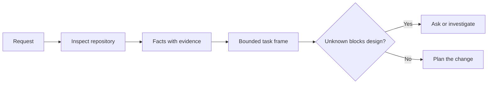

# Frame the Task Before the Agent Writes Code

> Một agent lập trình có thể triển khai một tác vụ rõ ràng nhanh chóng. Nó cũng có thể triển khai một tác vụ không rõ ràng nhanh chóng. Tốc độ giống nhau. Chi phí thì không.

**Type:** Learn + Build
**Languages:** Python (stdlib)
**Prerequisites:** Phase 14 lessons 31 and 36
**Time:** ~60 minutes

## Learning Objectives

- Biến một yêu cầu thành một khung tác vụ có giới hạn trước khi chỉnh sửa.
- Tách các sự thật trong kho mã khỏi các giả định và câu hỏi mở.
- Định nghĩa các đường dẫn được phép, đường dẫn bị cấm và bằng chứng nghiệm thu.
- Quyết định khi nào việc khảo sát đã đủ để bắt đầu công việc.

## The Expensive Failure

“Thêm bảo vệ chống email trùng” nghe cụ thể. Nó không cụ thể. Tính duy nhất thuộc về API, dịch vụ miền hay cơ sở dữ liệu? So sánh có phân biệt chữ hoa chữ thường không? Dạng lỗi nào đã công khai? Có được phép di chuyển không? Kiểm thử nào chứng minh hành vi?

Một agent có năng lực sẽ lấp các khoảng trống đó bằng những lựa chọn có vẻ hợp lý. Đó là trường hợp nguy hiểm vì triển khai có thể sạch, được kiểm thử và vẫn không tương thích với hệ thống.

Do đó, đơn vị đầu tiên của công việc agent lập trình không phải một chỉnh sửa. Đó là một khung tác vụ được hỗ trợ bởi bằng chứng kho mã.

## The Task Frame

Một khung hữu ích có sáu trường:

| Trường | Câu hỏi |
|---|---|
| Mục tiêu | Hành vi có thể quan sát nào phải thay đổi? |
| Các sự thật trong kho mã | Bạn đã xác minh điều gì trong mã, kiểm thử, cấu hình hoặc lịch sử? |
| Các đường dẫn được phép | Thay đổi có thể nằm ở đâu? |
| Các đường dẫn bị cấm | Điều gì phải giữ nguyên không bị chạm? |
| Bằng chứng nghiệm thu | Những lệnh hoặc quan sát nào chứng minh mục tiêu? |
| Các điều chưa biết | Những quyết định nào vẫn cần bằng chứng hoặc phán đoán của con người? |

Các sự thật cần bằng chứng. “API sử dụng 409 cho các trường hợp trùng” không phải một sự thật cho đến khi bạn có thể chỉ đến kiểm thử hoặc bộ xử lý hiện có. Một đường dẫn file và dòng là đủ. Một kết quả lệnh tốt hơn khi hành vi quan trọng.



## Reconnaissance Is a Search for Constraints

Đừng đọc toàn bộ kho mã. Tìm kiếm các bề mặt ràng buộc thay đổi:

1. Hành vi hiện tại và bên gọi của nó.
2. Kiểm thử hiện có gần nhất.
3. Hợp đồng công khai hoặc dạng được tuần tự hóa.
4. Các chỉ dẫn dự án chi phối đường dẫn.
5. Các lệnh xây dựng và xác minh.
6. Các thay đổi tương tự đã hoàn tất cho thấy các mẫu cục bộ.

Dừng khi mọi quyết định được lên kế hoạch đều được hỗ trợ bởi bằng chứng, được ủy nhiệm rõ ràng hoặc được liệt kê là một điều chưa biết. Đọc thêm sau thời điểm đó thường là né tránh.

## Unknowns Are Not Failures

Một điều chưa biết là một khoảng trống được kiểm soát. Một giả định là một câu trả lời không được kiểm soát cho khoảng trống đó.

Phân loại mỗi điều chưa biết:

- **Có thể khám phá:** kho mã hoặc hệ thống đang chạy có thể trả lời nó.
- **Có thể quyết định:** hợp đồng tác vụ cho agent thẩm quyền lựa chọn.
- **Con người:** lựa chọn thay đổi hành vi sản phẩm, chi phí, rủi ro hoặc khả năng tương thích công khai.
- **Hoãn lại:** lựa chọn nằm ngoài phần này và thuộc về các mục tiêu loại trừ.

Agent nên tiếp tục qua các điều chưa biết có thể khám phá và được ủy nhiệm. Nó nên tạm dừng ở các điều chưa biết thuộc con người trước khi lựa chọn bị chôn trong mã.

## Acceptance Before Implementation

Viết bằng chứng trước bản vá. Bằng chứng có thể là:

- một lệnh kiểm thử đơn vị hoặc tích hợp tập trung;
- một hành trình trình duyệt với một viewport có tên và trạng thái được mong đợi;
- một yêu cầu trên đường truyền và hợp đồng phản hồi chính xác;
- một phép đo hiệu năng với một ngưỡng;
- một kiểm tra phạm vi xác nhận không file không liên quan nào thay đổi.

“Các kiểm thử đạt” không phải một kế hoạch chứng minh. Nêu tên kiểm thử có thẩm quyền và khẳng định nó hỗ trợ.

## Build It

Bài thực hành tạo một `TaskFrame`, xác thực các ranh giới và bằng chứng của nó và ghi `outputs/task-frame.md`.

Chạy từ thư mục bài học này:

```bash
python3 code/main.py
python3 -m unittest discover code/tests -v
```

Phá ví dụ theo bốn cách: loại bỏ mục tiêu, loại bỏ một bằng chứng sự thật, làm một đường dẫn được phép và bị cấm chồng lấp và loại bỏ lệnh nghiệm thu. Bộ xác thực nên từ chối mỗi khung vì một lý do khác nhau.

## Use It in a Real Repository

Trước khi yêu cầu một agent chỉnh sửa:

1. Viết mục tiêu như một hành vi, không phải một thay đổi file.
2. Ghi lại hai hoặc ba sự thật với bằng chứng chính xác.
3. Nêu tên tập đường dẫn được phép nhỏ nhất.
4. Nêu không gian âm một cách tường minh.
5. Viết lệnh hoặc quan sát đóng tác vụ.
6. Liệt kê các quyết định mà bạn chưa có đủ cơ sở.

Khung nên vừa một màn hình. Nếu không thể, tác vụ có thể chứa nhiều thay đổi có thể xác minh độc lập.

## Exercises

1. Định khung một lỗi thực từ một trong các kho mã của bạn mà không đề xuất một lời giải.
2. Tìm một khẳng định trong khung thực ra là một giả định. Thay nó bằng bằng chứng.
3. Thêm một điều chưa biết thuộc con người mà câu trả lời sẽ thay đổi hợp đồng công khai.
4. Tách một đường dẫn được phép rộng thành tập an toàn nhỏ nhất.
5. Thêm một bằng chứng phạm vi vào bằng chứng nghiệm thu.

## Further Reading

- [Nuseibeh and Easterbrook, Requirements Engineering: A Roadmap](https://www.cs.toronto.edu/~sme/papers/2000/ICSE2000.pdf), để neo triển khai vào các mục tiêu thực tế và các ràng buộc đang tiến hóa.
- [Yang et al., SWE-agent: Agent-Computer Interfaces Enable Automated Software Engineering](https://arxiv.org/abs/2405.15793), cho bằng chứng rằng giao diện quanh một agent lập trình thay đổi hiệu quả của nó.

## What You Keep

Giữ `outputs/task-frame.md`. Nó là đầu vào cho bài tiếp theo, nơi khung trở thành một kế hoạch thực thi được hỗ trợ bởi bằng chứng.
