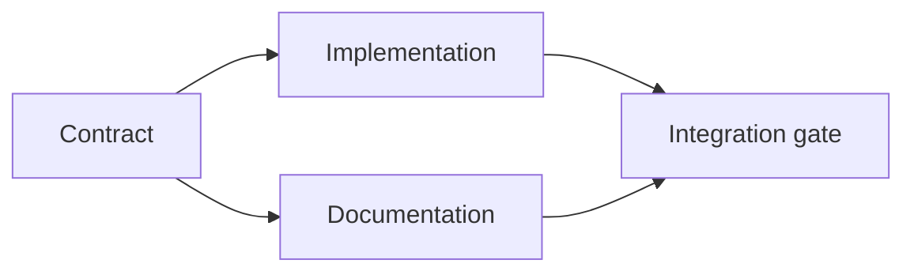

# Build an Evidence-Backed Execution Plan

> Một kế hoạch không phải một danh sách việc cần làm đẹp hơn. Đó là một đồ thị phụ thuộc trong đó mỗi thay đổi có một lý do và mỗi nút cuối có bằng chứng.

**Type:** Learn + Build
**Languages:** Python (stdlib)
**Prerequisites:** Phase 14 lesson 43
**Time:** ~65 minutes

## Learning Objectives

- Chuyển một khung tác vụ thành các mục công việc với bằng chứng và chứng minh.
- Mô hình hóa thứ tự như các phụ thuộc thay vì trình tự văn xuôi.
- Phát hiện các sự thật bị thiếu, phụ thuộc không xác định và chu trình trước khi chỉnh sửa.
- Tách các bước có thể chạy cùng nhau khỏi các bước phải chờ.

## Why Agent Plans Fail

Các kế hoạch yếu lặp lại yêu cầu ở thì tương lai:

1. Cập nhật API.
2. Thêm các kiểm thử.
3. Cập nhật tài liệu.

Không điều gì trong danh sách đó nói điều gì đã được tìm thấy, vì sao các file đó đúng, hợp đồng nào thay đổi trước hoặc điều gì có thể xảy ra đồng thời. Một agent có thể làm theo mọi bước và vẫn tạo ra việc làm lại.

Một kế hoạch mạnh đưa ra năm cam kết cho mỗi mục công việc:

| Cam kết | Mục đích |
|---|---|
| Định danh | Tham chiếu ổn định cho các phụ thuộc và bàn giao |
| Thay đổi | Thay đổi hành vi hoặc hợp đồng nhỏ nhất |
| Bằng chứng | Các sự thật kho mã biện minh cho thay đổi |
| Các phụ thuộc | Công việc phải đúng trước |
| Chứng minh | Kiểm tra chính xác đóng mục |

## Plan the Contract Before Its Implementations

Khi nhiều bề mặt phụ thuộc vào cùng hành vi, định nghĩa hành vi trước. Các kiểm thử, triển khai, tài liệu và tích hợp khi đó có thể chia sẻ một hợp đồng thay vì bịa bốn phiên bản.



Đồ thị phơi bày tính đồng thời an toàn. Triển khai và tài liệu có thể tiến hành cùng nhau sau khi hợp đồng được cố định. Tích hợp chờ cả hai.

## Evidence Changes the Plan

Bằng chứng kho mã không phải trang trí. Nó nên có khả năng thay đổi công việc:

- Một hàm trợ giúp hiện có loại bỏ một trừu tượng mới được lên kế hoạch.
- Một kiểm thử tương thích buộc một bước di chuyển.
- Một ràng buộc triển khai chuyển một thay đổi schema sang một tác vụ khác.
- Một kiểu phản hồi công khai thay đổi thứ tự triển khai và tài liệu.

Nếu bằng chứng không thể thay đổi kế hoạch, nó có lẽ không phải bằng chứng cho quyết định đó.

## Design for Interruption

Các phiên agent lập trình kết thúc bất ngờ. Một kế hoạch có thể tiếp tục có các mục công việc đủ nhỏ để một phiên khác có thể xác định:

- mục nào đã hoàn tất;
- chứng minh nào đã chạy;
- những sản phẩm nào thay đổi;
- những phụ thuộc nào hiện được bỏ chặn;
- mục an toàn tiếp theo là gì.

Đừng chỉ mã hóa trạng thái trong các ô được đánh dấu trong một cuộc trò chuyện. Lưu kế hoạch cạnh công việc.

## Plan Validation

Từ chối kế hoạch trước thực thi khi:

- một định danh bị trùng;
- một mục công việc không có bằng chứng;
- một mục công việc không có chứng minh;
- một phụ thuộc nêu tên một mục không xác định;
- đồ thị chứa một chu trình;
- hành động không thể đảo ngược đầu tiên xảy ra trước khi sự bất định liên quan được giải quyết.

Năm kiểm tra đầu mang tính cơ học. Kiểm tra cuối yêu cầu phán đoán và nên được nêu rõ.

## Build It

`code/main.py` mô hình hóa các mục công việc, xác thực các bằng chứng của chúng, tính các đợt thực thi bằng một sắp xếp tô pô và ghi `outputs/evidence-plan.json`.

Chạy:

```bash
python3 code/main.py
python3 -m unittest discover code/tests -v
```

Ví dụ tạo ba đợt. Định nghĩa hợp đồng chạy trước. Triển khai và tài liệu chạy cùng nhau. Cổng tích hợp chạy cuối.

## Use It with a Coding Agent

Yêu cầu agent tạo kế hoạch trước khi nó thay đổi các file. Đánh giá kế hoạch về ba điều:

1. Mỗi khẳng định về đường dẫn và hành vi có một bằng chứng kho mã.
2. Mỗi mục có một chứng minh hoàn thành rõ ràng.
3. Đồ thị trì hoãn công việc tốn kém hoặc không thể đảo ngược cho đến khi sự bất định mà nó phụ thuộc được giải quyết.

Phê duyệt kế hoạch, không phải một lời hứa mơ hồ sẽ cẩn thận.

## Exercises

1. Thêm một mục di chuyển yêu cầu phê duyệt rõ ràng của con người.
2. Tạo một chu trình và giải thích bất đồng sản phẩm ẩn đằng sau nó.
3. Tách một mục có hai lệnh chứng minh.
4. Thêm một mục công việc có thể chạy trong đợt thứ hai mà không chạm một trong hai nhánh hiện có.
5. Dựng kế hoạch dưới dạng Markdown trong khi giữ JSON làm nguồn sự thật.

## Further Reading

- [Nuseibeh and Easterbrook, Requirements Engineering: A Roadmap](https://www.cs.toronto.edu/~sme/papers/2000/ICSE2000.pdf), cho mối quan hệ lặp giữa các mục tiêu, đặc tả, đồng thuận và tiến hóa.
- [Barry Boehm, A Spiral Model of Software Development and Enhancement](https://dl.acm.org/doi/10.1145/12944.12948), cho việc sắp thứ tự phát triển quanh giải quyết rủi ro thay vì một trình tự tuyến tính cố định.

## What You Keep

Giữ `outputs/evidence-plan.json`. Nó trở thành hợp đồng ủy nhiệm trong bài tiếp theo.
