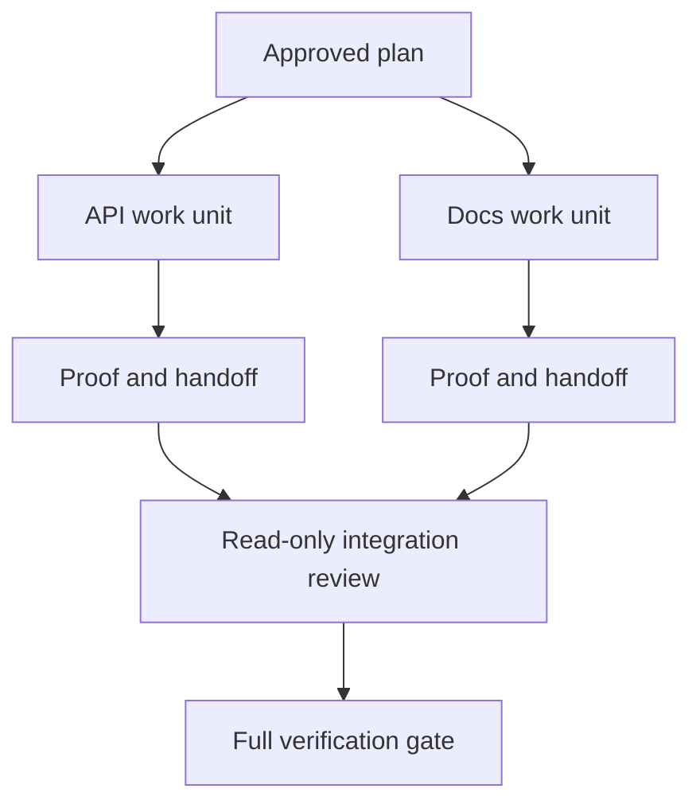

# Delegate Agent Work with Isolation and Merge Contracts

> Các agent song song chỉ tiết kiệm thời gian đồng hồ khi công việc độc lập. Nếu không, chúng biến một tác vụ rõ ràng thành một vấn đề phối hợp với tỷ lệ thất bại nhanh hơn.

**Type:** Learn + Build
**Languages:** Python (stdlib)
**Prerequisites:** Phase 14 lessons 39 and 44
**Time:** ~70 minutes

## Learning Objectives

- Quyết định liệu ủy nhiệm có được biện minh bởi sự độc lập thực hay không.
- Cho mỗi worker quyền sở hữu file độc quyền và chứng minh tường minh.
- Tính các đợt thực thi từ các phụ thuộc.
- Thiết kế một hợp đồng hợp nhất để kết hợp công việc agent an toàn.

## The Parallelism Test

Đừng ủy nhiệm vì có thêm các agent khả dụng. Ủy nhiệm khi ít nhất một trong các điều này đúng:

- hai cuộc điều tra có thể trả lời các điều chưa biết khác nhau một cách độc lập;
- hai triển khai sở hữu các file và hợp đồng rời nhau;
- một bên đánh giá có thể kiểm tra một sản phẩm đã hoàn tất mà không thay đổi nó;
- một kiểm tra bên ngoài chậm có thể chạy trong khi công việc cục bộ tiếp tục.

Giữ công việc tuần tự khi các agent cần cùng file, cùng quyết định chưa được giải quyết hoặc cùng môi trường có thể thay đổi.

## A Work Unit Is a Contract

Mỗi đơn vị được ủy nhiệm cần:

| Trường | Ý nghĩa |
|---|---|
| Mục tiêu | Một kết quả có thể quan sát |
| Bên chịu trách nhiệm | Một worker chịu trách nhiệm giải trình |
| Các đường dẫn | Quyền sở hữu ghi độc quyền |
| Các phụ thuộc | Các đơn vị đã hoàn tất bắt buộc trước khi bắt đầu |
| Chứng minh | Bằng chứng chính xác được trả về bên tích hợp |
| Bàn giao | Các file thay đổi, quyết định đã đưa ra, rủi ro còn lại |

“Xử lý backend” không phải một đơn vị công việc. “Triển khai kiểm tra trùng trong `app/accounts.py` và chứng minh nó bằng kiểm thử tài khoản tập trung” thì có.

## Isolation Has Three Layers

1. **Cô lập hệ thống file:** các worktree hoặc sandbox riêng ngăn các chỉnh sửa dùng chung vô tình.
2. **Cô lập quyền sở hữu:** các hợp đồng ngăn hai worker cố ý chỉnh sửa cùng đường dẫn.
3. **Cô lập trạng thái:** các log và đầu ra riêng ngăn một worker ghi đè bằng chứng của worker khác.

Cô lập hệ thống file không giải quyết quyền sở hữu. Hai worktree sạch vẫn có thể tạo các thiết kế xung đột. Hợp đồng hợp nhất phải giải quyết các giao diện dùng chung trước khi công việc bắt đầu.



## The Integrator Does Not Rebuild the Work

Bên tích hợp nên:

1. xác nhận mỗi bàn giao khớp phạm vi được giao của nó;
2. đọc đầu ra chứng minh, không chỉ bản tóm tắt của worker;
3. kết hợp các thay đổi theo thứ tự phụ thuộc;
4. chạy toàn bộ cổng xuyên đơn vị;
5. từ chối mở rộng phạm vi ẩn;
6. ghi lại các xung đột như các quyết định mới, không phải các chỉnh sửa âm thầm.

Nếu tích hợp yêu cầu viết lại hầu hết kết quả của một worker, phép phân rã gốc đã sai.

## Human and Agent Roles

Ủy nhiệm không loại bỏ phán đoán của con người. Con người vẫn sở hữu các lựa chọn thay đổi hành vi công khai, rủi ro, thẩm quyền hoặc chi phí không thể đảo ngược. Các agent có thể sở hữu điều tra, triển khai, xác minh và đánh giá có giới hạn.

Đây là tính tự chủ được hiệu chỉnh: hệ thống cấp tự do ở nơi bằng chứng và khôi phục mạnh, và yêu cầu một checkpoint ở nơi hệ quả cao.

## Build It

Bài thực hành kiểm tra chồng lấp đường dẫn, xác thực các phụ thuộc, tính các đợt thực thi an toàn và ghi `outputs/delegation-plan.json`.

Chạy:

```bash
python3 code/main.py
python3 -m unittest discover code/tests -v
```

Thay đổi đơn vị tài liệu để sở hữu `app/`. Kế hoạch nên chặn vì đường dẫn cha đó chồng lấp đơn vị API.

## Exercises

1. Phân rã một thay đổi thực thành hai đơn vị công việc độc lập và một bên tích hợp.
2. Tìm một phép chia song song được đề xuất chỉ trông có vẻ độc lập. Nêu quyết định dùng chung.
3. Thêm một worker nghiên cứu chỉ đọc có đầu ra là một bảng sự thật.
4. Thêm một cổng hợp nhất kiểm tra tập file thay đổi cuối cùng đối với mọi hợp đồng đơn vị.
5. Định nghĩa một quy tắc hủy cho một worker có phụ thuộc trở nên không hợp lệ.

## Further Reading

- [Reid Smith, The Contract Net Protocol](https://doi.org/10.1109/TC.1980.1675516), cho một trình bày hình thức sớm về phân bổ tác vụ phân tán và báo cáo kết quả.
- [Eric Horvitz, Principles of Mixed-Initiative User Interfaces](https://dl.acm.org/doi/10.1145/302979.303030), để quyết định khi nào tự động hóa nên hành động và khi nào nó nên trả quyền kiểm soát về một người.

## What You Keep

Giữ `outputs/delegation-plan.json`. Nó ghi lại vì sao phép chia an toàn, ai sở hữu mỗi đường dẫn và tích hợp phải nhận chứng minh nào.
