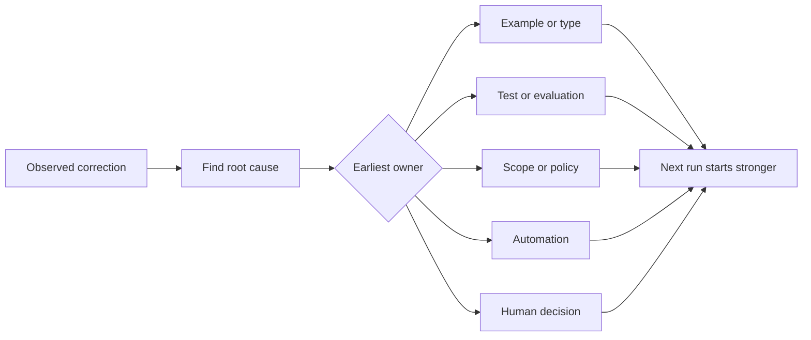

# Turn Every Agent Correction into a System Improvement

> Một sửa chữa chỉ nằm trong trò chuyện sửa một lần chạy. Một sửa chữa được nâng thành một kiểm thử, ranh giới, ví dụ hoặc công cụ cải thiện mọi lần chạy sau.

**Type:** Learn + Build
**Languages:** Python (stdlib)
**Prerequisites:** Phase 14 lessons 37 to 41
**Time:** ~65 minutes

## Learning Objectives

- Chuyển các sửa chữa agent thành các biện pháp kiểm soát bền vững.
- Đặt mỗi biện pháp kiểm soát ở lớp sớm nhất có thể ngăn tái diễn.
- Loại trùng các bài học lặp bằng các dấu vân tay ổn định.
- Loại bỏ các biện pháp kiểm soát không còn bảo vệ một rủi ro thực.

## Corrections Are Evidence

Khi bạn bảo một agent “đừng chỉnh sửa file đó,” bạn đã học được rằng ranh giới phạm vi không thể thực thi. Khi bạn nói “hình dạng đầu ra này sai,” bạn đã học được rằng một ví dụ hoặc kiểm thử bị thiếu. Khi thiết lập lại thất bại, bạn đã học được rằng tri thức môi trường thuộc về tự động hóa.

Coi sửa chữa như một quan sát về hệ thống công việc, không phải như một thất bại viết prompt.

## Promote to the Earliest Effective Layer

Sử dụng thứ tự này:

| Thất bại tái diễn | Đích bền vững |
|---|---|
| Kết quả sai hoặc hồi quy | Kiểm thử hoặc đánh giá |
| Hành động ngoài phạm vi hoặc không an toàn | Chính sách phạm vi hoặc quyền |
| Lỗi thiết lập hoặc lệnh lặp lại | Tự động hóa hoặc công cụ |
| Lỗi định dạng đầu ra lặp lại | Ví dụ chuẩn cộng bộ xác thực |
| Quy ước cục bộ mơ hồ | Chỉ dẫn với một kiểm tra kịch bản |
| Bất đồng sản phẩm | Bản ghi quyết định của con người |

Các biện pháp kiểm soát sớm hơn rẻ hơn. Một kiểu ngăn một trạng thái không hợp lệ mạnh hơn một bình luận đánh giá bắt nó sau này. Một kiểm thử tập trung mạnh hơn một đoạn yêu cầu agent ghi nhớ.



## The Ratchet Record

Ghi lại:

- triệu chứng;
- nguyên nhân gốc;
- hệ quả;
- số lần tái diễn;
- biện pháp kiểm soát được chọn;
- xác minh cho biện pháp kiểm soát;
- bên chịu trách nhiệm;
- ngày để đánh giá hoặc loại bỏ nó.

Đừng nâng mọi sở thích một lần. Nâng một sửa chữa khi tái diễn hoặc hệ quả biện minh cho sự phức tạp thường trực.

## Separate Cause from Symptom

“Agent đã chỉnh sửa README” là một triệu chứng. Các nguyên nhân có thể bao gồm:

- tác vụ cho phép gốc kho mã;
- tài liệu được ngầm coi là an toàn;
- kế hoạch gộp triển khai và tài liệu;
- hai worker có quyền sở hữu chồng lấp.

Mỗi nguyên nhân thuộc về một biện pháp kiểm soát khác. Một quy tắc chỉ lặp lại triệu chứng sẽ thất bại trong trường hợp hơi khác tiếp theo.

## Controls Also Decay

Các biện pháp kiểm soát cũ có thể xung đột, làm phình ngữ cảnh và mã hóa một hệ thống không còn tồn tại. Mỗi quy tắc được nâng cần một kiểm tra loại bỏ. Loại bỏ hoặc viết lại nó khi:

- kiến trúc bên dưới thay đổi;
- một biện pháp kiểm soát thực thi được mạnh hơn thay thế nó;
- thất bại không tái diễn qua một khoảng thời gian có ý nghĩa;
- biện pháp kiểm soát tạo nhiều ma sát hơn rủi ro nó ngăn.

Mục tiêu không phải file chỉ dẫn dài nhất. Đó là hệ thống nhỏ nhất giữ lại phán đoán khó nhọc mới có được.

## Build It

Bài thực hành phân loại các sửa chữa, nâng chúng thành các biện pháp kiểm soát, tạo dấu vân tay cho các bản trùng và ghi `outputs/feedback-ratchet.json`.

Chạy:

```bash
python3 code/main.py
python3 -m unittest discover code/tests -v
```

Thêm hai sửa chữa có cách diễn đạt khác nhau với cùng nguyên nhân. Cải thiện chuẩn hóa cho đến khi chúng gộp thành một biện pháp kiểm soát mà không gộp các thất bại không liên quan.

## Exercises

1. Lấy năm sửa chữa từ một phiên lập trình gần đây và phân loại các bên chịu trách nhiệm thực sự của chúng.
2. Thay một quy tắc văn xuôi bằng một kiểm thử thực thi được.
3. Thêm trọng số hệ quả để một lần xuất hiện đầu tiên nghiêm trọng có thể được nâng ngay lập tức.
4. Thêm một bên chịu trách nhiệm và ngày loại bỏ vào đầu ra bài thực hành.
5. Đánh giá một chỉ dẫn agent hiện có và chỉ xóa nó sau khi chứng minh một biện pháp kiểm soát mạnh hơn tồn tại.

## Further Reading

- [Basili, Caldiera, and Rombach, The Goal Question Metric Approach](https://www.cs.toronto.edu/~sme/CSC444F/handouts/GQM-paper.pdf), để biến các mục tiêu thành các câu hỏi và phép đo vận hành.
- [Shinn et al., Reflexion](https://arxiv.org/abs/2303.11366), để sử dụng các trace phản hồi cải thiện các quyết định sau mà không thay đổi trọng số mô hình.
- [Madaan et al., Self-Refine](https://arxiv.org/abs/2303.17651), cho phản hồi và chỉnh sửa lặp bên trong một vòng lặp tác vụ.

## What You Keep

Giữ `outputs/feedback-ratchet.json`. Nó là phần kết thúc bền vững của lộ trình Kỹ thuật có agent hỗ trợ và đầu vào cho các thay đổi workbench tương lai.
