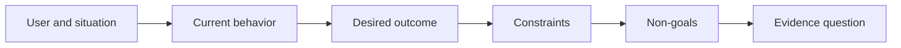

# Define the Outcome Before You Choose the Output

> Triển khai nhanh làm tăng cái giá của việc chọn sai vấn đề. Định hình kết quả trước để tốc độ hướng đúng phía.

**Type:** Learn + Build
**Languages:** Python (stdlib)
**Prerequisites:** None
**Time:** ~60 minutes

## Learning Objectives

- Viết một khung kết quả mà không nêu tên một giải pháp.
- Nhận diện người dùng, tình huống, hành vi hiện tại và thay đổi mong muốn.
- Làm các ràng buộc và mục tiêu loại trừ tường minh.
- Phát hiện sự rò rỉ giải pháp trước khi nó cứng lại thành phạm vi.

## Output Is Not Outcome

“Xây một trợ lý sự cố” nêu tên một đầu ra. Nó không nói ai cần nó, điều gì trở nên tốt hơn hoặc điều gì phải giữ an toàn.

Một khung kết quả nói:

> Khi một cảnh báo sản xuất đến, kỹ sư trực nhận diện dịch vụ đang lỗi và một hành động tiếp theo an toàn trong vòng hai phút, trong khi chẩn đoán vẫn chỉ đọc và có thể kiểm toán.

Câu đó có thể được thỏa mãn bằng phần mềm, một sổ tay vận hành, một sửa chữa dữ liệu hoặc một thay đổi giao diện nhỏ hơn. Nó giữ nhóm gắn với kết quả thay vì sản phẩm đầu tiên mà ai đó tưởng tượng.

## The Six-Part Frame

| Phần | Câu hỏi |
|---|---|
| Người dùng | Ai trực tiếp trải nghiệm vấn đề? |
| Tình huống | Nó xảy ra khi nào và ở đâu? |
| Hành vi hiện tại | Điều gì xảy ra hôm nay, bao gồm các cách làm vòng? |
| Kết quả mong muốn | Trạng thái có thể quan sát nào nên cải thiện? |
| Các ràng buộc | Những giới hạn an toàn, chính sách, chi phí hoặc tương thích nào được cố định? |
| Các mục tiêu loại trừ | Công việc liền kề hấp dẫn nào bị loại trừ? |



## Find Solution Leakage

Các phát biểu kết quả làm rò giải pháp khi chúng chứa một dạng sản phẩm, giao diện, lựa chọn mô hình, framework hoặc kiến trúc chưa được bằng chứng biện minh.

- “Người dùng nhận một bản tóm tắt AI hàng tuần” làm rò bản tóm tắt và nhịp.
- “Người dùng hiểu các thay đổi tài khoản trước phê duyệt” nêu kết quả.
- “Triển khai một cơ sở dữ liệu vector” làm rò hạ tầng.
- “Bằng chứng chính sách liên quan khả dụng trong khi đánh giá” nêu một khả năng.

Các ràng buộc có thể nêu tên công nghệ khi tính tương thích thực sự cố định nó. Ghi lại vì sao nó được cố định.

## Constraints Protect the Outcome

Các ràng buộc không phải các chi tiết triển khai. Chúng là một phần mục tiêu thực tế:

- không có các lần ghi sản xuất trong khi chẩn đoán;
- phản hồi trong ngân sách thời gian sự cố;
- các sự kiện kiểm toán hiện có vẫn có thẩm quyền;
- không có phụ thuộc runtime mới;
- hành vi trợ năng vẫn nguyên vẹn.

Một bản xây dựng đạt kết quả bằng cách vi phạm một ràng buộc đã không đạt kết quả.

## Non-Goals Create a Boundary

Các mục tiêu loại trừ ngăn một phần hữu ích biến thành một nền tảng. Các mục tiêu loại trừ tốt đủ cụ thể để từ chối công việc:

- không khắc phục tự động;
- không có hệ thống định tuyến cảnh báo mới;
- không thay thế chỉ huy sự cố;
- không phân tích lịch sử trong phần này.

## Build It

Bài thực hành xác thực một `OutcomeFrame` và ghi `outputs/outcome-frame.json`.

```bash
python3 code/main.py
python3 -m unittest discover code/tests -v
```

Thay kết quả mong muốn bằng “sử dụng trợ lý sự cố.” Bộ xác thực nên gắn cờ rằng đầu ra được đề xuất đã rò vào kết quả.

## Exercises

1. Viết lại một yêu cầu tính năng từ backlog của bạn thành một khung kết quả.
2. Thêm một ràng buộc thay đổi những giải pháp nào còn khả thi.
3. Thêm hai mục tiêu loại trừ giữ phần đầu tiên nhỏ.
4. Nhận diện quan sát sớm nhất sẽ bác bỏ kết quả mong muốn.
5. Viết ba đầu ra khác nhau có thể thỏa mãn cùng kết quả.

## Further Reading

- [Nuseibeh and Easterbrook, Requirements Engineering: A Roadmap](https://www.cs.toronto.edu/~sme/papers/2000/ICSE2000.pdf), để coi các mục tiêu thực tế là mỏ neo cho công việc phần mềm.
- [Dardenne, van Lamsweerde, and Fickas, Goal-Directed Requirements Acquisition](https://doi.org/10.1016/0167-6423(93)90021-G), để tinh chỉnh các mục tiêu cấp cao thành các ràng buộc và yêu cầu vận hành.

## What You Keep

Giữ `outputs/outcome-frame.json`. Bài tiếp theo kiểm tra nó đối với workflow mà mọi người thực sự thực hiện.
