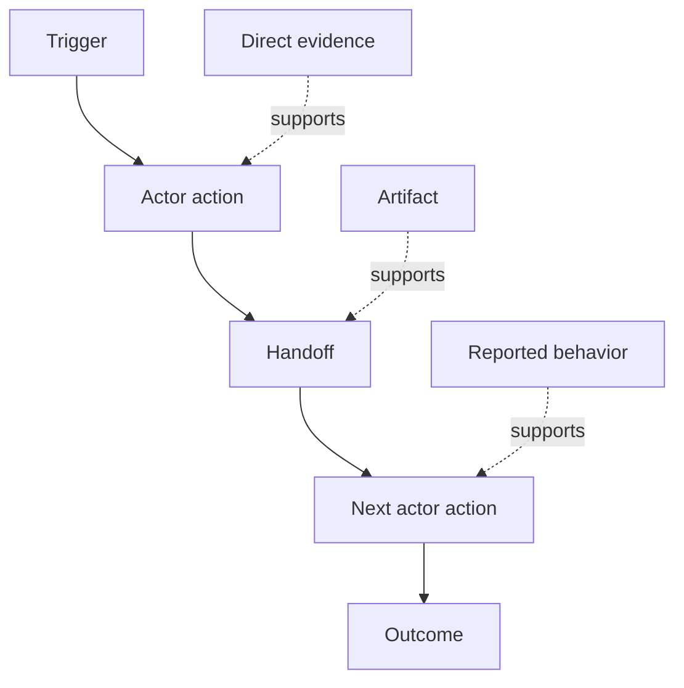

# Discover the Workflow People Actually Perform

> Các yêu cầu không chờ trong một cuộc họp để được thu thập. Chúng rải rác xuyên các hành động, cách làm vòng, bản ghi và bất đồng.

**Type:** Learn + Build
**Languages:** Python (stdlib)
**Prerequisites:** Phase 14 lesson 47
**Time:** ~70 minutes

## Learning Objectives

- Mô hình hóa workflow hiện tại như các hành động có thứ tự với bằng chứng.
- Tách quan sát trực tiếp khỏi hành vi được báo cáo hoặc suy ra.
- Định vị ma sát, các bàn giao, thẩm quyền và trạng thái ẩn.
- Giữ các khẳng định không chắc chắn nhìn thấy được thay vì biến chúng thành các yêu cầu.

## Start with the Current System

Đừng bắt đầu bằng cách hỏi mọi người muốn những tính năng nào. Bắt đầu bằng cách tái dựng điều gì đang xảy ra.

Với mỗi bước, ghi lại:

| Trường | Ví dụ |
|---|---|
| Bên thực hiện | Kỹ sư trực |
| Kích hoạt | Cảnh báo sản xuất đến |
| Hành động | Mở cảnh báo, rồi tìm các dashboard |
| Đầu vào | Payload cảnh báo và bản ghi triển khai |
| Đầu ra | Dịch vụ ứng viên và bên chịu trách nhiệm |
| Ma sát | Chuyển ngữ cảnh xuyên ba công cụ |
| Thẩm quyền | Chỉ huy sự cố phê duyệt một lần ghi |
| Bằng chứng | Bản ghi màn hình, log sự cố, sổ tay vận hành |

Workflow lớn hơn màn hình. Nó bao gồm chờ đợi, sao chép-dán, các kênh bên, phê duyệt, phục hồi lỗi và các bước mà mọi người đã ngừng nhận thấy.

## Evidence Has Strength

Sử dụng một thang bằng chứng đơn giản:

1. **Hành vi trực tiếp:** quan sát, trace, bản ghi hoặc sự kiện hệ thống.
2. **Sản phẩm:** phiếu, sổ tay vận hành, log, biểu mẫu hoặc đầu ra đã hoàn tất.
3. **Hành vi được báo cáo:** một người mô tả điều họ làm.
4. **Suy luận:** nhóm kết luận điều gì có lẽ xảy ra.

Cả bốn có thể hữu ích. Chỉ hai loại đầu chứng minh hành vi hiện tại trực tiếp. Gắn nhãn phần còn lại để độ tin cậy không âm thầm tăng phồng.



## Search for Four Things

- **Ma sát:** nỗ lực, trì hoãn, nhập lại hoặc phục hồi lặp lại.
- **Trạng thái ẩn:** các sự thật được mang trong trí nhớ, trò chuyện hoặc ghi chú cá nhân.
- **Thẩm quyền:** người hoặc hệ thống được phép thực hiện một thay đổi có hệ quả.
- **Các ngoại lệ:** trường hợp mà workflow bình thường ngừng bình thường.

Các tính năng AI thường thất bại ở các bàn giao và ngoại lệ vì luồng thành công là đường duy nhất được định hình.

## Do Not Average Away Disagreement

Hai người dùng có thể thực hiện các workflow khác nhau vì những lý do tốt. Giữ lại các biến thể cho đến khi bạn hiểu liệu chúng biểu diễn:

- các vai trò khác nhau;
- các mức rủi ro khác nhau;
- quy trình cũ và hiện tại;
- các khác biệt chuyên môn;
- một bất đồng chính sách thực sự.

Một workflow được lấy trung bình có thể không mô tả ai.

## Build It

Bài thực hành lưu bằng chứng trên mỗi bước workflow, xác thực thứ tự và độ tin cậy, tính tỷ lệ bằng chứng trực tiếp và ghi `outputs/workflow-evidence.json`.

```bash
python3 code/main.py
python3 -m unittest discover code/tests -v
```

Thêm một đường ngoại lệ trong đó bản ghi triển khai bị thiếu. Giữ nguyên thứ tự chính và ghi lại nơi nhánh bắt đầu.

## Exercises

1. Tái dựng một workflow từ một log mà không phỏng vấn ai.
2. Phỏng vấn một người dùng và đánh dấu mọi khẳng định vẫn thiếu bằng chứng trực tiếp.
3. Thêm một ranh giới thẩm quyền và một bước phục hồi thất bại.
4. Mô hình hóa hai biến thể workflow mà không hợp nhất chúng.
5. Nhận diện một tính năng được đề xuất loại bỏ một bước nhìn thấy được nhưng để công việc ẩn nguyên không bị chạm.

## Further Reading

- [Nuseibeh and Easterbrook, Requirements Engineering: A Roadmap](https://www.cs.toronto.edu/~sme/papers/2000/ICSE2000.pdf), đặc biệt cách nó xử lý khai thác yêu cầu như diễn giải, mô hình hóa và xác thực thay vì ghi lại đơn giản.
- [Gotel and Finkelstein, An Analysis of the Requirements Traceability Problem](https://doi.org/10.1109/ICRE.1994.292398), cho sự khó khăn của việc giữ mối quan hệ giữa các yêu cầu và các nguồn của chúng.

## What You Keep

Giữ `outputs/workflow-evidence.json`. Nó biến ma sát và bất định được quan sát thành một bản đồ giả định trong bài tiếp theo.
