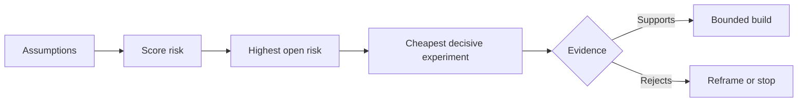

# Map Assumptions and Resolve the Riskiest One First

> Một lộ trình giấu sự bất định bên trong các tính năng. Một bản đồ giả định phơi bày điều gì phải đúng trước khi các tính năng đó xứng đáng tồn tại.

**Type:** Learn + Build
**Languages:** Python (stdlib)
**Prerequisites:** Phase 14 lesson 48
**Time:** ~65 minutes

## Learning Objectives

- Chuyển công việc được đề xuất thành các giả định tường minh.
- Chấm điểm tác động, bất định và tính không thể đảo ngược riêng biệt.
- Chọn thí nghiệm tiếp theo theo rủi ro, không phải sự hào hứng.
- Thay các giả định đã kiểm tra bằng bằng chứng và các quyết định.

## Every Build Contains Bets

Một công cụ sự cố có thể phụ thuộc vào tất cả những điều này là đúng:

- ngữ cảnh cảnh báo chứa đủ thông tin để nhận diện một dịch vụ;
- các kỹ sư tin một khuyến nghị mà họ không tự suy ra;
- thời gian phản hồi mong muốn quan trọng về vận hành;
- dữ liệu bắt buộc có thể được truy cập mà không có thẩm quyền không an toàn;
- workflow xảy ra đủ thường xuyên để biện minh cho bảo trì.

Đây không phải các tác vụ triển khai. Chúng là các điều kiện để bản xây dựng có giá trị, dùng được, khả thi và an toàn.

## Assumption Classes

| Lớp | Câu hỏi |
|---|---|
| Giá trị | Kết quả có đủ quan trọng không? |
| Tính dùng được | Người dùng có thể hiểu và hành động dựa trên nó không? |
| Tính khả thi | Hệ thống có thể tạo ra nó với dữ liệu và các ràng buộc khả dụng không? |
| Tính duy trì được | Tổ chức có thể duy trì chi phí, quyền sở hữu và vận hành không? |
| An toàn | Nó có thể thất bại mà không có hệ quả không chấp nhận được không? |

Viết các giả định như các phát biểu có thể bác bỏ. “Tính năng hữu ích” không thể được kiểm tra. “Tám trong mười kỹ sư trực nhận diện đúng dịch vụ nhanh hơn với kết quả chỉ đọc” thì có thể.

## Risk Is Not One Number

Bài thực hành sử dụng ba chiều từ một đến năm:

- **Tác động:** thiệt hại nếu giả định sai.
- **Bất định:** sự yếu của bằng chứng hiện tại.
- **Tính không thể đảo ngược:** chi phí học sau khi cam kết.

Điểm ví dụ nhân tác động và bất định, rồi thêm tính không thể đảo ngược. Công thức không phổ quát. Mục đích của nó là buộc nhóm nêu vì sao một điều chưa biết nên được giải quyết trước một điều khác.



## Design an Experiment, Not a Confirmation Ritual

Một phép kiểm tra hữu ích có:

- một khẳng định có thể sai;
- một quần thể hoặc mẫu thực tế;
- một kết quả có thể quan sát;
- một ngưỡng được quyết định trước kết quả;
- một quyết định tiếp theo cho đạt, không đạt và bằng chứng mơ hồ.

Tránh các phép kiểm tra chỉ minh họa rằng nhóm có thể xây ý tưởng.

## Reversibility Changes Order

Các lựa chọn hệ quả cao, không thể đảo ngược cần bằng chứng sớm hơn. Một lần phát lại chỉ đọc có thể đi trước một tích hợp sản xuất. Một bộ điều hợp tạm có thể đi trước một di chuyển dữ liệu. Một khuyến nghị được con người phê duyệt có thể đi trước hành động tự động.

Hình dạng bản xây dựng nên theo hình dạng bất định.

## Build It

Bài thực hành xếp hạng các giả định, phân biệt các khẳng định đã kiểm tra với đang mở, chọn rủi ro mở cao nhất và ghi `outputs/assumption-map.json`.

```bash
python3 code/main.py
python3 -m unittest discover code/tests -v
```

Thay đổi bằng chứng trên giả định rủi ro cao nhất và quan sát cách thí nghiệm tiếp theo thay đổi.

## Exercises

1. Viết năm giả định cho một tính năng bạn muốn xây dựng.
2. Thêm một giả định an toàn mà danh sách tính năng của bạn bỏ sót.
3. Định nghĩa một ngưỡng sẽ khiến bạn dừng xây dựng.
4. Thay một thí nghiệm lớn bằng một phép kiểm tra quyết định rẻ hơn.
5. So sánh xếp hạng rủi ro với ưu tiên lộ trình và giải thích sự không khớp.

## Further Reading

- [Barry Boehm, A Spiral Model of Software Development and Enhancement](https://dl.acm.org/doi/10.1145/12944.12948), cho một chu kỳ phát triển do rủi ro dẫn dắt giải quyết bất định trước cam kết sâu hơn.
- [Dardenne, van Lamsweerde, and Fickas, Goal-Directed Requirements Acquisition](https://doi.org/10.1016/0167-6423(93)90021-G), để tinh chỉnh các mục tiêu trong khi phơi bày các trở ngại và ràng buộc.

## What You Keep

Giữ `outputs/assumption-map.json`. Bài tiếp theo sử dụng nó để chọn phần nhỏ nhất có thể tạo bằng chứng mang tính quyết định.
