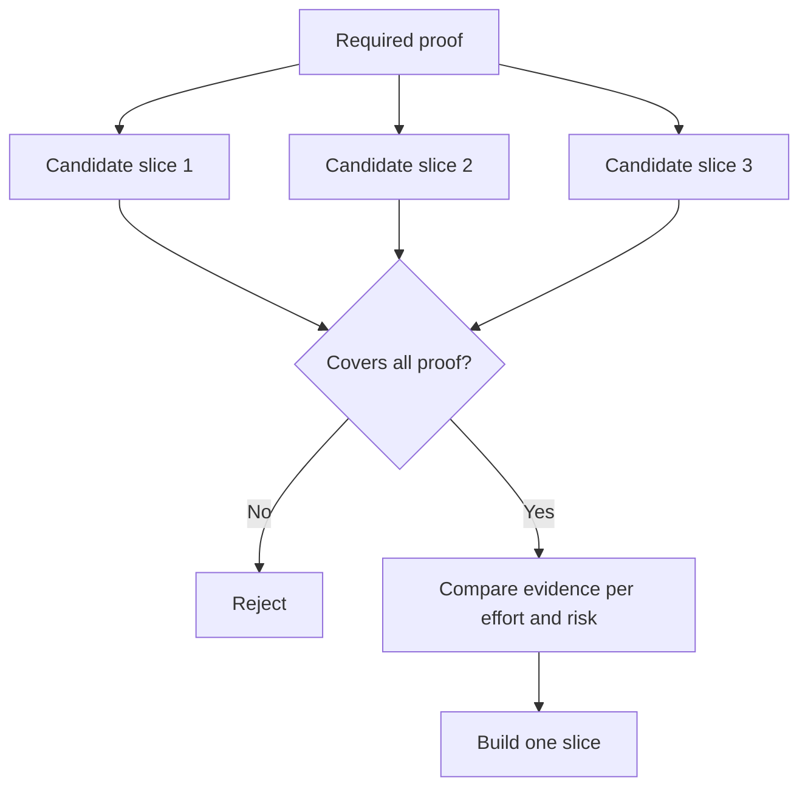

# Choose the Smallest Slice That Can Change the Decision

> Nhỏ chỉ hữu ích khi nó chứng minh điều gì đó quan trọng. Một bản xây dựng nhỏ không thể thay đổi quyết định tiếp theo chỉ đơn thuần là chưa hoàn chỉnh.

**Type:** Learn + Build
**Languages:** Python (stdlib)
**Prerequisites:** Phase 14 lesson 49
**Time:** ~65 minutes

## Learning Objectives

- Định nghĩa một phần theo các giả định nó chứng minh.
- Cân bằng giá trị kết quả, giảm bất định, nỗ lực và hệ quả.
- Ưu tiên bằng chứng có thể đảo ngược hơn cam kết sản xuất quá sớm.
- Từ chối các phần bỏ qua phần rủi ro của workflow.

## Vertical Means Evidence End to End

Một phần hữu ích đi qua workflow thực tối thiểu cần để quan sát một kết quả. Nó có thể hẹp về người dùng, dữ liệu, thời lượng và khả năng. Nó không nên hẹp bằng cách loại bỏ đúng sự bất định mà bạn cần kiểm tra.

Các ví dụ:

- Một lần phát lại chỉ đọc xuyên mười sự cố thực kiểm tra nhận diện dịch vụ và niềm tin của người vận hành.
- Một dashboard được trau chuốt trên dữ liệu tổng hợp có thể kiểm tra sự hiểu nhưng không kiểm tra tính khả thi dữ liệu.
- Một bộ tự khắc phục sản xuất kiểm tra mọi thứ cùng lúc với hệ quả không chấp nhận được.

## Define Required Proof First

Lấy các giả định mở rủi ro cao nhất và biến chúng thành một tập chứng minh bắt buộc. Một phần ứng viên chỉ đủ điều kiện nếu nó bao phủ tập đó.

Rồi so sánh các phần đủ điều kiện về:

| Chiều | Hướng |
|---|---|
| Giá trị kết quả | Nhiều hơn tốt hơn |
| Bất định được giảm | Nhiều hơn tốt hơn |
| Nỗ lực | Ít hơn tốt hơn |
| Hệ quả | Ít hơn tốt hơn |
| Tính có thể đảo ngược | Nhiều hơn tốt hơn |

Điểm của bài thực hành đơn giản có chủ ý. Cổng đủ điều kiện quan trọng hơn phép tính.



## Common False Minimums

- **Mức tối thiểu chỉ UI:** loại bỏ bất định dữ liệu và vận hành.
- **Mức tối thiểu chỉ hạ tầng:** chứng minh khả năng kỹ thuật mà không có giá trị người dùng.
- **Mức tối thiểu luồng thành công:** bỏ qua ngoại lệ tạo phần lớn rủi ro.
- **Mức tối thiểu demo:** tạo một sản phẩm thuyết phục nhưng không có phép đo lặp lại được.
- **Mức tối thiểu nền tảng:** xây máy móc tái sử dụng trước khi một workflow xứng đáng với nó.

## Add a Stop Rule

Trước triển khai, viết điều gì xảy ra nếu phần thất bại:

- từ bỏ kết quả;
- thay đổi người dùng hoặc tình huống đích;
- kiểm tra một cơ chế khác;
- thu thập bằng chứng tốt hơn;
- thu hẹp thẩm quyền thêm.

Nếu mọi kết quả dẫn đến “tiếp tục xây dựng,” phần đó không phải một thí nghiệm.

## Build It

Bài thực hành lọc các ứng viên theo chứng minh bắt buộc, chấm điểm các phần đủ điều kiện và ghi `outputs/slice-decision.json`.

```bash
python3 code/main.py
python3 -m unittest discover code/tests -v
```

Thêm một ứng viên rẻ hơn chỉ chứng minh một giả định bắt buộc. Nó nên vẫn không đủ điều kiện ngay cả khi điểm số của nó cao.

## Exercises

1. Thiết kế ba phần cho cùng kết quả ở các mức hệ quả khác nhau.
2. Nêu tập chứng minh bắt buộc trước khi chấm điểm chúng.
3. Loại bỏ một khả năng trong khi giữ bằng chứng mang tính quyết định.
4. Thêm một quy tắc dừng cho một thí điểm thất bại.
5. Nhận diện một thành phần nền tảng tái sử dụng nên chờ đến sau phần này.

## Further Reading

- [Barry Boehm, A Spiral Model of Software Development and Enhancement](https://dl.acm.org/doi/10.1145/12944.12948), để khớp mỗi chu kỳ phát triển với các rủi ro nó phải giải quyết.
- [Lenarduzzi and Taibi, MVP Explained: A Systematic Mapping Study on the Definitions of Minimal Viable Product](https://arxiv.org/abs/1609.07592), cho sự mơ hồ quanh “tối thiểu” và “khả dụng” trong thực hành sản phẩm phần mềm.

## What You Keep

Giữ `outputs/slice-decision.json`. Nó ghi lại vì sao phần này là phần nhỏ nhất có thể thay đổi quyết định.
