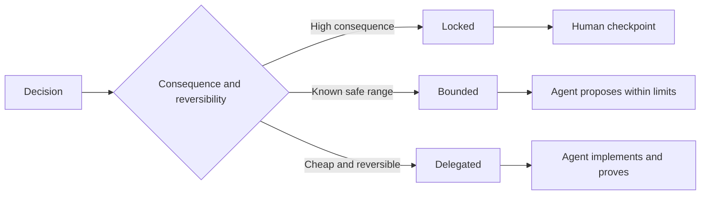

# Write Specifications That Preserve Judgment

> Một đặc tả hữu ích cố định các bất biến và bằng chứng trong khi để mở các lựa chọn triển khai có thể đảo ngược. Đó là một ranh giới quyết định, không phải một kịch bản.

**Type:** Learn + Build
**Languages:** Python (stdlib)
**Prerequisites:** Phase 14 lesson 50
**Time:** ~75 minutes

## Learning Objectives

- Tách biệt kết quả, các bất biến, ví dụ, mục tiêu loại trừ và chứng minh.
- Đánh dấu các quyết định là bị khóa, có giới hạn hoặc được ủy nhiệm.
- Giữ phán đoán agent ở nơi các lựa chọn rẻ và có thể đảo ngược.
- Yêu cầu các checkpoint con người ở nơi hệ quả hoặc hành vi công khai thay đổi.

## Two Bad Extremes

Một tác vụ thiếu đặc tả yêu cầu một agent đoán hệ thống. Một tác vụ quá đặc tả yêu cầu nó chép lại một thiết kế có thể đã sai.

Khoảng giữa hữu ích là một hợp đồng thực thi được:

| Bề mặt | Mục đích |
|---|---|
| Kết quả | Kết quả có thể quan sát |
| Các bất biến | Các điều kiện phải luôn đúng |
| Các ví dụ | Các trường hợp cụ thể tiết lộ ý định |
| Các mục tiêu loại trừ | Hành vi liền kề được loại trừ có chủ ý |
| Chính sách quyết định | Những lựa chọn nào bị khóa, có giới hạn hoặc được ủy nhiệm |
| Chứng minh | Bằng chứng bắt buộc trước khi hoàn thành |

## Three Decision Modes

- **Bị khóa:** agent không được chọn. Sử dụng cho tương thích công khai, thẩm quyền, an toàn, chi phí không thể đảo ngược hoặc một cam kết sản phẩm.
- **Có giới hạn:** agent có thể chọn trong các giới hạn tường minh. Sử dụng cho các ngân sách tìm kiếm, số lần thử lại, các phụ thuộc được phép hoặc một họ giao diện đã biết.
- **Được ủy nhiệm:** agent sở hữu lựa chọn và phải giải thích nó. Sử dụng cho cấu trúc cục bộ, tên, các tái cấu trúc có thể đảo ngược và các chi tiết triển khai.



## Specify Behavior Through Examples

Các ví dụ nén ý định tốt hơn các tính từ. “Hữu ích,” “vững chắc” và “sẵn sàng cho sản xuất” không thể thực thi. Một tập nhỏ các ví dụ bình thường, biên, thất bại và bị cấm cho cả bên xây dựng và bộ xác minh thứ gì đó cụ thể.

Các ví dụ không thay thế các bất biến. Một trường hợp đạt không thể chứng minh một quy tắc an toàn phổ quát.

## Proof Must Match the Claim

- Một kiểm thử đơn vị chứng minh một hợp đồng hàm cục bộ.
- Một kiểm thử dữ liệu truyền chứng minh hành vi tuần tự hóa và truyền tải.
- Một hành trình trình duyệt chứng minh một đường giao diện.
- Một tập phát lại chứng minh hành vi trên các trường hợp đại diện.
- Một log kiểm toán chứng minh các ranh giới thẩm quyền được giữ.

Đừng chấp nhận một lớp thấp hơn làm chứng minh cho một khẳng định lớp cao hơn.

## Preserve Unknowns Deliberately

Một đặc tả có thể nói “triển khai có thể chọn bất kỳ nguồn chỉ đọc nào trả về trong ngân sách thời gian.” Đó không phải sự mơ hồ. Đó là một quyết định được ủy nhiệm có chủ ý với một ranh giới và chứng minh.

Các đặc tả nên tiến hóa khi bằng chứng thay đổi. Giữ lý do đằng sau các lựa chọn bị khóa và có giới hạn để các nhóm sau có thể chỉnh sửa chúng mà không phải khảo cổ.

## Build It

Bài thực hành xác thực mọi bề mặt hợp đồng, kiểm tra các chế độ quyết định và ghi `outputs/executable-specification.json`.

```bash
python3 code/main.py
python3 -m unittest discover code/tests -v
```

Chuyển quyết định ghi sản xuất từ bị khóa sang được ủy nhiệm. Giải thích vì sao schema chấp nhận giá trị nhưng rủi ro sản phẩm thì không.

## Exercises

1. Chuyển một phiếu backlog thành sáu bề mặt đặc tả.
2. Thay ba chỉ dẫn triển khai bằng một bất biến và hai ví dụ.
3. Đánh dấu mọi quyết định và biện minh mỗi lựa chọn bị khóa hoặc có giới hạn.
4. Thêm một bằng chứng chứng minh cho mỗi bất biến.
5. Loại bỏ một ràng buộc không có bằng chứng hoặc lý do rủi ro.

## Further Reading

- [Nuseibeh and Easterbrook, Requirements Engineering: A Roadmap](https://www.cs.toronto.edu/~sme/papers/2000/ICSE2000.pdf), cho mối quan hệ giữa các mục tiêu, đặc tả chính xác, xác thực, đồng thuận và tiến hóa.
- [Zave and Jackson, Four Dark Corners of Requirements Engineering](https://doi.org/10.1145/237432.237434), để tách biệt các giả định môi trường, yêu cầu và đặc tả.
- [Gotel and Finkelstein, An Analysis of the Requirements Traceability Problem](https://doi.org/10.1109/ICRE.1994.292398), để giữ vì sao một yêu cầu tồn tại và nó đến từ đâu.

## What You Keep

Giữ `outputs/executable-specification.json`. Nó trở thành hợp đồng mà các agent lập trình và bên đánh giá con người chia sẻ.
