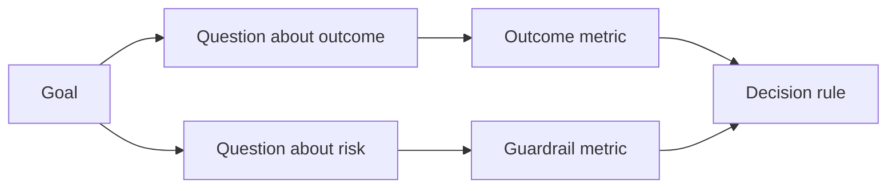

# Design Success Metrics Before the Result Exists

> Đo lường nên trả lời một quyết định, không trang trí một dashboard. Bắt đầu với mục tiêu, suy ra các câu hỏi, rồi chọn các thước đo nhỏ nhất trả lời chúng.

**Type:** Learn + Build
**Languages:** Python (stdlib)
**Prerequisites:** Phase 14 lessons 47 and 51
**Time:** ~70 minutes

## Learning Objectives

- Suy ra các câu hỏi và thước đo từ một mục tiêu kết quả.
- Định nghĩa các ngưỡng, khoảng thời gian, nguồn và hướng trước khi quan sát các kết quả.
- Ghép các thước đo kết quả với các chốt bảo vệ và thước đo đối trọng.
- Khớp bằng chứng đánh giá với quyết định mà bản xây dựng phải hỗ trợ.

## Goal, Question, Metric

Bắt đầu với một mục tiêu:

> Giảm thời gian để nhận diện dịch vụ bị ảnh hưởng mà không tăng các hành động không an toàn.

Suy ra các câu hỏi:

- Dịch vụ đúng được nhận diện nhanh đến đâu?
- Dịch vụ được nhận diện là đúng thường xuyên đến đâu?
- Chẩn đoán có giữ chỉ đọc không?
- Workflow có tăng việc bỏ qua cảnh báo hoặc khối lượng công việc của người vận hành không?

Rồi chọn các thước đo vận hành hóa các câu hỏi đó.



## A Metric Needs a Contract

Mọi thước đo cần:

| Trường | Ví dụ |
|---|---|
| Tên | `median_identification_seconds` |
| Hướng | tối đa |
| Ngưỡng | 120 |
| Khoảng thời gian | mười lần phát lại sự cố |
| Nguồn | log sự kiện phát lại |
| Quần thể | các kỹ sư trực trong thí điểm |
| Loại | kết quả hoặc chốt bảo vệ |

Không có nguồn và khoảng thời gian, một con số không thể được tái tạo. Không có một ngưỡng, nó không thể dẫn dắt một quyết định.

## Outcome, Guardrail, and Counter-Metric

- **Thước đo kết quả:** trạng thái mong muốn có cải thiện không?
- **Chốt bảo vệ:** một ràng buộc cố định có giữ đúng không?
- **Thước đo đối trọng:** cải thiện cục bộ có chuyển chi phí hoặc tác hại sang nơi khác không?

Với một workflow sự cố, tốc độ là chưa đủ. Tính đúng đắn, các lần ghi sản xuất, khối lượng công việc người vận hành và các cảnh báo bị bỏ lỡ bảo vệ trước một kết quả nhanh nhưng không an toàn.

## Offline and Online Evidence

Phát lại ngoại tuyến hữu ích cho tính lặp lại và độ bao phủ biên. Một thí điểm có giới hạn hữu ích cho hành vi thực, niềm tin và các tác động workflow. Không cái nào thay thế cái kia.

Sử dụng bằng chứng rẻ nhất có thể trả lời quyết định hiện tại. Đừng để người dùng thực tiếp xúc chỉ vì triển khai đã sẵn sàng.

## Decide Before You Measure

Viết các đường đạt, không đạt và mơ hồ trước khi nhìn thấy các kết quả. Nếu không nhóm sẽ di chuyển ngưỡng để bảo vệ bản xây dựng.

Ví dụ:

- đạt: tỷ lệ dịch vụ đúng ít nhất 0.9 và thời gian trung vị tối đa 120 giây;
- không đạt: bất kỳ lần ghi sản xuất nào hoặc tỷ lệ đúng dưới 0.75;
- mơ hồ: cải thiện nhỏ với biến thiên rộng, yêu cầu một tập phát lại lớn hơn.

## Build It

Bài thực hành xác thực một kế hoạch đo lường, đánh giá các ngưỡng bao gồm biên, ghi lại các giá trị bị thiếu và ghi `outputs/measurement-report.json`.

```bash
python3 code/main.py
python3 -m unittest discover code/tests -v
```

Loại bỏ thước đo chốt bảo vệ và quan sát vì sao kế hoạch trở nên không hợp lệ ngay cả khi các thước đo kết quả còn lại.

## Exercises

1. Suy ra ba câu hỏi từ một mục tiêu kết quả.
2. Thêm một thước đo đối trọng bắt chi phí được chuyển sang một vai trò khác.
3. Định nghĩa nguồn, quần thể và khoảng thời gian cho mọi thước đo.
4. Viết các quyết định đạt, không đạt và mơ hồ trước khi tạo các giá trị.
5. Nhận diện một thước đo dễ thu thập nhưng không thể thay đổi quyết định. Loại bỏ nó.

## Further Reading

- [Basili, Software Modeling and Measurement: The Goal/Question/Metric Paradigm](https://drum.lib.umd.edu/items/8119803a-362b-42ec-b6ce-2311713e7236), để suy ra các phép đo vận hành từ các mục tiêu tường minh.
- [Basili, Caldiera, and Rombach, The Goal Question Metric Approach](https://www.cs.toronto.edu/~sme/CSC444F/handouts/GQM-paper.pdf), để áp dụng phương pháp như một hệ thống phản hồi và cải thiện.

## What You Keep

Giữ `outputs/measurement-report.json`. Nó định nghĩa cổng bằng chứng cho giai đoạn nguyên mẫu, thí điểm hoặc sản xuất.
