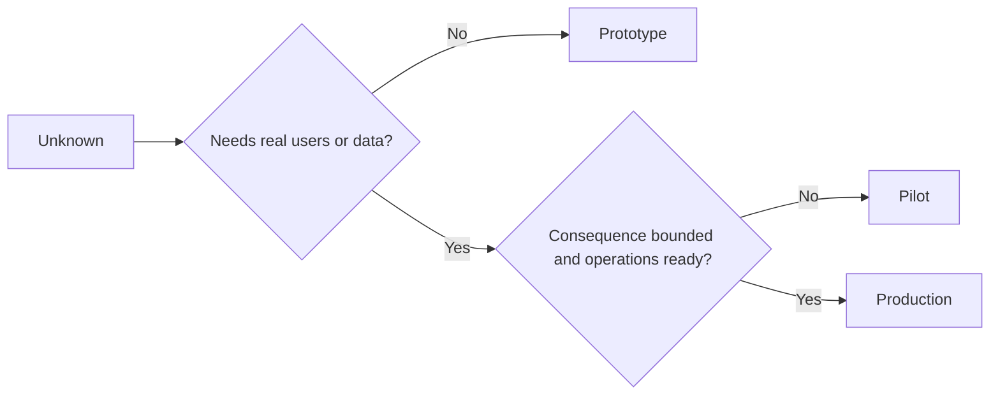

# Choose Prototype, Pilot, or Production Deliberately

> Đây là các môi trường học khác nhau, không phải các mức độ trau chuốt. Chọn giai đoạn trả lời điều chưa biết hiện tại với ít hệ quả không cần thiết nhất.

**Type:** Learn + Build
**Languages:** Python (stdlib)
**Prerequisites:** Phase 14 lessons 50 to 52
**Time:** ~70 minutes

## Learning Objectives

- Chọn một giai đoạn xây dựng từ điều chưa biết, đối tượng, dữ liệu, hệ quả và sự sẵn sàng.
- Định nghĩa các biện pháp kiểm soát và tiêu chí kết thúc dành riêng cho giai đoạn.
- Ngăn các nguyên mẫu âm thầm trở thành các hệ thống sản xuất.
- Trì hoãn thẩm quyền thực cho đến khi bằng chứng và vận hành biện minh cho nó.

## Three Different Questions

| Giai đoạn | Câu hỏi chính |
|---|---|
| Nguyên mẫu | Cơ chế này có thể tạo bằng chứng chút nào không? |
| Thí điểm | Nó có hoạt động an toàn với một đối tượng thực có giới hạn và các điều kiện thực không? |
| Sản xuất | Chúng ta có thể sở hữu nó liên tục ở mức độ tin cậy và rủi ro đã hứa không? |

Một nguyên mẫu có thể hoàn chỉnh về kỹ thuật và vẫn có thể bỏ đi. Một thí điểm có thể sử dụng dữ liệu sản xuất trong khi vẫn giới hạn về đối tượng và thẩm quyền. Sản xuất bắt đầu khi tổ chức chấp nhận trách nhiệm liên tục.

## Prototype

Sử dụng một nguyên mẫu khi điều chưa biết không yêu cầu người dùng thực hoặc dữ liệu thực. Giữ nó:

- có thể loại bỏ;
- cô lập;
- hẹp về hành vi;
- tường minh về câu hỏi học hỏi;
- không có các bảo đảm vận hành giả.

Đừng tối ưu hóa kiến trúc trước khi cơ chế xứng đáng với một giai đoạn nữa.

## Pilot

Sử dụng một thí điểm khi điều chưa biết yêu cầu hành vi thực, dữ liệu thực tế hoặc một workflow thực, nhưng hệ quả hoặc sự sẵn sàng chưa tương thích với phát hành rộng.

Một thí điểm cần:

- một đối tượng được nêu tên;
- một con người chịu trách nhiệm;
- thời lượng và thẩm quyền có giới hạn;
- kiểm toán và khôi phục;
- các ngưỡng kết quả và chốt bảo vệ;
- các tiêu chí kết thúc để mở rộng, chỉnh sửa hoặc dừng.

## Production

Sản xuất cần nhiều hơn triển khai:

- mục tiêu mức dịch vụ;
- trực và quyền sở hữu sự cố;
- đánh giá bảo mật và riêng tư;
- các biện pháp kiểm soát chi phí và dung lượng;
- khôi phục và phục hồi;
- giám sát liên tục;
- một đường loại bỏ.



## Stage Drift

Mã nguyên mẫu trở nên nguy hiểm khi nó có được người dùng, dữ liệu hoặc thẩm quyền mà không có được quyền sở hữu. Đánh dấu các ranh giới nguyên mẫu và thí điểm trong cấu hình, kiểm soát truy cập, telemetry và tài liệu. Một banner cảnh báo là chưa đủ.

Giai đoạn nên có thể quan sát từ chính hệ thống.

## Build It

Bài thực hành chọn một giai đoạn từ ngữ cảnh quyết định, trả về các biện pháp kiểm soát bắt buộc và ghi `outputs/stage-decisions.json`.

```bash
python3 code/main.py
python3 -m unittest discover code/tests -v
```

Thay ví dụ thí điểm thành hệ quả thấp với sự sẵn sàng vận hành. Giải thích bằng chứng bổ sung nào sẽ biện minh cho sản xuất.

## Exercises

1. Phân loại ba dự án hiện tại theo giai đoạn học hỏi, không phải trạng thái triển khai.
2. Viết các tiêu chí kết thúc thí điểm bao gồm một quyết định dừng.
3. Thêm một biện pháp kiểm soát kỹ thuật ngăn một nguyên mẫu tiếp cận dữ liệu sản xuất.
4. Nhận diện trách nhiệm vận hành đầu tiên làm bản xây dựng trở thành sản xuất.
5. Thiết kế một bằng chứng khôi phục cho thí điểm có giới hạn.

## Further Reading

- [Barry Boehm, A Spiral Model of Software Development and Enhancement](https://dl.acm.org/doi/10.1145/12944.12948), để khớp cam kết của mỗi lần lặp với rủi ro đã được giải quyết.
- [Fagerholm et al., Building Blocks for Continuous Experimentation](https://doi.org/10.1145/2601248.2601276), cho các điều kiện tổ chức và kỹ thuật bắt buộc để chạy các thí nghiệm liên tục.

## What You Keep

Giữ `outputs/stage-decisions.json`. Nó ghi lại vì sao mỗi giai đoạn được biện minh và những biện pháp kiểm soát nào phải tồn tại trước giai đoạn tiếp theo.
