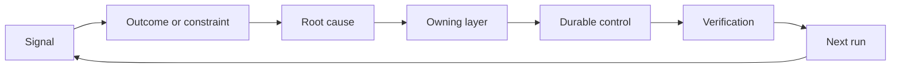

# Build a Feedback Ratchet with Ownership and Retirement

> Phát hành khép một vòng lặp xây dựng và mở vòng lặp học hỏi. Bằng chứng phải thay đổi hệ thống hoặc nó trở thành telemetry không ai sở hữu.

**Type:** Learn + Build
**Languages:** Python (stdlib)
**Prerequisites:** Phase 14 lessons 46 and 53
**Time:** ~75 minutes

## Learning Objectives

- Biến các sự cố, đánh giá, hành vi người dùng và sửa chữa thành các hành động có bên chịu trách nhiệm.
- Định tuyến mỗi tín hiệu đến ngữ cảnh, đánh giá, chính sách, runtime hoặc backlog.
- Ưu tiên tái diễn theo mức độ nghiêm trọng và tần suất.
- Cho mỗi biện pháp kiểm soát một điều kiện loại bỏ.

## Feedback Is Infrastructure

Một nhóm có thể thu thập các trace, đánh giá, phiếu hỗ trợ và log sự cố mà không học từ bất kỳ thứ nào. Cơ chế bị thiếu là nâng lên: một đường được định nghĩa từ quan sát đến một thay đổi bền vững với một bên chịu trách nhiệm và chứng minh.

Vòng lặp là:

1. quan sát một tín hiệu cụ thể;
2. kết nối nó với một kết quả, ràng buộc hoặc giả định;
3. nhận diện lớp hệ thống sớm nhất sở hữu nguyên nhân;
4. tạo một thay đổi có giới hạn;
5. xác minh rằng tái diễn trở nên ít có khả năng hơn;
6. đánh giá liệu biện pháp kiểm soát nên còn lại hay không.

## Route to the Owning Layer

| Tín hiệu | Đích |
|---|---|
| Dương tính giả, hồi quy, kết quả sai | Đánh giá hoặc kiểm thử |
| Thiếu ngữ cảnh, công việc trùng, sự thật cũ | Nguồn ngữ cảnh hoặc tuyến truy xuất |
| Hành động không an toàn hoặc khoảng trống thẩm quyền | Chính sách hoặc ranh giới quyền |
| Hết thời gian chờ, bão thử lại, phụ thuộc không khả dụng | Biện pháp kiểm soát runtime |
| Nhu cầu sản phẩm mới hoặc đánh đổi chưa giải quyết | Mục backlog được định hình |

Khắc phục nguyên nhân ở lớp hiệu quả sớm nhất. Đừng thêm một đoạn prompt nữa khi một kiểm thử hoặc quyền có thể làm thất bại bất khả thi.



## Ownership Is Part of the Control

Mỗi hành động bánh cóc cần:

- một bên chịu trách nhiệm;
- một ưu tiên dựa trên hệ quả và tái diễn;
- sản phẩm cần thay đổi;
- xác minh chứng minh thay đổi;
- một khoảng thời gian đánh giá hoặc hết hạn;
- một điều kiện loại bỏ.

Một cải thiện không có bên chịu trách nhiệm là một quan sát với định dạng tốt hơn.

## Retire Stale Controls

Các hệ thống phản hồi tích lũy chính sách. Chính sách đó có thể trở nên mâu thuẫn và tốn kém. Đánh giá các biện pháp kiểm soát khi:

- kiến trúc hoặc workflow thay đổi;
- một bất biến cấp thấp hơn thay thế một chỉ dẫn cấp cao hơn;
- thất bại được bảo vệ chưa xuất hiện qua khoảng thời gian được chọn;
- biện pháp kiểm soát chặn công việc hợp lệ thường xuyên hơn nó ngăn tác hại.

Loại bỏ cũng cần bằng chứng. Đừng xóa một biện pháp kiểm soát vì nó có vẻ cũ.

## Connect Build and Coding-Agent Feedback

Cùng cơ chế bánh cóc phục vụ cả hai lộ trình:

- Bằng chứng sản phẩm thay đổi khung kết quả, các giả định, phần hoặc kế hoạch đo lường.
- Các sửa chữa agent lập trình thay đổi các kiểm thử, ngữ cảnh, phạm vi, tự động hóa hoặc bàn giao.
- Các sự cố có thể thay đổi cả ranh giới sản phẩm và workbench agent.

Đây là lý do định hình bản xây dựng không phải một giai đoạn kết thúc trước lập trình. Nó tiếp tục qua mỗi thay đổi được chấp nhận.

## Build It

Bài thực hành phân loại các tín hiệu, tạo các hành động bánh cóc có bên chịu trách nhiệm, ưu tiên chúng và ghi `outputs/feedback-backlog.json`.

```bash
python3 code/main.py
python3 -m unittest discover code/tests -v
```

Thêm một tín hiệu hết thời gian chờ runtime và xác nhận nó định tuyến đến runtime thay vì backlog chung.

## Exercises

1. Biến một sự cố và một phàn nàn người dùng thành các hành động bánh cóc.
2. Nêu tên lớp sớm nhất có thể ngăn mỗi lần tái diễn.
3. Thêm các lệnh hoặc quan sát xác minh vào đầu ra bài thực hành.
4. Định nghĩa một điều kiện loại bỏ cho một quy tắc chính sách.
5. Truy vết một sửa chữa được chấp nhận trở lại khung tác vụ tiếp theo.

## Further Reading

- [Basili, Caldiera, and Rombach, The Goal Question Metric Approach](https://www.cs.toronto.edu/~sme/CSC444F/handouts/GQM-paper.pdf), cho học hỏi tổ chức qua đo lường hướng mục tiêu.
- [Fagerholm et al., Building Blocks for Continuous Experimentation](https://doi.org/10.1145/2601248.2601276), cho vòng lặp kỹ thuật và tổ chức kết nối bằng chứng với phát triển sản phẩm tiếp tục.
- [Nuseibeh and Easterbrook, Requirements Engineering: A Roadmap](https://www.cs.toronto.edu/~sme/papers/2000/ICSE2000.pdf), để coi các yêu cầu là tiến hóa qua vòng đời hệ thống.

## What You Keep

Giữ `outputs/feedback-backlog.json`. Nó là sản phẩm kết thúc của lộ trình Phán đoán sản phẩm và bàn giao và đầu vào cho khung kết quả tiếp theo.
