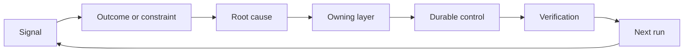

# Build a Feedback Ratchet with Ownership and Retirement

> Phát hành khép một vòng lặp xây dựng và mở vòng lặp học hỏi. Bằng chứng phải thay đổi hệ thống hoặc nó trở thành telemetry không ai sở hữu.

**Type:** Learn + Build
**Languages:** Python (stdlib)
**Prerequisites:** Phase 14 lessons 46 and 53
**Time:** ~75 minutes

## Learning Objectives

- Biến các sự cố, đánh giá, hành vi người dùng và sửa chữa thành các hành động có bên chịu trách nhiệm.
- Định tuyến mỗi tín hiệu đến ngữ cảnh, đánh giá, chính sách, runtime hoặc backlog.
- Ưu tiên tái diễn theo mức độ nghiêm trọng và tần suất.
- Cho mỗi biện pháp kiểm soát một điều kiện loại bỏ.
- Truyền đạt một quyết định bàn giao với bằng chứng, các đánh đổi và một người chịu trách nhiệm.

## Feedback Is Infrastructure

Một nhóm có thể thu thập các trace, đánh giá, phiếu hỗ trợ và log sự cố mà không học từ bất kỳ thứ nào. Cơ chế bị thiếu là nâng lên: một đường được định nghĩa từ quan sát đến một thay đổi bền vững với một bên chịu trách nhiệm và chứng minh.

Vòng lặp là:

1. quan sát một tín hiệu cụ thể;
2. kết nối nó với một kết quả, ràng buộc hoặc giả định;
3. nhận diện lớp hệ thống sớm nhất sở hữu nguyên nhân;
4. tạo một thay đổi có giới hạn;
5. xác minh rằng tái diễn trở nên ít có khả năng hơn;
6. đánh giá liệu biện pháp kiểm soát nên còn lại hay không.

## Route to the Owning Layer

| Tín hiệu | Đích |
|---|---|
| Dương tính giả, hồi quy, kết quả sai | Đánh giá hoặc kiểm thử |
| Thiếu ngữ cảnh, công việc trùng, sự thật cũ | Nguồn ngữ cảnh hoặc tuyến truy xuất |
| Hành động không an toàn hoặc khoảng trống thẩm quyền | Chính sách hoặc ranh giới quyền |
| Hết thời gian chờ, bão thử lại, phụ thuộc không khả dụng | Biện pháp kiểm soát runtime |
| Nhu cầu sản phẩm mới hoặc đánh đổi chưa giải quyết | Mục backlog được định hình |

Khắc phục nguyên nhân ở lớp hiệu quả sớm nhất. Đừng thêm một đoạn prompt nữa khi một kiểm thử hoặc quyền có thể làm thất bại bất khả thi.



## Ownership Is Part of the Control

Mỗi hành động bánh cóc cần:

- một bên chịu trách nhiệm;
- một ưu tiên dựa trên hệ quả và tái diễn;
- sản phẩm cần thay đổi;
- xác minh chứng minh thay đổi;
- một khoảng thời gian đánh giá hoặc hết hạn;
- một điều kiện loại bỏ.

Một cải thiện không có bên chịu trách nhiệm là một quan sát với định dạng tốt hơn.

## Retire Stale Controls

Các hệ thống phản hồi tích lũy chính sách. Chính sách đó có thể trở nên mâu thuẫn và tốn kém. Đánh giá các biện pháp kiểm soát khi:

- kiến trúc hoặc workflow thay đổi;
- một bất biến cấp thấp hơn thay thế một chỉ dẫn cấp cao hơn;
- thất bại được bảo vệ chưa xuất hiện qua khoảng thời gian được chọn;
- biện pháp kiểm soát chặn công việc hợp lệ thường xuyên hơn nó ngăn tác hại.

Loại bỏ cũng cần bằng chứng. Đừng xóa một biện pháp kiểm soát vì nó có vẻ cũ.

## Connect Build and Coding-Agent Feedback

Cùng cơ chế bánh cóc phục vụ cả hai lộ trình:

- Bằng chứng sản phẩm thay đổi khung kết quả, các giả định, phần hoặc kế hoạch đo lường.
- Các sửa chữa agent lập trình thay đổi các kiểm thử, ngữ cảnh, phạm vi, tự động hóa hoặc bàn giao.
- Các sự cố có thể thay đổi cả ranh giới sản phẩm và workbench agent.

Đây là lý do định hình bản xây dựng không phải một giai đoạn kết thúc trước lập trình. Nó tiếp tục qua mỗi thay đổi được chấp nhận.

## Build It

Bài thực hành phân loại các tín hiệu, tạo các hành động bánh cóc có bên chịu trách nhiệm, ưu tiên chúng và ghi `outputs/feedback-backlog.json`.

```bash
python3 code/main.py
python3 -m unittest discover code/tests -v
```

Thêm một tín hiệu hết thời gian chờ runtime và xác nhận nó định tuyến đến runtime thay vì backlog chung.

## Practice Lab: Own a Decision After a Setback

Chọn một quy trình làm việc từ dự án hồ sơ năng lực của lộ trình nghề nghiệp của bạn. Đưa nó qua một quyết định, một thử nghiệm nhỏ và một lần xem xét. Giữ bằng chứng trong [mẫu bàn giao nghề nghiệp](https://github.com/rohitg00/ai-engineering-from-scratch/blob/main/phases/14-agent-engineering/54-build-the-feedback-ratchet/outputs/career-delivery-evidence.md).

Bài thực hành Python tạo ra các hành động backlog ví dụ. Nó không quan sát người dùng, đo lường một can thiệp hay chứng minh sự sẵn sàng nghề nghiệp. Hoàn thành lần chạy của nó là bước chuẩn bị cho bài tập này.

### 1. Establish What Happened

Ghi lại người dùng, tác vụ, quy trình hiện tại và kết quả bạn muốn cải thiện. Liên kết một quan sát được đồng ý, một hồ sơ hỗ trợ đã che thông tin hoặc một vết tác vụ có thể tái tạo. Tách điều bạn quan sát được khỏi điều ai đó báo cáo và điều bạn suy luận.

Tìm một trở ngại: một giả định thất bại, một kết quả không dùng được, một chi phí bất ngờ hoặc một lần bàn giao bị trì hoãn. Giải thích bằng chứng nào đã thay đổi hiểu biết của bạn. Một trở ngại cần một phản ứng và một quyết định, không phải một câu chuyện thành công được viết xoay quanh nó.

Nếu bạn không thể làm việc với người dùng, chạy một mô phỏng có nhãn rõ ràng với một đồng nghiệp hoặc một kịch bản được nêu. Giữ các quan sát mô phỏng tách biệt với bằng chứng từ người dùng thật. Không bịa ra các cuộc phỏng vấn, phê duyệt, việc áp dụng hay tác động kinh doanh.

### 2. Make Progress Within Your Authority

Liệt kê những điều chưa biết và chọn hành động có thể đảo ngược rẻ nhất có thể giải quyết điều có hệ quả lớn nhất. Nêu rõ bạn có thể quyết định điều gì, điều gì bị giới hạn bởi một thỏa thuận hiện có và điều gì cần được cho phép trước khi thực thi.

Ví dụ, bạn có thể chuẩn bị một lần phát lại ngoại tuyến đã che thông tin trong khi chờ quyền sử dụng dữ liệu khách hàng. Chủ động nghĩa là đưa công việc được cho phép tiến lên và làm rõ quyết định bị chặn. Nó không mở rộng quyền truy cập hay quyền phê duyệt của bạn.

### 3. Compare Options and Brief the Decision Owner

Viết một bản tóm tắt quyết định ngắn cho người không cần chi tiết triển khai. Bao gồm:

- vấn đề của người dùng và bằng chứng đã thay đổi kế hoạch;
- ít nhất hai lựa chọn, bao gồm lựa chọn thủ công rẻ hơn hoặc không xây dựng khi hợp lý;
- các đánh đổi về chất lượng, thiết kế tương tác, công sức, chi phí vận hành và rủi ro;
- khuyến nghị của bạn, sự không chắc chắn còn lại và quyết định cần có;
- người chịu trách nhiệm quyết định, các bên liên quan bị ảnh hưởng và ngày cần quyết định.

Nhờ một đồng nghiệp đại diện cho một bên liên quan bị ảnh hưởng và thách thức một đánh đổi. Ghi lại phản đối và cách nó thay đổi, hoặc không thay đổi, khuyến nghị của bạn. Gắn nhãn phản hồi đóng vai là mô phỏng; nó không thể thay thế sự đồng ý của một bên liên quan thực tế.

### 4. Run a Bounded Experiment

Chọn công việc prototype, pilot hoặc production dựa trên câu hỏi bạn cần trả lời. Xác định đối tượng, dữ liệu, thẩm quyền, thời lượng, rollback và điều kiện để tiếp tục, thay đổi hoặc dừng trước khi thu thập kết quả.

Đi qua tương tác từ điểm bắt đầu của người dùng đến một tác vụ đã hoàn thành. Bao gồm một trường hợp đầu ra sai hoặc thiếu dữ liệu. Quan sát liệu người dùng có thể nhận ra lỗi, sửa nó và khôi phục mà không có sự trợ giúp ẩn từ bạn hay không.

Tính thời gian xem xét và sửa chữa của con người là một phần của quy trình làm việc. Một phản hồi mô hình nhanh hơn vẫn có thể khiến toàn bộ tác vụ chậm hơn hoặc khó tin tưởng hơn.

### 5. Compare Outcomes and Economics

Ghi lại một đường cơ sở và một lần đo tiếp theo bằng cùng định nghĩa chỉ số, quần thể tác vụ, phương pháp thu thập và các cửa sổ quan sát có thể so sánh. Giữ số lượng mẫu, các loại trừ và liên kết bằng chứng cạnh các con số. Nếu những điều kiện đó thay đổi, giải thích vì sao phép so sánh bị hạn chế.

Bao gồm một kết quả của người dùng, một rào chắn chất lượng hoặc an toàn và tổng công sức xem xét của con người. Ghi lại kết quả ngay cả khi nó không đạt mục tiêu. Các mẫu nhỏ hoặc mô phỏng hỗ trợ một khẳng định học hỏi có giới hạn, không phải khẳng định về tác động kinh doanh đã được chứng minh.

Ước tính chi phí trên mỗi tác vụ hoàn thành thành công bằng các lần gọi mô hình, thử lại, dịch vụ hỗ trợ và xem xét của con người. Nêu giả định về đơn giá lao động và tách mức sử dụng đo được khỏi ước tính. So sánh chi phí đó với phương án thủ công hoặc giả định về giá trị đằng sau dự án.

Sử dụng [bài học FinOps for LLMs](https://aiengineeringfromscratch.com/lesson?path=phases/17-infrastructure-and-production/27-finops-llms) hiện có để đi sâu hơn vào phân bổ và kinh tế đơn vị. Thay đổi mô hình chỉ là một phản ứng có thể có; thu hẹp quy trình hoặc giữ lại một bước thủ công có thể là quyết định sản phẩm tốt hơn.

### 6. Close the Loop

Sử dụng các tiêu chí đã công bố trước để khuyến nghị tiếp tục, thay đổi hoặc dừng. Nếu bằng chứng chưa có kết luận, nêu tên quan sát còn thiếu và thử nghiệm có giới hạn tiếp theo. Ghi lại phản hồi của người chịu trách nhiệm quyết định; để nó chờ xử lý nếu chưa có quyết định nào được đưa ra.

Chọn một cải tiến cho chính quy trình bàn giao: khung tác vụ rõ hơn, hướng dẫn người dùng đi qua sớm hơn, checklist xem xét tốt hơn, bàn giao agent nhỏ hơn hoặc trường hợp đánh giá chặt chẽ hơn. Chỉ định một người chịu trách nhiệm và một ngày xem xét.

Khi xem xét, quyết định giữ, sửa đổi hay loại bỏ cải tiến đó. Ghi lại bằng chứng cho lựa chọn. Một checklist mới tạo thêm việc mà không ngăn được lỗi mục tiêu chưa xứng đáng được giữ lâu dài.

## Shipped Artifact

Sao chép [career-delivery-evidence.md](https://github.com/rohitg00/ai-engineering-from-scratch/blob/main/phases/14-agent-engineering/54-build-the-feedback-ratchet/outputs/career-delivery-evidence.md) vào dự án của riêng bạn và hoàn thành nó với các liên kết bằng chứng. Giữ mẫu đã được đưa vào kho mã có thể tái sử dụng. Bao gồm bản tóm tắt quyết định, hướng dẫn đi qua tương tác, so sánh phép đo và bước theo dõi có người chịu trách nhiệm cùng sản phẩm hồ sơ năng lực nghề nghiệp của bạn.

## Verify It

Sử dụng thang tiêu chí nghiệm thu thủ công này với một đồng nghiệp. Đánh dấu mỗi hàng **đạt**, **cần cải thiện** hoặc **chưa quan sát**, và cung cấp một liên kết bằng chứng hoặc một quan sát cụ thể còn thiếu. Một trường đã điền không phải bằng chứng rằng phán đoán là vững chắc.

| Kiểm tra | Bằng chứng đáp ứng nó |
|---|---|
| Quy trình có căn cứ | Một quan sát có thể truy vết hỗ trợ vấn đề; các khẳng định được báo cáo, suy luận và mô phỏng được gắn nhãn. |
| Thẩm quyền được tôn trọng | Công việc tiếp theo có thể đảo ngược là rõ ràng, và mọi hành động bị hạn chế đều chờ người chịu trách nhiệm quyết định thực sự của nó. |
| Đánh đổi được truyền đạt | Các phương án đáng tin cậy, một phản đối của bên liên quan, một khuyến nghị và một yêu cầu quyết định rõ ràng được ghi lại. |
| Tương tác được kiểm tra | Hướng dẫn đi qua bao quát thành công, thất bại, khôi phục và công sức xem xét của con người. |
| Kết quả được so sánh | Các định nghĩa đường cơ sở và lần đo tiếp theo khớp nhau; mẫu, rào chắn, chi phí và giới hạn so sánh được thể hiện. |
| Trở ngại có người chịu trách nhiệm | Bằng chứng thay đổi quyết định tiếp tục/thay đổi/dừng và một hành động tiếp theo có người chịu trách nhiệm. |
| Quy trình được cải thiện | Một cải tiến quy trình có người chịu trách nhiệm, ngày xem xét và quyết định giữ/sửa đổi/loại bỏ dựa trên bằng chứng. |

Hành vi người dùng thực chưa được quan sát vẫn là một khoảng trống ngay cả khi mọi bước mô phỏng đều qua. Giữ ranh giới đó trong khẳng định của hồ sơ năng lực và xác định quan sát tiếp theo cần thiết để khép nó lại.

## Exercises

1. Biến một sự cố và một phàn nàn người dùng thành các hành động bánh cóc.
2. Nêu tên lớp sớm nhất có thể ngăn mỗi lần tái diễn.
3. Thêm các lệnh hoặc quan sát xác minh vào đầu ra bài thực hành.
4. Định nghĩa một điều kiện loại bỏ cho một quy tắc chính sách.
5. Truy vết một sửa chữa được chấp nhận trở lại khung tác vụ tiếp theo.

## Further Reading

- [Basili, Caldiera, and Rombach, The Goal Question Metric Approach](https://www.cs.toronto.edu/~sme/CSC444F/handouts/GQM-paper.pdf), cho học hỏi tổ chức qua đo lường hướng mục tiêu.
- [Fagerholm et al., Building Blocks for Continuous Experimentation](https://doi.org/10.1145/2601248.2601276), cho vòng lặp kỹ thuật và tổ chức kết nối bằng chứng với phát triển sản phẩm tiếp tục.
- [Nuseibeh and Easterbrook, Requirements Engineering: A Roadmap](https://www.cs.toronto.edu/~sme/papers/2000/ICSE2000.pdf), để coi các yêu cầu là tiến hóa qua vòng đời hệ thống.

## What You Keep

Giữ `outputs/feedback-backlog.json` làm ví dụ định tuyến và bằng chứng bàn giao nghề nghiệp đã hoàn thành của bạn làm hồ sơ về các quyết định của riêng bạn. Cùng nhau, chúng khép lại lộ trình Product Judgment and Delivery và cung cấp thông tin cho khung kết quả tiếp theo.
