# Communication Protocols

> Các agent không thể nói cùng ngôn ngữ không phải là một nhóm. Chúng là những người lạ hét vào khoảng không.

**Type:** Build
**Languages:** TypeScript
**Prerequisites:** Phase 14 (Agent Engineering), Lesson 16.01 (Why Multi-Agent)
**Time:** ~120 minutes

## Learning Objectives

- Triển khai khám phá và gọi công cụ MCP để các agent có thể sử dụng các công cụ được máy chủ bên ngoài cung cấp
- Xây dựng một agent card và endpoint tác vụ A2A cho phép một agent giao việc cho agent khác qua HTTP
- So sánh MCP (truy cập công cụ), A2A (agent với agent), ACP (kiểm toán doanh nghiệp), và ANP (sự tin cậy phi tập trung) và giải thích giao thức nào giải quyết vấn đề nào
- Kết nối nhiều giao thức với nhau trong một hệ thống duy nhất nơi các agent khám phá công cụ qua MCP và giao tác vụ qua A2A

## The Problem

Bạn chia hệ thống của mình thành nhiều agent. Một nhà nghiên cứu, một người viết mã, một người xem xét. Chúng rất giỏi công việc riêng. Nhưng bây giờ bạn cần chúng thực sự nói chuyện với nhau.

Nỗ lực đầu tiên của bạn là hiển nhiên: truyền các chuỗi qua lại. Nhà nghiên cứu trả về một khối văn bản, người viết mã phân tích nó theo bất kỳ cách nào có thể. Nó hoạt động cho đến khi người viết mã diễn giải sai một tóm tắt nghiên cứu, hoặc hai agent bế tắc khi chờ nhau, hoặc bạn cần các agent do các nhóm khác nhau xây dựng cộng tác. Đột nhiên “chỉ cần truyền chuỗi” sụp đổ.

Đây là vấn đề giao thức giao tiếp. Không có một hợp đồng dùng chung cho cách các agent trao đổi thông tin, các hệ thống đa agent mong manh, không thể kiểm toán, và không thể mở rộng vượt quá một ít agent do chính bạn viết.

Hệ sinh thái AI đã phản hồi bằng bốn giao thức, mỗi giao thức giải quyết một lát cắt khác nhau của vấn đề:

- **MCP** cho truy cập công cụ
- **A2A** cho cộng tác giữa các agent
- **ACP** cho khả năng kiểm toán doanh nghiệp
- **ANP** cho danh tính và sự tin cậy phi tập trung

Bài này đi sâu. Bạn sẽ đọc các định dạng truyền tải thực từ mỗi đặc tả, xây dựng các triển khai hoạt động, và kết nối cả bốn vào một hệ thống thống nhất.

## The Concept

### The Protocol Landscape

Hãy nghĩ về bốn giao thức này như các lớp, mỗi lớp giải quyết một câu hỏi khác nhau:

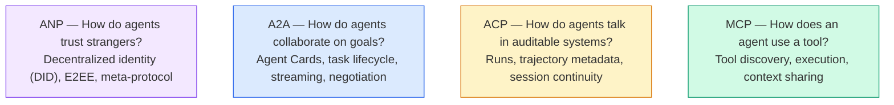

Chúng không phải là đối thủ. Chúng giải quyết các vấn đề khác nhau ở các cấp khác nhau.

### MCP (Recap)

MCP được trình bày sâu trong Giai đoạn 13. Nhắc lại nhanh: MCP tiêu chuẩn hóa cách một LLM kết nối với các công cụ và nguồn dữ liệu bên ngoài. Nó là một giao thức **khách-chủ** nơi agent (máy khách) khám phá và gọi các công cụ được một máy chủ cung cấp.

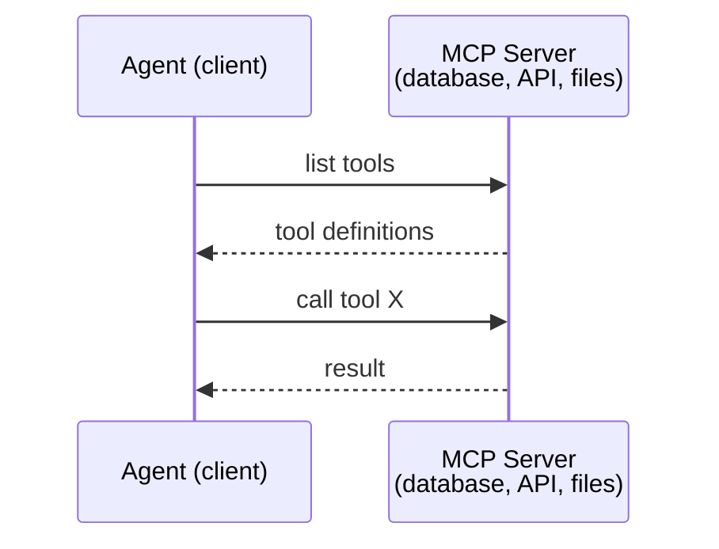

MCP là giao tiếp **agent với công cụ**. Nó không giúp các agent nói chuyện với nhau.

### A2A (Agent2Agent Protocol)

**Được tạo bởi:** Google (hiện thuộc Linux Foundation với tên `lf.a2a.v1`)
**Phiên bản đặc tả:** 1.0.1
**Vấn đề:** Các agent tự chủ cộng tác, đàm phán, và giao tác vụ cho nhau như thế nào?

A2A là giao thức cho **cộng tác agent ngang hàng**. Trong khi MCP kết nối một agent với công cụ, A2A kết nối một agent với các agent khác. Mỗi agent công bố một **Agent Card** tại một URL được quy ước, và các agent khác khám phá, đàm phán với, và giao tác vụ cho nó.

#### How A2A Works

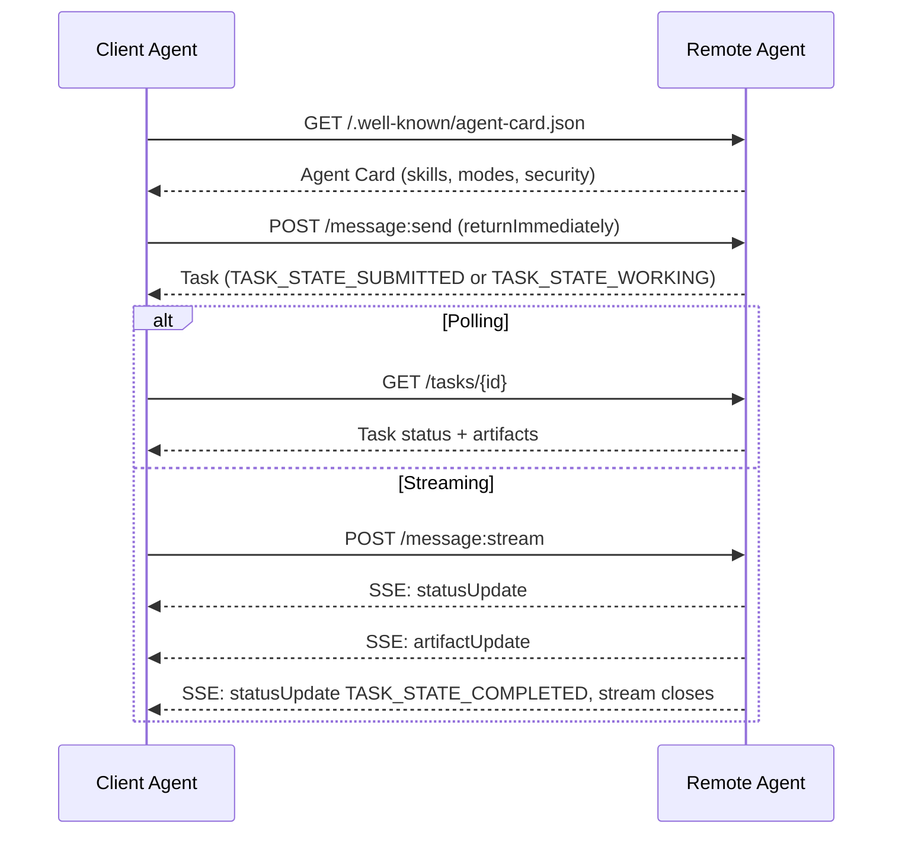

#### The Real Agent Card

Đây là hình dạng thực tế của một Agent Card A2A ngoài thực tế. Được phục vụ tại `GET /.well-known/agent-card.json`:

```json
{
  "name": "Research Agent",
  "description": "Searches documentation and summarizes findings",
  "version": "1.0.0",
  "supportedInterfaces": [
    {
      "url": "https://research-agent.example.com/a2a/v1",
      "protocolBinding": "JSONRPC",
      "protocolVersion": "1.0"
    },
    {
      "url": "https://research-agent.example.com/a2a/rest",
      "protocolBinding": "HTTP+JSON",
      "protocolVersion": "1.0"
    }
  ],
  "provider": {
    "organization": "Your Company",
    "url": "https://example.com"
  },
  "capabilities": {
    "streaming": true,
    "pushNotifications": false
  },
  "defaultInputModes": ["text/plain", "application/json"],
  "defaultOutputModes": ["text/plain", "application/json"],
  "skills": [
    {
      "id": "web-research",
      "name": "Web Research",
      "description": "Searches the web and synthesizes findings",
      "tags": ["research", "search", "summarization"],
      "examples": ["Research the latest changes in React 19"]
    },
    {
      "id": "doc-analysis",
      "name": "Documentation Analysis",
      "description": "Reads and analyzes technical documentation",
      "tags": ["docs", "analysis"],
      "inputModes": ["text/plain", "application/pdf"],
      "outputModes": ["application/json"]
    }
  ],
  "securitySchemes": {
    "bearer": {
      "httpAuthSecurityScheme": {
        "scheme": "Bearer",
        "bearerFormat": "JWT"
      }
    }
  },
  "securityRequirements": [{ "schemes": { "bearer": { "list": [] } } }]
}
```

Những điều then chốt cần chú ý:
- **Các kỹ năng** là những gì một agent có thể làm. Mỗi kỹ năng có một ID, các thẻ, và các kiểu MIME đầu vào/đầu ra được hỗ trợ. Đây là cách một agent máy khách quyết định liệu agent từ xa này có thể xử lý yêu cầu của nó hay không.
- **supportedInterfaces** liệt kê nhiều liên kết giao thức. Một agent đơn lẻ có thể nói JSON-RPC, REST, và gRPC đồng thời.
- **Bảo mật** được tích hợp vào card: `securitySchemes` nêu tên mỗi cơ chế và `securityRequirements` nói những cơ chế nào áp dụng. Máy khách biết nó cần xác thực gì trước khi thực hiện một yêu cầu đơn lẻ.

#### Task Lifecycle

Các tác vụ là đơn vị công việc cốt lõi trong A2A. Chúng di chuyển qua các trạng thái đã định (sơ đồ bỏ tiền tố `TASK_STATE_` mà mọi trạng thái mang trên đường truyền):

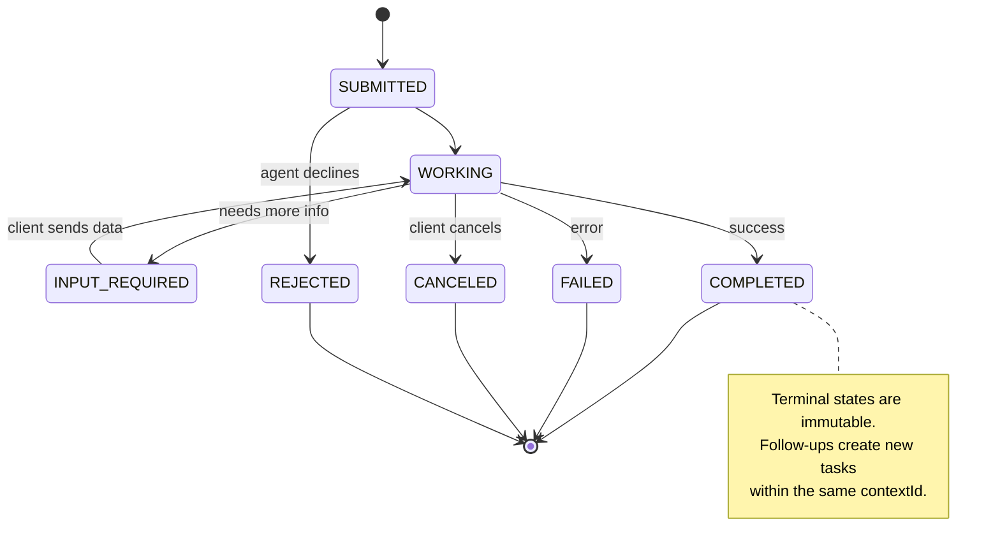

Tất cả 8 trạng thái (đặc tả cũng định nghĩa `UNSPECIFIED` như một sentinel, được bỏ qua ở đây):

| Trạng thái | Kết thúc? | Ý nghĩa |
|---|---|---|
| `TASK_STATE_SUBMITTED` | Không | Đã xác nhận, chưa xử lý |
| `TASK_STATE_WORKING` | Không | Đang được xử lý tích cực |
| `TASK_STATE_INPUT_REQUIRED` | Không | Agent cần thêm thông tin từ máy khách |
| `TASK_STATE_AUTH_REQUIRED` | Không | Cần xác thực |
| `TASK_STATE_COMPLETED` | Có | Hoàn thành thành công |
| `TASK_STATE_FAILED` | Có | Hoàn thành với lỗi |
| `TASK_STATE_CANCELED` | Có | Đã hủy trước khi hoàn thành |
| `TASK_STATE_REJECTED` | Có | Agent từ chối tác vụ |

Một khi tác vụ đạt một trạng thái kết thúc, nó bất biến. Không có thông điệp tiếp theo. Các yêu cầu tiếp nối tạo một tác vụ mới trong cùng `contextId`.

#### Wire Format

A2A sử dụng JSON-RPC 2.0. Đây là hình dạng của một trao đổi thông điệp thực:

**Máy khách gửi một thông điệp:**
```json
{
  "jsonrpc": "2.0",
  "id": 1,
  "method": "SendMessage",
  "params": {
    "message": {
      "messageId": "msg-001",
      "role": "ROLE_USER",
      "parts": [{ "text": "Research React 19 compiler features" }]
    },
    "configuration": {
      "acceptedOutputModes": ["text/plain", "application/json"],
      "historyLength": 10
    }
  }
}
```

**Agent phản hồi với một tác vụ:**
```json
{
  "jsonrpc": "2.0",
  "id": 1,
  "result": {
    "task": {
      "id": "task-abc-123",
      "contextId": "ctx-xyz-789",
      "status": {
        "state": "TASK_STATE_COMPLETED",
        "timestamp": "2026-03-27T10:30:00Z"
      },
      "artifacts": [
        {
          "artifactId": "art-001",
          "name": "research-results",
          "parts": [{
            "data": {
              "findings": [
                "React 19 compiler auto-memoizes components",
                "No more manual useMemo/useCallback needed",
                "Compiler runs at build time, not runtime"
              ]
            },
            "mediaType": "application/json"
          }]
        }
      ]
    }
  }
}
```

**Truyền luồng qua SSE:**
```text
POST /message:stream HTTP/1.1
Content-Type: application/a2a+json
A2A-Version: 1.0

data: {"task":{"id":"task-123","contextId":"ctx-123","status":{"state":"TASK_STATE_WORKING"}}}

data: {"statusUpdate":{"taskId":"task-123","contextId":"ctx-123","status":{"state":"TASK_STATE_WORKING","message":{"messageId":"msg-002","role":"ROLE_AGENT","parts":[{"text":"Searching documentation..."}]}}}}

data: {"artifactUpdate":{"taskId":"task-123","contextId":"ctx-123","artifact":{"artifactId":"art-1","parts":[{"text":"partial findings..."}]},"append":true,"lastChunk":false}}

data: {"statusUpdate":{"taskId":"task-123","contextId":"ctx-123","status":{"state":"TASK_STATE_COMPLETED"}}}
```

### ACP (Agent Communication Protocol)

**Được tạo bởi:** IBM / BeeAI
**Phiên bản đặc tả:** 0.2.0 (OpenAPI 3.1.1)
**Trạng thái:** Đang hợp nhất vào A2A dưới Linux Foundation
**Vấn đề:** Các agent giao tiếp với khả năng kiểm toán đầy đủ, tính liên tục phiên, và theo dõi quỹ đạo như thế nào?

ACP là **giao thức doanh nghiệp**. Khác với những gì nhiều bản tóm tắt tuyên bố, ACP **không** sử dụng JSON-LD. Nó là một API REST/JSON trực tiếp được định nghĩa qua OpenAPI. Điều làm nó đặc biệt là **TrajectoryMetadata**: mỗi phản hồi agent có thể mang một nhật ký chi tiết các bước suy luận và lệnh gọi công cụ tạo ra nó.

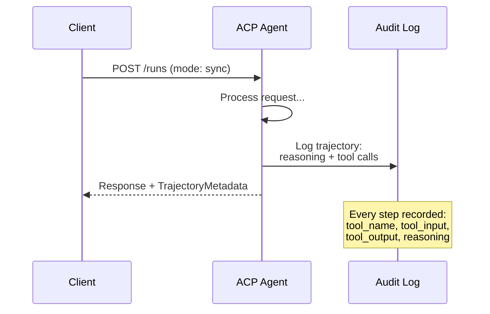

#### Agent Discovery in ACP

ACP định nghĩa bốn phương pháp khám phá:

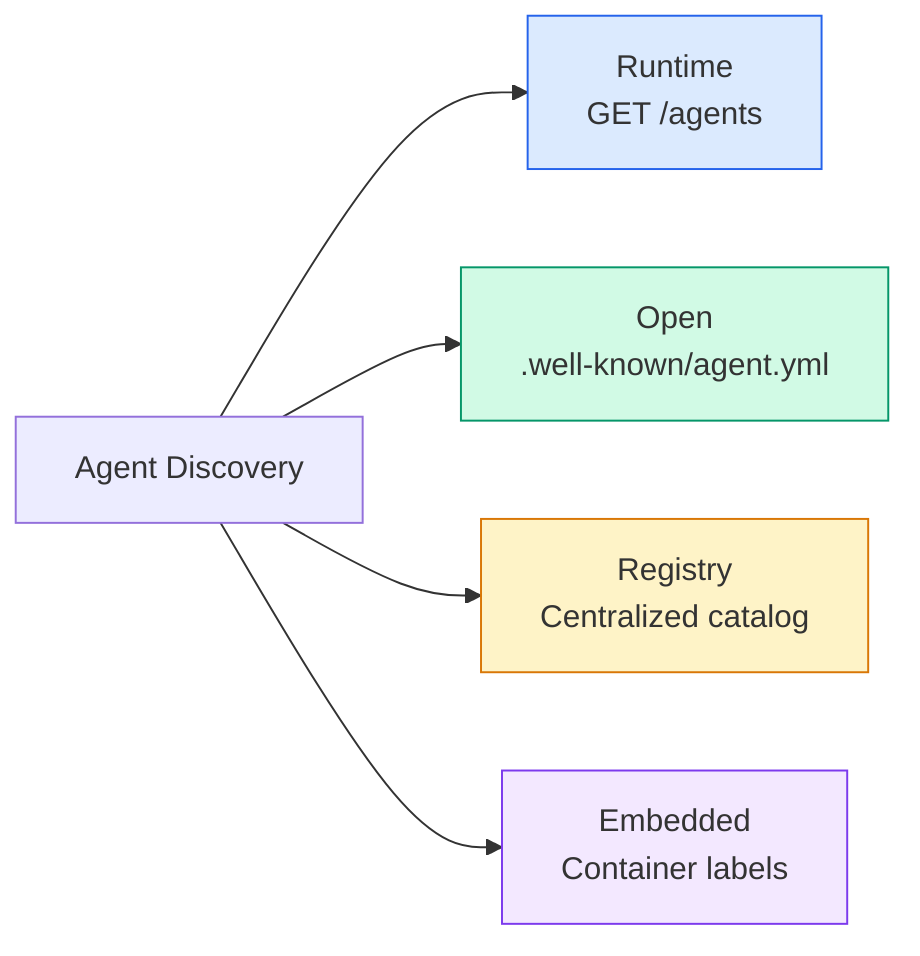

**AgentManifest** đơn giản hơn Agent Card của A2A:

```json
{
  "name": "summarizer",
  "description": "Summarizes documents with source citations",
  "input_content_types": ["text/plain", "application/pdf"],
  "output_content_types": ["text/plain", "application/json"],
  "metadata": {
    "tags": ["summarization", "RAG"],
    "framework": "BeeAI",
    "capabilities": [
      {
        "name": "Document Summarization",
        "description": "Condenses long documents into key points"
      }
    ],
    "recommended_models": ["llama3.3:70b-instruct-fp16"],
    "license": "Apache-2.0",
    "programming_language": "Python"
  }
}
```

#### Run Lifecycle

ACP sử dụng “Run” thay cho “Task”. Một Run là một lần thực thi agent với ba chế độ:

| Chế độ | Hành vi |
|---|---|
| `sync` | Chặn. Phản hồi chứa kết quả hoàn chỉnh. |
| `async` | Trả về 202 ngay lập tức. Thăm dò `GET /runs/{id}` để lấy trạng thái. |
| `stream` | Luồng SSE. Các sự kiện kích hoạt khi agent làm việc. |

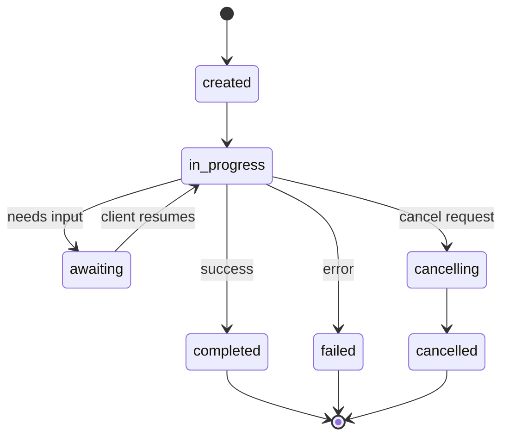

#### TrajectoryMetadata (The Audit Trail)

Đây là điểm khác biệt then chốt của ACP. Mỗi phần thông điệp có thể bao gồm siêu dữ liệu cho thấy chính xác agent đã làm gì:

```json
{
  "role": "agent/researcher",
  "parts": [
    {
      "content_type": "text/plain",
      "content": "The weather in San Francisco is 72F and sunny.",
      "metadata": {
        "kind": "trajectory",
        "message": "I need to check the weather for this location",
        "tool_name": "weather_api",
        "tool_input": { "location": "San Francisco, CA" },
        "tool_output": { "temperature": 72, "condition": "sunny" }
      }
    }
  ]
}
```

Đối với các ngành được quản lý, đây là vàng. Mỗi câu trả lời đi kèm một chuỗi suy luận có thể chứng minh: các công cụ nào được gọi, các đầu vào nào được dùng, các đầu ra nào được nhận. Không có hộp đen.

ACP cũng hỗ trợ **CitationMetadata** cho ghi nguồn:

```json
{
  "kind": "citation",
  "start_index": 0,
  "end_index": 47,
  "url": "https://weather.gov/sf",
  "title": "NWS San Francisco Forecast"
}
```

### ANP (Agent Network Protocol)

**Được tạo bởi:** Cộng đồng mã nguồn mở (do GaoWei Chang thành lập)
**Repo:** [github.com/agent-network-protocol/AgentNetworkProtocol](https://github.com/agent-network-protocol/AgentNetworkProtocol)
**Vấn đề:** Các agent từ các tổ chức khác nhau tin cậy nhau như thế nào mà không có một thẩm quyền trung tâm?

ANP là **giao thức danh tính phi tập trung**. Nó xây dựng sự tin cậy bằng W3C Decentralized Identifiers (DID) và mã hóa đầu cuối. Khác với A2A nơi bạn khám phá các agent qua các endpoint đã biết, ANP cho phép các agent chứng minh danh tính bằng mật mã.

ANP có ba lớp:

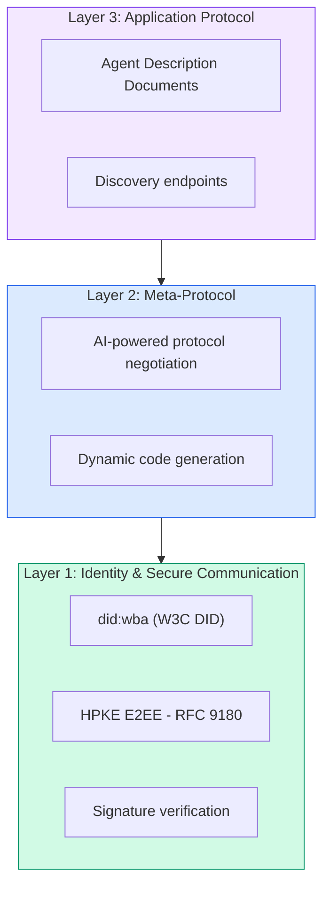

#### DID Documents (Real Structure)

ANP sử dụng một phương thức DID tùy chỉnh gọi là `did:wba` (Agent dựa trên web). DID `did:wba:example.com:user:alice` phân giải thành `https://example.com/user/alice/did.json`:

```json
{
  "@context": [
    "https://www.w3.org/ns/did/v1",
    "https://w3id.org/security/suites/jws-2020/v1",
    "https://w3id.org/security/suites/secp256k1-2019/v1"
  ],
  "id": "did:wba:example.com:user:alice",
  "verificationMethod": [
    {
      "id": "did:wba:example.com:user:alice#key-1",
      "type": "EcdsaSecp256k1VerificationKey2019",
      "controller": "did:wba:example.com:user:alice",
      "publicKeyJwk": {
        "crv": "secp256k1",
        "x": "NtngWpJUr-rlNNbs0u-Aa8e16OwSJu6UiFf0Rdo1oJ4",
        "y": "qN1jKupJlFsPFc1UkWinqljv4YE0mq_Ickwnjgasvmo",
        "kty": "EC"
      }
    },
    {
      "id": "did:wba:example.com:user:alice#key-x25519-1",
      "type": "X25519KeyAgreementKey2019",
      "controller": "did:wba:example.com:user:alice",
      "publicKeyMultibase": "z9hFgmPVfmBZwRvFEyniQDBkz9LmV7gDEqytWyGZLmDXE"
    }
  ],
  "authentication": [
    "did:wba:example.com:user:alice#key-1"
  ],
  "keyAgreement": [
    "did:wba:example.com:user:alice#key-x25519-1"
  ],
  "humanAuthorization": [
    "did:wba:example.com:user:alice#key-1"
  ],
  "service": [
    {
      "id": "did:wba:example.com:user:alice#agent-description",
      "type": "AgentDescription",
      "serviceEndpoint": "https://example.com/agents/alice/ad.json"
    }
  ]
}
```

Những điều then chốt cần chú ý:
- **Tách biệt khóa** được thực thi. Các khóa ký (secp256k1) tách biệt với các khóa mã hóa (X25519).
- **`humanAuthorization`** là độc nhất ở ANP. Các khóa này yêu cầu phê duyệt tường minh của con người (sinh trắc học, mật khẩu, HSM) trước khi sử dụng. Các thao tác rủi ro cao như chuyển tiền đi qua đường này.
- Các khóa **`keyAgreement`** được sử dụng cho mã hóa đầu cuối HPKE (RFC 9180).
- Phần **service** liên kết tới tài liệu Agent Description.

#### How Trust Works in ANP

ANP **không** sử dụng một mạng lưới tin cậy hoặc đồ thị chứng thực. Sự tin cậy là song phương và được xác minh theo từng tương tác:

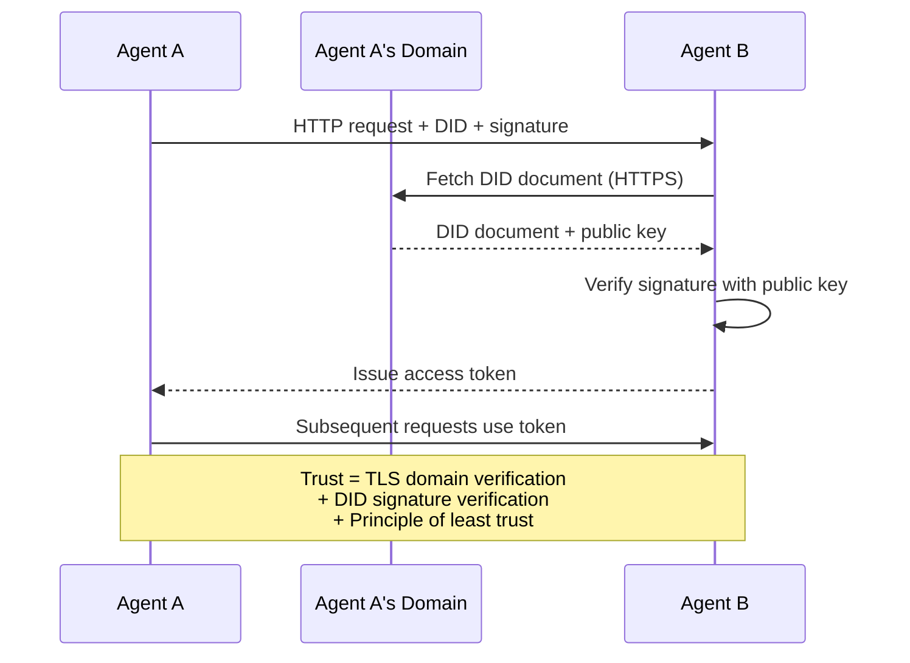

Sự tin cậy đến từ ba nguồn:
1. **TLS cấp miền** xác minh máy chủ tài liệu DID
2. **Các chữ ký mật mã DID** xác minh danh tính của agent
3. **Nguyên tắc tin cậy tối thiểu** chỉ cấp các quyền tối thiểu

Không có lan truyền tin cậy dựa trên lời đồn hoặc chấm điểm PageRank. Bạn xác minh từng agent trực tiếp qua DID của nó.

#### Meta-Protocol Negotiation

Đây là tính năng mới lạ nhất của ANP. Khi hai agent từ các hệ sinh thái khác nhau gặp nhau, chúng không cần các định dạng dữ liệu được thỏa thuận trước. Chúng đàm phán bằng ngôn ngữ tự nhiên:

```json
{
  "action": "protocolNegotiation",
  "sequenceId": 0,
  "candidateProtocols": "I can communicate using:\n1. JSON-RPC with hotel booking schema\n2. REST with OpenAPI 3.1 spec\n3. Natural language over HTTP",
  "modificationSummary": "Initial proposal",
  "status": "negotiating"
}
```

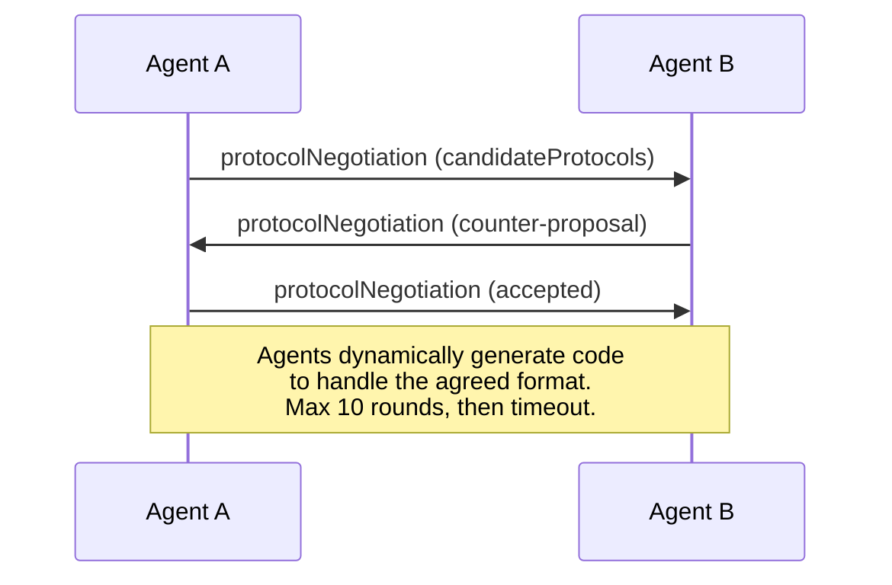

Các agent trao đổi qua lại (tối đa 10 vòng) cho đến khi đồng ý về một định dạng, rồi sinh mã động để xử lý nó. Các giá trị trạng thái: `negotiating`, `rejected`, `accepted`, `timeout`.

Điều này có nghĩa là hai agent chưa từng thấy nhau trước đó có thể tìm ra cách giao tiếp mà không cần ai định nghĩa trước một lược đồ dùng chung.

### Comparison (Corrected)

| | MCP | A2A | ACP | ANP |
|---|---|---|---|---|
| **Được tạo bởi** | Anthropic | Google / Linux Foundation | IBM / BeeAI | Cộng đồng |
| **Định dạng đặc tả** | JSON-RPC | JSON-RPC / REST / gRPC | OpenAPI 3.1 (REST) | JSON-RPC |
| **Sử dụng chính** | Agent với công cụ | Agent với agent | Agent với agent | Agent với agent |
| **Khám phá** | Liệt kê công cụ | `/.well-known/agent-card.json` | `GET /agents`, `/.well-known/agent.yml` | `/.well-known/agent-descriptions`, các endpoint dịch vụ DID |
| **Danh tính** | Ngầm định (cục bộ) | Các cơ chế bảo mật (OAuth, mTLS) | Cấp máy chủ | W3C DID (`did:wba`) với E2EE |
| **Dấu vết kiểm toán** | Không áp dụng | Cơ bản (lịch sử tác vụ) | TrajectoryMetadata (lệnh gọi công cụ, suy luận) | Không được đặc tả hình thức |
| **Máy trạng thái** | Không áp dụng | 9 trạng thái tác vụ | 7 trạng thái lần chạy | Không áp dụng |
| **Truyền luồng** | Không áp dụng | SSE | SSE | Không phụ thuộc lớp truyền tải |
| **Tính năng độc đáo** | Các lược đồ công cụ | Agent Card + các kỹ năng | Dấu vết kiểm toán quỹ đạo | Đàm phán siêu giao thức |
| **Tốt nhất cho** | Công cụ & dữ liệu | Cộng tác động | Các ngành được quản lý | Tin cậy xuyên tổ chức |
| **Trạng thái** | Ổn định | Ổn định (v1.0) | Đang hợp nhất vào A2A | Đang phát triển tích cực |

### How They Work Together

Các giao thức này không loại trừ lẫn nhau. Một hệ thống doanh nghiệp thực tế sử dụng nhiều giao thức:

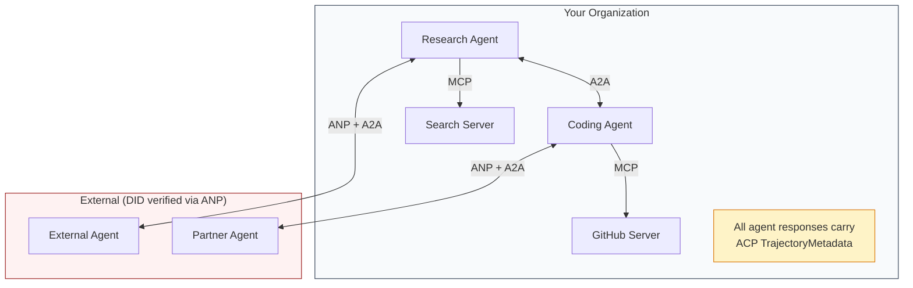

- **MCP** kết nối mỗi agent với các công cụ của nó
- **A2A** xử lý cộng tác giữa các agent (nội bộ và bên ngoài)
- **ACP** bọc các phản hồi trong siêu dữ liệu quỹ đạo cho khả năng kiểm toán
- **ANP** cung cấp xác minh danh tính cho các agent bạn không kiểm soát

```figure
swarm-message-bus
```

## Build It

### Step 1: Core Message Types

Mọi hệ thống đa agent bắt đầu bằng một định dạng thông điệp. Chúng ta định nghĩa các kiểu ánh xạ tới những gì các giao thức thực sử dụng:

```typescript
import crypto from "node:crypto";

type MessageRole = "ROLE_USER" | "ROLE_AGENT";

type MessagePart =
  | { text: string }
  | { data: unknown; mediaType: string }
  | { url: string; filename: string; mediaType: string };

type TrajectoryEntry = {
  reasoning: string;
  toolName?: string;
  toolInput?: unknown;
  toolOutput?: unknown;
  timestamp: number;
};

type AgentMessage = {
  id: string;
  role: MessageRole;
  parts: MessagePart[];
  trajectory?: TrajectoryEntry[];
  replyTo?: string;
  timestamp: number;
};

function createMessage(
  role: MessageRole,
  parts: MessagePart[],
  replyTo?: string
): AgentMessage {
  return {
    id: crypto.randomUUID(),
    role,
    parts,
    replyTo,
    timestamp: Date.now(),
  };
}

function textMessage(role: MessageRole, text: string): AgentMessage {
  return createMessage(role, [{ text }]);
}
```

Chú ý: `MessagePart` là đa phương thức (văn bản, dữ liệu có cấu trúc, file) giống như các đặc tả A2A và ACP thực. Như trong A2A 1.0, trường hiện diện (`text`, `data`, hoặc `url`) nói phần đó là gì; không có thẻ `kind`. `TrajectoryEntry` ghi lại chuỗi suy luận, khớp với TrajectoryMetadata của ACP.

### Step 2: A2A Agent Card and Registry

Xây dựng khám phá agent khớp với đặc tả A2A thực:

```typescript
type Skill = {
  id: string;
  name: string;
  description: string;
  tags: string[];
  inputModes: string[];
  outputModes: string[];
};

type AgentInterface = {
  url: string;
  protocolBinding: string;
  protocolVersion: string;
};

type AgentCard = {
  name: string;
  description: string;
  version: string;
  supportedInterfaces: AgentInterface[];
  capabilities: {
    streaming: boolean;
    pushNotifications: boolean;
  };
  defaultInputModes: string[];
  defaultOutputModes: string[];
  skills: Skill[];
};

class AgentRegistry {
  private cards: Map<string, AgentCard> = new Map();

  register(card: AgentCard) {
    this.cards.set(card.name, card);
  }

  discoverBySkillTag(tag: string): AgentCard[] {
    return [...this.cards.values()].filter((card) =>
      card.skills.some((skill) => skill.tags.includes(tag))
    );
  }

  discoverByInputMode(mimeType: string): AgentCard[] {
    return [...this.cards.values()].filter(
      (card) =>
        card.defaultInputModes.includes(mimeType) ||
        card.skills.some((skill) => skill.inputModes.includes(mimeType))
    );
  }

  resolve(name: string): AgentCard | undefined {
    return this.cards.get(name);
  }

  listAll(): AgentCard[] {
    return [...this.cards.values()];
  }
}
```

Điều này phong phú hơn đáng kể so với một ánh xạ tên-năng lực đơn giản. Bạn có thể khám phá các agent theo thẻ kỹ năng, theo kiểu MIME đầu vào, hoặc theo tên, giống như đặc tả A2A thực hỗ trợ.

### Step 3: A2A Task Lifecycle

Xây dựng máy trạng thái tác vụ đầy đủ:

```typescript
type TaskState =
  | "TASK_STATE_SUBMITTED"
  | "TASK_STATE_WORKING"
  | "TASK_STATE_INPUT_REQUIRED"
  | "TASK_STATE_AUTH_REQUIRED"
  | "TASK_STATE_COMPLETED"
  | "TASK_STATE_FAILED"
  | "TASK_STATE_CANCELED"
  | "TASK_STATE_REJECTED";

const TERMINAL_STATES: TaskState[] = [
  "TASK_STATE_COMPLETED",
  "TASK_STATE_FAILED",
  "TASK_STATE_CANCELED",
  "TASK_STATE_REJECTED",
];

type TaskStatus = {
  state: TaskState;
  message?: AgentMessage;
  timestamp: number;
};

type Artifact = {
  id: string;
  name: string;
  parts: MessagePart[];
};

type Task = {
  id: string;
  contextId: string;
  status: TaskStatus;
  artifacts: Artifact[];
  history: AgentMessage[];
};

type TaskEvent =
  | { statusUpdate: { taskId: string; status: TaskStatus } }
  | {
      artifactUpdate: {
        taskId: string;
        artifact: Artifact;
        append: boolean;
        lastChunk: boolean;
      };
    };

type TaskHandler = (
  task: Task,
  message: AgentMessage
) => AsyncGenerator<TaskEvent>;

class TaskManager {
  private tasks: Map<string, Task> = new Map();
  private handlers: Map<string, TaskHandler> = new Map();
  private listeners: Map<string, ((event: TaskEvent) => void)[]> = new Map();

  registerHandler(agentName: string, handler: TaskHandler) {
    this.handlers.set(agentName, handler);
  }

  subscribe(taskId: string, listener: (event: TaskEvent) => void) {
    const existing = this.listeners.get(taskId) ?? [];
    existing.push(listener);
    this.listeners.set(taskId, existing);
  }

  async sendMessage(
    agentName: string,
    message: AgentMessage,
    contextId?: string
  ): Promise<Task> {
    const handler = this.handlers.get(agentName);
    if (!handler) {
      const task = this.createTask(contextId);
      task.status = {
        state: "TASK_STATE_REJECTED",
        timestamp: Date.now(),
        message: textMessage("ROLE_AGENT", `No handler for ${agentName}`),
      };
      return task;
    }

    const task = this.createTask(contextId);
    task.history.push(message);
    task.status = { state: "TASK_STATE_SUBMITTED", timestamp: Date.now() };

    this.processTask(task, handler, message).catch((err) => {
      task.status = {
        state: "TASK_STATE_FAILED",
        timestamp: Date.now(),
        message: textMessage("ROLE_AGENT", String(err)),
      };
    });
    return task;
  }

  getTask(taskId: string): Task | undefined {
    return this.tasks.get(taskId);
  }

  cancelTask(taskId: string): boolean {
    const task = this.tasks.get(taskId);
    if (!task || TERMINAL_STATES.includes(task.status.state)) return false;
    task.status = { state: "TASK_STATE_CANCELED", timestamp: Date.now() };
    this.emit(taskId, {
      statusUpdate: { taskId, status: task.status },
    });
    return true;
  }

  private createTask(contextId?: string): Task {
    const task: Task = {
      id: crypto.randomUUID(),
      contextId: contextId ?? crypto.randomUUID(),
      status: { state: "TASK_STATE_SUBMITTED", timestamp: Date.now() },
      artifacts: [],
      history: [],
    };
    this.tasks.set(task.id, task);
    return task;
  }

  private async processTask(
    task: Task,
    handler: TaskHandler,
    message: AgentMessage
  ) {
    task.status = { state: "TASK_STATE_WORKING", timestamp: Date.now() };
    this.emit(task.id, {
      statusUpdate: { taskId: task.id, status: task.status },
    });

    try {
      for await (const event of handler(task, message)) {
        if (TERMINAL_STATES.includes(task.status.state)) break;

        if ("statusUpdate" in event) {
          task.status = event.statusUpdate.status;
        }
        if ("artifactUpdate" in event) {
          const update = event.artifactUpdate;
          const existing = task.artifacts.find(
            (a) => a.id === update.artifact.id
          );
          if (existing && update.append) {
            existing.parts.push(...update.artifact.parts);
          } else {
            task.artifacts.push(update.artifact);
          }
        }
        this.emit(task.id, event);
      }
    } catch (err) {
      task.status = {
        state: "TASK_STATE_FAILED",
        timestamp: Date.now(),
        message: textMessage("ROLE_AGENT", String(err)),
      };
      this.emit(task.id, {
        statusUpdate: { taskId: task.id, status: task.status },
      });
    }
  }

  private emit(taskId: string, event: TaskEvent) {
    for (const listener of this.listeners.get(taskId) ?? []) {
      listener(event);
    }
  }
}
```

Điều này triển khai vòng đời tác vụ A2A thực: `TASK_STATE_SUBMITTED`, `TASK_STATE_WORKING`, `TASK_STATE_INPUT_REQUIRED`, rồi một trạng thái kết thúc. Các bộ xử lý là các generator bất đồng bộ nhường ra các sự kiện `statusUpdate` và `artifactUpdate`, cùng các lớp bọc mà luồng SSE mang.

### Step 4: ACP-Style Audit Trail

Bọc giao tiếp với theo dõi quỹ đạo:

```typescript
type AuditEntry = {
  runId: string;
  agentName: string;
  input: AgentMessage[];
  output: AgentMessage[];
  trajectory: TrajectoryEntry[];
  status: "created" | "in-progress" | "completed" | "failed" | "awaiting";
  startedAt: number;
  completedAt?: number;
  sessionId?: string;
};

class AuditableRunner {
  private log: AuditEntry[] = [];
  private handlers: Map<
    string,
    (input: AgentMessage[]) => Promise<{
      output: AgentMessage[];
      trajectory: TrajectoryEntry[];
    }>
  > = new Map();

  registerAgent(
    name: string,
    handler: (input: AgentMessage[]) => Promise<{
      output: AgentMessage[];
      trajectory: TrajectoryEntry[];
    }>
  ) {
    this.handlers.set(name, handler);
  }

  async run(
    agentName: string,
    input: AgentMessage[],
    sessionId?: string
  ): Promise<AuditEntry> {
    const entry: AuditEntry = {
      runId: crypto.randomUUID(),
      agentName,
      input: structuredClone(input),
      output: [],
      trajectory: [],
      status: "created",
      startedAt: Date.now(),
      sessionId,
    };
    this.log.push(entry);

    const handler = this.handlers.get(agentName);
    if (!handler) {
      entry.status = "failed";
      return entry;
    }

    entry.status = "in-progress";
    try {
      const result = await handler(input);
      entry.output = structuredClone(result.output);
      entry.trajectory = structuredClone(result.trajectory);
      entry.status = "completed";
      entry.completedAt = Date.now();
    } catch (err) {
      entry.status = "failed";
      entry.trajectory.push({
        reasoning: `Error: ${String(err)}`,
        timestamp: Date.now(),
      });
      entry.completedAt = Date.now();
    }
    return entry;
  }

  getFullAuditLog(): AuditEntry[] {
    return structuredClone(this.log);
  }

  getAuditLogForAgent(agentName: string): AuditEntry[] {
    return structuredClone(
      this.log.filter((e) => e.agentName === agentName)
    );
  }

  getAuditLogForSession(sessionId: string): AuditEntry[] {
    return structuredClone(
      this.log.filter((e) => e.sessionId === sessionId)
    );
  }

  getTrajectoryForRun(runId: string): TrajectoryEntry[] {
    const entry = this.log.find((e) => e.runId === runId);
    return entry ? structuredClone(entry.trajectory) : [];
  }
}
```

Mọi lần thực thi agent tạo ra một mục kiểm toán đầy đủ: những gì đi vào, những gì đi ra, và quỹ đạo hoàn chỉnh của các lệnh gọi công cụ và bước suy luận ở giữa. Bạn có thể truy vấn theo agent, theo phiên, hoặc theo từng lần chạy riêng lẻ.

### Step 5: ANP-Style Identity Verification

Xây dựng danh tính và xác minh dựa trên DID:

```typescript
type VerificationMethod = {
  id: string;
  type: string;
  controller: string;
  publicKeyDer: string;
};

type DIDDocument = {
  id: string;
  verificationMethod: VerificationMethod[];
  authentication: string[];
  keyAgreement: string[];
  humanAuthorization: string[];
  service: { id: string; type: string; serviceEndpoint: string }[];
};

type AgentIdentity = {
  did: string;
  document: DIDDocument;
  privateKey: crypto.KeyObject;
  publicKey: crypto.KeyObject;
};

class IdentityRegistry {
  private documents: Map<string, DIDDocument> = new Map();

  publish(doc: DIDDocument) {
    this.documents.set(doc.id, doc);
  }

  resolve(did: string): DIDDocument | undefined {
    return this.documents.get(did);
  }

  verify(did: string, signature: string, payload: string): boolean {
    const doc = this.documents.get(did);
    if (!doc) return false;

    const authKeyIds = doc.authentication;
    const authKeys = doc.verificationMethod.filter((vm) =>
      authKeyIds.includes(vm.id)
    );

    for (const key of authKeys) {
      const publicKey = crypto.createPublicKey({
        key: Buffer.from(key.publicKeyDer, "base64"),
        format: "der",
        type: "spki",
      });
      const isValid = crypto.verify(
        null,
        Buffer.from(payload),
        publicKey,
        Buffer.from(signature, "hex")
      );
      if (isValid) return true;
    }
    return false;
  }

  requiresHumanAuth(did: string, operationKeyId: string): boolean {
    const doc = this.documents.get(did);
    if (!doc) return false;
    return doc.humanAuthorization.includes(operationKeyId);
  }
}

function createIdentity(domain: string, agentName: string): AgentIdentity {
  const did = `did:wba:${domain}:agent:${agentName}`;
  const { publicKey, privateKey } = crypto.generateKeyPairSync("ed25519");

  const publicKeyDer = publicKey
    .export({ format: "der", type: "spki" })
    .toString("base64");

  const keyId = `${did}#key-1`;
  const encKeyId = `${did}#key-x25519-1`;

  const document: DIDDocument = {
    id: did,
    verificationMethod: [
      {
        id: keyId,
        type: "Ed25519VerificationKey2020",
        controller: did,
        publicKeyDer,
      },
      {
        id: encKeyId,
        type: "X25519KeyAgreementKey2019",
        controller: did,
        publicKeyDer,
      },
    ],
    authentication: [keyId],
    keyAgreement: [encKeyId],
    humanAuthorization: [],
    service: [
      {
        id: `${did}#agent-description`,
        type: "AgentDescription",
        serviceEndpoint: `https://${domain}/agents/${agentName}/ad.json`,
      },
    ],
  };

  return { did, document, privateKey, publicKey };
}

function signPayload(identity: AgentIdentity, payload: string): string {
  return crypto
    .sign(null, Buffer.from(payload), identity.privateKey)
    .toString("hex");
}
```

Điều này phản ánh mô hình danh tính ANP thực: các agent có các tài liệu DID với các khóa xác thực, thỏa thuận khóa, và ủy quyền con người riêng biệt. `IdentityRegistry` mô phỏng phân giải DID (trong sản xuất đây sẽ là các lần lấy HTTP tới miền của agent).

### Step 6: Protocol Gateway

Kết nối cả bốn giao thức vào một hệ thống thống nhất:

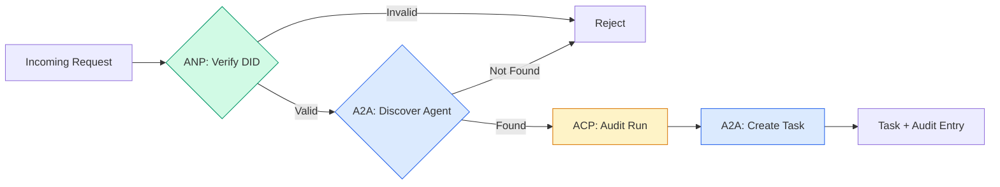

```typescript
class ProtocolGateway {
  private registry: AgentRegistry;
  private taskManager: TaskManager;
  private auditRunner: AuditableRunner;
  private identityRegistry: IdentityRegistry;

  constructor(
    registry: AgentRegistry,
    taskManager: TaskManager,
    auditRunner: AuditableRunner,
    identityRegistry: IdentityRegistry
  ) {
    this.registry = registry;
    this.taskManager = taskManager;
    this.auditRunner = auditRunner;
    this.identityRegistry = identityRegistry;
  }

  async delegateTask(
    fromDid: string,
    signature: string,
    targetAgent: string,
    message: AgentMessage,
    sessionId?: string
  ): Promise<{ task: Task; audit: AuditEntry } | { error: string }> {
    if (!this.identityRegistry.verify(fromDid, signature, message.id)) {
      return { error: "Identity verification failed" };
    }

    const card = this.registry.resolve(targetAgent);
    if (!card) {
      return { error: `Agent ${targetAgent} not found in registry` };
    }

    const audit = await this.auditRunner.run(
      targetAgent,
      [message],
      sessionId
    );
    const task = await this.taskManager.sendMessage(targetAgent, message);

    return { task, audit };
  }

  discoverAndDelegate(
    fromDid: string,
    signature: string,
    skillTag: string,
    message: AgentMessage
  ): Promise<{ task: Task; audit: AuditEntry } | { error: string }> {
    const candidates = this.registry.discoverBySkillTag(skillTag);
    if (candidates.length === 0) {
      return Promise.resolve({
        error: `No agents found with skill tag: ${skillTag}`,
      });
    }
    return this.delegateTask(
      fromDid,
      signature,
      candidates[0].name,
      message
    );
  }
}
```

Gateway làm bốn việc trong một lệnh gọi:
1. **ANP**: Xác minh danh tính bên gọi qua chữ ký DID
2. **A2A**: Khám phá agent đích và kiểm tra các năng lực
3. **ACP**: Bọc việc thực thi trong một dấu vết kiểm toán có quỹ đạo
4. **A2A**: Tạo một tác vụ với theo dõi vòng đời đầy đủ

### Step 7: Wire It All Together

```typescript
async function protocolDemo() {
  const registry = new AgentRegistry();
  registry.register({
    name: "researcher",
    description: "Searches and summarizes findings",
    version: "1.0.0",
    supportedInterfaces: [
      {
        url: "https://researcher.local/a2a/v1",
        protocolBinding: "JSONRPC",
        protocolVersion: "1.0",
      },
    ],
    capabilities: { streaming: true, pushNotifications: false },
    defaultInputModes: ["text/plain"],
    defaultOutputModes: ["text/plain", "application/json"],
    skills: [
      {
        id: "web-research",
        name: "Web Research",
        description: "Searches the web",
        tags: ["research", "search", "summarization"],
        inputModes: ["text/plain"],
        outputModes: ["application/json"],
      },
    ],
  });
  registry.register({
    name: "coder",
    description: "Writes code from specs",
    version: "1.0.0",
    supportedInterfaces: [
      {
        url: "https://coder.local/a2a/v1",
        protocolBinding: "JSONRPC",
        protocolVersion: "1.0",
      },
    ],
    capabilities: { streaming: false, pushNotifications: false },
    defaultInputModes: ["text/plain", "application/json"],
    defaultOutputModes: ["text/plain"],
    skills: [
      {
        id: "code-gen",
        name: "Code Generation",
        description: "Generates code",
        tags: ["coding", "generation"],
        inputModes: ["text/plain", "application/json"],
        outputModes: ["text/plain"],
      },
    ],
  });

  const taskManager = new TaskManager();
  const auditRunner = new AuditableRunner();

  const researchTrajectory: TrajectoryEntry[] = [];

  taskManager.registerHandler(
    "researcher",
    async function* (task, message) {
      yield {
        statusUpdate: {
          taskId: task.id,
          status: {
            state: "TASK_STATE_WORKING" as const,
            timestamp: Date.now(),
          },
        },
      };

      researchTrajectory.push({
        reasoning: "Searching for React 19 documentation",
        toolName: "web_search",
        toolInput: { query: "React 19 compiler features" },
        toolOutput: {
          results: ["react.dev/blog/react-19", "github.com/react/react"],
        },
        timestamp: Date.now(),
      });

      researchTrajectory.push({
        reasoning: "Extracting key findings from search results",
        toolName: "doc_analysis",
        toolInput: { url: "react.dev/blog/react-19" },
        toolOutput: {
          summary:
            "React 19 compiler auto-memoizes, no manual useMemo needed",
        },
        timestamp: Date.now(),
      });

      yield {
        artifactUpdate: {
          taskId: task.id,
          artifact: {
            id: crypto.randomUUID(),
            name: "research-results",
            parts: [
              {
                data: {
                  findings: [
                    "React 19 compiler auto-memoizes components",
                    "No more manual useMemo/useCallback needed",
                    "Compiler runs at build time, not runtime",
                  ],
                  sources: ["react.dev/blog/react-19"],
                },
                mediaType: "application/json",
              },
            ],
          },
          append: false,
          lastChunk: true,
        },
      };

      yield {
        statusUpdate: {
          taskId: task.id,
          status: {
            state: "TASK_STATE_COMPLETED" as const,
            timestamp: Date.now(),
          },
        },
      };
    }
  );

  auditRunner.registerAgent("researcher", async () => ({
    output: [
      textMessage("ROLE_AGENT", "React 19 compiler auto-memoizes components"),
    ],
    trajectory: researchTrajectory,
  }));

  const identityRegistry = new IdentityRegistry();

  const coderIdentity = createIdentity("coder.local", "coder");
  const researcherIdentity = createIdentity("researcher.local", "researcher");

  identityRegistry.publish(coderIdentity.document);
  identityRegistry.publish(researcherIdentity.document);

  const gateway = new ProtocolGateway(
    registry,
    taskManager,
    auditRunner,
    identityRegistry
  );

  console.log("=== Protocol Demo ===\n");

  console.log("1. Agent Discovery (A2A)");
  const researchAgents = registry.discoverBySkillTag("research");
  console.log(
    `   Found ${researchAgents.length} agent(s):`,
    researchAgents.map((a) => a.name)
  );

  console.log("\n2. Identity Verification (ANP)");
  const message = textMessage("ROLE_USER", "Research React 19 compiler features");
  const signature = signPayload(coderIdentity, message.id);
  const verified = identityRegistry.verify(
    coderIdentity.did,
    signature,
    message.id
  );
  console.log(`   Coder DID: ${coderIdentity.did}`);
  console.log(`   Signature verified: ${verified}`);

  console.log("\n3. Task Delegation (A2A + ACP + ANP)");
  const result = await gateway.delegateTask(
    coderIdentity.did,
    signature,
    "researcher",
    message,
    "session-001"
  );

  if ("error" in result) {
    console.log(`   Error: ${result.error}`);
    return;
  }

  console.log(`   Task ID: ${result.task.id}`);
  console.log(`   Task state: ${result.task.status.state}`);
  console.log(`   Artifacts: ${result.task.artifacts.length}`);

  console.log("\n4. Audit Trail (ACP)");
  console.log(`   Run ID: ${result.audit.runId}`);
  console.log(`   Status: ${result.audit.status}`);
  console.log(`   Trajectory steps: ${result.audit.trajectory.length}`);
  for (const step of result.audit.trajectory) {
    console.log(`     - ${step.reasoning}`);
    if (step.toolName) {
      console.log(`       Tool: ${step.toolName}`);
    }
  }

  console.log("\n5. Full Audit Log");
  const fullLog = auditRunner.getFullAuditLog();
  console.log(`   Total runs: ${fullLog.length}`);
  for (const entry of fullLog) {
    const duration = entry.completedAt
      ? `${entry.completedAt - entry.startedAt}ms`
      : "in-progress";
    console.log(`   ${entry.agentName}: ${entry.status} (${duration})`);
  }
}

protocolDemo().catch((err) => {
  console.error("Protocol demo failed:", err);
  process.exitCode = 1;
});
```

## What Goes Wrong

Các giao thức giải quyết luồng thuận lợi. Đây là những gì hỏng trong sản xuất:

**Trôi lược đồ.** Agent A công bố một Agent Card quảng bá đầu ra `application/json`. Nhưng lược đồ JSON thay đổi giữa các phiên bản. Agent B phân tích cú pháp định dạng cũ và nhận rác. Cách sửa: đặt phiên bản cho các kỹ năng và lược đồ đầu ra. Đặc tả A2A hỗ trợ `version` trên Agent Card vì lý do này.

**Vi phạm máy trạng thái.** Một bộ xử lý agent nhường ra một cập nhật trạng thái `TASK_STATE_COMPLETED`, rồi cố nhường ra thêm các hiện vật. Tác vụ là bất biến. Mã của bạn âm thầm bỏ các cập nhật hoặc ném lỗi. Cách sửa: kiểm tra trạng thái kết thúc trước khi nhường ra. `TaskManager` ở trên thực thi điều này với `break` sau các trạng thái kết thúc.

**Lỗi phân giải tin cậy.** Agent A cố xác minh DID của Agent B, nhưng miền của Agent B bị ngừng hoạt động. Không thể lấy tài liệu DID. Bạn thất bại mở (chấp nhận các agent chưa xác minh) hay thất bại đóng (từ chối mọi thứ)? ANP khuyến nghị thất bại đóng với nguyên tắc tin cậy tối thiểu.

**Phình quỹ đạo.** Ghi nhật ký quỹ đạo ACP mạnh nhưng tốn kém. Một agent phức tạp thực hiện 200 lệnh gọi công cụ mỗi lần chạy tạo ra các mục kiểm toán khổng lồ. Cách sửa: ghi nhật ký quỹ đạo ở các mức chi tiết có thể cấu hình. Ghi lại tên công cụ và IO cho tuân thủ, bỏ các bước suy luận cho các khối lượng công việc không được quản lý.

**Đám đông khám phá dồn dập.** 50 agent đều truy vấn `GET /agents` đồng thời khi khởi động. Cách sửa: lưu đệm Agent Card với TTL, so le các khoảng khám phá, hoặc sử dụng đăng ký dựa trên đẩy thay vì thăm dò.

## Use It

### Real Implementations

**A2A** trưởng thành nhất. [Đặc tả chính thức](https://github.com/google/A2A) của Google là mã nguồn mở dưới Linux Foundation. Các SDK cho Python và TypeScript. Nếu các agent của bạn cần khám phá và cộng tác động, bắt đầu ở đây.

**ACP** đang hợp nhất vào A2A. [Dự án BeeAI](https://github.com/i-am-bee/acp) của IBM tạo ACP như một lựa chọn thay thế ưu tiên REST, nhưng khái niệm siêu dữ liệu quỹ đạo đang được hấp thụ vào hệ sinh thái A2A. Sử dụng các mẫu ACP (ghi nhật ký quỹ đạo, vòng đời lần chạy) ngay cả khi bạn sử dụng A2A làm lớp truyền tải.

**ANP** mang tính thử nghiệm nhất. [Repo cộng đồng](https://github.com/agent-network-protocol/AgentNetworkProtocol) có một SDK Python (AgentConnect). Khái niệm đàm phán siêu giao thức thực sự mới. Đáng theo dõi cho các triển khai agent xuyên tổ chức.

**MCP** đã được trình bày trong Giai đoạn 13. Nếu bạn muốn các agent sử dụng công cụ, MCP là tiêu chuẩn.

### Picking the Right Protocol

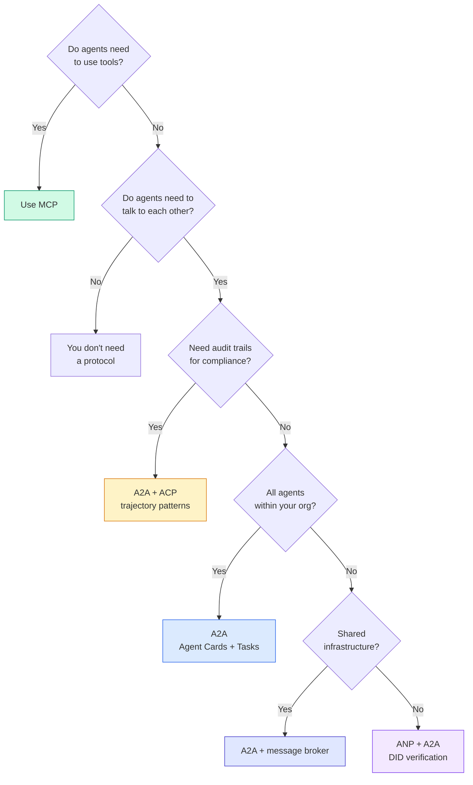

## Ship It

Bài này tạo ra:
- `code/main.ts` -- triển khai hoàn chỉnh của cả bốn mẫu giao thức
- `outputs/prompt-protocol-selector.md` -- một prompt giúp bạn chọn các giao thức cho hệ thống

## Exercises

1. **Giao tác vụ nhiều chặng.** Mở rộng `TaskManager` để một bộ xử lý agent có thể giao các tác vụ con cho các agent khác. Nhà nghiên cứu nhận một tác vụ, giao các tác vụ con “tìm kiếm” và “tóm tắt” cho hai agent chuyên gia, chờ cả hai hoàn thành, rồi hợp nhất kết quả vào các hiện vật của chính nó.

2. **Dấu vết kiểm toán truyền luồng.** Sửa `AuditableRunner` để hỗ trợ chế độ truyền luồng. Thay vì chờ kết quả đầy đủ, nhường ra các cập nhật `AuditEntry` theo thời gian thực khi các mục quỹ đạo được thêm vào. Sử dụng một generator bất đồng bộ tạo ra các snapshot kiểm toán.

3. **Luân chuyển DID.** Thêm luân chuyển khóa vào `IdentityRegistry`. Một agent nên có thể công bố một tài liệu DID mới với các khóa được cập nhật trong khi duy trì một tham chiếu `previousDid`. Các bộ xác minh nên chấp nhận chữ ký từ cả khóa hiện tại và trước đó trong một thời gian ân hạn.

4. **Đàm phán giao thức.** Triển khai khái niệm siêu giao thức của ANP. Hai agent trao đổi các thông điệp `protocolNegotiation` với các định dạng ứng viên (ví dụ: “Tôi có thể nói JSON-RPC” so với “Tôi thích REST”). Sau tối đa 3 vòng, chúng đồng ý một định dạng hoặc hết thời gian chờ. Định dạng đã thống nhất quyết định `TaskManager` hoặc `AuditableRunner` nào chúng sử dụng.

5. **Khám phá có giới hạn tốc độ.** Thêm một lớp bọc `RateLimitedRegistry` lưu đệm các lần tra cứu Agent Card với một TTL có thể cấu hình và giới hạn các truy vấn khám phá cho mỗi agent mỗi giây. Mô phỏng một đám đông dồn dập gồm 100 agent khám phá nhau khi khởi động và đo sự khác biệt.

## Key Terms

| Thuật ngữ | Mọi người nói gì | Ý nghĩa thực sự |
|------|----------------|----------------------|
| MCP | “Giao thức cho công cụ AI” | Một giao thức khách-chủ cho các agent khám phá và sử dụng công cụ. Agent với công cụ, không phải agent với agent. |
| A2A | “Giao thức agent của Google” | Một giao thức ngang hàng cho cộng tác agent dưới Linux Foundation. Khám phá qua Agent Card, vòng đời tác vụ 9 trạng thái, truyền luồng qua SSE. Hỗ trợ các liên kết JSON-RPC, REST, và gRPC. |
| ACP | “Nhắn tin agent doanh nghiệp” | API REST của IBM/BeeAI cho các lần chạy agent với TrajectoryMetadata: mỗi phản hồi mang chuỗi suy luận và lệnh gọi công cụ đầy đủ. Đang hợp nhất vào A2A. |
| ANP | “Danh tính agent phi tập trung” | Một giao thức cộng đồng sử dụng `did:wba` (DID) cho danh tính mật mã, HPKE cho E2EE, và đàm phán siêu giao thức được AI hỗ trợ cho các agent chưa từng thấy nhau. |
| Agent Card (Thẻ agent) | “Danh thiếp của agent” | Một tài liệu JSON tại `/.well-known/agent-card.json` mô tả các kỹ năng, các kiểu MIME được hỗ trợ, các cơ chế bảo mật, và các liên kết giao thức. |
| DID | “ID phi tập trung” | Tiêu chuẩn W3C cho các danh tính có thể xác minh bằng mật mã được lưu trên miền riêng của agent. ANP sử dụng phương thức `did:wba`. |
| TrajectoryMetadata | “Biên nhận kiểm toán” | Cơ chế của ACP để gắn các bước suy luận, lệnh gọi công cụ, và đầu vào/đầu ra của chúng vào mọi phản hồi agent. |
| Meta-protocol (Siêu giao thức) | “Các agent đàm phán cách nói chuyện” | Cách tiếp cận của ANP nơi các agent sử dụng ngôn ngữ tự nhiên để thống nhất động các định dạng dữ liệu, rồi sinh mã để xử lý chúng. |
| Task (Tác vụ) | “Một đơn vị công việc” | Đối tượng có trạng thái của A2A theo dõi công việc từ gửi đến hoàn thành. Bất biến một khi kết thúc. |

## Further Reading

- [Google A2A specification](https://github.com/google/A2A) -- đặc tả chính thức và các SDK (v1.0.1, Linux Foundation)
- [IBM/BeeAI ACP specification](https://github.com/i-am-bee/acp) -- đặc tả OpenAPI 3.1 cho các lần chạy agent và siêu dữ liệu quỹ đạo
- [Agent Network Protocol](https://github.com/agent-network-protocol/AgentNetworkProtocol) -- danh tính dựa trên DID, E2EE, đàm phán siêu giao thức
- [Model Context Protocol docs](https://modelcontextprotocol.io/) -- đặc tả MCP của Anthropic (được trình bày trong Giai đoạn 13)
- [W3C Decentralized Identifiers](https://www.w3.org/TR/did-core/) -- tiêu chuẩn danh tính làm nền tảng cho ANP
- [RFC 9180 (HPKE)](https://www.rfc-editor.org/rfc/rfc9180) -- cơ chế mã hóa ANP sử dụng cho E2EE
- [FIPA Agent Communication Language](http://www.fipa.org/specs/fipa00061/SC00061G.html) -- tiền thân học thuật của các giao thức agent hiện đại
