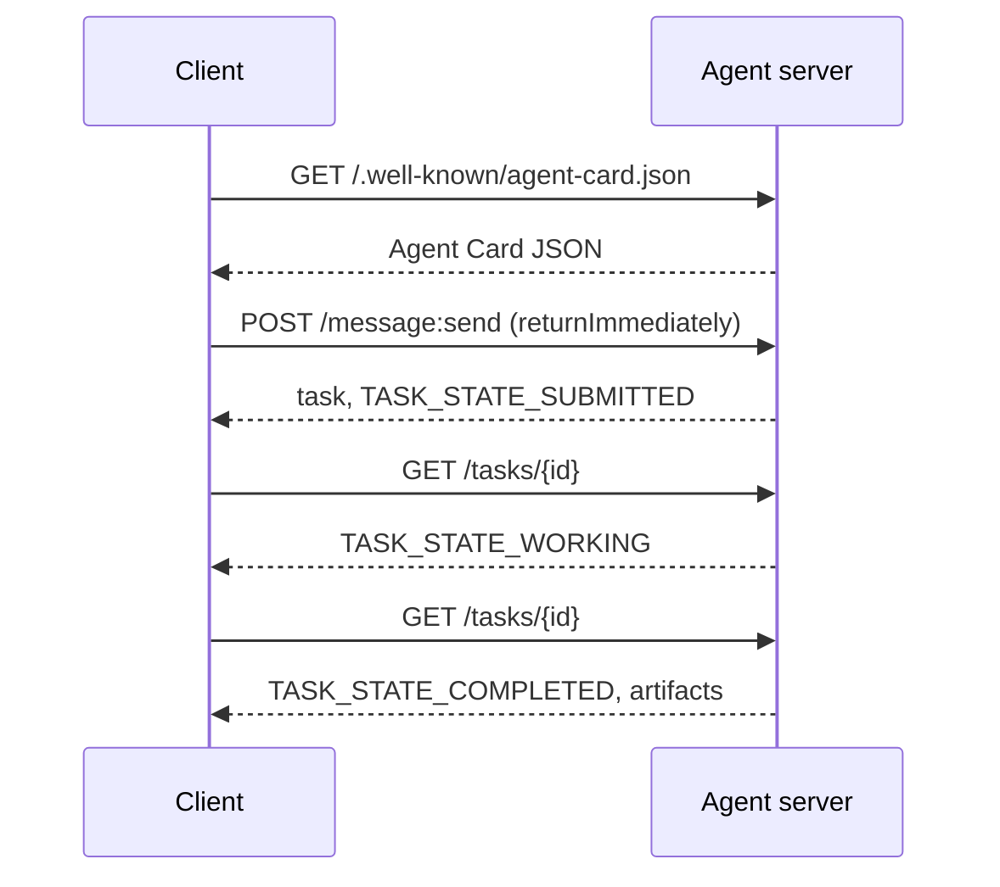

# A2A — The Agent-to-Agent Protocol

> Google công bố A2A vào tháng 4 năm 2025; đến tháng 4 năm 2026 đặc tả ở https://a2a-protocol.org/latest/specification/ và 150+ tổ chức ủng hộ nó. A2A là phần bổ sung theo chiều ngang cho MCP (Bài 13): trong khi MCP theo chiều dọc (agent ↔ công cụ), A2A là ngang hàng (agent ↔ agent). Nó định nghĩa các Agent Card (khám phá), các tác vụ có hiện vật (văn bản, dữ liệu có cấu trúc, video), các vòng đời tác vụ không trong suốt, và xác thực. Các hệ thống sản xuất ngày càng ghép MCP với A2A. Google Cloud đưa hỗ trợ A2A vào Vertex AI Agent Builder trong giai đoạn 2025-2026.

**Type:** Learn + Build
**Languages:** Python (stdlib, `http.server`, `json`)
**Prerequisites:** Phase 16 · 04 (Primitive Model)
**Time:** ~75 minutes

## Problem

Agent của bạn cần gọi một agent khác trên một hệ thống khác. Bằng cách nào? Bạn có thể cung cấp một endpoint HTTP, định nghĩa một lược đồ JSON riêng, và hy vọng phía kia nói được nó. Mỗi cặp agent trở thành một tích hợp tùy chỉnh.

A2A là giao thức truyền tải phổ quát cho lệnh gọi đó. Khám phá tiêu chuẩn, mô hình tác vụ tiêu chuẩn, truyền tải tiêu chuẩn, các hiện vật tiêu chuẩn. Giống HTTP+REST nhưng cho các agent như những công dân hạng nhất.

## Concept

### The four elements

**Agent Card.** Một tài liệu JSON tại `/.well-known/agent-card.json` mô tả agent: tên, kỹ năng, `supportedInterfaces` (URL endpoint, liên kết giao thức, phiên bản giao thức), các kiểu phương tiện đầu vào và đầu ra mặc định, và các yêu cầu xác thực (`securitySchemes` cộng với `securityRequirements`). Khám phá xảy ra bằng cách đọc card.

```http
GET /.well-known/agent-card.json HTTP/1.1
Host: agent.example.com
```

```json
{
  "name": "code-review-agent",
  "description": "Reviews Python and TypeScript code.",
  "version": "1.0.0",
  "supportedInterfaces": [
    {
      "url": "https://agent.example.com",
      "protocolBinding": "HTTP+JSON",
      "protocolVersion": "1.0"
    }
  ],
  "capabilities": {"streaming": false, "pushNotifications": false},
  "securitySchemes": {
    "bearer": {"httpAuthSecurityScheme": {"scheme": "Bearer"}}
  },
  "securityRequirements": [{"schemes": {"bearer": {"list": []}}}],
  "defaultInputModes": ["text/plain", "application/json"],
  "defaultOutputModes": ["application/json"],
  "skills": [
    {
      "id": "review-python",
      "name": "Review Python",
      "description": "Reviews Python code.",
      "tags": ["code-review", "python"]
    },
    {
      "id": "review-typescript",
      "name": "Review TypeScript",
      "description": "Reviews TypeScript code.",
      "tags": ["code-review", "typescript"]
    }
  ]
}
```

**Tác vụ.** Đơn vị công việc. Một đối tượng bất đồng bộ, có trạng thái với một vòng đời: `TASK_STATE_SUBMITTED` → `TASK_STATE_WORKING` → `TASK_STATE_COMPLETED` / `TASK_STATE_FAILED` / `TASK_STATE_CANCELED`. Một máy khách gửi một thông điệp, máy chủ tạo tác vụ, và máy khách thăm dò hoặc đăng ký các cập nhật.

**Hiện vật.** Loại kết quả được một tác vụ tạo ra. Văn bản, JSON có cấu trúc, hình ảnh, video, âm thanh. Các hiện vật có kiểu: mỗi phần mang một trong `text`, `raw`, `url`, hoặc `data` và có thể nêu `mediaType` của nó, nên các phương thức khác nhau là hạng nhất.

**Vòng đời không trong suốt.** A2A không quy định *cách* agent từ xa giải tác vụ. Máy khách thấy các chuyển trạng thái và hiện vật; triển khai được tự do sử dụng bất kỳ framework nào.

### The MCP/A2A split

- **MCP** (Bài 13): agent ↔ công cụ. Agent đọc/ghi qua JSON-RPC tới một máy chủ công cụ. Không trạng thái theo mặc định.
- **A2A**: agent ↔ agent. Giao thức ngang hàng; cả hai phía là các agent với suy luận riêng.

Các hệ thống đa agent sản xuất sử dụng cả hai. Một bên ngang hàng A2A gọi các công cụ MCP ở phía nó. Sự phân chia giữ hai mối quan tâm sạch.

### Discovery flow



Đây là các tuyến liên kết HTTP+JSON, và mọi yêu cầu mang `A2A-Version: 1.0`. Theo mặc định `SendMessage` chặn cho đến khi tác vụ đạt một trạng thái kết thúc hoặc bị gián đoạn, nên một máy khách thăm dò đặt `configuration.returnImmediately` để nhận tác vụ trở lại ngay lập tức.

Hoặc với truyền luồng: `POST /message:stream` trả về Server-Sent Events (một `task` trước, rồi các sự kiện `statusUpdate` và `artifactUpdate`), và `/tasks/{id}:subscribe` gắn lại vào một tác vụ đang chạy. Luồng đóng khi tác vụ đạt một trạng thái kết thúc; không có cờ `final`.

### Auth

A2A hỗ trợ ba mẫu phổ biến:

- **Bearer token**: OAuth2 hoặc không trong suốt (`httpAuthSecurityScheme` hoặc `oauth2SecurityScheme`).
- **mTLS**: TLS tương hỗ; các tổ chức chứng minh danh tính cho nhau (`mtlsSecurityScheme`).
- **Khóa API**: một khóa trong header, tham số truy vấn, hoặc cookie (`apiKeySecurityScheme`).

Xác thực được khai báo trong Agent Card: `securitySchemes` nêu tên mỗi cơ chế và `securityRequirements` nói máy khách phải thỏa những cơ chế nào. Các máy khách khám phá và tuân thủ.

### 150+ organizations by April 2026

Việc áp dụng doanh nghiệp thúc đẩy quy mô A2A. Điểm nổi bật: A2A trở thành cách các hệ thống agent doanh nghiệp vượt qua các ranh giới tin cậy. Google Cloud cung cấp hỗ trợ A2A trong Vertex AI Agent Builder; Microsoft Agent Framework hỗ trợ nó; hầu hết các framework lớn (LangGraph, CrewAI, AutoGen) cung cấp các adapter A2A.

### Where A2A wins

- **Các lệnh gọi xuyên tổ chức.** Agent tại công ty A gọi agent tại công ty B. Không có A2A, mỗi cặp là một hợp đồng riêng.
- **Các framework không đồng nhất.** Agent LangGraph gọi agent CrewAI gọi agent Python tùy chỉnh. A2A chuẩn hóa.
- **Các hiện vật có kiểu.** Kết quả video, JSON có cấu trúc, âm thanh — tất cả là hạng nhất.
- **Các tác vụ chạy dài.** Vòng đời không trong suốt + thăm dò làm các tác vụ dài hàng giờ trở nên đơn giản.

### Where A2A struggles

- **Các lệnh gọi nhỏ nhạy độ trễ.** Vòng đời A2A là bất đồng bộ. Agent với agent dưới một mili giây không phù hợp; sử dụng RPC trực tiếp.
- **Các agent trong tiến trình liên kết chặt.** Nếu cả hai agent chạy trong cùng tiến trình Python, vòng khứ hồi HTTP của A2A là quá mức.
- **Các nhóm nhỏ.** Chi phí phụ đặc tả là có thật; các agent chỉ nội bộ có thể không cần tính hình thức.

### A2A vs ACP, ANP, NLIP

Một số đặc tả liên quan xuất hiện trong giai đoạn 2024-2026:

- **ACP** (IBM/Linux Foundation) — tiền thân của A2A, phạm vi hẹp hơn.
- **ANP** (Agent Network Protocol) — thiên về khám phá ngang hàng, ưu tiên phi tập trung.
- **NLIP** (Ecma Natural Language Interaction Protocol, được tiêu chuẩn hóa tháng 12 năm 2025) — kiểu nội dung ngôn ngữ tự nhiên.

A2A là giao thức ngang hàng được áp dụng nhiều nhất tính đến tháng 4 năm 2026. Xem arXiv:2505.02279 (Liu và cộng sự, “A Survey of Agent Interoperability Protocols”) để có so sánh.

```figure
sw-agent-card-discovery
```

## Build It

`code/main.py` triển khai một máy chủ và máy khách A2A tối thiểu sử dụng `http.server` và JSON, trên liên kết HTTP+JSON 1.0. Máy chủ:

- cung cấp `/.well-known/agent-card.json`,
- chấp nhận `POST /message:send`,
- quản lý trạng thái tác vụ,
- trả về các hiện vật trên `GET /tasks/{id}`.

Máy khách:

- lấy Agent Card,
- gửi một thông điệp với `returnImmediately`,
- thăm dò cho đến khi hoàn thành,
- đọc hiện vật.

Chạy:

```
python3 code/main.py
```

Script khởi động máy chủ trong một luồng nền, rồi chạy máy khách với nó. Bạn thấy luồng hoàn chỉnh: khám phá, gửi, thăm dò, hiện vật.

## Use It

`outputs/skill-a2a-integrator.md` thiết kế một tích hợp A2A: nội dung Agent Card, các lược đồ tác vụ, lựa chọn xác thực, truyền luồng so với thăm dò.

## Ship It

Danh sách kiểm tra:

- **Ghim phiên bản đặc tả.** A2A vẫn đang phát triển; mỗi mục `supportedInterfaces` khai báo `protocolVersion` của nó, và các máy khách gửi `A2A-Version: 1.0`.
- **Tạo tác vụ lũy đẳng.** Các lần gửi trùng (thử lại mạng) nên tạo một tác vụ. Khử trùng lặp theo `messageId` của máy khách.
- **Các lược đồ hiện vật.** Khai báo những hình dạng nào agent trả về; các bên tiêu thụ nên xác thực.
- **Giới hạn tốc độ + xác thực.** A2A hướng ra công khai; áp dụng bảo mật web tiêu chuẩn.
- **Thư chết cho các tác vụ thất bại.** Kiểm tra các mẫu theo thời gian cho các loại lỗi tái diễn.

## Exercises

1. Chạy `code/main.py`. Xác nhận máy khách khám phá máy chủ và nhận hiện vật đúng.
2. Thêm một kỹ năng thứ hai vào máy chủ (ví dụ: “tóm tắt”). Cập nhật Agent Card. Viết một máy khách chọn kỹ năng dựa trên loại tác vụ. Một yêu cầu 1.0 không có trường kỹ năng, nên máy chủ định tuyến theo các phần thông điệp.
3. Triển khai `POST /message:stream`: trả lời bằng Server-Sent Events (một `task` trước, rồi các sự kiện `statusUpdate`) và đóng luồng tại một trạng thái kết thúc. Máy khách cần làm gì khác?
4. Đọc đặc tả A2A (https://a2a-protocol.org/latest/specification/). Xác định ba điều đặc tả bắt buộc mà demo này không triển khai.
5. So sánh A2A (khám phá Agent Card) với MCP (liệt kê năng lực phía máy chủ qua `listTools`). Đánh đổi giữa các agent tự mô tả và thăm dò năng lực là gì?

## Key Terms

| Thuật ngữ | Mọi người nói gì | Ý nghĩa thực sự |
|------|----------------|------------------------|
| A2A | “Agent với agent” | Giao thức ngang hàng cho các agent gọi các agent khác xuyên hệ thống. Google 2025. |
| Agent Card (Thẻ agent) | “Danh thiếp của agent” | JSON tại `/.well-known/agent-card.json` mô tả các kỹ năng, `supportedInterfaces`, xác thực. |
| Task (Tác vụ) | “Đơn vị công việc” | Đối tượng có trạng thái bất đồng bộ với một vòng đời; các hiện vật được tạo khi hoàn thành. |
| Artifact (Hiện vật) | “Kết quả” | Đầu ra có kiểu: văn bản, JSON có cấu trúc, hình ảnh, video, âm thanh. Phương tiện hạng nhất. |
| Opaque lifecycle (Vòng đời không trong suốt) | “Giải như thế nào là việc của agent” | Máy khách thấy các chuyển trạng thái; máy chủ tự do chọn framework/công cụ. |
| Discovery (Khám phá) | “Tìm agent” | `GET /.well-known/agent-card.json` trả về card. |
| MCP vs A2A (MCP so với A2A) | “Công cụ so với bên ngang hàng” | MCP: dọc agent ↔ công cụ. A2A: ngang agent ↔ agent. |
| ACP / ANP / NLIP | “Các giao thức anh em” | Các đặc tả liền kề; A2A được áp dụng nhiều nhất năm 2026. |

## Further Reading

- [A2A specification](https://a2a-protocol.org/latest/specification/) — đặc tả chuẩn
- [A2A v1.0.1 release](https://github.com/a2aproject/A2A/tree/v1.0.1): `docs/specification.md` và `specification/a2a.proto` được gắn thẻ mà bài này theo
- [Google Developers Blog — A2A announcement](https://developers.googleblog.com/en/a2a-a-new-era-of-agent-interoperability/) — bài viết ra mắt tháng 4 năm 2025
- [A2A GitHub repo](https://github.com/a2aproject/A2A) — các triển khai tham chiếu và SDK
- [Liu et al. — A Survey of Agent Interoperability Protocols](https://arxiv.org/html/2505.02279v1) — so sánh MCP, ACP, A2A, ANP
