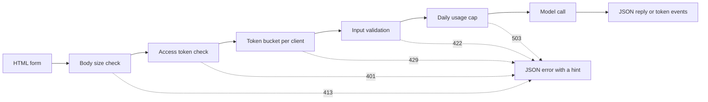

# Model Demo Interfaces — From a Function to a Shareable App

> Một demo mô hình có một hợp đồng: một đầu vào, một lời gọi mô hình, và một đầu ra. Đặt một giới hạn lên mỗi phần trước khi bạn chia sẻ liên kết.

**Type:** Build
**Languages:** Python
**Prerequisites:** Phase 11 · 13 (Building a Production LLM Application), Phase 17 · 08 (Inference Metrics), Phase 17 · 19 (AI Gateways)
**Time:** ~90 minutes

## Learning Objectives

- Viết hợp đồng đầu vào, lời gọi mô hình, và đầu ra của một demo, với một giới hạn trên mỗi phần.
- Dựng một ứng dụng HTTP thư viện chuẩn với một trang HTML, một endpoint JSON, và một endpoint Server-Sent Events.
- Xác thực đầu vào theo thứ tự chi phí, và trả về các lỗi JSON cho người dùng biết hành động tiếp theo.
- Bảo vệ một demo công khai bằng một token bucket cho mỗi client, một mức trần sử dụng hằng ngày, và một access token tùy chọn.
- Viết các log yêu cầu không giữ văn bản đầu vào và không địa chỉ client.
- So sánh demo thư viện chuẩn với hai phiên bản framework, và nêu các dấu hiệu rằng một demo phải trở thành một sản phẩm.

## The Problem

Mô hình của bạn hoạt động trong một notebook. Bây giờ một người đánh giá muốn thử mười đầu vào, và một khách hàng muốn thấy một kết quả trên điện thoại. Không ai trong số họ sẽ mở notebook của bạn.

Một ô notebook không có các giới hạn đầu vào và không hiển thị tiến độ. Các lỗi của nó là các stack trace mà chỉ bạn có thể đọc. Nó cũng chạy với thông tin xác thực và ngân sách của bạn. Nếu bạn đặt ô đó đằng sau một URL công khai mà không thay đổi, bạn có thể kỳ vọng các thất bại như sau:

- Một người dùng dán một tài liệu 40,000 ký tự. Lời gọi mô hình chạy trong một phút rồi thất bại với một stack trace.
- Một script gửi 500 yêu cầu trong một phút. Mỗi yêu cầu là một lời gọi mô hình trả phí.
- Trang không hiển thị gì trong tám giây, nên người dùng nhấp nút thêm bốn lần.
- Log server giữ mọi đầu vào, bao gồm đầu vào có một số tài khoản khách hàng.

Một giao diện demo ngăn các thất bại này bằng một lượng mã nhỏ. Bài học này dựng một giao diện bằng thư viện chuẩn Python, để bạn có thể thấy mọi phần. Sau đó nó dựng cùng demo bằng hai framework phổ biến và so sánh mỗi framework mặc định làm gì.

## The Concept

### A demo is a contract

Mọi demo có ba phần. Đầu vào là những gì người dùng có thể gửi. Lời gọi mô hình chuyển đầu vào thành một đầu ra. Đầu ra là những gì người dùng thấy, và điều đó bao gồm các lỗi.

Viết hợp đồng ra trước khi bạn viết trang:

| Phần | Câu hỏi cần trả lời | Câu trả lời trong bài học này |
|------|--------------------|-----------------------|
| Đầu vào | Kiểu gì, kích thước gì, những ký tự nào? | Một chuỗi từ 1 đến 500 ký tự, không có ký tự điều khiển |
| Lời gọi mô hình | Một lời gọi mất bao lâu, và nó tốn bao nhiêu? | Một mô hình từ khóa đồ chơi chạy dưới một mili giây không mất phí |
| Đầu ra | Người dùng thấy gì khi thành công và khi thất bại? | Một nhãn, một điểm số, và một câu trả lời, hoặc một lỗi JSON có gợi ý |

Một notebook không có giới hạn trên bất kỳ phần nào trong ba phần. Một demo đặt một giới hạn trên mỗi phần, và server áp dụng các giới hạn cho mọi client.



Các phép kiểm tra chạy theo thứ tự chi phí. Một yêu cầu không hợp lệ dừng tại phép kiểm tra đầu tiên mà nó trượt, nên nó gần như không tốn gì cho server. Lời gọi mô hình đến cuối cùng, vì nó là bước duy nhất tốn tiền.

### Validate before the model runs

Trình duyệt có thể kiểm tra đầu vào trước khi gửi bất cứ thứ gì. Các thuộc tính `maxlength` và `required` trên một vùng văn bản cho người dùng phản hồi không cần lời gọi mạng. Các phép kiểm tra này chỉ giúp những người dùng trung thực. Bất kỳ client nào cũng có thể gửi một yêu cầu mà không qua trang, nên server lặp lại mọi phép kiểm tra.

Đặt các phép kiểm tra server theo thứ tự chi phí:

1. Đọc header `Content-Length`. Từ chối một body vượt giới hạn trước khi bạn đọc nó.
2. Phân tích body JSON. Từ chối một body không phải đối tượng JSON.
3. Kiểm tra các trường. Từ chối văn bản rỗng, văn bản vượt giới hạn, và các ký tự điều khiển.
4. Chỉ dùng một lời gọi mô hình cho một yêu cầu đã vượt qua mọi phép kiểm tra.

| Phép kiểm tra trượt | Trạng thái HTTP | Mã lỗi |
|--------------|-------------|------------|
| Không có header `Content-Length` | 411 Length Required | `length_required` |
| `Content-Length` không phải một số | 400 Bad Request | `bad_length` |
| Body vượt 4,096 byte | 413 Content Too Large | `body_too_large` |
| Body dừng trước khi `Content-Length` byte đến | 408 Request Timeout | `request_timeout` |
| Kiểu nội dung không phải JSON | 415 Unsupported Media Type | `unsupported_media_type` |
| Body không phải một đối tượng JSON | 400 Bad Request | `bad_json` |
| Văn bản thiếu, rỗng, quá dài, hoặc có ký tự điều khiển | 422 Unprocessable Content | `missing_text`, `empty_text`, `text_too_long`, `control_characters` |

RFC 9110 định nghĩa các mã trạng thái này và các tên của chúng.

Các ví dụ là một phần của thiết kế đầu vào. Một ví dụ cho người dùng thấy một đầu vào tốt trông như thế nào. Nó cũng cho một người đánh giá một kiểm thử với một lần nhấp. Chọn một ví dụ cho mỗi lớp đầu ra. Demo này có một ví dụ tích cực, một tiêu cực, và một trung lập.

### Show that the model is working

Một lời gọi mô hình có thể mất vài giây. Không có phản hồi, người dùng không thể phân biệt một mô hình chậm với một trang bị hỏng. Một người dùng không thấy thay đổi có thể nhấp lần nữa, và khi đó server nhận một yêu cầu trả phí thứ hai.

Trang trong bài học này cho bốn loại phản hồi:

- Nó vô hiệu hóa nút gửi khi một yêu cầu chạy.
- Nó hiển thị thời gian đã trôi qua và cập nhật mỗi 100 mili giây.
- Nó hiển thị thời gian đến token đầu tiên khi token đầu tiên đến.
- Nó hiển thị tổng thời gian khi yêu cầu kết thúc.

Khi bạn học [các metric suy luận](../../08-inference-metrics-goodput/), thời gian đến token đầu tiên (TTFT) là một metric server. Trang demo hiển thị cùng con số cho người dùng, được đo trong trình duyệt.

### Send the output as a stream

Một mô hình ngôn ngữ tạo câu trả lời của nó từng token một. Nếu server chờ token cuối cùng, người dùng chờ toàn bộ quá trình sinh. Nếu server gửi mỗi token khi nó sẵn sàng, người dùng bắt đầu đọc sau token đầu tiên.

Server-Sent Events (SSE) là định dạng chuẩn cho việc này. Phản hồi có kiểu nội dung `text/event-stream`. Mỗi sự kiện là một nhóm các dòng `event:` và `data:`, và một dòng trống kết thúc sự kiện. Tiêu chuẩn HTML WHATWG định nghĩa định dạng.

```text
event: token
data: {"index":0,"text":"Label:"}

event: token
data: {"index":1,"text":" positive."}

event: done
data: {"label":"positive","score":1.0,"tokens":11}
```

Trình duyệt có một giao diện `EventSource` cho SSE, nhưng nó chỉ gửi các yêu cầu GET. Một yêu cầu GET đặt đầu vào trong URL, và các web server cùng proxy viết các URL vào các access log của chúng. Thay vào đó demo này gửi một yêu cầu POST với một body JSON. Trang đọc phản hồi bằng `fetch()` và `response.body.getReader()`, và nó tự phân tích định dạng sự kiện.

Một stream có một vấn đề mà một câu trả lời JSON đơn lẻ không có. Server gửi trạng thái 200 trước token đầu tiên. Nếu mô hình thất bại sau đó, server không thể thay đổi trạng thái. Nên server gửi một sự kiện `error` trong stream, và trang hiển thị sự kiện đó là một lỗi.

Khi bạn dựng [ứng dụng LLM production](../../../11-llm-engineering/13-production-app/), một framework gửi các token qua SSE cho bạn. Bài học này viết cùng giao thức bằng tay, để bạn có thể thấy mỗi dòng mà server gửi.

### Write errors that a user can act on

Một thông điệp lỗi có hai nhiệm vụ. Nó cho người dùng biết điều gì đã xảy ra, và nó cho người dùng biết phải làm gì tiếp theo. Một stack trace không làm nhiệm vụ nào cho một người lạ.

Mọi lỗi trong demo này có cùng hình dạng JSON:

```json
{
  "error": {
    "code": "text_too_long",
    "message": "The text has 812 characters. The limit is 500.",
    "hint": "Shorten the text to 500 characters or fewer.",
    "request_id": "a8f3c2b435e3"
  }
}
```

- `code` là một tên ổn định. Mã client và các kiểm thử so sánh với nó.
- `message` nêu sự việc, với các con số mà người dùng cần.
- `hint` cho người dùng một hành động.
- `request_id` kết nối một báo cáo người dùng với một bản ghi log.

RFC 9457 định nghĩa một định dạng lỗi chuẩn cho các API HTTP, được gọi là problem details. Demo này dùng một hình dạng nhỏ hơn cho cùng mục đích. Dùng RFC 9457 khi các nhóm khác gọi API của bạn.

### Share a public demo safely

Một liên kết công khai thay đổi ai có thể gửi yêu cầu. Lập kế hoạch một biện pháp kiểm soát cho mỗi rủi ro:

| Rủi ro | Biện pháp kiểm soát trong demo này | Biện pháp kiểm soát cho một lượng người dùng lớn hơn |
|------|----------------------|-------------------------------|
| Một client gửi quá nhiều yêu cầu | Một token bucket cho mỗi client, với 429 và `Retry-After` | Các giới hạn theo người dùng sau khi đăng nhập |
| Những người lạ tìm thấy liên kết | Một access token tùy chọn trong header `Authorization` | Đăng nhập một lần với một nhà cung cấp danh tính |
| Tổng chi phí tăng không có giới hạn | Một mức trần sử dụng hằng ngày, với 503 và `Retry-After` | Các giới hạn chi tiêu và cảnh báo tại nhà cung cấp mô hình |
| Đầu vào rất lớn hoặc bất thường | Giới hạn kích thước body, giới hạn độ dài văn bản, kiểm tra ký tự điều khiển | Kiểm duyệt nội dung trên đầu vào và đầu ra |
| Các log giữ đầu vào riêng tư | Các bản ghi với độ dài đầu vào và một hash có khóa của client | Một thời hạn lưu giữ và kiểm soát truy cập trên các log |

Một token bucket dùng hai con số. Dung lượng là đợt bùng phát lớn nhất mà một client có thể gửi. Tốc độ nạp lại là tốc độ yêu cầu dài hạn. Mỗi yêu cầu lấy một token, và bucket nạp lại liên tục đến dung lượng của nó:

```text
tokens = min(capacity, tokens + refill_rate * seconds_since_last_request)
accept the request if tokens >= 1, then subtract 1
```

Khi bucket rỗng, server trả lời `429 Too Many Requests`. RFC 6585 định nghĩa trạng thái 429, và nó cho phép server thêm một header `Retry-After`. Demo này luôn thêm header, với số giây đến token tiếp theo. Trang đọc header và vô hiệu hóa nút trong khoảng thời gian đó.

Demo dùng địa chỉ IP client làm khóa bucket. Đằng sau một reverse proxy, mọi yêu cầu đến từ địa chỉ proxy, nên tất cả người dùng dùng chung một bucket. Trong trường hợp đó, đọc địa chỉ client từ một header mà proxy của chính bạn đặt. Không tin header đó từ bất kỳ nguồn nào khác, vì một client có thể đặt bất kỳ giá trị nào vào nó.

Khi bạn học [các AI gateway](../../19-ai-gateways/), gateway áp dụng các giới hạn tốc độ theo tenant. Một demo cần cùng biện pháp kiểm soát ở quy mô nhỏ hơn. Một giới hạn tốc độ kiểm soát mỗi client, nhưng nó không kiểm soát tổng. Một trăm client mỗi client đều dưới giới hạn vẫn có thể dùng toàn bộ ngân sách. Một mức trần sử dụng đếm tất cả các lời gọi mô hình trong một ngày và từ chối các lời gọi sau một con số cố định.

Các log cần sự cẩn thận tương tự đầu vào. Handler `http.server` mặc định viết địa chỉ IP client và dòng yêu cầu vào standard error. Nếu đầu vào nằm trong URL, đầu vào đi vào log. Demo này thay thế dòng log đó. Mỗi yêu cầu viết một bản ghi với route, trạng thái, mã lỗi, độ trễ, và độ dài đầu vào. Địa chỉ client trở thành một hash có khóa, để bạn có thể đếm các yêu cầu theo client mà không lưu địa chỉ.

Cho người dùng biết bạn giữ gì. Trang demo nói server giữ độ dài văn bản và không bao giờ chính văn bản.

### When a demo becomes a product

Một demo phục vụ những người đã biết trong các phiên ngắn từ một tiến trình. Những dấu hiệu này cho bạn biết demo hiện là một sản phẩm:

- Những người ngoài nhóm của bạn dùng nó mỗi tuần.
- Ai đó yêu cầu một mục tiêu uptime, hoặc báo cáo một lần ngừng hoạt động.
- Người dùng yêu cầu đăng nhập, lưu kết quả, hoặc xem lịch sử của họ.
- Chi phí mô hình hằng tuần là một dòng trong một ngân sách.
- Đầu vào bao gồm dữ liệu mà một hợp đồng hoặc một luật điều chỉnh.

| Thuộc tính | Demo | Sản phẩm |
|----------|------|---------|
| Người dùng | Những người đã biết, các phiên ngắn | Những người chưa biết, sử dụng hằng ngày |
| Trạng thái | Không có | Các tài khoản, lịch sử, kết quả đã lưu |
| Tính khả dụng | Nỗ lực tốt nhất, một tiến trình | Một mục tiêu được viết ra, các replica, một người phụ trách trực |
| Kiểm soát chi phí | Một mức trần sử dụng hằng ngày | Các quota theo người dùng và thanh toán |
| Khả năng quan sát | Một bản ghi log cho mỗi yêu cầu | Các trace, metric, và cảnh báo |

Khi bạn thấy những dấu hiệu này, chuyển demo sang stack production từ bài học ứng dụng LLM production. Stack đó thêm xác thực thực sự, các mô hình dự phòng, tracing, và theo dõi chi phí theo người dùng.

```figure
demo-token-bucket
```

## Build It

Mã là một tệp, `code/main.py`, không có dependency ngoài thư viện chuẩn. Chạy self-test trước:

```bash
python3 code/main.py
```

Self-test kiểm tra validator, token bucket, định dạng stream, và một vòng HTTP thực sự. Nó khởi động server trên một cổng trống, gửi ba yêu cầu, dừng server, và thoát. Chỉ khởi động server cho một trình duyệt khi bạn cần nó:

```bash
python3 code/main.py --serve
```

Mở `http://127.0.0.1:8000` trong một trình duyệt. Nhấn Ctrl+C để dừng server.

### Step 1: The model call

Mô hình là một bộ đếm từ khóa đồ chơi. Nó gắn nhãn văn bản là tích cực, tiêu cực, hoặc trung lập. Nó cũng tạo một câu trả lời ngắn, từng token một.

```python
def classify(text):
    words = WORD_RE.findall(text.lower())
    positive = sum(1 for word in words if word in POSITIVE)
    negative = sum(1 for word in words if word in NEGATIVE)
    score = (positive - negative) / max(1, positive + negative)
    if score > 0:
        label = "positive"
    elif score < 0:
        label = "negative"
    else:
        label = "neutral"
    return {"label": label, "score": round(score, 3), "positive_cues": positive,
            "negative_cues": negative, "words": len(words)}


def generate(text):
    result = classify(text)
    reply = (
        f"Label: {result['label']}. Positive cues: {result['positive_cues']}. "
        f"Negative cues: {result['negative_cues']}. Words read: {result['words']}."
    )
    parts = reply.split(" ")
    yield parts[0]
    for part in parts[1:]:
        yield " " + part
```

Một mô hình thật thay thế `generate` và không gì khác. Đặt một lời gọi API hoặc một mô hình cục bộ bên trong nó. Giữ chữ ký: một chuỗi đi vào, và các token đi ra. Validator, các giới hạn, và trang giữ nguyên.

### Step 2: Validation and error responses

Một lớp ngoại lệ mang mọi lỗi. Nó giữ trạng thái HTTP, một mã ổn định, một thông điệp, một gợi ý, và các header phản hồi tùy chọn.

```python
class DemoError(Exception):
    def __init__(self, status, code, message, hint, headers=None):
        super().__init__(message)
        self.status = status
        self.code = code
        self.message = message
        self.hint = hint
        self.headers = dict(headers or {})


def validate_text(payload, max_chars=MAX_CHARS):
    if "text" not in payload:
        raise DemoError(422, "missing_text", 'The field "text" is missing.', 'Add a "text" field with your input.')
    text = payload["text"]
    if not isinstance(text, str):
        raise DemoError(422, "text_not_string", 'The field "text" is not a string.', "Send the input as a string.")
    text = text.strip()
    if not text:
        raise DemoError(422, "empty_text", "The text is empty.", "Type a sentence or pick an example.")
    if len(text) > max_chars:
        raise DemoError(422, "text_too_long", f"The text has {len(text)} characters. The limit is {max_chars}.",
                        f"Shorten the text to {max_chars} characters or fewer.")
    if CONTROL_RE.search(text):
        raise DemoError(422, "control_characters", "The text contains control characters.",
                        "Remove the hidden characters, then send the text again.")
    return text
```

Validator loại bỏ khoảng trắng đầu và cuối trước. Một văn bản chỉ có dấu cách khi đó trượt vì rỗng, và gợi ý cho người dùng biết cần nhập gì. `check_body_size` và `parse_json_body` dùng cùng mẫu cho các trường hợp 411, 413, 415, và 400. `error_body` chuyển bất kỳ `DemoError` nào thành hình dạng JSON từ mục khái niệm.

### Step 3: The token bucket

```python
class TokenBucket:
    def __init__(self, capacity, refill_per_second, now):
        if capacity < 1:
            raise ValueError("capacity must be at least 1")
        if refill_per_second <= 0:
            raise ValueError("refill_per_second must be positive")
        self.capacity = float(capacity)
        self.refill_per_second = float(refill_per_second)
        self.tokens = float(capacity)
        self.updated = now

    def take(self, now, cost=1.0):
        elapsed = max(0.0, now - self.updated)
        self.tokens = min(self.capacity, self.tokens + elapsed * self.refill_per_second)
        self.updated = now
        if self.tokens >= cost:
            self.tokens -= cost
            return 0.0
        return (cost - self.tokens) / self.refill_per_second
```

`take` trả về 0.0 khi nó chấp nhận yêu cầu. Nếu không nó trả về số giây đến khi bucket có đủ token. Server làm tròn giá trị đó lên và gửi nó trong `Retry-After`.

`RateLimiter` giữ một bucket cho mỗi client trong một `OrderedDict`. Một khóa bảo vệ từ điển, vì `ThreadingHTTPServer` xử lý mỗi yêu cầu trong luồng riêng của nó. Khi từ điển có hơn `max_clients` mục, bộ giới hạn loại bỏ client có yêu cầu cũ nhất. Một client bị loại bỏ nhận một bucket đầy ở yêu cầu tiếp theo của nó. Đặt `max_clients` cao hơn số client hoạt động mà bạn kỳ vọng.

Bộ giới hạn nhận một đối số `clock`. Các kiểm thử truyền một `FakeClock`, để một kiểm thử có thể tiến thời gian thêm mười giây mà không chờ. `UsageCap` dùng cùng mẫu đồng hồ cho tổng hằng ngày. Nó đếm các lời gọi trong các cửa sổ cố định 86,400 giây, và nó trả về số giây đến cửa sổ tiếp theo khi số đếm đầy.

### Step 4: The stream

```python
def sse_event(event, data):
    payload = json.dumps(data, separators=(",", ":"), ensure_ascii=False)
    return f"event: {event}\ndata: {payload}\n\n".encode("utf-8")


def stream_events(text, generate_fn=generate, delay=0.0, sleep=time.sleep):
    count = 0
    try:
        for token in generate_fn(text):
            yield sse_event("token", {"index": count, "text": token})
            count += 1
            if delay:
                sleep(delay)
    except Exception:
        yield sse_event("error", MODEL_ERROR)
        return
    result = classify(text)
    yield sse_event("done", {"label": result["label"], "score": result["score"], "tokens": count})
```

`json.dumps` viết một ký tự xuống dòng bên trong một chuỗi thành hai ký tự `\n`. Vì vậy mỗi sự kiện có một dòng dữ liệu không có ký tự xuống dòng thô trong đó. Một ký tự xuống dòng thô trong dữ liệu sẽ phá định dạng sự kiện.

Generator bắt một lỗi mô hình và gửi một sự kiện `error`, vì server đã gửi dòng trạng thái. Các đối số `delay` và `sleep` làm chậm stream cho một trình duyệt, và chúng giữ các kiểm thử nhanh.

### Step 5: The request handler

`DemoHandler` mở rộng `BaseHTTPRequestHandler`. Handler POST chạy các phép kiểm tra theo thứ tự từ mục khái niệm:

```python
def do_POST(self):
    app = self.server.app
    request_id = uuid.uuid4().hex[:12]
    client_id = self.client_address[0]
    started = time.perf_counter()
    route = self.path if self.path in self.routes else "other"
    status, code, chars = 200, None, 0
    try:
        declared = self.headers.get("Content-Length")
        try:
            if route == "other":
                raise DemoError(404, "not_found", "This endpoint does not exist.",
                                "Send requests to /api/predict or /api/stream.")
            size = check_body_size(declared, app.config.max_body_bytes)
        except DemoError:
            self.drain(int(declared) if declared and declared.isdigit() else 0)
            raise
        try:
            body = self.rfile.read(size)
        except TimeoutError:
            self.close_connection = True
            raise DemoError(408, "request_timeout", "The request body did not arrive in time.",
                            "Send the request again with the full body.") from None
        app.admit(client_id, self.headers.get("Authorization"))
        text = app.read_text(self.headers.get("Content-Type"), body)
        chars = len(text)
        app.charge()
        if route == "/api/predict":
            self.send_json(200, predict(text), request_id)
        else:
            code = self.send_stream(text, request_id)
    except DemoError as err:
        status, code = err.status, err.code
        self.send_error_json(err, request_id)
    except TimeoutError:
        status, code = 408, "request_timeout"
        self.close_connection = True
    except Exception:
        status, code = 500, "internal_error"
        self.send_error_json(DemoError(500, "internal_error", "The server failed on this request.",
                                       "Try again. Quote the request id if you report the problem."), request_id)
    finally:
        latency_ms = (time.perf_counter() - started) * 1000
        app.log.record(request_id, route, client_id, status, chars, latency_ms, code)
```

`admit` kiểm tra access token và token bucket. `charge` kiểm tra mức trần hằng ngày. Nó chạy cuối cùng, để chỉ các yêu cầu hợp lệ được tính vào mức trần. Mọi yêu cầu viết một bản ghi log trong khối `finally`, và điều đó bao gồm các yêu cầu bị từ chối. Bản ghi giữ `route`, không bao giờ đường dẫn thô, vì một đường dẫn có thể mang một chuỗi truy vấn có văn bản người dùng.

Bốn chi tiết ngăn các thất bại dễ bị bỏ sót:

- `timeout = 10` trên lớp handler đóng một kết nối khi client ngừng gửi. Không có nó, một client khai báo 100 byte và gửi 10 giữ một luồng server mãi mãi. Handler gửi một lỗi JSON 408 với id yêu cầu và đóng kết nối. Một timeout sau khi stream bắt đầu chỉ đóng kết nối, vì dòng trạng thái đã được gửi.
- `log_message` trả về không có đầu ra. Điều này loại bỏ dòng log mặc định có địa chỉ client và dòng yêu cầu.
- `drain` đọc và loại bỏ tối đa 64 KiB của một body bị từ chối. RFC 1122 nói TCP gửi một reset khi một máy chủ đóng một kết nối có dữ liệu chưa đọc. Khi đó client có thể mất câu trả lời 413.
- `send_stream` bắt `BrokenPipeError` và đóng generator. Khi người dùng đóng tab, mô hình dừng, và yêu cầu không tốn thêm gì.

`BaseHTTPRequestHandler` mặc định dùng HTTP/1.0. Khi đó điểm kết thúc của một body được stream là thời điểm server đóng kết nối. Một server dùng HTTP/1.1 gửi body với mã hóa truyền chunked cho cùng mục đích.

### Step 6: The page

`render_page` trả về một tài liệu HTML với một style inline và một script inline. Trang không nạp script, font, hoặc hình ảnh bên ngoài nào. Script đọc stream như sau:

```javascript
const reader = response.body.getReader();
const decoder = new TextDecoder();
let buffer = "";
while (true) {
  const chunk = await reader.read();
  if (chunk.done) { break; }
  buffer += decoder.decode(chunk.value, { stream: true });
  let cut = buffer.indexOf("\n\n");
  while (cut >= 0) {
    const frame = parseFrame(buffer.slice(0, cut));
    buffer = buffer.slice(cut + 2);
    cut = buffer.indexOf("\n\n");
    if (frame.event === "token") { output.textContent += frame.data.text; }
  }
}
```

Một chunk mạng có thể kết thúc ở giữa một sự kiện. Bộ đọc giữ phần chưa hoàn chỉnh trong `buffer` cho đến khi dòng trống đến.

Trang viết đầu ra mô hình bằng `textContent` và không bao giờ bằng `innerHTML`. Đầu ra mô hình là văn bản không đáng tin cậy. Giả sử trang chèn một câu trả lời dưới dạng HTML, và câu trả lời chứa một phần tử có một thuộc tính `onerror`. Khi đó thuộc tính đó có thể chạy mã trong trình duyệt của người dùng.

Server cũng gửi một header `Content-Security-Policy` với `default-src 'none'`. Chính sách cho phép một script inline và một style inline, được nhận diện bằng các hash SHA-256 của chúng. Trình duyệt từ chối mọi script khác, bao gồm một script mà một kẻ tấn công chèn vào trang.

```python
def csp_hash(source):
    digest = hashlib.sha256(source.encode("utf-8")).digest()
    return "'sha256-" + base64.b64encode(digest).decode("ascii") + "'"
```

### Step 7: Run it and try to break it

Khởi động server, rồi dùng `curl` từ một terminal thứ hai. Gửi liên tiếp bảy yêu cầu đến một server mới. Bucket giữ năm token và nhận một token mới mỗi hai giây:

```bash
for i in 1 2 3 4 5 6 7; do
  curl -s -o /dev/null -w '%{http_code} ' -X POST http://127.0.0.1:8000/api/predict \
    -H 'Content-Type: application/json' -d '{"text": "ok"}'
done
```

```text
200 200 200 200 200 429 429
```

Chờ mười giây, rồi gửi một văn bản rỗng:

```bash
curl -s -X POST http://127.0.0.1:8000/api/predict \
  -H 'Content-Type: application/json' -d '{"text": ""}'
```

```json
{"error": {"code": "empty_text", "message": "The text is empty.", "hint": "Type a sentence or pick an example.", "request_id": "e3e3599feaea"}}
```

Xem stream sự kiện bằng `curl -N`, tắt đệm đầu ra:

```bash
curl -N -X POST http://127.0.0.1:8000/api/stream \
  -H 'Content-Type: application/json' -d '{"text": "The screen is bright."}'
```

Để yêu cầu một access token, đặt `DEMO_ACCESS_TOKEN` trước khi bạn khởi động server. Khi đó trang hiển thị một trường cho token.

```bash
export DEMO_ACCESS_TOKEN="$(python3 -c 'import secrets; print(secrets.token_urlsafe(24))')"
echo "$DEMO_ACCESS_TOKEN"
python3 code/main.py --serve
```

Chạy các kiểm thử:

```bash
python3 -m unittest discover -s code/tests -v
```

Các kiểm thử HTTP khởi động server trên cổng 0, để hệ điều hành chọn một cổng trống. `tearDown` dừng server và kiểm tra rằng luồng của nó đã kết thúc.

## Use It

Hai framework Python dựng cùng loại demo với ít mã hơn: Gradio và Streamlit. Cả hai ví dụ bên dưới import hợp đồng từ `main.py`, để validator và mô hình giữ nguyên. Bạn không cần framework nào để chạy `main.py` hoặc các kiểm thử.

### Components around one function

Gradio đặt một giao diện web quanh một hàm Python. Các thành phần đầu vào và đầu ra mô tả hợp đồng, và một hàm generator gửi đầu ra từng phần.

```python
import os

import gradio as gr

from main import EXAMPLES, MAX_CHARS, DemoError, classify, generate, validate_text


def label_text(text):
    try:
        clean = validate_text({"text": text})
    except DemoError as err:
        raise gr.Error(f"{err.message} {err.hint}")
    label = classify(clean)["label"]
    reply = ""
    for token in generate(clean):
        reply += token
        yield reply, label


demo = gr.Interface(
    fn=label_text,
    inputs=gr.Textbox(label="Text to label", lines=5, max_length=MAX_CHARS),
    outputs=[gr.Textbox(label="Reply"), gr.Textbox(label="Label")],
    examples=list(EXAMPLES),
    flagging_mode="never",
)

if __name__ == "__main__":
    demo.queue(max_size=20).launch(auth=("demo", os.environ["DEMO_PASSWORD"]))
```

Mỗi `yield` thay thế toàn bộ giá trị đầu ra. Vì vậy hàm yield toàn bộ câu trả lời đến thời điểm đó ở mỗi bước.

Đặt `flagging_mode` có chủ đích trước khi bạn chia sẻ một liên kết. Chế độ mặc định hiển thị một nút đánh dấu. Khi một người dùng nhấn nó, Gradio viết đầu vào và đầu ra vào một tệp CSV trên server. Giá trị `"never"` loại bỏ nút.

`queue(max_size=20)` giới hạn số yêu cầu đang chờ. Giới hạn đồng thời mặc định là một lời gọi đang chạy cho mỗi sự kiện. Khi đó một mô hình chậm phục vụ từng người dùng một cho đến khi bạn tăng giới hạn. Gradio cũng tạo các endpoint API khi ứng dụng khởi chạy, nên các script có thể gọi demo mà không qua trang. Giới hạn tốc độ của bạn cũng phải áp dụng cho các endpoint đó.

### A script that reruns on every input

Streamlit chạy toàn bộ script của bạn từ trên xuống dưới mỗi lần người dùng thay đổi một widget. Một form thu thập các giá trị widget của nó và gửi chúng trong một batch khi người dùng nhấn nút gửi.

```python
import streamlit as st

from main import EXAMPLES, MAX_CHARS, DemoError, classify, generate, validate_text

st.title("Toy sentiment demo")
st.caption("Do not paste private data.")

example = st.selectbox("Start from an example", ["", *EXAMPLES])
with st.form("demo"):
    text = st.text_area("Text to label", value=example, max_chars=MAX_CHARS)
    submitted = st.form_submit_button("Run model")

if submitted:
    try:
        clean = validate_text({"text": text})
    except DemoError as err:
        st.error(f"{err.message} {err.hint}")
    else:
        st.write_stream(generate(clean))
        st.write(f"Label: {classify(clean)['label']}")
```

`st.write_stream` nhận generator trực tiếp và viết mỗi chunk khi nó đến. Nạp một mô hình thật bằng `@st.cache_resource`, vì script chạy lại ở mỗi lần gửi. Decorator giữ một bản sao của mô hình cho tất cả các phiên.

### What each option does by default

| Nhu cầu | Thư viện chuẩn (bài học này) | Gradio | Streamlit |
|------|--------------------------------|--------|-----------|
| Form, ví dụ, vùng kết quả | Bạn viết HTML | `Interface` dựng chúng từ các thành phần và `examples` | Các widget như `st.text_area` và `st.selectbox` |
| Giới hạn độ dài đầu vào | `maxlength` trên trang và một phép kiểm tra server | `max_length` trên `Textbox` | `max_chars` trên `st.text_area` |
| Đầu ra từng phần | Bạn viết SSE và bộ đọc stream | Một hàm generator, nơi mỗi `yield` thay thế đầu ra | `st.write_stream` với một generator các chunk |
| Hiển thị tiến độ | Bạn viết bộ đếm thời gian | Một hiển thị tiến độ trên vùng đầu ra, được đặt bằng `show_progress` | `st.write_stream` hiển thị mỗi chunk khi nó đến |
| Các lỗi cho người dùng | JSON với `code`, `message`, `hint`, `request_id` | `raise gr.Error(...)` hiển thị thông điệp | `st.error(...)` hiển thị thông điệp |
| Tính đồng thời | Một luồng cho mỗi yêu cầu, không giới hạn | Một hàng đợi, với một lời gọi đang chạy cho mỗi sự kiện theo mặc định | Mỗi tương tác chạy lại script cho phiên đó |
| Liên kết công khai | Bạn vận hành server và tên miền | `launch(share=True)` cho một liên kết hết hạn sau một tuần | Bạn triển khai ứng dụng lên một server |
| Đăng nhập | Một phép kiểm tra bearer token | `launch(auth=...)` với tên người dùng và mật khẩu | `st.login()` với một nhà cung cấp OpenID Connect |
| Giới hạn tốc độ và mức trần chi phí | Token bucket và mức trần hằng ngày | Mã của bạn, với địa chỉ client từ yêu cầu | Mã của bạn |
| Đầu vào mà công cụ ghi ra đĩa | Chỉ độ dài đầu vào, trong log | Các mẫu được đánh dấu trong một tệp CSV, trừ khi `flagging_mode="never"` | Mã của bạn quyết định |

Các framework tiết kiệm nhiều công việc nhất trên trang: form, các ví dụ, hiển thị tiến độ, và đầu ra từng phần. Chúng tiết kiệm ít công việc hơn trên các rủi ro của một liên kết công khai. Trong cả ba phiên bản, giới hạn tốc độ, mức trần chi phí, và quyền riêng tư log là công việc của bạn. Phiên bản thư viện chuẩn cho thấy từng phần này, để bạn biết cần kiểm tra gì trong một framework.

## Ship It

Bài học này tạo `outputs/skill-demo-interface-checklist.md`. Đưa cho nó một mô tả của một demo mô hình hoặc mã của demo. Nó trả về một đánh giá đạt hoặc trượt về hợp đồng, phản hồi, các lỗi, và các biện pháp kiểm soát cho một liên kết công khai. Mỗi mục trượt đi cùng một cách sửa.

## Exercises

1. Đặt `BUCKET_CAPACITY` thành 2 và `REFILL_PER_SECOND` thành 1. Dự đoán đầu ra của vòng lặp bảy yêu cầu. Sau đó chạy nó và so sánh.
2. Thêm một trường `language` vào body yêu cầu. Chỉ chấp nhận `"en"`. Trả về một lỗi 422 có gợi ý cho bất kỳ giá trị nào khác, và thêm hai kiểm thử.
3. Tìm một câu mà mô hình đồ chơi gắn nhãn sai, như "Màn hình không tốt." Thêm nó làm một ví dụ thứ tư, với một ghi chú trên trang giải thích giới hạn.
4. Đặt demo đằng sau một reverse proxy trên máy của bạn. Thêm một tùy chọn `trust_proxy` chỉ đọc `X-Forwarded-For` từ địa chỉ proxy. Viết một kiểm thử chứng minh rằng một client không thể chọn khóa bucket riêng của nó.
5. Thay `generate` bằng một lời gọi đến một API mô hình trả về các token dưới dạng một stream. Giữ validator, các giới hạn, và định dạng sự kiện. So sánh thời gian đến token đầu tiên trong trang với độ trễ trong log server.

## Key Terms

| Thuật ngữ | Cách mọi người nói | Ý nghĩa thực sự |
|------|-----------------|------------------------|
| Demo contract (Hợp đồng demo) | "UI" | Các giới hạn đầu vào, lời gọi mô hình, và hình dạng đầu ra, bao gồm các lỗi |
| Token bucket | "Một bộ giới hạn tốc độ" | Một bộ đếm theo client nạp lại ở một tốc độ cố định đến một dung lượng. Mỗi yêu cầu dùng một token |
| Retry-After | "Thử sau" | Một header phản hồi với số giây, hoặc một ngày, sau đó client có thể thử lại |
| Server-Sent Events | "Streaming" | Một phản hồi `text/event-stream` gồm các dòng `event:` và `data:`, với một dòng trống sau mỗi sự kiện |
| Time to first token (Thời gian đến token đầu tiên) | "Độ trễ" | Thời gian từ yêu cầu đến token đầu tiên trên màn hình của người dùng |
| Usage cap (Mức trần sử dụng) | "Ngân sách" | Một giới hạn trên tổng số lời gọi mô hình trong một cửa sổ thời gian, cho tất cả các client cùng nhau |
| Keyed hash (Hash có khóa) | "Một ID ẩn danh" | Một HMAC của địa chỉ client với một salt bí mật. Nó là một định danh giả: bất kỳ ai có salt có thể kiểm tra một địa chỉ đã biết |
| Content Security Policy | "CSP" | Một header phản hồi cho trình duyệt biết trang có thể dùng những script, style, và kết nối nào |

## Further Reading

- [Tài liệu Python `http.server`](https://docs.python.org/3/library/http.server.html): các lớp server, mặc định HTTP/1.0, dòng log mặc định, và cảnh báo rằng mô-đun không dành cho production.
- [Tiêu chuẩn HTML WHATWG, server-sent events](https://html.spec.whatwg.org/multipage/server-sent-events.html): định dạng stream sự kiện và giao diện `EventSource`.
- [MDN, Sử dụng server-sent events](https://developer.mozilla.org/en-US/docs/Web/API/Server-sent_events/Using_server-sent_events): các ví dụ về định dạng sự kiện và API trình duyệt.
- [MDN, Sử dụng readable stream](https://developer.mozilla.org/en-US/docs/Web/API/Streams_API/Using_readable_streams): cách đọc một body phản hồi `fetch()` từng chunk.
- [MDN, Sử dụng Fetch API](https://developer.mozilla.org/en-US/docs/Web/API/Fetch_API/Using_Fetch): các yêu cầu có một body JSON, và xử lý phản hồi.
- [MDN, 429 Too Many Requests](https://developer.mozilla.org/en-US/docs/Web/HTTP/Reference/Status/429) và [MDN, Retry-After](https://developer.mozilla.org/en-US/docs/Web/HTTP/Reference/Headers/Retry-After): trạng thái giới hạn tốc độ và header của nó.
- [MDN, Content Security Policy](https://developer.mozilla.org/en-US/docs/Web/HTTP/Guides/CSP): các hash cho các script inline và chỉ thị `default-src`.
- [RFC 6585](https://www.rfc-editor.org/rfc/rfc6585.html): các mã trạng thái HTTP bổ sung, bao gồm 429.
- [RFC 9110](https://www.rfc-editor.org/rfc/rfc9110.html): ngữ nghĩa HTTP, bao gồm 413, 415, và 422.
- [RFC 9457](https://www.rfc-editor.org/rfc/rfc9457.html): problem details, một định dạng lỗi JSON chuẩn cho các API HTTP.
- [RFC 1122](https://www.rfc-editor.org/rfc/rfc1122.html): các yêu cầu máy chủ, bao gồm TCP reset khi đóng với dữ liệu chưa đọc (mục 4.2.2.13).
- [Gradio, Chia sẻ ứng dụng của bạn](https://gradio.app/guides/sharing-your-app): các liên kết chia sẻ, xác thực, trang API, và các giới hạn tốc độ.
- [Gradio, Các đầu ra streaming](https://gradio.app/guides/streaming-outputs): các hàm generator làm đầu ra từng phần.
- [Gradio, Interface](https://gradio.app/docs/gradio/interface): `examples`, `flagging_mode`, và `concurrency_limit`.
- [Gradio, Sử dụng flagging](https://gradio.app/guides/using-flagging): nơi các mẫu được đánh dấu đi vào trên đĩa.
- [Streamlit, Các khái niệm cơ bản](https://docs.streamlit.io/get-started/fundamentals/main-concepts): luồng dữ liệu chạy lại.
- [Streamlit, st.write_stream](https://docs.streamlit.io/develop/api-reference/write-magic/st.write_stream) và [Streamlit, Caching](https://docs.streamlit.io/develop/concepts/architecture/caching): đầu ra từng phần và một mô hình nạp một lần.
- [Streamlit, st.login](https://docs.streamlit.io/develop/api-reference/user/st.login): đăng nhập với một nhà cung cấp OpenID Connect.
