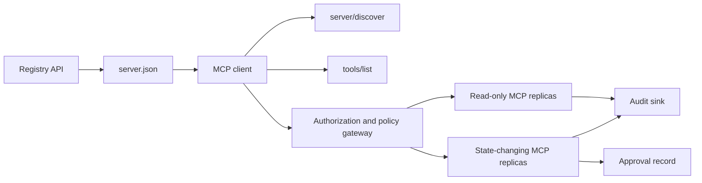

# Capstone 13: Stateless MCP Server with Registry and Governance

> MCP sản xuất không phải một tiến trình máy chủ. Nó là một chuỗi hợp đồng: siêu dữ liệu có thể công bố, khám phá trực tiếp, một phong bì yêu cầu phi trạng thái, ủy quyền, chính sách, kiểm toán, và bằng chứng triển khai.

**Type:** Capstone
**Languages:** Python and TypeScript reference models; any production language
**Prerequisites:** Phase 11, Phase 13, Phase 14, Phase 17, and Phase 18
**Các bài chuyên sâu MCP bắt buộc:** [Bài 28: Hợp đồng công cụ](../../../13-tools-and-protocols/28-mcp-tool-contracts-and-content/docs/en.md), [Bài 29: Độ tin cậy](../../../13-tools-and-protocols/29-mcp-reliability-cancellation-and-flow-control/docs/en.md), [Bài 30: Chuỗi cung ứng Registry](../../../13-tools-and-protocols/30-mcp-registry-supply-chain-and-drift/docs/en.md), và [Bài 31: Vận hành tuân thủ](../../../13-tools-and-protocols/31-mcp-conformance-versioning-and-operations/docs/en.md)
**Mục tiêu giao thức:** MCP `2026-07-28`
**Time:** ~25 hours

## Learning Objectives

- Triển khai phong bì yêu cầu và kết quả MCP phi trạng thái.
- Giữ siêu dữ liệu Registry tách biệt với khám phá giao thức trực tiếp.
- Xây dựng khám phá công cụ tất định, có nhận thức về bộ nhớ đệm.
- Thực thi bên phát hành, đối tượng nhận, phạm vi, và chính sách phê duyệt cho mọi lệnh gọi công cụ.
- Triển khai Streamable HTTP mà không có tính gắn kết phiên.
- Chứng minh hành vi tại các ranh giới truyền tin, ủy quyền, chính sách, registry, và kiểm toán.

## Required MCP Prerequisite Path

Hoàn thành bốn bài Phase 13 được liên kết theo thứ tự trước khi coi bài tổng kết này là sẵn sàng cho sản xuất:

1. [Bài 28](../../../13-tools-and-protocols/28-mcp-tool-contracts-and-content/docs/en.md) định nghĩa các hợp đồng công cụ, lược đồ, nội dung, phân trang, hoàn thành, định tuyến, và lỗi mà máy chủ này phải cung cấp.
2. [Bài 29](../../../13-tools-and-protocols/29-mcp-reliability-cancellation-and-flow-control/docs/en.md) định nghĩa các cuộc đua hủy, hạn chót, tính lũy đẳng, áp lực ngược, thử lại, và hành vi kết nối lại.
3. [Bài 30](../../../13-tools-and-protocols/30-mcp-registry-supply-chain-and-drift/docs/en.md) định nghĩa không gian tên, nguồn gốc, ghim tiếp nhận, trạng thái Registry, độ trôi, sổ cái, và bằng chứng khôi phục.
4. [Bài 31](../../../13-tools-and-protocols/31-mcp-conformance-versioning-and-operations/docs/en.md) định nghĩa các bản ghi chuẩn và âm tính, các thời kỳ phiên bản nghiêm ngặt, kiểm tra vi sai SDK, bằng chứng proxy, che dữ liệu, sức khỏe, và kiểm soát cổng phát hành.

Bài tổng kết tích hợp những hiện vật đó. Nó không thay thế chúng bằng một kiểm thử SDK trên luồng thuận lợi.

## The Problem

Một nền tảng nội bộ cần các công cụ dữ liệu chỉ đọc và một tập nhỏ các công cụ thay đổi trạng thái. Các nhà phát triển phải có thể khám phá máy chủ, hiểu cách kết nối, kiểm tra các khả năng trực tiếp của nó, và chỉ gọi các thao tác mà họ được ủy quyền sử dụng.

Phần khó không phải là đăng ký một hàm. Phần khó là giữ sáu sự thật khác nhau đồng bộ:

1. `server.json` cho biết máy chủ có thể được cài đặt hoặc truy cập ở đâu.
2. `server/discover` cho biết tiến trình trực tiếp hỗ trợ gì lúc này.
3. Mỗi yêu cầu cho biết nó sử dụng bản sửa đổi giao thức và khả năng máy khách nào.
4. Ủy quyền ràng buộc một bên gọi với bên phát hành, tài nguyên, và các phạm vi chính xác.
5. Chính sách quyết định liệu hành động cụ thể này có được chạy không.
6. Bằng chứng kiểm toán ghi lại những gì đã vượt qua ranh giới mà không rò rỉ bí mật hoặc payload nhạy cảm.

Nếu bất kỳ điều nào trong số này bị lệch, nền tảng có thể liệt kê một máy chủ không thể truy cập, định tuyến một máy khách không tương thích, chấp nhận một token được cấp cho tài nguyên khác, hoặc cung cấp một hành động phá hủy mà không có việc rà soát dự kiến.

## The Two Discovery Layers

Registry và máy chủ MCP trực tiếp trả lời những câu hỏi khác nhau.

| Lớp | Hợp đồng | Câu hỏi nó trả lời |
|---|---|---|
| Công bố | `server.json` và Registry API | Máy chủ này là gì, gói hoặc endpoint từ xa của nó ở đâu, và nó được cấu hình như thế nào? |
| Runtime | `server/discover` | Tiến trình này hỗ trợ những phiên bản giao thức, khả năng, phần mở rộng, và danh tính máy chủ nào? |

Registry chính thức sử dụng một lược đồ `server.json` có phiên bản. Một mục từ xa có thể chỉ định một URL Streamable HTTP:

```json
{
  "$schema": "https://static.modelcontextprotocol.io/schemas/2025-12-11/server.schema.json",
  "name": "com.example/internal-readonly",
  "title": "Internal Read-Only Tools",
  "description": "Read-only incident and data lookup tools.",
  "version": "1.0.0",
  "remotes": [
    {
      "type": "streamable-http",
      "url": "https://mcp.internal.example.com/readonly"
    }
  ]
}
```

Phiên bản lược đồ Registry và bản sửa đổi giao thức MCP độc lập với nhau. Đừng viết lại một ngày để khớp với ngày còn lại. Xác thực mỗi tài liệu theo hợp đồng riêng của nó.

Tính hợp lệ của lược đồ không chứng minh quyền sở hữu không gian tên. Một nhà phát hành được xác minh cho `example.com` sử dụng không gian tên DNS đảo ngược `com.example/*` hoặc một trong các không gian tên con của nó. Luồng xác thực Registry chứng minh quyền sở hữu đó. Giữ các nhãn miền theo thứ tự thông thường của chúng sẽ đặt tên cho một không gian tên khác.

Hàm `validate_registry_document` của mô hình stdlib được cố ý thiết kế là một bộ xác thực một phần cho cấu hình từ xa. Nó kiểm tra các trường bắt buộc chính thức `name`, `description`, và `version`; `title` tùy chọn; các ràng buộc về tên và độ dài được công bố; hình thức phiên bản cụ thể; và hình thức URL HTTP(S) của mỗi remote `streamable-http` hoặc `sse`. Nó còn yêu cầu một danh sách `remotes` không rỗng vì bài tổng kết này luôn thăm dò trực tiếp một remote. `validate_publisher_namespace` kiểm tra riêng tên với miền nhà phát hành đã được xác minh, trong khi `validate_runtime_alignment` so sánh tên và phiên bản công bố với `serverInfo` trực tiếp. Lược đồ chính thức cũng hỗ trợ các bản ghi chỉ có gói và nhiều trường remote hơn. Trước khi công bố, xác thực toàn bộ tài liệu bằng JSON Schema chính thức được ghim hoặc `mcp-publisher`; đừng trình bày tập con không phụ thuộc này là xác thực lược đồ đầy đủ.

Máy chủ phải triển khai `server/discover`; một máy khách có thể gọi nó trước các phương thức khác. Máy khách của bài tổng kết này làm như vậy sau khi phân giải endpoint, và nhận bản sửa đổi giao thức hiện tại cùng các khả năng trực tiếp:

```json
{
  "resultType": "complete",
  "supportedVersions": ["2026-07-28"],
  "capabilities": {
    "tools": {
      "listChanged": false
    }
  },
  "_meta": {
    "io.modelcontextprotocol/serverInfo": {
      "name": "com.example/internal-readonly",
      "version": "1.0.0"
    }
  },
  "ttlMs": 3600000,
  "cacheScope": "public"
}
```

Một danh mục riêng có thể lập chỉ mục thêm dữ liệu sở hữu, rà soát, hoặc vòng đời, nhưng nó không được tự tạo dữ liệu đó thành các trường truyền tin MCP hoặc các trường gốc `server.json`. Lưu chính sách tổ chức bên cạnh bản ghi được công bố. Khi cần siêu dữ liệu tùy chỉnh công khai, sử dụng phần mở rộng `_meta.io.modelcontextprotocol.registry/publisher-provided` của Registry và nằm trong giới hạn 4 KB của nó.

## Stateless MCP Core

Bản sửa đổi MCP `2026-07-28` loại bỏ các phiên giao thức và bắt tay `initialize` / `notifications/initialized`. Nó cũng loại bỏ `Mcp-Session-Id`.

Mỗi yêu cầu mang ngữ cảnh giao thức trong `params._meta`:

```json
{
  "io.modelcontextprotocol/protocolVersion": "2026-07-28",
  "io.modelcontextprotocol/clientCapabilities": {},
  "io.modelcontextprotocol/clientInfo": {
    "name": "internal-platform-client",
    "version": "1.0.0"
  }
}
```

Phiên bản và khả năng là các sự kiện của yêu cầu, không phải các sự kiện của kết nối. Một bộ cân bằng tải có thể gửi các yêu cầu liên tiếp đến các bản sao khỏe mạnh khác nhau vì bất kỳ bản sao nào cũng có thể xác thực yêu cầu từ chính thông điệp.

Các kết quả thông thường bao gồm `resultType: "complete"`. Các máy chủ nên đặt danh tính của chúng trong `_meta.io.modelcontextprotocol/serverInfo` trên mỗi kết quả. Một phiên bản giao thức thiếu hoặc không phải chuỗi là params không hợp lệ `-32602`. Lỗi `-32022` chỉ dành cho một chuỗi được cung cấp nhưng không được hỗ trợ, với chính xác `{"supported": ["2026-07-28"], "requested": "..."}` làm dữ liệu của nó.

### Cacheable discovery

`tools/list` phải tất định với cùng một tập công cụ hiệu lực. Kết quả bao gồm:

- `ttlMs`, một gợi ý độ mới cho máy khách;
- `cacheScope`, hoặc `public` hoặc `private`;
- một thứ tự công cụ ổn định để các danh sách giống nhau có thể tái sử dụng bộ nhớ đệm prompt;
- `resultType: "complete"` và siêu dữ liệu danh tính máy chủ.

Ủy quyền theo người dùng thông thường nên tạo ra `cacheScope: "private"`. Đừng đặt khả năng hiển thị công cụ theo người dùng sau một bộ nhớ đệm công khai dùng chung.

## Streamable HTTP

Một máy chủ mạng cung cấp một endpoint MCP nhận POST. Mỗi yêu cầu hoặc thông báo JSON-RPC có POST riêng của nó.

Đối với một yêu cầu, máy chủ trả về một đối tượng JSON hoặc một luồng SSE có phạm vi theo yêu cầu đó. Một yêu cầu `subscriptions/listen` tồn tại lâu mang các thông báo thay đổi được đăng ký. Không có luồng GET độc lập, DELETE phiên, header phiên, hoặc phát lại `Last-Event-ID` trong cơ chế truyền tải hiện tại.

Mỗi yêu cầu bao gồm:

- `MCP-Protocol-Version`, khớp với siêu dữ liệu phần thân;
- `Mcp-Method`, khớp với phương thức JSON-RPC;
- `Mcp-Name` cho `tools/call`, `resources/read`, và `prompts/get`;
- `Accept: application/json, text/event-stream`.

Từ chối các header phản chiếu không khớp với lỗi `-32020` được chỉ định. Xác thực `Origin`, ràng buộc các máy chủ phát triển cục bộ với loopback, xác thực máy khách từ xa, và coi một phản hồi SSE có phạm vi theo yêu cầu bị đóng là hủy.



```figure
cf-mcp-gate
```

## Authorization and Policy

Siêu dữ liệu truyền tải không phải ủy quyền. Xác thực ủy quyền trên mọi lệnh gọi.

Đối với các máy chủ từ xa:

1. Khám phá siêu dữ liệu tài nguyên được bảo vệ.
2. Chọn máy chủ ủy quyền cho tài nguyên đó.
3. Ưu tiên Client ID Metadata Documents cho việc đăng ký máy khách. Coi Dynamic Client Registration là hỗ trợ tương thích.
4. Gửi chỉ báo tài nguyên trong quá trình ủy quyền.
5. Xác thực một giá trị `iss` được trả về với máy chủ ủy quyền được ghi lại cho luồng.
6. Đặt khóa thông tin xác thực máy khách theo bên phát hành. Không bao giờ tái sử dụng dữ liệu đăng ký giữa các bên phát hành.
7. Xác thực bên phát hành token, đối tượng nhận hoặc tài nguyên, hạn dùng, và các phạm vi tại máy chủ MCP.
8. Áp dụng một quyết định chính sách thứ hai cho công cụ và các đối số cụ thể.

Các annotation công cụ như `readOnlyHint` và `destructiveHint` giúp máy khách trình bày rủi ro. Chúng không phải các kiểm soát ủy quyền đáng tin cậy.

### Approval is a record, not a magic scope

Một lệnh gọi thay đổi trạng thái cần một bản ghi phê duyệt ràng buộc với tác nhân, công cụ, các đối số được chuẩn hóa hoặc giá trị băm, môi trường đích, hạn dùng, và chính sách sử dụng một lần hoặc lặp lại. Chỉ một tin nhắn trò chuyện không phải bằng chứng phê duyệt.

Mô hình Python băm JSON chuẩn tắc với các khóa được sắp xếp, rồi ràng buộc giá trị băm đó với chủ thể token, tên công cụ, URL máy chủ, và hạn dùng. Phát lại bản ghi sau khi thay đổi dù chỉ một đối số sẽ thất bại trước khi handler chạy. Phê duyệt là bằng chứng riêng, không phải một phạm vi được thêm vào token truy cập.

Giữ các công cụ rủi ro cao trên một bề mặt có thể rà soát riêng khi điều đó làm giảm đáng kể phạm vi ảnh hưởng. Sự tách biệt chỉ hữu ích nếu thông tin xác thực, chính sách, danh tính triển khai, và các kiểm soát kiểm toán cũng tách biệt.

## Build It

### 1. Model publication metadata

Tạo và xác thực lược đồ `server.json`. Bao gồm một tên ổn định bên trong không gian tên được xác thực cho nhà phát hành, cùng phiên bản, mô tả, siêu dữ liệu `repository` hoặc `packages` chính thức khi phù hợp, và một cơ chế truyền tải từ xa hoặc stdio. Giữ bí mật dưới dạng đầu vào biến môi trường được khai báo, không bao giờ là giá trị trực tiếp.

### 2. Implement live discovery

Triển khai `server/discover` trước bất kỳ RPC tính năng nào. Công bố các phiên bản giao thức, khả năng, phần mở rộng, và danh tính máy chủ được hỗ trợ. Thêm một trường hợp từ chối phiên bản sử dụng `-32022`.

### 3. Implement the stateless envelope

Yêu cầu phiên bản giao thức và khả năng máy khách trong mọi yêu cầu. Trả về `resultType` và danh tính máy chủ trong mọi kết quả. Loại bỏ trạng thái khởi tạo, bộ nhớ đệm khả năng theo kết nối, và định danh phiên.

### 4. Build the tool surface

Bắt đầu với hai công cụ chỉ đọc và một công cụ thay đổi trạng thái. Cung cấp cho mỗi công cụ một JSON Schema có giới hạn, mô tả chính xác, hình thức kết quả tất định, và các annotation trung thực. Thêm lược đồ đầu ra khi máy khách dựa vào các kết quả có cấu trúc.

### 5. Add cache-aware listing

Trả về các công cụ theo thứ tự ổn định với `ttlMs` và `cacheScope`. Thực thi riêng hành vi hết hạn bộ nhớ đệm và thông báo thay đổi danh sách.

### 6. Add authorization and policy

Xác thực bên phát hành, đối tượng nhận, hạn dùng, và phạm vi. Chạy một quyết định chính sách cho mọi lệnh gọi công cụ. Ràng buộc các phê duyệt với những hành động rủi ro cao chính xác. Từ chối các phê duyệt thiếu hoặc cũ trước khi thực thi một handler.

### 7. Separate registry and runtime validation

Xác thực bản ghi `server.json` tĩnh, rồi thăm dò endpoint từ xa bằng `server/discover`. Báo cáo độ trôi khi remote, danh tính, phiên bản, hoặc các khả năng bắt buộc được công bố không khớp với tiến trình trực tiếp.

### 8. Add audit evidence

Ghi lại tác nhân, bên phát hành, tài nguyên, công cụ, quyết định chính sách, định danh yêu cầu, ngữ cảnh trace, độ trễ, và kết quả. Che hoặc băm các đối số và kết quả nhạy cảm trước khi lưu bền vững. Giữ đích nhận kiểm toán bên ngoài ngữ cảnh mô hình có thể thấy.

### 9. Exercise horizontal scaling

Đặt hai bản sao phi trạng thái sau một bộ cân bằng tải. Gửi ít nhất 100 yêu cầu đồng thời. Chứng minh rằng tính đúng đắn không phụ thuộc vào tính gắn kết. Nếu một công cụ cần trạng thái giữa các lệnh gọi, cấp một handle mờ rõ ràng và lưu nó trong một hệ thống bền vững dùng chung.

### 10. Cross the real wire

Chạy các kiểm tra tuân thủ với binary máy chủ thực tế. Thu thập các header yêu cầu và phần thân JSON, không chỉ các đối tượng SDK. Thực thi phiên bản sai, header không khớp, thiếu phạm vi, đối tượng nhận sai, đối số sai định dạng, lỗi handler, hủy, và hết hạn bộ nhớ đệm.

## Required Evidence Pack

Một bài nộp chưa hoàn chỉnh cho đến khi nó chứa cả năm lớp bằng chứng:

| Bằng chứng | Chứng minh tối thiểu | Bài học nguồn |
|---|---|---|
| Truyền tin | Các header thô và phần thân JSON-RPC được che cho các trường hợp chuẩn và âm tính, bao gồm lỗi kiểu siêu dữ liệu, header không khớp, phiên bản không được hỗ trợ, `resultType` thiếu hoặc không xác định, thông báo không phản hồi, và khớp ID phản hồi | [Bài 31](../../../13-tools-and-protocols/31-mcp-conformance-versioning-and-operations/docs/en.md) |
| Proxy | Cùng một trường hợp ổn định chạy trực tiếp và qua trung gian đã triển khai, với trạng thái và giá trị băm phần thân ở đầu vào, nguồn gốc, và đầu ra; chứng minh lỗi giao thức không bị gộp thành phản hồi 500 chung và truyền luồng không bị đệm | [Bài 29](../../../13-tools-and-protocols/29-mcp-reliability-cancellation-and-flow-control/docs/en.md) và [31](../../../13-tools-and-protocols/31-mcp-conformance-versioning-and-operations/docs/en.md) |
| Tiếp nhận | Không gian tên nhà phát hành đã xác minh, giá trị băm bản ghi Registry bất biến, nguồn gốc hiện vật hoặc remote, quan sát danh tính và khả năng `server/discover` trực tiếp, ghim descriptor, trạng thái Registry hiện tại, và sự kiện sổ cái tiếp nhận | [Bài 30](../../../13-tools-and-protocols/30-mcp-registry-supply-chain-and-drift/docs/en.md) |
| Thử lại | Một cuộc đua hủy với hoàn thành, timeout rõ ràng, thử lại đọc an toàn, khóa lũy đẳng đột biến, tải lại khi kết nối lại, và bằng chứng rằng hủy yêu cầu không thể âm thầm trở thành hủy tác vụ bền vững | [Bài 29](../../../13-tools-and-protocols/29-mcp-reliability-cancellation-and-flow-control/docs/en.md) |
| Khôi phục | Phiên bản trước chính xác, các giá trị băm tiếp nhận và hiện vật, ghim descriptor, trạng thái Registry hoạt động, cửa sổ sức khỏe hiện tại, kết quả khôi phục tuyến, và bằng chứng quyết định được che | [Bài 30](../../../13-tools-and-protocols/30-mcp-registry-supply-chain-and-drift/docs/en.md) và [31](../../../13-tools-and-protocols/31-mcp-conformance-versioning-and-operations/docs/en.md) |

Lưu một giá trị băm của gói đã che cùng bản phát hành. Nếu thiếu bất kỳ lớp nào, giữ lại bản phát hành. Đừng suy ra hành vi proxy từ một dispatcher trong tiến trình, việc tiếp nhận từ sự hiện diện trong Registry, an toàn thử lại từ một id JSON-RPC mới, hoặc mức sẵn sàng khôi phục từ “bản triển khai trước.”

## Local Reference Models

Mô hình Python minh họa siêu dữ liệu registry, xác thực không gian tên nhà phát hành DNS đảo ngược, các kiểm tra danh tính từ công bố đến runtime, khám phá trực tiếp, liệt kê công cụ tất định, siêu dữ liệu theo yêu cầu, các kiểm tra bên phát hành đáng tin cậy, đối tượng nhận, hạn dùng, và phạm vi, các phê duyệt gắn với hành động, một bộ xác thực Registry một phần được lập tài liệu, chính sách, và kiểm toán mà không mở một socket mạng:

```bash
cd phases/19-capstone-projects/13-mcp-server-with-registry
python3 code/main.py
python3 -m unittest discover -s code/tests -v
```

Dự án TypeScript cung cấp hình thức JSON-RPC phi trạng thái trên stdio mà không có MCP SDK. Đường dẫn `tools/call` của nó thực thi cùng các lược đồ đầu vào có giới hạn được công bố bởi `tools/list`; các đối số không hợp lệ cho một công cụ đã biết trả về một kết quả hoàn chỉnh với `isError: true` mà không gọi bộ thực thi:

```bash
cd phases/19-capstone-projects/13-mcp-server-with-registry/code/ts
npm install
npm run typecheck
npm test
npm run demo
```

Các mô hình này chứng minh logic hợp đồng cục bộ. Chúng không chứng minh các header HTTP, trao đổi OAuth, công bố Registry, tích hợp OPA, cân bằng tải, hoặc việc bộ thu thập nhận được.

## Wire Example

```http
POST /mcp HTTP/1.1
Host: mcp.internal.example.com
Content-Type: application/json
Accept: application/json, text/event-stream
MCP-Protocol-Version: 2026-07-28
Mcp-Method: tools/call
Mcp-Name: postgres.readonly
Authorization: Bearer REDACTED

{
  "jsonrpc": "2.0",
  "id": 42,
  "method": "tools/call",
  "params": {
    "name": "postgres.readonly",
    "arguments": {"sql": "SELECT 1"},
    "_meta": {
      "io.modelcontextprotocol/protocolVersion": "2026-07-28",
      "io.modelcontextprotocol/clientCapabilities": {},
      "io.modelcontextprotocol/clientInfo": {
        "name": "internal-platform-client",
        "version": "1.0.0"
      }
    }
  }
}
```

## Ship It

Cung cấp một kho chứa:

- một `server.json` hợp lệ theo lược đồ;
- các bề mặt máy chủ chỉ đọc và thay đổi trạng thái;
- `server/discover`, `tools/list` tất định, và `tools/call` được kiểm soát bằng chính sách;
- một bản triển khai Streamable HTTP với hai bản sao có thể thay thế nhau;
- tích hợp ủy quyền và phê duyệt;
- một bộ công bố Registry hoặc adapter Registry API riêng;
- các định nghĩa chính sách và bản ghi phê duyệt gắn với hành động;
- đầu ra kiểm toán được che và lan truyền trace;
- bằng chứng lỗi truyền tin và proxy;
- bằng chứng tiếp nhận, thử lại, sức khỏe, và khôi phục với một giá trị băm của gói đã che.

| Trọng số | Tiêu chí | Bằng chứng |
|---:|---|---|
| 25 | Tính đúng đắn giao thức | Siêu dữ liệu yêu cầu phi trạng thái, khám phá, kết quả, header, và các trường hợp âm tính |
| 20 | Ủy quyền | Các trường hợp bên phát hành, đối tượng nhận, hạn dùng, phạm vi, và phê duyệt gắn với hành động |
| 15 | Tính toàn vẹn Registry | `server.json` hợp lệ, bản ghi công bố, phép thăm dò khám phá trực tiếp, và báo cáo độ trôi |
| 15 | Chính sách và an toàn | Các trường hợp cho phép, từ chối, sai định dạng, phê duyệt cũ, và dữ liệu nhạy cảm |
| 15 | Quy mô và độ tin cậy | Hai bản sao, không phụ thuộc tính gắn kết, hủy, timeout, và phục hồi |
| 10 | Khả năng kiểm toán | Bằng chứng kiểm toán và trace phía nhận được che |

## Exercises

1. Thay URL remote được công bố trong khi giữ nguyên máy chủ trực tiếp. Làm cho việc xác thực registry báo cáo độ trôi chính xác.
2. Gửi `tools/list` hai lần với các đầu vào giống nhau và chứng minh thứ tự công cụ ổn định theo byte. Sau đó cho `ttlMs` hết hạn và làm mới.
3. Gửi một phần thân hợp lệ với một header `MCP-Protocol-Version` khác. Trả về `-32020` và không gọi chính sách hoặc công cụ.
4. Cấp một token cho máy chủ chỉ đọc và đưa nó cho máy chủ thay đổi trạng thái. Chứng minh xác thực đối tượng nhận thất bại trước khi handler chạy.
5. Ràng buộc một phê duyệt với một giá trị băm đối số được chuẩn hóa. Thay đổi một trường và chứng minh phê duyệt không thể được phát lại.
6. Định tuyến các lệnh gọi liên tiếp đến các bản sao luân phiên. Thay thế bộ nhớ tiến trình ẩn bằng một handle dùng chung rõ ràng ở mọi nơi quy trình cần lưu bền vững.
7. Ngắt một kết nối SSE có phạm vi theo yêu cầu và thử lại với một ID yêu cầu JSON-RPC mới. Xác minh rằng không có đường phục hồi `Last-Event-ID` nào được sử dụng.

## Key Terms

| Thuật ngữ | Cách mọi người nói | Ý nghĩa thực sự |
|---|---|---|
| Stateless MCP (MCP phi trạng thái) | "Không có trạng thái ở đâu cả" | Không có phiên giao thức; trạng thái giữa các lệnh gọi là rõ ràng và do máy chủ quản lý |
| `server.json` | "Bản kê khai công cụ" | Siêu dữ liệu Registry cho đặt tên, đóng gói, cấu hình, và cơ chế truyền tải |
| `server/discover` | "Bắt tay" | Một RPC bắt buộc thông thường cho các phiên bản và khả năng trực tiếp, không phải bộ khởi tạo phiên |
| Cache scope (Phạm vi bộ nhớ đệm) | "Tôi có thể lưu đệm nó không?" | Liệu một kết quả có thể lưu đệm có an toàn cho tái sử dụng chung hay riêng |
| Policy decision (Quyết định chính sách) | "Token cho phép điều đó" | Một quyết định riêng trên tác nhân, công cụ, đích, đối số, và ngữ cảnh |
| Approval record (Bản ghi phê duyệt) | "Một người đã nhấp có" | Bằng chứng ràng buộc với một tác nhân và hành động có hệ quả theo một chính sách hạn dùng |
| Explicit handle (Handle rõ ràng) | "Một ID phiên" | Dữ liệu ứng dụng thông thường cho trạng thái có tên do máy chủ quản lý, không phải trạng thái kết nối giao thức |

## Further Reading

- [MCP 2026-07-28 key changes](https://modelcontextprotocol.io/specification/2026-07-28/changelog)
- [Streamable HTTP](https://modelcontextprotocol.io/specification/2026-07-28/basic/transports/streamable-http)
- [Server discovery](https://modelcontextprotocol.io/specification/2026-07-28/server/discover)
- [MCP authorization](https://modelcontextprotocol.io/specification/2026-07-28/basic/authorization)
- [Official Registry server.json requirements](https://github.com/modelcontextprotocol/registry/blob/main/docs/reference/server-json/official-registry-requirements.md)
- [Official Registry OpenAPI contract](https://registry.modelcontextprotocol.io/openapi.yaml)
