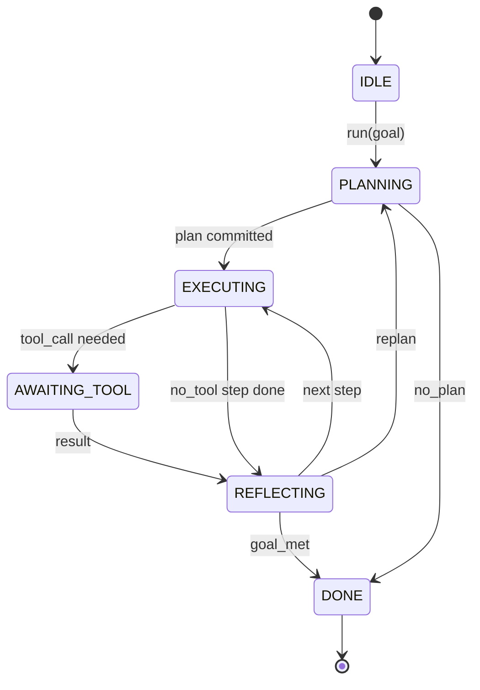

# Agent Harness Loop Contract

> Harness chính là agent. Mô hình là một bộ đồng xử lý. Bài này đóng băng hợp đồng vòng lặp mà bạn có thể kết nối bất kỳ mô hình nào vào.

**Type:** Build
**Languages:** Python
**Prerequisites:** Phase 13 lessons 01-07, Phase 14 lesson 01
**Time:** ~90 minutes

## Learning Objectives
- Đặc tả một vòng lặp harness agent như một máy trạng thái tất định với các chuyển tiếp rõ ràng.
- Triển khai mười chủ đề hook vòng đời mà người vận hành kết nối chính sách, dữ liệu đo từ xa, và các chốt bảo vệ vào.
- Định nghĩa hai điểm kéo nơi vòng lặp nhường quyền điều khiển lại cho bên gọi và tiếp tục với một đầu vào mới.
- Thực thi ngân sách theo phiên (lượt, lệnh gọi công cụ, thời gian thực) mà không rò rỉ trạng thái một phần khi vượt quá.
- Phát ra một luồng có kiểu gồm mười một loại sự kiện để các UI và bộ theo dõi hạ nguồn có thể đăng ký mà không kiểm tra trực tiếp vòng lặp.

```figure
cf-loop-contract
```

## The frame

Một agent lập trình chạy không giám sát trong bốn mươi lượt không phải một vòng lặp trò chuyện. Nó là một máy trạng thái mà các nút của nó người vận hành có thể chặn và các cạnh của nó người vận hành có thể kiểm toán. Một khi bạn viết ra hợp đồng, việc đổi mô hình, công cụ, hoặc chính sách không còn là tái cấu trúc. Nó trở thành một lệnh gọi đăng ký.

Bài này xây dựng hợp đồng đó. Chúng ta đặt tên sáu trạng thái, mười chủ đề hook, hai điểm kéo, mười một loại sự kiện, và một phong bì ngân sách. Mọi thứ khác trong harness (registry công cụ, truyền tải JSON-RPC, dispatcher, bộ lập kế hoạch) cắm vào hình thức này.

## The states

Vòng lặp có sáu trạng thái. Năm trạng thái hoạt động. Một trạng thái kết thúc.



`IDLE` là điểm vào hợp lệ duy nhất. `DONE` là điểm thoát hợp lệ duy nhất. `AWAITING_TOOL` là trạng thái duy nhất tự nó tạo ra một điểm kéo. Điểm kéo thứ hai, `on_pause`, không phải một trạng thái: nó kích hoạt từ bất kỳ trạng thái đang hoạt động nào khi ngân sách cạn hoặc một hook yêu cầu xem xét. Mọi chuyển tiếp khác đều là nội bộ.

Máy trạng thái là tất định. Với cùng nhật ký sự kiện, harness vào lại cùng trạng thái. Thuộc tính đó là thứ cho phép bạn phát lại các phiên để gỡ lỗi mà không gọi lại mô hình.

## The hook topics

Các hook là chỗ nối của người vận hành vào vòng lặp. Harness kích hoạt mười chủ đề. Mỗi chủ đề chấp nhận số lượng bên đăng ký bất kỳ. Các bên đăng ký được kích hoạt theo thứ tự đăng ký. Một bên đăng ký có thể biến đổi payload, phát sinh lỗi để hủy lượt, hoặc trả về một giá trị báo hiệu để bỏ qua bước tiếp theo.

```text
before_plan         after_plan
before_tool_call    after_tool_call
before_step         after_step
on_error
on_pause
on_budget_exceeded
on_complete
```

Hình thức phản ánh điều mà Claude Code, Cursor, và OpenCode đều đã hội tụ vào giữa năm 2025. Các tên mang tính chức năng, không mang thương hiệu. Một hook chặn `rm -rf` nằm trong `before_tool_call`. Một hook gửi một span OpenTelemetry nằm trong `after_step`. Một hook tiếp tục trên một phiên bị tạm dừng nằm trong `on_pause`.

## The pull points

Vòng lặp nhường quyền điều khiển hai lần. Đầu tiên trên `AWAITING_TOOL` khi nó không thể tiến triển mà không có một kết quả công cụ. Thứ hai trên `on_pause` khi ngân sách cạn hoặc một hook yêu cầu rõ ràng con người rà soát.

Một điểm kéo không phải ngoại lệ. Nó là một lần trả về. Bên gọi kiểm tra trạng thái harness, lấy bất cứ thứ gì harness yêu cầu, và gọi `resume(payload)`. Harness tiếp tục từ nơi nó dừng. Đây là cùng hình thức với một generator Python. Cơ chế truyền tải qua điểm kéo do bạn chọn. Trong một TUI nó là phím nhấn. Trên MCP nó là `tools/call`. Trên một hàng đợi nó là thăm dò công việc.

## The event stream

Vòng lặp thêm các sự kiện vào một luồng có kiểu tại các điểm cụ thể trong hợp đồng. Luồng chỉ được thêm và các bên đăng ký có thể phát lại từ bất kỳ độ lệch nào. Mười một loại sự kiện được triển khai là:

- `session.start` — phát ra một lần khi `run(goal)` được gọi
- `plan.draft` — phát ra khi bộ lập kế hoạch trả về một kế hoạch nháp
- `plan.commit` — phát ra sau khi bản nháp được chốt làm kế hoạch hoạt động
- `step.start` — phát ra lúc bắt đầu mỗi bước đang thực thi
- `step.end` — phát ra lúc kết thúc mỗi bước đang thực thi
- `tool.call` — phát ra khi một bước cần công cụ nhường quyền điều khiển cho bên gọi
- `tool.result` — phát ra khi tiếp tục với một kết quả công cụ
- `tool.error` — phát ra khi tiếp tục với một lỗi hoặc khi một hook hủy lệnh gọi
- `budget.warn` — phát ra khi chạm một giới hạn ngân sách
- `session.pause` — phát ra khi vòng lặp nhường tại một lần tạm dừng (ngân sách hoặc hook)
- `session.complete` — phát ra một lần khi vòng lặp đạt `DONE`

Các sự kiện không sao chép payload hook. Các hook mang tính mệnh lệnh (biến đổi, hủy). Các sự kiện mang tính quan sát (ghi lại, gửi đi). Coi chúng là trực giao.

## The budget envelope

Một phiên mang ba giới hạn. Số lượt, số lệnh gọi công cụ, số giây thời gian thực. Mỗi lượt tăng số lượt thêm một. Mỗi lệnh gọi công cụ tăng số lệnh gọi công cụ thêm một. Thời gian thực được kiểm tra trên mọi chuyển tiếp trạng thái. Khi chạm bất kỳ giới hạn nào, vòng lặp kích hoạt `on_budget_exceeded`, phát ra `budget.warn`, rồi chuyển đến `IDLE` với một lý do vượt ngân sách tại điểm kéo tiếp theo.

Ngân sách không phải một công tắc ngắt. Nó là một lần nhường. Bên gọi quyết định có mở rộng ngân sách và tiếp tục, hay đóng phiên.

## What this lesson does not do

Nó không gọi một mô hình. Nó không đăng ký công cụ thực. Nó không triển khai một cơ chế truyền tải. Đó là bốn bài tiếp theo. Bài này chốt hợp đồng để bốn bài tiếp theo có thể cắm vào nó mà không viết lại.

Bộ lập kế hoạch tất định trong `main.py` là một vật thay thế. Nó trả về một kế hoạch được mã hóa cứng gồm ba bước, hai trong số đó yêu cầu một kết quả công cụ. Điểm chính là vòng lặp, không phải kế hoạch.

## How to read the code

`HarnessLoop` là lớp chính. Nó giữ trạng thái, kích hoạt hook, phát ra sự kiện. `Budget` theo dõi giới hạn. `Event` là phong bì có kiểu trên luồng. `HookRegistry` là bảng điều phối. `_transition` là hàm duy nhất thay đổi trạng thái, nên các bất biến máy trạng thái nằm ở một nơi.

Đọc `main.py` từ trên xuống dưới. Sau đó đọc `code/tests/test_loop.py`. Các kiểm thử ghim mọi chuyển tiếp và mọi thứ tự kích hoạt hook.

## Going further

Phần khó nhất của việc xây dựng một harness trong sản xuất không phải máy trạng thái. Nó là làm cho hợp đồng có thể được thực thi. Hợp đồng phải sống sót qua một lần nạp nóng bộ lập kế hoạch. Nó phải sống sót qua một công cụ trả về JSON sai định dạng. Nó phải sống sót qua một hook phát sinh lỗi trong `before_tool_call` ở hai phần ba chặng đường của một phiên bốn mươi lượt. Các kiểm thử trong bài này thực thi những chế độ lỗi đó. Chạy chúng. Phá chúng. Thêm trường hợp.

Bài tiếp theo thêm registry công cụ. Sau đó, cơ chế truyền tải JSON-RPC. Sau đó, dispatcher. Đến bài hai mươi bốn, vòng lặp trong file này sẽ chạy một kế hoạch thực với các công cụ thực và ngân sách thực được thực thi.
