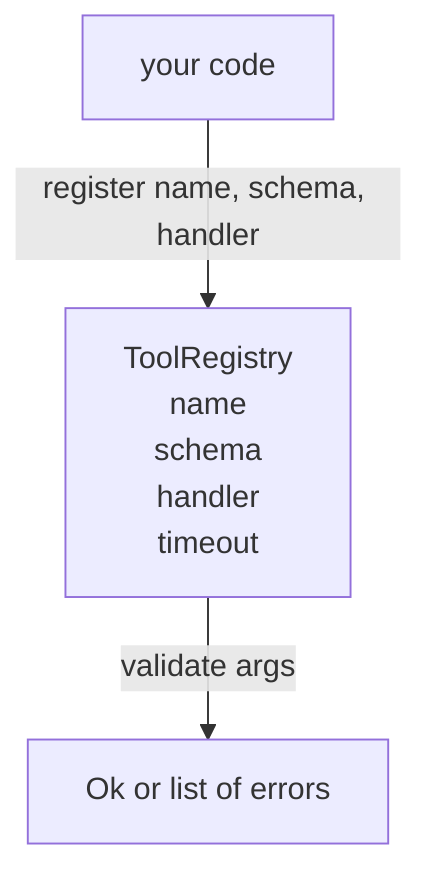

# Tool Registry with Schema Validation

> Một công cụ mà agent không thể xác thực là một công cụ mà agent không thể gọi. Xây dựng registry và bộ kiểm tra lược đồ trước khi bạn xây dựng các công cụ.

**Type:** Build
**Languages:** Python
**Prerequisites:** Phase 13 lessons 01-07, Phase 14 lesson 01
**Time:** ~90 minutes

## Learning Objectives
- Giữ một registry có kiểu gồm tên công cụ → lược đồ → handler mà dispatcher có thể hỏi một lần và tin tưởng sau đó.
- Triển khai một tập con JSON Schema 2020-12 bao phủ các từ khóa mà chín mươi phần trăm lệnh gọi công cụ thực sự sử dụng.
- Trả về các đường dẫn lỗi chính xác, có hình thức json-pointer để mô hình có thể tự sửa trong một vòng khứ hồi.
- Từ chối đăng ký lại mà không có ghi đè rõ ràng, vì ghi đè âm thầm là cách các danh mục công cụ sản xuất bị trôi.
- Giữ bộ xác thực thuần túy (không I/O, không thời gian, không biến toàn cục) để nó có thể được chạy lại trên một nhật ký phát lại.

```figure
cf-registry-validate
```

## Why the registry comes before the tool

Một agent lập trình năm 2026 có nhiều công cụ được đăng ký hơn số mô hình có thể chứa trong một cửa sổ ngữ cảnh duy nhất. Một harness không tầm thường sẽ đăng ký hai trăm công cụ và đưa ra mười đến bốn mươi ở bất kỳ lượt nào. Registry là nguồn sự thật cho "những công cụ nào tồn tại," "các đối số của chúng có hình thức gì," và "tôi gọi handler nào." Một khi ba câu trả lời đó được ghim, phần còn lại của harness có thể ngừng đoán.

Sai lầm chúng ta đang tránh là cung cấp handler không có lược đồ, hoặc cung cấp lược đồ không có xác thực. Cả hai đều phổ biến. Cả hai biến lớp tiếp theo (dispatcher trong bài hai mươi ba) thành một trò đoán mà chế độ lỗi duy nhất là một stack trace từ handler.

## What a tool record looks like

```text
ToolRecord
  name        : str          (unique, lowercase alphanumeric and underscore segments separated by dots, e.g., snake_case.segment.case)
  description : str          (one line, shown to the model)
  schema      : dict         (JSON Schema 2020-12 subset)
  handler     : Callable     (async or sync, returns Any)
  idempotent  : bool         (dispatcher uses this for retry decisions)
  timeout_ms  : int          (override per-tool dispatcher default)
```

Lược đồ là trường duy nhất mà bộ xác thực chạm tới. Handler là mờ đối với nó. Chúng ta cố ý tách chúng. Lược đồ là dữ liệu. Handler là mã. Trộn chúng khiến bạn muốn đặt logic xác thực bên trong handler, chính là lỗi chúng ta đang ngăn chặn.

## The JSON Schema 2020-12 subset

Đặc tả 2020-12 đầy đủ là một bài báo. Chúng ta cần tám từ khóa.

```text
type           string / number / integer / boolean / object / array / null
properties     map of property name -> schema
required       list of property names
enum           list of allowed primitive values
minLength      integer, applies to strings
maxLength      integer, applies to strings
pattern        ECMA-262-compatible regex, applies to strings
items          schema applied to every array element
```

Như vậy đủ bao phủ điều một API công cụ thực sự cần. Các từ khóa chúng ta không thêm (oneOf, anyOf, allOf, $ref, điều kiện) hợp lệ trong các lược đồ sản xuất nhưng biến bộ xác thực thành một trình duyệt cây có chu trình. Chúng ta đang xây dựng một registry, không phải một bộ máy JSON Schema.

## Json pointer error paths

Khi xác thực thất bại, bộ xác thực trả về một danh sách lỗi. Mỗi lỗi mang một đường dẫn json-pointer vào đầu vào. Một con trỏ là một chuỗi tên thuộc tính và chỉ số mảng có tiền tố dấu gạch chéo.

```text
{"a": {"b": [1, 2, "x"]}}
                    ^
                    /a/b/2
```

Mô hình đọc đường dẫn lỗi tốt hơn đọc câu. Nếu một lược đồ yêu cầu `args.user.email` và mô hình truyền một số nguyên, lỗi nên là `/user/email` với `expected_type: string`. Mô hình sửa điều đó trong lệnh gọi tiếp theo mà không cần một vòng ngôn ngữ tự nhiên.

## Registration and override

`register(name, schema, handler, **opts)` mặc định từ chối đăng ký lại. Bên gọi phải truyền `override=True` để thay thế. Đây là vệ sinh vận hành. Hai phần của cơ sở mã âm thầm đăng ký cùng tên công cụ là loại lỗi mất một tuần để tìm trong sản xuất.

Registry cung cấp ba phương thức đọc. `get(name)` trả về bản ghi hoặc phát sinh lỗi. `validate(name, args)` trả về một `Ok` hoặc một danh sách lỗi. `names()` trả về các tên công cụ theo thứ tự đăng ký.

## What the validator is and is not

Nó là một lượt qua cây lược đồ, đệ quy. Nó thuần túy. Nó không gọi handler. Nó không ép kiểu (một chuỗi `"42"` không vượt qua một lược đồ số). Nó không âm thầm cắt ngắn.

Nó không phải một ranh giới bảo mật. Một handler độc hại vẫn có thể hành xử sai sau khi xác thực đạt. Dispatcher trong bài hai mươi ba thêm các lớp timeout và sandbox. Registry thêm hình thức.

## Shape



## How to read the code

`code/main.py` định nghĩa `ToolRegistry`, `ToolRecord`, `ValidationError`, và tám hàm xác thực. Bộ xác thực điều phối theo `schema["type"]` (hoặc coi một lược đồ có `enum` là kiểm tra enum không kiểu). Mỗi bộ xác thực kiểu trả về một danh sách rỗng hoặc một danh sách `ValidationError`. Trình duyệt cấp cao nối các lỗi và thêm các đoạn đường dẫn vào đầu khi nó đi xuống.

`code/tests/test_registry.py` bao phủ đăng ký, ghi đè, xác thực thành công, xác thực thất bại với các đường dẫn, và mọi từ khóa trong tập con.

## Going further

Hai phần mở rộng bạn sẽ muốn khi bài này hoàn tất là phân giải `$ref` với một khối định nghĩa cục bộ, và `additionalProperties: false` cho hình thức nghiêm ngặt. Cả hai đều nhỏ. Cả hai thường được thêm khi danh mục công cụ vượt năm mươi công cụ. Chúng ta bỏ chúng khỏi bài để giữ file trong một lần đọc.

Bài tiếp theo (hai mươi hai) xây dựng cơ chế truyền tải stdio JSON-RPC cung cấp registry này cho một máy khách mô hình. Bài sau đó (hai mươi ba) bọc cả hai sau một dispatcher với timeout và thử lại.
