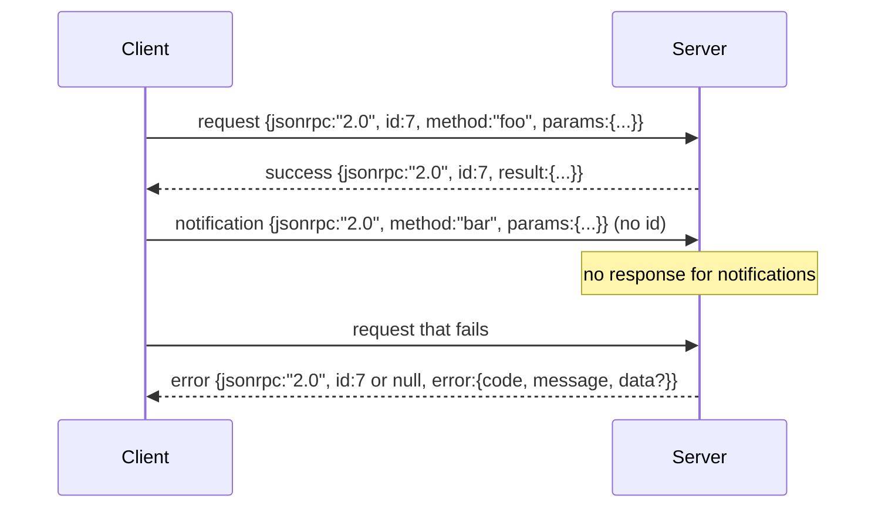

# JSON-RPC 2.0 Over Newline-Delimited Stdio

> Cơ chế truyền tải giữa một máy khách mô hình và một máy chủ công cụ là JSON-RPC trên stdio. Viết thủ công nó một lần dạy bạn điều mà mọi lớp đóng khung đang trả giá cho.

**Type:** Build
**Languages:** Python
**Prerequisites:** Phase 13 lessons 01-07, Phase 14 lesson 01
**Time:** ~90 minutes

## Learning Objectives
- Nói JSON-RPC 2.0 được đóng khung dưới dạng JSON phân cách bằng dòng mới trên stdin và stdout.
- Ánh xạ năm mã lỗi tiêu chuẩn (-32700, -32600, -32601, -32602, -32603) và đưa chúng ra với ngữ nghĩa đúng.
- Phân biệt yêu cầu, phản hồi, thông báo, và lô mà không tự tạo các khóa phong bì mới.
- Xử lý một lỗi phân tích cú pháp trên mỗi dòng mà không làm hỏng phần còn lại của luồng.
- Xây dựng một demo tự kết thúc sử dụng io.BytesIO để bài học chạy mà không tạo một tiến trình con.

```figure
cf-jsonrpc-frames
```

## Why JSON-RPC stays the lingua franca

Một agent lập trình năm 2026 nói chuyện với có lẽ mười hai máy chủ công cụ trong một phiên duy nhất. Mỗi máy chủ là một tiến trình riêng hoặc một endpoint từ xa. Định dạng truyền tin vẫn như vậy từ năm 2013. JSON-RPC 2.0 là đặc tả hai trang. Nó tồn tại vì các lựa chọn thay thế (gRPC, HTTP mỗi lệnh gọi, binary tùy chỉnh) đều áp đặt một đánh đổi mà JSON-RPC không có: chúng chọn truyền luồng hoặc chia lô hoặc gắn kết với cơ chế truyền tải. JSON-RPC đối xứng trên stdio, socket, websocket, và HTTP, và một máy khách có thể điều khiển một máy chủ nó chưa từng thấy nếu cả hai tuân thủ đặc tả.

Bài này xây dựng biến thể stdio. JSON phân cách bằng dòng mới. Mỗi yêu cầu là một dòng. Mỗi phản hồi là một dòng. Ranh giới truyền tải là `\n`.

## The wire shape

Có bốn hình thức phong bì. Hai được nói bởi máy khách. Hai được nói bởi máy chủ.



Một thông báo không có `id`. Máy chủ không được phản hồi nó. Nếu một máy chủ trả về một phản hồi cho một thông báo, máy khách không có cách nào gắn nó với một vị trí gọi. Quy tắc duy nhất đó giữ phép tính đóng khung đơn giản.

Một lô là một mảng JSON các yêu cầu hoặc thông báo. Máy chủ trả lời bằng một mảng phản hồi, theo thứ tự bất kỳ, một cho mỗi mục không phải thông báo. Nếu mọi mục trong lô đều là thông báo, máy chủ không gửi lại gì.

## The five error codes

```text
-32700  Parse error      JSON could not be parsed
-32600  Invalid Request  Envelope shape is wrong
-32601  Method not found
-32602  Invalid params
-32603  Internal error
```

Các mã giữa -32000 và -32099 được dành cho các lỗi do máy chủ định nghĩa. Mọi thứ khác do ứng dụng định nghĩa. Bài học bám vào năm mã. Nếu handler của bạn phát sinh lỗi, cơ chế truyền tải bọc nó thành -32603 với tên lớp ngoại lệ trong `data.exception`.

Một lỗi phân tích cú pháp có một quy tắc đặc biệt. `id` trong phản hồi là `null`, vì yêu cầu chưa bao giờ được phân tích đủ để trích xuất một id.

## Newline framing and the BytesIO demo

Cơ chế truyền tải đọc từng dòng một. Một dòng là các byte đến và bao gồm `\n`. Nếu một dòng không thể được phân tích cú pháp, cơ chế truyền tải ghi một phản hồi -32700 với `id: null` và tiếp tục. Luồng không bị làm hỏng. Dòng tiếp theo được phân tích mới.

Trong bài học chúng ta bọc một cặp `io.BytesIO` làm stdin và stdout. Máy chủ đọc yêu cầu cho đến EOF, ghi các phản hồi cho từng yêu cầu, và trả về. Không tạo tiến trình. Không timeout. Hành vi truyền tải giống hệt một pipe tiến trình con thực vì giao diện `io` của Python cung cấp cùng hợp đồng `.readline()` và `.write()`.

## Method dispatch

Cơ chế truyền tải không biết những phương thức nào tồn tại. Nó bàn giao cho một đối tượng có thể gọi `handler(method, params)` mà harness cung cấp. Handler trả về một kết quả hoặc phát sinh lỗi. Ba lớp ngoại lệ đưa ra các mã cụ thể.

```text
MethodNotFound -> -32601
InvalidParams  -> -32602
Anything else  -> -32603 with exception name in data
```

Cơ chế truyền tải không bao giờ thấy một registry công cụ. Registry nằm sau handler. Đây là cách phân lớp chúng ta muốn. Cơ chế truyền tải nói JSON-RPC. Registry nói hình thức công cụ. Dispatcher (bài hai mươi ba) khâu chúng lại.

## Stream behavior on errors

```text
client writes              server reads             server writes
---------------            -----------              -------------
{...valid request...}      parses ok                {...response, id matches...}
{...broken json...         parse fails              {id:null, error: -32700}
{...valid request...}      parses ok                {...response, id matches...}
{...missing method...}     invalid envelope         {id:X, error: -32600}
```

Một dòng JSON hỏng không dừng vòng lặp. Một trường `method` thiếu không dừng vòng lặp. Một ngoại lệ handler không dừng vòng lặp. Cơ chế truyền tải tiếp tục đọc cho đến EOF.

## Notifications and asymmetric flows

Một thông báo là gửi rồi quên. Harness sử dụng thông báo cho các sự kiện tiến độ, tín hiệu hủy, và dòng nhật ký. Thông báo là cách một công cụ chạy lâu có thể truyền luồng cập nhật trạng thái mà không khứ hồi cho từng cập nhật.

Bài học triển khai một hàm hỗ trợ thông báo đi ra, `write_notification`. Máy chủ sử dụng nó để phát ra tiến độ trong khi một yêu cầu đang được xử lý. Demo thể hiện mẫu: một yêu cầu đi vào, handler phát ra hai thông báo tiến độ, rồi ghi phản hồi cuối cùng.

## How to read the code

`code/main.py` định nghĩa `StdioTransport`, hàm hỗ trợ phân tích cú pháp (`parse_request`), ba hàm hỗ trợ ghi (`write_response`, `write_error`, `write_notification`), và vòng lặp điều phối `serve`. Các hằng số mã lỗi nằm ở phạm vi module.

`code/tests/test_transport.py` bao phủ năm mã lỗi, thông báo (không ghi phản hồi), lô (mảng vào, mảng ra, bỏ qua thông báo), JSON hỏng (lỗi phân tích cú pháp rồi tiếp tục), và luồng bất đối xứng nơi một handler ghi một thông báo giữa lệnh gọi.

## Going further

Cơ chế truyền tải này đủ cho các bài tiếp theo. Các cơ chế truyền tải sản xuất thêm ba thứ. Một trường id tương quan tồn tại qua chuyển tiếp (`id` của bạn đã là thứ này, nhưng trong một mạng lưới bạn cũng cần một trace id bên ngoài). Một kênh hủy (một thông báo như `$/cancelRequest` với id của lệnh gọi đang xử lý). Và một bắt tay thương lượng kiểu nội dung để cùng một socket có thể nói JSON-RPC và Streamable HTTP. Không thứ nào trong số đó thay đổi định dạng truyền tin. Chúng thêm siêu dữ liệu.
