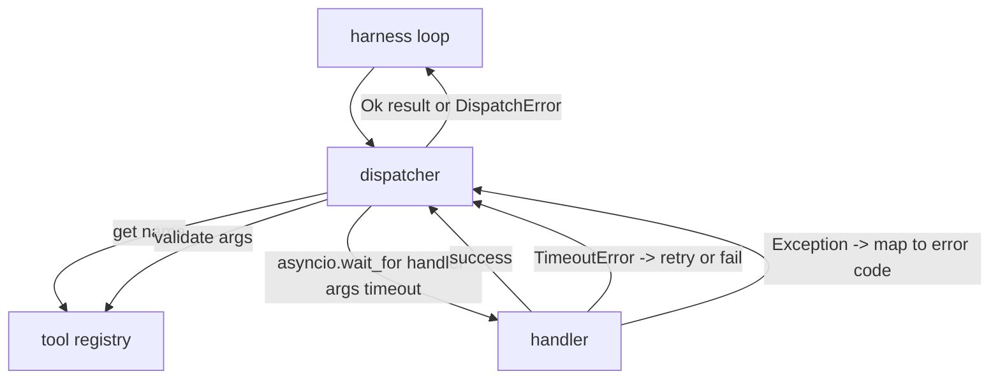
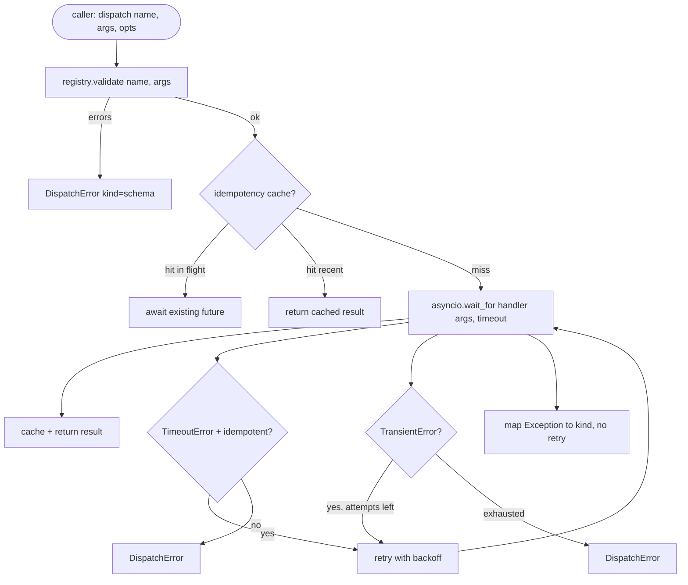

# Function Call Dispatcher

> Dispatcher là nơi harness trả giá cho mọi lời hứa mà lược đồ đã đưa ra. Timeout, thử lại, loại trùng, ánh xạ lỗi. Tất cả trên một chỗ nối.

**Type:** Build
**Languages:** Python
**Prerequisites:** Phase 13 lessons 01-07, Phase 14 lesson 01
**Time:** ~90 minutes

## Learning Objectives
- Bọc một handler công cụ trong một timeout theo lệnh gọi trả về một lỗi có kiểu thay vì treo vòng lặp.
- Áp dụng thử lại với thời gian chờ lùi theo hàm mũ có jitter và số lần thử tối đa.
- Loại trùng các lần thử lại theo một khóa lũy đẳng để một lần thử lại chạy đua với bản gốc chậm không chạy hai lần.
- Ánh xạ các ngoại lệ handler và lỗi truyền tải vào một phong bì lỗi duy nhất mà vòng lặp harness đã hiểu.
- Giới hạn điều phối song song bằng một giới hạn đồng thời để việc phân nhánh bốn mươi lệnh gọi công cụ không làm cạn vòng lặp sự kiện.

```figure
cf-dispatch-retry
```

## Where the dispatcher sits

Giữa vòng lặp harness (bài hai mươi) và registry công cụ (bài hai mươi mốt). Cơ chế truyền tải (bài hai mươi hai) cấp dữ liệu cho vòng lặp. Vòng lặp đưa một lệnh gọi công cụ cho dispatcher. Dispatcher gọi registry, chạy handler, và trả về một kết quả hoặc một phong bì lỗi có hình thức JSON-RPC.



Dispatcher là lớp duy nhất biết về bộ hẹn giờ, thử lại, và tính lũy đẳng. Vòng lặp không biết. Registry không biết. Handler không biết. Sự cô lập đó là điểm chính.

## Timeouts

Mỗi công cụ có một timeout mặc định. Bản ghi registry mang `timeout_ms`. Dispatcher ghi đè nó từ một giá trị ghi đè theo lệnh gọi khi harness truyền vào. Chúng ta dùng `asyncio.wait_for`. Khi timeout, tác vụ handler bị hủy và dispatcher trả về `DispatchError(kind="timeout")`.

Một timeout mặc định không phải một lỗi có thể thử lại đối với các công cụ không lũy đẳng. Một `db.write` bị timeout có thể đã hoặc chưa commit. Thử lại làm trùng lần ghi. Dispatcher tuân thủ cờ `idempotent` từ bản ghi registry. Các công cụ lũy đẳng thử lại. Các công cụ không lũy đẳng không thử lại.

## Retries with exponential backoff

Chính sách thử lại là tối đa ba lần thử. Thời gian chờ lùi theo hàm mũ với jitter.

```text
attempt 1  -> delay 0
attempt 2  -> delay 0.1s * (1 + random[0..0.5])
attempt 3  -> delay 0.4s * (1 + random[0..0.5])
```

Chỉ các lỗi `timeout` và `transient` thử lại. Một lỗi `schema`, một `not_found`, hoặc một lỗi `internal` không thử lại. Các lỗi lược đồ là tất định. Thử lại không thay đổi kết quả và đốt ngân sách.

Vòng lặp thử lại tôn trọng ngân sách từ harness. Nếu ngân sách của bên gọi không còn lệnh gọi công cụ nào, dispatcher thất bại nhanh ở lần thử đầu tiên và trả về `kind="budget_exceeded"`.

## Idempotency key dedupe

Một lần thử lại kích hoạt trong khi bản gốc vẫn đang được xử lý là một lỗi sản xuất thực sự. Lệnh gọi đầu tiên treo ở bốn phẩy chín giây (ngay dưới timeout). Lần thử lại kích hoạt ở năm giây. Giờ hai yêu cầu chạy đua với cùng backend. Nếu công cụ là `payments.charge`, bạn đã tính phí hai lần.

Dispatcher chấp nhận một `idempotency_key` tùy chọn. Nếu cùng khóa đang được xử lý khi một lệnh gọi đến, dispatcher đợi future đang xử lý và trả về kết quả của nó. Bộ nhớ đệm giữ các khóa trong sáu mươi giây sau khi hoàn tất để hấp thụ các lần thử lại muộn.

Khóa là trách nhiệm của bên gọi. Harness suy ra nó từ bộ lập kế hoạch: `f"{step_id}:{tool_name}:{hash(args)}"`. Dispatcher không tự tạo khóa, vì suy ra một khóa chỉ từ các đối số khiến hai lệnh gọi khác nhau về ngữ nghĩa trông giống nhau.

## Error envelope

Một lần điều phối thất bại trả về một hình thức duy nhất.

```text
DispatchError
  kind        : "timeout" | "transient" | "schema" | "not_found" | "internal" | "budget_exceeded"
  message     : str
  attempts    : int
  jsonrpc_code: int   (one of -32601, -32602, -32603)
```

Vòng lặp harness ánh xạ `kind` sang trạng thái tiếp theo. `schema` và `not_found` đi đến `on_error` và kích hoạt lập lại kế hoạch. `timeout` và `transient` đi đến `on_error` và có thể có hoặc không lập lại kế hoạch tùy theo số lần thử. `budget_exceeded` kích hoạt `on_budget_exceeded`.

## Concurrency limit on fan-out

`gather(*calls)` chạy tất cả coroutine đồng thời. Với bốn mươi lệnh gọi công cụ, đó là bốn mươi socket mở hoặc bốn mươi pipe tiến trình con. Hầu hết backend không thích bốn mươi kết nối song song từ một máy khách.

Dispatcher bọc `gather` trong một semaphore. Giới hạn đồng thời mặc định là tám. Mỗi lệnh gọi lấy semaphore trước khi điều phối và nhả khi hoàn tất. Bên gọi thấy đầu ra có hình thức `gather` nhưng việc lập lịch thực tế có giới hạn.

## Flow for one call



## How to read the code

`code/main.py` định nghĩa `Dispatcher`, `DispatchError`, và `TransientError`. Dispatcher nhận một registry khi khởi tạo. `dispatch(name, args, ...)` bất đồng bộ là điểm vào duy nhất. Các timeout theo lần thử được áp dụng nội tuyến bên trong `_run_with_retries` sử dụng `asyncio.wait_for`. `gather_bounded(calls)` chạy nhiều lần điều phối với giới hạn đồng thời.

`code/tests/test_dispatcher.py` bao phủ kích hoạt timeout, thử lại khi tạm thời, không thử lại khi lỗi lược đồ, loại trùng lũy đẳng (hai lệnh gọi đồng thời với cùng khóa gộp thành một lần gọi handler), và giới hạn đồng thời (semaphore đang hoạt động).

Các kiểm thử sử dụng `asyncio.sleep(0)` và các handler tất định dựa trên `Counter`, nên chúng hoàn tất trong mili giây và không phụ thuộc vào thời gian thực.

## Going further

Hai phần mở rộng mà các dispatcher sản xuất thêm. Thứ nhất, ghi nhật ký có cấu trúc tại mọi chuyển tiếp (điều mà luồng sự kiện của vòng lặp đã cho bạn, nhưng dispatcher cũng nên phát ra các sự kiện `dispatch.attempt` và `dispatch.retry`). Thứ hai, bộ ngắt mạch: sau N lỗi trong một cửa sổ, một công cụ nhận một khoảng nghỉ mà các lần điều phối trả về ngay với `kind="circuit_open"` thay vì thử handler. Cả hai phù hợp trên dispatcher này mà không thay đổi hợp đồng.

Bài hai mươi bốn gắn dispatcher với một agent lập kế hoạch và thực thi để bạn thấy cả bốn phần chuyển động.
