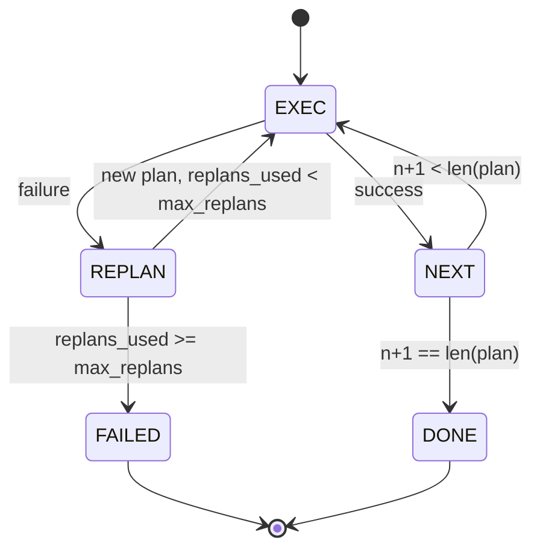

# Plan-Execute Control Flow

> Một kế hoạch không thể sống sót qua một thất bại là một script. Một script có thể lập lại kế hoạch là một agent. Xây dựng bộ lập lại kế hoạch trước.

**Type:** Build
**Languages:** Python
**Prerequisites:** Phase 13 lessons 01-07, Phase 14 lesson 01
**Time:** ~90 minutes

## Learning Objectives
- Biểu diễn một kế hoạch dưới dạng một danh sách có thứ tự các bước có kiểu để bộ thực thi có thể suy luận về tiến độ và kết quả.
- Thực thi các bước tuần tự với một bước bàn giao lỗi có kiểm soát trở lại bộ lập kế hoạch.
- Lập lại kế hoạch từ con trỏ hiện tại với lỗi trước đó trong ngữ cảnh để kế hoạch tiếp theo có thông tin.
- Phát ra một diff kế hoạch trên mỗi bản sửa đổi để một bộ theo dõi hoặc UI hạ nguồn có thể hiển thị tại sao kế hoạch thay đổi.
- Thực thi hai ngân sách: một trần bước cứng và một trần lập lại kế hoạch cứng.

```figure
cg-plan-replan
```

## Plan and execute, not chain-of-thought

Một agent chuỗi suy nghĩ phát ra token và để vòng lặp đoán nơi lệnh gọi công cụ kết thúc. Một agent lập kế hoạch và thực thi phát ra một kế hoạch có cấu trúc trước, rồi thực thi từng bước một cách tất định. Kế hoạch là dữ liệu mà harness có thể nội quan. Việc thực thi là harness chạy dữ liệu đó qua một dispatcher.

Hai phần. Một bộ lập kế hoạch tạo ra một kế hoạch. Một bộ thực thi chạy kế hoạch. Công việc thú vị là điều xảy ra khi bộ thực thi gặp một thất bại. Ba lựa chọn:

```text
1. Abort         (return failed, surface the error)
2. Skip          (mark step failed, continue with the rest)
3. Replan        (hand the error to the planner, get a new plan from the cursor)
```

Lập lại kế hoạch là lựa chọn biến một script thành một agent.

## The Step shape

```text
Step
  id              : int           (monotonic within a plan revision)
  tool_name       : str
  args            : dict
  expected_outcome: str           (planner's stated success condition)
  result          : Any | None
  error           : str | None
```

`expected_outcome` là một câu ngắn mà bộ lập kế hoạch phát ra bên cạnh bước. Nó không được bộ thực thi thực thi. Nó dành cho hai thứ: bộ lập lại kế hoạch đọc nó khi sửa đổi kế hoạch; luồng sự kiện phát ra nó để một bộ theo dõi có thể hiển thị "bước này được kỳ vọng làm X."

## The planner shape

```python
def planner(goal: str, history: list[Step], last_error: str | None) -> list[Step]:
    ...
```

Một hàm thuần túy. `goal` là mục tiêu người dùng. `history` là các bước đã được thực thi (với kết quả và lỗi được điền vào). `last_error` là None ở lệnh gọi đầu tiên và thông điệp thất bại gần nhất ở mọi lệnh gọi tiếp theo. Bộ lập kế hoạch trả về kế hoạch tiếp theo bắt đầu từ con trỏ.

Bộ lập kế hoạch không biết về bộ thực thi. Nó không biết về thử lại. Nó không biết về timeout. Nó tạo ra một kế hoạch. Chỉ vậy thôi.

## The executor

Bộ thực thi là một máy trạng thái nhỏ. Mỗi bước chạy qua dispatcher. Kết quả là một trong ba thứ: thành công, thất bại-có thể lập lại kế hoạch, thất bại-chí mạng. Các thất bại có thể lập lại kế hoạch bàn giao lại cho bộ lập kế hoạch. Các thất bại chí mạng (vượt ngân sách, chạm trần lập lại kế hoạch) trả về một kết quả phiên `FAILED`.



## Plan diffs on revision

Khi bộ lập kế hoạch trả về một kế hoạch mới sau một thất bại, bộ thực thi phát ra một sự kiện `plan.diff` với ba trường.

```text
removed: list of step ids that were in the old plan and are not in the new
added  : list of step ids in the new plan that were not in the old
revised: list of step ids whose tool_name or args changed
```

Một bộ theo dõi hoặc UI có thể hiển thị điều này dưới dạng gạch ngang trên các bước bị bỏ và tô sáng trên các bước được thêm. Điểm chính không phải định dạng diff. Điểm chính là sửa đổi là một sự kiện có thể thấy, không phải một lần viết lại âm thầm.

## Two budgets, both hard

`max_steps` giới hạn tổng số lần thực thi bước trên toàn phiên, bao gồm lập lại kế hoạch. Mặc định là mười hai. Các lần thử thất bại cũng được tính. Một kế hoạch năm bước thất bại ở bước cuối đã dùng năm lần thực thi. Nếu mỗi lần lập lại kế hoạch thử lại bước đó và thêm ba bước mới, và bước cuối của lần sửa đầu tiên lại thất bại, số đếm là chín, và lần sửa thứ hai cần thêm bốn: mười ba. Trình thực thi chạy lần thứ mười hai, từ chối lần thứ mười ba và trả về FAILED với lý do `step_budget`.

`max_replans` giới hạn số lần bộ lập kế hoạch được gọi sau kế hoạch đầu tiên. Mặc định là năm. Đây là giới hạn quan trọng hơn. Một bộ lập kế hoạch trả về cùng một kế hoạch hỏng năm lần liên tiếp nếu không sẽ lặp cho đến khi ngân sách bước bắt được nó. Giới hạn lập lại kế hoạch khiến thất bại nhanh hơn và lý do rõ ràng hơn.

## The deterministic planner in this lesson

Chúng ta không gọi một mô hình trong bài này. Bài học cung cấp một bộ lập kế hoạch tất định chọn một kế hoạch dựa trên `last_error`.

```text
last_error is None    -> emit a four-step plan
last_error matches X  -> emit a three-step plan that routes around X
last_error matches Y  -> emit a two-step plan that gives up gracefully
otherwise             -> return [] (signals nothing to replan)
```

Như vậy đủ để kiểm thử hành vi của bộ thực thi trên mọi đường chuyển tiếp: thành công, lập lại kế hoạch một lần, lập lại kế hoạch hai lần, cạn lập lại kế hoạch, và cạn ngân sách bước.

## Result shape

```text
SessionResult
  status      : "completed" | "failed"
  reason      : str     ("goal_met" | "step_budget" | "replan_budget" | "no_plan")
  history     : list[Step]
  revisions   : list[PlanDiff]
  events      : list[Event]
```

Vòng lặp harness từ bài hai mươi có thể đọc trực tiếp điều này. Dispatcher từ bài hai mươi ba là thứ thực thi từng bước. Registry từ bài hai mươi mốt xác thực các đối số của từng bước. Cơ chế truyền tải từ bài hai mươi hai sẽ cung cấp toàn bộ luồng này trên JSON-RPC cho một máy khách mô hình.

## How to read the code

`code/main.py` định nghĩa `PlanExecuteAgent`, `Step`, `PlanDiff`, `SessionResult`, và bộ lập kế hoạch tất định. Bộ thực thi là một phương thức `run(goal)` duy nhất trả về một `SessionResult`. Diff kế hoạch được tính bằng cách so sánh các id bước và các tuple `(tool_name, args)`.

`code/tests/test_agent.py` bao phủ một thành công tuyến tính, một thất bại giữa kế hoạch lập lại kế hoạch một lần, cạn lập lại kế hoạch trả về `failed:replan_budget`, cạn ngân sách bước, và định dạng sự kiện diff kế hoạch.

## Going further

Hai phần mở rộng bạn sẽ muốn khi kết nối thứ này với một mô hình thực. Thứ nhất, lưu đệm kế hoạch một phần: khi một kế hoạch thành công ở ba bước đầu trong sáu bước rồi thất bại, bạn không muốn chạy lại ba bước đầu. Bộ thực thi đã giữ lịch sử; bộ lập kế hoạch chỉ cần đọc nó. Thứ hai, các nhánh song song: bộ thực thi hiện tại hoàn toàn tuần tự. Một bộ lập kế hoạch phát ra một nhánh độc lập (`gather_step` thay vì `next_step`) có thể chạy hai lệnh gọi công cụ đồng thời qua dispatcher.

Cả hai thêm độ phức tạp thực sự. Cả hai dễ thêm hơn khi bộ thực thi tuyến tính đã được ghim. Đó là điều bài này làm.
