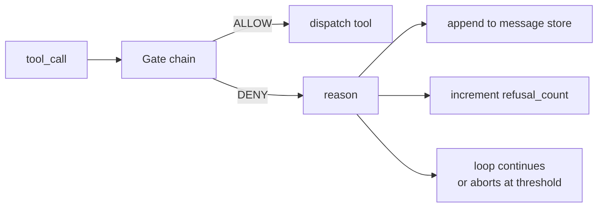
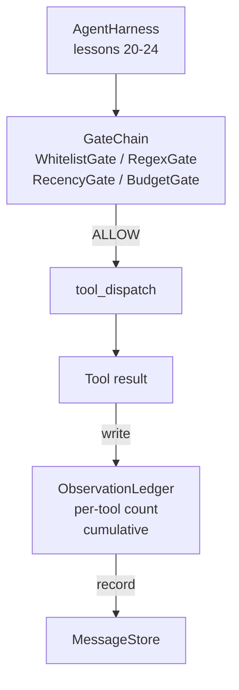

# Capstone Lesson 25: Verification Gates and the Observation Budget

> Một harness agent không có một lớp xác minh là một điều ước trong áo choàng dài. Bài này xây dựng chuỗi cổng tất định quyết định liệu một lệnh gọi công cụ có được phép kích hoạt không, agent được phép thấy bao nhiêu đầu ra của nó, và khi nào vòng lặp phải dừng vì agent đã đọc quá nhiều. Chuỗi là một hàm của các cổng nhỏ, có tên cùng một sổ cái quan sát theo dõi mọi token mà mô hình đã được cho xem.

**Type:** Build
**Languages:** Python (stdlib)
**Prerequisites:** Phase 19 · 20-24 (Track A1: agent loop, tool registry, message store, prompt builder, model router), Phase 14 · 33 (instructions as constraints), Phase 14 · 36 (scope contracts), Phase 14 · 38 (verification gates)
**Time:** ~90 minutes

## Learning Objectives

- Xây dựng một giao thức `VerificationGate` với một phương thức `evaluate(call)` tất định.
- Kết hợp các cổng ngân sách, độ gần đây, danh sách trắng, và regex thành một chuỗi với ngữ nghĩa đoản mạch.
- Theo dõi mọi quan sát qua một `ObservationLedger` được đặt khóa theo công cụ và lượt.
- Từ chối một lệnh gọi công cụ khi ngân sách quan sát tích lũy sẽ bị vượt.
- Đưa ra một bản ghi `GateDecision` có cấu trúc mà hệ thống quan sát hạ nguồn có thể tiếp nhận.

## The Problem

Khi một harness agent để mô hình gọi công cụ tự do, ba lớp lỗi xuất hiện trong giờ đầu tiên sử dụng thực.

Thứ nhất là quan sát không giới hạn. Một lần grep trên một repo 200K dòng đổ nửa triệu token đầu ra vào lượt tiếp theo. Mô hình thấy một kết quả khớp trên mỗi kilobyte và phần còn lại của ngữ cảnh bị lãng phí. Hóa đơn token lớn và agent giờ làm nhiệm vụ tệ hơn, không phải tốt hơn.

Thứ hai là độ gần đây cũ. Một tác vụ chạy lâu tích lũy năm mươi lệnh gọi công cụ. Mô hình đọc lại read_file đầu tiên từ lượt ba như thể nó là trạng thái trực tiếp. Các chỉnh sửa ở lượt bốn mươi bảy không bao giờ xuất hiện vì bộ dựng prompt tuần tự hóa các quan sát sớm nhất trước.

Thứ ba là quyền hạn tăng dần. Một tác vụ nghiên cứu bắt đầu bằng gọi `web_search`, rồi bằng cách nào đó kết thúc bằng chạy `shell` vì mô hình tự tạo một tên công cụ và harness mặc định cho phép. Đến khi có người đọc trace, một file rác đang nằm trong /tmp và một lệnh curl đã chạy tới một API riêng.

Một cổng xác minh là thành phần harness nói không. Nó không phải một mô hình. Nó không phải một bộ chấm. Nó là một hàm tất định của `(call, history, ledger)` trả về ALLOW hoặc DENY với một lý do. Lý do được ghi nhật ký. Mô hình được thông báo. Vòng lặp tiếp tục hoặc hủy.

## The Concept



Một cổng là bất cứ thứ gì có một phương thức `evaluate(call, ctx) -> GateDecision`. Chuỗi là một danh sách có thứ tự. Đánh giá đoản mạch ở lần từ chối đầu tiên. Thứ tự quan trọng: các cổng cấu trúc rẻ chạy trước các cổng đếm token đắt.

Bài này cung cấp bốn cổng:

- `WhitelistGate`. Các tên công cụ được phép là một tập rõ ràng. Bất cứ thứ gì bên ngoài đều bị từ chối. Đây là cổng rẻ nhất và chạy trước.
- `RegexGate`. Các đối số công cụ được so khớp với một regex. Hữu ích để từ chối các lệnh gọi shell có `rm -rf` trong đó, hoặc các lệnh gọi HTTP đến IP nội bộ. Thuần túy trên payload lệnh gọi.
- `RecencyGate`. Mô hình chỉ thấy các quan sát từ N lượt gần nhất. Các quan sát cũ hơn bị che. Cổng từ chối một lệnh gọi công cụ có kết quả sẽ kéo dài một cửa sổ quan sát đã quá cũ.
- `BudgetGate`. Tổng token tích lũy mà mô hình đã đọc trong phiên có một trần. Khi sổ cái cho biết đã chạm trần, mọi lệnh gọi công cụ tiếp theo đều bị từ chối.

Sổ cái quan sát là phần ghi sổ. Mỗi lệnh gọi công cụ thành công ghi một hàng: tên công cụ, lượt, token phát ra, tích lũy. Sổ cái trả lời hai câu hỏi: tổng cộng mô hình đã thấy bao nhiêu, và nó đã thấy bao nhiêu của công cụ X. Cổng ngân sách đọc câu thứ nhất. Một cổng ngân sách theo công cụ, mà bạn sẽ viết như một bài tập, đọc câu thứ hai.

```figure
cg-gate-chain
```

## Architecture



Harness hỏi chuỗi. Chuỗi gật đầu hoặc từ chối. Nếu nó gật đầu, công cụ chạy, sổ cái tăng, và kết quả được thêm vào kho thông điệp. Nếu nó từ chối, mô hình được đưa sự từ chối dưới dạng một thông điệp hệ thống và vòng lặp quyết định thử lại hay hủy.

## What you will build

Triển khai là một `main.py` duy nhất cùng các kiểm thử.

1. Các dataclass `Observation` và `ToolCall` định nghĩa các hình thức truyền tin.
2. `ObservationLedger` ghi các hàng `(turn, tool, tokens)` và trả lời `cumulative()` và `per_tool(name)`.
3. `GateDecision` mang `(allow, reason, gate_name)`.
4. `VerificationGate` là giao thức. Mỗi cổng triển khai `evaluate(call, ctx)`.
5. `GateChain` bọc một danh sách có thứ tự. Nó gọi từng cổng, trả về lần từ chối đầu tiên, hoặc trả về cho phép nếu mọi cổng đều đạt.
6. Demo chạy một vòng lặp agent tổng hợp nhỏ. Ba lượt. Lượt thứ ba kích hoạt cổng ngân sách và vòng lặp báo cáo một sự từ chối rõ ràng với số lần từ chối khác không.

Bộ đếm token cố ý là một heuristic ngớ ngẩn `len(text) // 4`. Điểm chính của bài này là hệ thống nối cổng, không phải tokenizer. Thay bằng một tokenizer thực trong sản xuất.

## Why the chain order matters

Một lần từ chối rẻ hơn một lần cho phép. `WhitelistGate` chạy tra cứu băm $O(1)$. `RegexGate` chạy trong $O(\text{pattern} \cdot \text{argv})$. `RecencyGate` đọc một phần nhỏ của kho thông điệp. `BudgetGate` đọc toàn bộ sổ cái. Bạn sắp xếp chúng theo chi phí tăng dần để một lệnh gọi bị từ chối đoản mạch trước khi làm công việc đắt.

Bạn cũng sắp xếp chúng theo phạm vi ảnh hưởng. Danh sách trắng là khẳng định mạnh nhất: công cụ này không nằm trong hợp đồng. Cổng regex tiếp theo: đối số này không nằm trong hợp đồng. Độ gần đây đến sau: harness vẫn quan tâm nhưng lệnh gọi hợp lệ về cấu trúc. Ngân sách cuối cùng vì, theo định nghĩa, nó chỉ kích hoạt khi mọi thứ khác đã đạt.

## How this composes with the rest of Track A

Các bài trước đã cho bạn vòng lặp, registry công cụ, kho thông điệp, bộ dựng prompt, và bộ định tuyến mô hình. Bài này thêm lớp giữa mô hình và các công cụ. Bài 26 cung cấp sandbox mà dispatcher đưa lệnh gọi công cụ đến khi chuỗi cổng nói ALLOW. Bài 27 cung cấp harness đánh giá ghi lại số lần từ chối như một tín hiệu chất lượng. Bài 28 nối các quyết định cổng vào các span OpenTelemetry. Bài 29 khâu tất cả thành một agent lập trình hoạt động.

## Running it

```bash
cd phases/19-capstone-projects/25-verification-gates-observation-budget
python3 code/main.py
python3 -m pytest code/tests/ -v
```

Demo in một trace theo từng lượt bao gồm mọi quyết định cổng và thoát với mã không. Các kiểm thử bao phủ sổ cái, từng cổng riêng lẻ, đoản mạch chuỗi, và vòng lặp tổng hợp từ đầu đến cuối.
