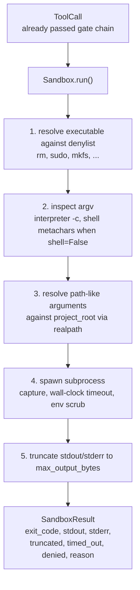
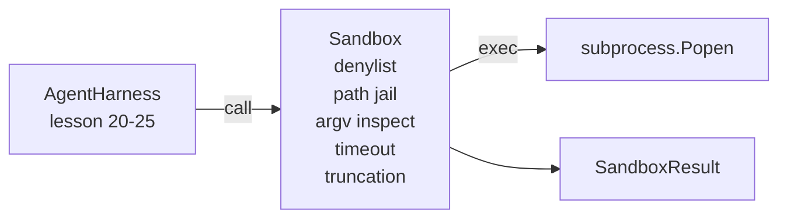

# Capstone Lesson 26: Sandbox Runner with Denylist and Path Jail

> Cổng xác minh quyết định liệu một lệnh gọi công cụ có nên chạy không. Sandbox quyết định điều xảy ra khi nó chạy. Bài này cung cấp một trình chạy tiến trình con từ chối các tệp thực thi nguy hiểm, từ chối các hình thức argv nguy hiểm, giam mọi đường dẫn file trong một thư mục gốc dự án, cắt ngắn đầu ra quá lớn, và diệt các tiến trình mất kiểm soát khi timeout thời gian thực. Nó là lớp thứ hai trong hai lớp nằm giữa mô hình và hệ điều hành.

**Type:** Build
**Languages:** Python (stdlib)
**Prerequisites:** Phase 19 · 25 (verification gates and observation budget), Phase 14 · 33 (instructions as constraints), Phase 14 · 38 (verification gates)
**Time:** ~90 minutes

## Learning Objectives

- Xây dựng một lớp `Sandbox` bọc `subprocess.run` với timeout, thu thập, và cắt ngắn.
- Từ chối một lệnh theo tên dựa trên một danh sách cấm và theo cấu trúc dựa trên một bộ kiểm tra argv.
- Từ chối bất kỳ đối số đường dẫn nào phân giải ra ngoài một thư mục gốc dự án được khai báo.
- Từ chối các siêu ký tự shell khi chế độ shell tắt.
- Trả về một `SandboxResult` có cấu trúc mà hệ thống quan sát hạ nguồn và harness đánh giá có thể tiếp nhận.

## The Problem

Một agent lập trình có thể gọi shell có thể cài cửa hậu, đánh cắp khóa, làm hỏng một laptop nhà phát triển, và tích lũy hóa đơn đám mây trong một lượt duy nhất. Cách phòng vệ ít tốn kém nhất là không cho nó shell. Cách ít tốn kém thứ hai là một sandbox nói không với một danh sách mẫu chính xác.

Ba lớp lỗi tái diễn trong các trace agent.

Thứ nhất là các tệp thực thi nguy hiểm. Một mô hình chịu áp lực sửa một vấn đề đường dẫn sẽ thử `sudo`, `chmod -R 777`, `rm -rf`, `mkfs`, `dd`. Không lệnh nào trong số này thuộc về một lần chạy agent. Danh sách cấm bắt chúng theo tên và theo bí danh.

Thứ hai là các thủ thuật argv. Một mô hình đã được bảo không dùng shell sẽ chuyển một tấn công qua một trình thông dịch: `python3 -c "import os; os.system('rm -rf /')"`, `bash -c '...'`, `node -e '...'`, `perl -e '...'`. Sandbox cần biết rằng bất kỳ trình thông dịch nào chạy với một cờ kiểu `-c` cũng chỉ là một lệnh gọi shell với các bước bổ sung.

Thứ ba là thoát đường dẫn. Mô hình được bảo đọc `./src/main.py` và thay vào đó đọc `../../etc/passwd`. Sandbox giam mọi đối số đường dẫn bằng cách phân giải nó qua `os.path.realpath` và khẳng định tiền tố.

Sandbox không phải một ranh giới bảo mật theo nghĩa hệ điều hành. Một kẻ tấn công quyết tâm có khả năng thực thi mã vẫn có thể thoát ra. Sandbox là một chốt bảo vệ tại thời điểm phát triển: nó làm các chế độ lỗi phổ biến trở nên rõ ràng và ngăn agent gây thiệt hại chỉ vì sự kém cỏi.

## The Concept



Sandbox có bốn trục từ chối: tên, argv, đường dẫn, cấu trúc. Mỗi trục là một hàm thuần túy của lệnh gọi, chưa có tiến trình con. Tiến trình con chỉ được tạo sau khi mọi trục đều đạt.

Các mã thoát `SandboxResult` là những mã thông thường: 0 thành công, khác không thất bại, cùng ba mã báo hiệu cho denied (-100), timed_out (-101), và truncated (mã thoát là mã thực, với một cờ được đặt). Các bài hạ nguồn đọc kết quả có cấu trúc này thay vì phân tích stderr.

```figure
cg-path-jail
```

## Architecture



Danh sách cấm là một frozenset các tên cơ sở tệp thực thi. Các bí danh (`/bin/rm`, `/usr/bin/rm`) đều phân giải về cùng tên cơ sở. Bộ kiểm tra argv biết hình thức trình thông dịch: bất kỳ argv nào mà argv[0] là một trình thông dịch và bất kỳ đối số phía sau nào bắt đầu bằng `-c` hoặc `-e` đều bị từ chối. Các siêu ký tự shell (`;`, `|`, `&`, `>`, `<`, dấu backtick, `$()`) gây từ chối khi lệnh gọi không yêu cầu rõ ràng một shell.

Nhà giam đường dẫn là phần tinh vi nhất. Sandbox nhận một `project_root` khi khởi tạo. Bất kỳ đối số nào trông giống một đường dẫn (chứa `/` hoặc khớp với một file tồn tại) đều được chuẩn hóa qua `os.path.realpath`, rồi được kiểm tra với realpath của thư mục gốc dự án. Nếu đích đã phân giải không nằm dưới thư mục gốc, từ chối. Các lần thử thoát symlink (một symlink trong thư mục gốc dự án trỏ ra ngoài) bị chặn bằng cách kiểm tra realpath, không phải đường dẫn nguyên văn.

## What you will build

Triển khai là `main.py` cùng một thư mục kiểm thử.

1. Dataclass `SandboxResult`: exit_code, stdout, stderr, truncated, timed_out, denied, reason, duration_ms.
2. Dataclass `SandboxConfig`: project_root, max_output_bytes, timeout_seconds, denylist, interpreter_block.
3. Lớp `Sandbox`: `run(argv, *, shell=False, cwd=None)` trả về một `SandboxResult`.
4. Các hàm hỗ trợ từ chối nội bộ: `_check_executable_denylist`, `_check_argv_interpreter`, `_check_shell_metachars`, `_check_path_jail`.
5. Cắt ngắn đầu ra với một cờ `truncated` rõ ràng và một dòng đánh dấu trong luồng được thu thập.
6. Demo ở cuối: một chuỗi lệnh gọi hợp lệ và đối kháng. Mỗi lệnh được hiển thị với kết quả của nó.

Sandbox sử dụng `subprocess.run` với `shell=False` theo mặc định và `capture_output=True`. Timeout thời gian thực sử dụng đối số `timeout`; khi `TimeoutExpired`, sandbox diệt nhóm tiến trình và tổng hợp một SandboxResult.

## Why this is not a real sandbox

Sandbox của bài học không sử dụng namespace, cgroups, seccomp, gVisor, Firecracker, hoặc bất kỳ sự cô lập ở mức kernel nào. Bất cứ thứ gì tiến trình con có thể làm, sandbox có thể làm. Sự bảo vệ mang tính cấu trúc: agent bị từ chối những lần gọi nguy hiểm phổ biến nhất, và sự từ chối rõ ràng đi vào hệ thống quan sát thay vì âm thầm chạy.

Với agent sản xuất bạn xếp lớp lên trên: chạy bên trong một container Docker không đặc quyền, chạy bên trong một microVM, bỏ các capability, gắn thư mục gốc dự án chỉ đọc và một thư mục làm việc tạm đọc-ghi, đặt ulimit cho bộ nhớ và CPU, làm sạch môi trường về một danh sách trắng an toàn đã biết. Bài 29 làm một phần điều này. Cô lập hệ điều hành nằm ngoài phạm vi bài này.

## Running it

```bash
cd phases/19-capstone-projects/26-sandbox-runner-denylist
python3 code/main.py
python3 -m pytest code/tests/ -v
```

Demo tạo một thư mục tạm, đặt một file sạch vào đó, rồi chạy một loạt lệnh gọi. Các lệnh gọi hợp lệ thành công. Các lệnh gọi bị từ chối trả về SandboxResult với `denied=True` và một lý do. Các timeout trả về `timed_out=True`. Cắt ngắn đặt `truncated=True`. Demo in một bảng JSON các kết quả và thoát với mã không.

## How this composes with the rest of Track A

Bài 25 tạo ra chuỗi cổng. Bài 26 là bộ thực thi chạy sau một ALLOW của cổng. Harness đánh giá của bài 27 so sánh các kết quả sandbox với mã thoát dự kiến theo tác vụ. Bài 28 phát ra một span `gen_ai.tool.execution` quanh mỗi lần gọi `Sandbox.run`. Demo đầu cuối của bài 29 nối một agent lập trình thực qua cả hai lớp.
