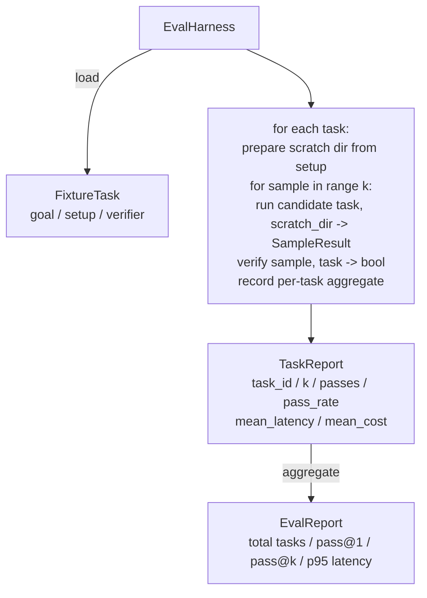

# Capstone Lesson 27: Eval Harness with Fixture Tasks

> Một agent lập trình chỉ tốt như bộ tác vụ bạn dùng để đo nó. Bài này xây dựng một harness đánh giá nhận một thư mục các tác vụ fixture, chạy từng tác vụ qua một agent ứng viên, chấm đạt hoặc trượt qua một bộ xác minh tất định, và tổng hợp các kết quả thành pass@1, pass@k, độ trễ trung bình, và chi phí trung bình. Harness là nguồn sự thật cho phép bạn phân biệt một lỗi thoái lui với một lần tái cấu trúc.

**Type:** Build
**Languages:** Python (stdlib)
**Prerequisites:** Phase 19 · 25 (verification gates), Phase 19 · 26 (sandbox runner), Phase 14 · 30 (eval-driven agent development), Phase 14 · 19 (SWE-bench and GAIA benchmarks)
**Time:** ~90 minutes

## Learning Objectives

- Định nghĩa một tác vụ fixture như một bộ ba mục tiêu, thiết lập, và bộ xác minh.
- Chấm điểm nhiều lần chạy mẫu theo tác vụ và tính pass@1 và pass@k.
- Tổng hợp độ trễ và chi phí thành các chỉ số trung bình và phân vị thứ 95.
- Nối các bộ xác minh tất định (diff file, mã thoát, khớp regex) thành các hàm tái sử dụng.
- Phát ra một báo cáo JSON có cấu trúc mà một script theo dõi thoái lui có thể tiếp nhận.

## The Problem

Ba chế độ lỗi gây tai họa cho các benchmark agent được xây dựng không có harness đánh giá.

Thứ nhất là đạt không được xác minh. Agent nói nó đã sửa lỗi, con người liếc qua diff, bộ kiểm thử được đánh dấu xanh, và ba tuần sau kiểm thử hồi quy làm lộ cùng lỗi. Agent đã suy luận có vẻ hợp lý mà không thực sự sửa gì.

Thứ hai là thoái lui không bị phát hiện. Một thay đổi mẫu prompt khiến agent tốt hơn 4% ở tác vụ ồn ào và tệ hơn 14% ở tác vụ yên lặng. Không có tập chuẩn và điểm theo tác vụ, lỗi thoái lui đi vào main và chỉ xuất hiện khi một khách hàng phàn nàn.

Thứ ba là độ trôi theo tác vụ. Đánh giá được chạy vào thứ Hai với 100 tác vụ và vào thứ Sáu với 95 trong số đó, vì ai đó đổi tên năm fixture. Tỷ lệ đạt trông như một cải thiện 5%. Nó không phải.

Harness là chương trình biến những thất bại này thành sự thật. Nó chạy mọi fixture, mọi lần, theo một thứ tự có thể tái lập, với một bộ xác minh trả về true hoặc false trên một bước kiểm tra tất định.

## The Concept

```mermaid
flowchart LR
  F1[fixtures/task_001/<br/>task.json + expected/] --> Harness
  F2[fixtures/task_002/<br/>...] --> Harness
  Harness[Harness<br/>for each task:<br/>setup / run agent k samples /<br/>verify each sample /<br/>record latency, cost]
  Harness --> Report[EvalReport<br/>pass@1 / pass@k<br/>mean ms / p95 ms<br/>mean cost]
```

Một `FixtureTask` là một file JSON nhỏ cùng một thư mục `expected/` tùy chọn. JSON khai báo một `id`, một `goal` (prompt đưa vào agent), một khối `setup` (các file để đặt vào thư mục tạm), và một khối `verifier`. Khối verifier đặt tên một hàm trong registry bộ xác minh của harness và cung cấp các đối số của nó.

Ba hình thức bộ xác minh bao phủ phần lớn các tác vụ hữu ích.

Thứ nhất là `file_equals`. Sau khi agent chạy, so sánh một file có tên với nội dung dự kiến. Điều này bắt các tác vụ "sửa lỗi này đúng theo cách này".

Thứ hai là `regex_match`. Nội dung của file có tên được so khớp với một regex. Điều này bắt các tác vụ "hàm phải tồn tại và trả về X" nơi có nhiều lời giải chấp nhận được.

Thứ ba là `shell_exit_zero`. Harness chạy một lệnh shell (qua sandbox từ bài 26) và chỉ cho tác vụ đạt nếu lệnh thoát với mã không. Điều này bắt các tác vụ "các kiểm thử phải đạt".

Harness chạy mỗi tác vụ `k` lần. Pass@k là `1 - (1 - p)^k` với p là tỷ lệ đạt thực nghiệm; harness cũng báo cáo số đếm thô để bạn có thể phát hiện phương sai. Độ trễ là thời gian thực theo mẫu. Chi phí là bất cứ thứ gì agent tự báo cáo (số token, USD, hoặc cả hai); harness cộng nó trên các mẫu và trình bày các số liệu theo tác vụ và tổng hợp.

```figure
pass-at-k
```

## Architecture



Ứng viên là một đối tượng có thể gọi: `Callable[[FixtureTask, str], SampleResult]`. Harness tạo thư mục tạm qua `tempfile.mkdtemp()` và truyền đường dẫn của nó như một chuỗi thông thường. Harness không quan tâm ứng viên hoạt động thế nào. Ứng viên có thể là một bộ áp dụng patch tất định (hữu ích cho tự kiểm thử harness), một agent LLM thực, một fuzzer. Hợp đồng là SampleResult.

## What you will build

`main.py` cung cấp:

1. Dataclass `FixtureTask`.
2. Dataclass `SampleResult`: success_self_reported, latency_ms, cost_units, edits.
3. Các dataclass `TaskReport`, `EvalReport` với `to_dict()`.
4. `VerifierRegistry` ánh xạ tên bộ xác minh sang hàm. Các bộ xác minh tích hợp: file_equals, regex_match, shell_exit_zero.
5. Lớp `EvalHarness`. Chạy một thư mục tác vụ với một ứng viên. Trả về EvalReport.
6. Năm tác vụ fixture được đóng gói trong `tasks/`:
   - lệch một trong `fizzbuzz`
   - thiếu return trong `factorial`
   - lỗi gõ trong thông điệp lỗi
   - thân hàm rỗng
   - lệch một trong duyệt danh sách liên kết
7. Một ứng viên tham chiếu tất định (`apply_known_fixes`) mà harness sử dụng để minh họa một pass@1 sạch là 1.0.
8. Demo in JSON EvalReport và thoát với mã không.

Các tác vụ fixture được đóng gói dưới dạng file JSON trong `tasks/` cùng các file nguồn đi cặp trong `tasks/<id>/buggy/` và `tasks/<id>/expected/`. Harness sao chép buggy vào một thư mục tạm, đưa nó cho ứng viên, và xác minh với expected.

## Why pass@k and not just pass@1

Các agent LLM thực mang tính ngẫu nhiên. Một pass@1 là 0.6 trông như một thất bại. Một pass@5 là 0.95 nói rằng agent có đáp án đúng phần lớn thời gian nhưng đang chọn sai trên các mẫu đầu. Cách sửa là lấy mẫu và xếp hạng, không phải lúc nào cũng huấn luyện thêm. Pass@k làm điều đó hiển lộ.

Pass@k được báo cáo cùng pass@1 vì pass@k che đậy một thất bại thực: nếu mô hình có đáp án đúng một lần trong hai mươi lần thử thì bạn không có một agent hữu ích. Harness hiển thị cả hai.

## How this composes with the rest of Track A

Bài 25 tạo ra chuỗi cổng. Bài 26 tạo ra sandbox. Harness sử dụng sandbox cho bất kỳ bộ xác minh `shell_exit_zero` nào. Bài 28 bọc mỗi lần chạy harness trong một trace OTel. Bài 29 chạy demo đầu cuối với một trong các fixture được đóng gói và khẳng định pass@1 = 1.0 cho ứng viên tham chiếu.

## Running it

```bash
cd phases/19-capstone-projects/27-eval-harness-fixture-tasks
python3 code/main.py
python3 -m pytest code/tests/ -v
```

Demo in EvalReport dưới dạng JSON, bao gồm pass@1, pass@5, độ trễ trung bình, và phân tích theo tác vụ. Mã thoát là không. Các kiểm thử bao phủ các hàm xác minh, phép toán pass@k, nạp fixture, và harness từ đầu đến cuối với ứng viên tham chiếu được đóng gói.
