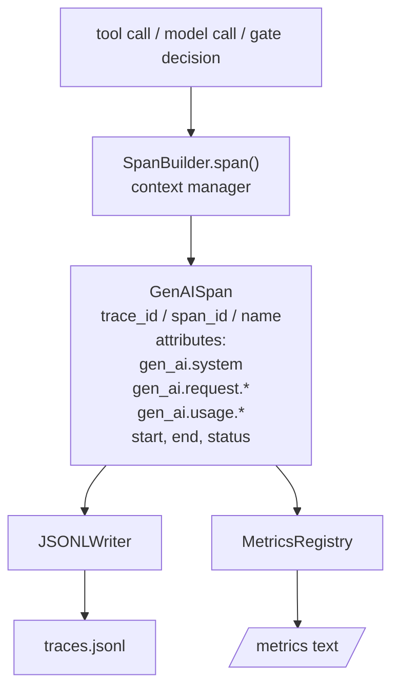
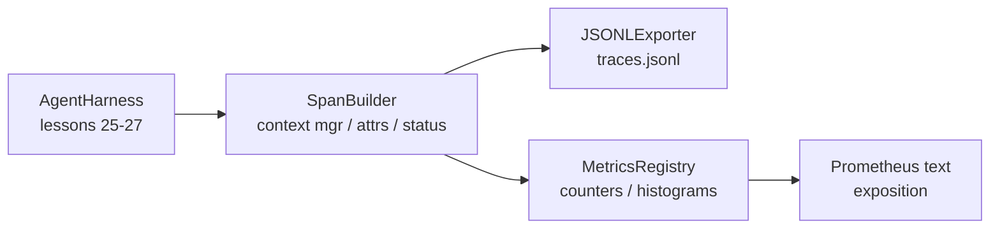

# Capstone Lesson 28: Observability with OTel GenAI Spans and Prometheus Metrics

> Một harness agent không có khả năng quan sát là một hộp đen tốn tiền. Bài này viết thủ công một bộ dựng span phát ra các bản ghi tuân thủ các quy ước ngữ nghĩa GenAI của OpenTelemetry, ghi chúng vào một file JSON-Lines mỗi span một dòng, và cung cấp các bộ đếm và histogram ở định dạng văn bản Prometheus. Toàn bộ là Python stdlib và chạy ngoại tuyến.

**Type:** Build
**Languages:** Python (stdlib)
**Prerequisites:** Phase 19 · 25 (verification gates), Phase 19 · 26 (sandbox), Phase 19 · 27 (eval harness), Phase 13 · 20 (OpenTelemetry GenAI), Phase 14 · 23 (OTel GenAI conventions)
**Time:** ~90 minutes

## Learning Objectives

- Xây dựng một lớp dữ liệu span có hình thức theo các quy ước ngữ nghĩa GenAI của OpenTelemetry.
- Triển khai một bộ xuất JSONL ghi một span tự chứa trên mỗi dòng.
- Xây dựng các bộ đếm và histogram với các nhãn và trình bày định dạng văn bản Prometheus.
- Bọc bất kỳ đối tượng có thể gọi nào trong một trình quản lý ngữ cảnh span ghi lại thời lượng, trạng thái, và các ngoại lệ.
- Xác minh rằng các span phát ra khứ hồi qua `json.loads` và khớp với hình thức đặc tả.

## The Problem

Một agent lập trình trong sản xuất tạo ra ba lớp hiện vật mỗi lượt: một lệnh gọi mô hình, một lần thực thi công cụ, và một quyết định cổng xác minh. Không thứ nào trong số này hữu ích nếu không có dữ liệu đo từ xa có cấu trúc.

Chế độ lỗi thứ nhất là trace thiếu. Điều gì đó hỏng vào thứ Ba nhưng bản ghi duy nhất là một nhật ký trò chuyện 500 dòng. Không có bản ghi về công cụ nào đã chạy, mất bao lâu, bao nhiêu token đi vào prompt, hoặc liệu cổng có từ chối gì không. Tác giả agent phải đoán.

Chế độ lỗi thứ hai là trace không thể phân tích. Harness đã ghi các span nhưng sử dụng các tên trường tùy tiện riêng. Không thứ gì trong Grafana, Honeycomb, Jaeger, hoặc CLI cục bộ có thể đọc chúng. Bất kỳ công cụ nào tồn tại trong ngăn xếp của nhóm đều bị lãng phí vì các span không tiêu chuẩn.

Chế độ lỗi thứ ba là chỉ số không được tổng hợp. Bạn có thể thấy một lệnh gọi công cụ chậm trong trace, nhưng bạn không thể trả lời "độ trễ p95 của các lệnh gọi read_file trong giờ vừa qua là bao nhiêu?" vì không có chỉ số, chỉ có trace.

Các quy ước ngữ nghĩa GenAI của OpenTelemetry tồn tại chính xác cho điều này. Chúng định nghĩa một tập nhỏ các thuộc tính tiêu chuẩn mà các bộ phát span trên các framework LLM dùng chung. Nếu harness của bạn ghi những thuộc tính đó, mọi backend tương thích OTel đều có thể đọc chúng.

## The Concept



Mọi thao tác trong harness tạo ra một span. Một span có một trace id (toàn bộ lần gọi agent), một span id (thao tác này), một tên (ví dụ `gen_ai.chat`, `gen_ai.tool.execution`), các thuộc tính tuân theo quy ước GenAI, một thời điểm bắt đầu và kết thúc, và một trạng thái.

Các quy ước GenAI chuẩn hóa các khóa thuộc tính này: `gen_ai.system` (nhà cung cấp nào, ví dụ `anthropic`, `openai`), `gen_ai.request.model` (id mô hình), `gen_ai.request.max_tokens`, `gen_ai.usage.input_tokens`, `gen_ai.usage.output_tokens`, `gen_ai.response.model`, `gen_ai.response.id`, `gen_ai.operation.name`, cùng các khóa đặc thù công cụ `gen_ai.tool.name` và `gen_ai.tool.call.id`.

Bộ xuất ghi JSONL. Một đối tượng JSON trên mỗi dòng. Đây là định dạng đơn giản nhất có thể mà công cụ hạ nguồn có thể truyền luồng, grep, và nhập. Một bộ xuất OTel thực sẽ nói OTLP gRPC; bộ xuất JSONL của bài học là tương đương ngoại tuyến và thoát với mã không trên mọi máy trạm.

Các chỉ số nằm cạnh các trace. Một bộ đếm tăng trên mỗi lệnh gọi công cụ: `tools_called_total{tool="read_file"}`. Một histogram ghi lại độ trễ quan sát được: `tool_latency_ms{tool="read_file"}`. Cả hai tuần tự hóa thành định dạng trình bày văn bản Prometheus, là tiêu chuẩn trên thực tế cho các chỉ số dựa trên kéo.

```figure
trace-spans
```

## Architecture



Bộ dựng span là một lớp nhỏ với một phương thức `span(name, attrs)` trả về một trình quản lý ngữ cảnh. Trình quản lý ngữ cảnh ghi thời điểm bắt đầu khi vào, ghi thời điểm kết thúc khi thoát, gắn một ngoại lệ nếu có phát sinh, và đẩy span đã hoàn tất đến bộ xuất.

Registry chỉ số là hai dict. Các bộ đếm là `{(name, frozen_labels): int}`. Các histogram giữ các mẫu thô trong một danh sách và tuần tự hóa thành các nhóm histogram Prometheus tại thời điểm trình bày.

## What you will build

`main.py` cung cấp:

1. Dataclass `GenAISpan`: trace_id, span_id, parent_span_id, name, attributes, start_unix_nano, end_unix_nano, status, status_message, events.
2. Lớp `SpanBuilder` với trình quản lý ngữ cảnh `span(name, attrs, parent=None)`.
3. Lớp `JSONLExporter` với `export(span)` thêm một dòng.
4. Các lớp `Counter` và `Histogram` cùng `MetricsRegistry`.
5. `prometheus_exposition(registry)` tạo ra đầu ra định dạng văn bản.
6. Decorator `wrap_tool_call(name)` phát ra một span và cập nhật các chỉ số.
7. Demo: tổng hợp một lần gọi agent hoàn chỉnh (span gen_ai.chat quanh các span công cụ), ghi traces.jsonl, in phần trình bày Prometheus, thoát với mã không.

Span id và trace id là các chuỗi hex 16 byte, được tạo từ `os.urandom`. Điều đó khớp với ngữ cảnh trace W3C của OTel. Bộ xuất không bao giờ ném ngoại lệ; các lỗi IO được đưa ra nhưng harness tiếp tục chạy.

Histogram có một tập nhóm cố định (mặc định OTel cho độ trễ tính bằng mili giây: 5, 10, 25, 50, 100, 250, 500, 1000, 2500, 5000, 10000, +Inf). Các mẫu được lưu dưới dạng một danh sách; phần trình bày tính số đếm theo nhóm khi cần.

## Why hand-rolled instead of opentelemetry-sdk

OTel Python SDK là một phụ thuộc thực. Nó cũng là vài nghìn dòng mã, nhiều tiến trình cho bộ xuất OTLP, và một chi phí runtime lấn át ngân sách bài học. Phiên bản viết thủ công dạy định dạng truyền tin. Trong sản xuất bạn nối cùng các thuộc tính vào SDK thực và nhận bộ xuất OTLP, chia lô, và phát hiện tài nguyên miễn phí.

Các quy ước ổn định. Định dạng truyền tin mà bài học phát ra sẽ tiếp tục được phân tích vào năm 2030 vì OTel không bao giờ phá vỡ các tên thuộc tính GenAI; họ chỉ thêm các tên mới.

## How this composes with the rest of Track A

Bài 25 tạo ra chuỗi cổng. Bài 26 tạo ra sandbox. Bài 27 tạo ra harness đánh giá. Bài 28 làm cả ba có thể quan sát. Bài 29 bọc mọi bước của demo đầu cuối trong các span và in văn bản Prometheus ở cuối.

## Running it

```bash
cd phases/19-capstone-projects/28-observability-otel-traces
python3 code/main.py
python3 -m pytest code/tests/ -v
```

Demo phát ra một `traces.jsonl` trong thư mục làm việc của bài học (được dọn ở cuối), rồi in một mẫu ba span, rồi in phần trình bày Prometheus cho các bộ đếm và histogram. Các kiểm thử xác minh rằng các span tuần tự hóa khứ hồi, các thuộc tính GenAI chuẩn hiện diện, các bộ đếm tăng đúng, và phần trình bày histogram chứa các số đếm nhóm dự kiến.
