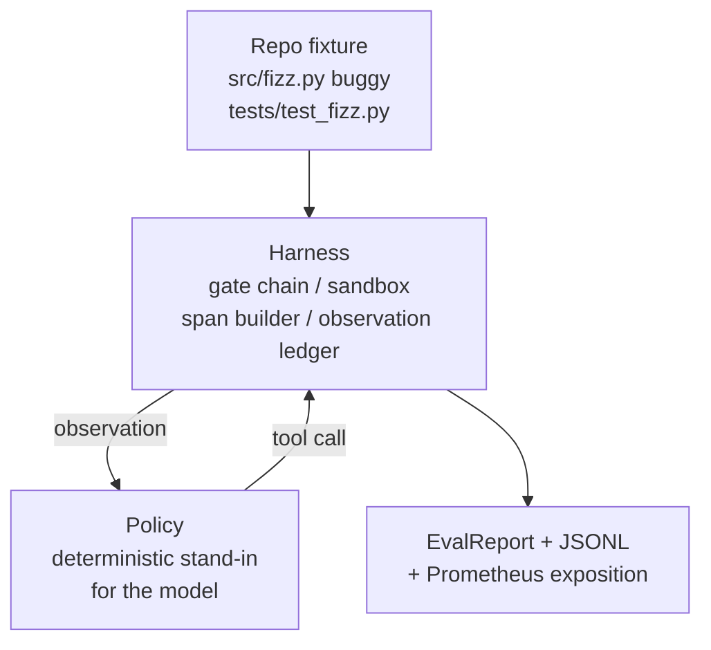
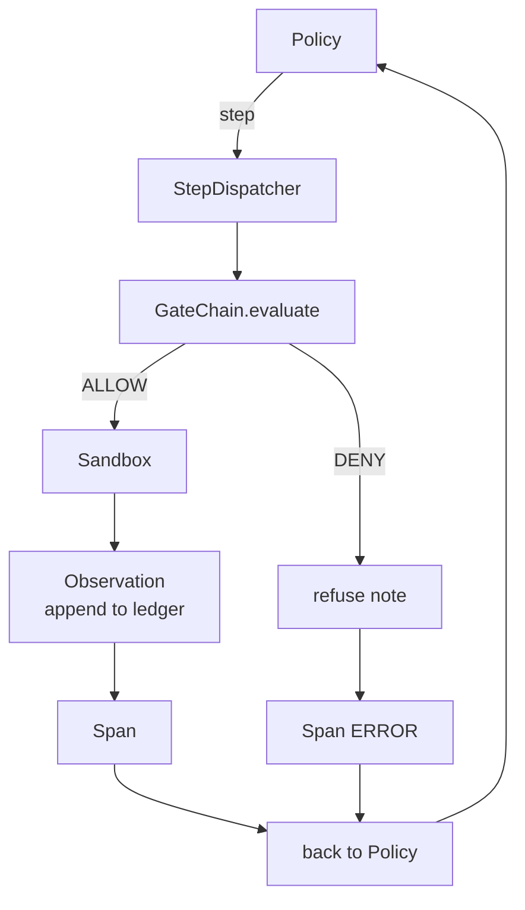

# Capstone Lesson 29: End-to-End Coding Agent on the Harness

> Thành quả của Track A. Bài này khâu chuỗi cổng, sandbox, harness đánh giá, và các span OTel thành một agent lập trình hoạt động sửa một lỗi thực (nhỏ, ở quy mô fixture) trong một dự án Python nhiều file. Agent là một chính sách tất định, không phải một LLM; sự thay thế khiến bài học có thể tái lập và cho thấy harness vẫn luôn là phần thú vị. Hợp đồng giống hệt: một mô hình thực cắm vào chỗ nối chính sách.

**Type:** Build
**Languages:** Python (stdlib)
**Prerequisites:** Phase 19 · 25 (verification gates), Phase 19 · 26 (sandbox), Phase 19 · 27 (eval harness), Phase 19 · 28 (observability), Phase 14 · 38 (verification gates), Phase 14 · 41 (workbench for real repos), Phase 14 · 42 (agent workbench capstone)
**Time:** ~90 minutes

## Learning Objectives

- Kết hợp chuỗi cổng, sandbox, harness đánh giá, và bộ dựng span thành một vòng lặp agent duy nhất.
- Triển khai một chính sách tất định sử dụng read_file, run_tests, và write_file để sửa một lỗi fixture.
- Thực thi một ngân sách bước toàn cục cùng một ngân sách token quan sát trên một lần chạy đầu cuối.
- Phát ra các trace GenAI OTel và chỉ số Prometheus đầy đủ cho toàn bộ lần chạy.
- Xác minh agent giải quyết fixture trong ít hơn 12 bước với không lần kích hoạt cổng nào trên các công cụ hợp lệ.

## The Problem

Hầu hết demo agent hoạt động riêng lẻ: một sandbox tự nó, một harness đánh giá tự nó, một bộ phát span tự nó. Chúng trông ổn. Kết hợp chúng và các chỗ nối lộ ra.

Chuỗi cổng nói ALLOW nhưng sandbox từ chối vì một lý do chuỗi không dự liệu. Harness đánh giá ghi nhận đạt nhưng các span OTel nói cổng đã từ chối một công cụ mà agent tuyên bố nó đã dùng. Bộ đếm Prometheus tăng hai lần khi lẽ ra phải tăng một lần. Ngân sách quan sát bị vượt nhưng agent tiếp tục vì ngân sách được theo dõi trong chuỗi và sandbox không biết.

Bài này là kiểm thử tích hợp cho toàn bộ track. Agent phải làm bốn việc theo thứ tự: đọc dự án, chạy các kiểm thử, xác định lỗi từ thất bại kiểm thử, ghi bản sửa, chạy lại các kiểm thử, và dừng. Mọi thao tác đều qua chuỗi cổng. Mọi lần thực thi công cụ đều qua sandbox. Mọi bước được bọc trong một span. Harness đánh giá chấm toàn bộ ở cuối.

## The Concept



Chính sách của agent là một máy trạng thái. Năm trạng thái.

`SURVEY`: agent đọc danh sách dự án. Trạng thái tiếp theo là RUN_TESTS.

`RUN_TESTS`: agent chạy lệnh kiểm thử. Nếu các kiểm thử đạt, máy trạng thái dừng với thành công. Nếu không trạng thái tiếp theo là INSPECT.

`INSPECT`: agent đọc file nguồn bị lỗi. Trạng thái tiếp theo là FIX.

`FIX`: agent ghi file đã sửa. Trạng thái tiếp theo là VERIFY.

`VERIFY`: agent chạy lại lệnh kiểm thử. Nếu các kiểm thử đạt, dừng thành công. Nếu không dừng với thất bại.

Mỗi trạng thái tương ứng với một lệnh gọi công cụ. Mỗi lệnh gọi công cụ đi qua chuỗi cổng. Nếu một lệnh gọi công cụ bị từ chối, agent báo cáo sự từ chối trong trace và dừng.

Lỗi fixture là một lỗi lệch một trong `fizz.py`. Chính sách tất định phát hiện lỗi từ thông điệp thất bại kiểm thử qua một regex và phát ra file đã sửa. Thay chính sách bằng một LLM không thay đổi hợp đồng harness.

```figure
cg-harness-weave
```

## Architecture



Bài học tự chứa. Mỗi thành phần cơ sở của bài trước được triển khai lại ở quy mô tối thiểu trong `main.py` (cổng, sandbox, sổ cái, span) để bài học chạy mà không import các bài anh em. Các tên khớp chính xác với bài 25-28 để ánh xạ khái niệm không mơ hồ.

## What you will build

`main.py` cung cấp:

1. Các thành phần cơ sở harness tối thiểu, được sao chép với cùng các tên như bài 25-28: `GateChain`, `Sandbox`, `ObservationLedger`, `SpanBuilder`, `MetricsRegistry`.
2. Lớp `CodingAgentPolicy`: máy trạng thái với năm trạng thái.
3. Hàm hỗ trợ `Repo`: chuẩn bị một thư mục tạm với fixture lỗi được đóng gói.
4. Lớp `AgentRun`: điều khiển chính sách, điều phối qua harness, trả về một `AgentRunReport`.
5. Một fixture được đóng gói (`fixture_repo/`) với src/fizz.py, tests/test_fizz.py, và một cây expected/ cho harness đánh giá.
6. Demo: chạy chính sách từ đầu đến cuối, in trace từng bước, khẳng định đạt, in các chỉ số.

Fixture được đóng gói có cùng hình thức với cấu trúc tác vụ của bài 27: một file lỗi và một file kiểm thử. Thông điệp thất bại kiểm thử chứa đủ thông tin để chính sách tất định xác định bản sửa. Một LLM thực sẽ làm cùng công việc, chậm hơn và với khả năng nhớ rộng hơn, nhưng nó sẽ không thay đổi các kỳ vọng của harness.

## Why the policy is not an LLM

Một LLM thực đòi hỏi một khóa API, một lệnh gọi mạng, và tính ngẫu nhiên không thể xác minh. Harness là phần bài học quan tâm. Thay bằng một chính sách tất định cho phép bài học chạy trên bất kỳ laptop nhà phát triển nào với không phụ thuộc bên ngoài và cho phép bộ kiểm thử khẳng định số bước chính xác.

Chính sách của bài học là một tập con thực sự của điều một agent LLM làm. Chính sách đọc repo, thấy kiểm thử thất bại, xác định dòng, và phát ra một bản sửa. Một LLM đi qua cùng vòng lặp với cùng hợp đồng harness; việc ghi sổ giống hệt.

## What the demo asserts

Demo đầu cuối khẳng định năm điều tại thời điểm thoát, và bộ kiểm thử khẳng định lại chúng bằng chương trình.

Chính sách đã giải quyết fixture trong ít hơn 12 bước.

Ngân sách quan sát chưa bao giờ bị vượt.

Không lần từ chối cổng nào kích hoạt trên các công cụ hợp lệ. (Agent chưa bao giờ tự tạo một tên công cụ bị từ chối.)

Mọi bước đều có một span tương ứng trong traces.jsonl.

Phần trình bày Prometheus chứa một mục `tools_called_total{tool="read_file"}` và một histogram `tool_latency_ms`.

## How this composes with the rest of Track A

Bài này là sự tích hợp. Bài 25 viết chuỗi cổng. Bài 26 viết sandbox. Bài 27 viết harness đánh giá. Bài 28 viết khả năng quan sát. Bài 29 chứng minh chúng hoạt động như một hệ thống. Một harness agent thực mở rộng từ đây: đổi chính sách tất định lấy một mô hình, đổi fixture được đóng gói lấy một tác vụ repo thực, đổi bộ xuất JSONL lấy OTLP.

## Running it

```bash
cd phases/19-capstone-projects/29-end-to-end-coding-task-demo
python3 code/main.py
python3 -m pytest code/tests/ -v
```

Demo in một trace theo bước, báo cáo đánh giá cuối cùng, và phần trình bày Prometheus. Mã thoát là không. Các kiểm thử bao phủ các chuyển tiếp trạng thái chính sách, các từ chối cổng trên các lệnh gọi công cụ tổng hợp, lần chạy đầu cuối trên fixture được đóng gói, và các bất biến ngân sách bước.
