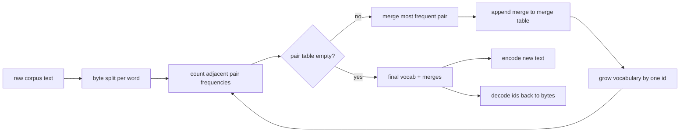
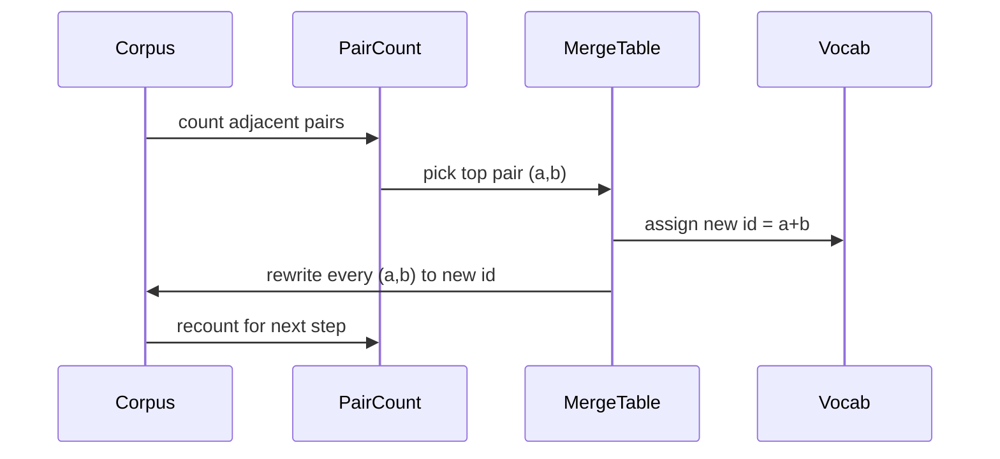

# BPE Tokenizer From Scratch

> Byte vào, id ra, id trở lại cùng các byte. Xây dựng tokenizer mà mọi mô hình văn bản hiện đại vẫn bắt đầu từ đó.

**Type:** Build
**Languages:** Python
**Prerequisites:** Phase 04 lessons, Phase 07 transformer lessons
**Time:** ~90 minutes

## Learning Objectives
- Huấn luyện một từ vựng Byte-Pair Encoding từ một corpus văn bản thô bằng cách liên tục hợp nhất cặp ký hiệu liền kề thường gặp nhất.
- Triển khai một bảng hợp nhất tất định và áp dụng nó vào văn bản mới để tạo một luồng id từ con.
- Khứ hồi đầu vào UTF-8 tùy ý thành id và trở lại mà không mất thông tin.
- Dành riêng và bảo vệ các token đặc biệt (`<|endoftext|>`, `<|pad|>`) để chúng tồn tại qua huấn luyện và giải mã.
- Suy luận về lý do một bảng chữ cái ở mức byte là mức sàn đúng cho một tokenizer đa dụng.

```figure
cap-bpe-merge
```

## The frame

Một mô hình ngôn ngữ không bao giờ thấy văn bản. Nó thấy các số nguyên. Ánh xạ từ một chuỗi sang một danh sách số nguyên và trở lại là tokenizer. Làm sai lớp này và mọi đường cong mất mát trong lần chạy huấn luyện đều đang đo sai thứ.

Họ tokenizer từ con chiếm ưu thế cho các mô hình văn bản tổng quát là Byte-Pair Encoding. Ý tưởng nhỏ. Bắt đầu từ một bảng chữ cái đã biết. Tìm cặp ký hiệu liền kề xuất hiện thường xuyên nhất trong corpus huấn luyện. Hợp nhất nó thành một ký hiệu mới. Lặp lại cho đến khi từ vựng đạt kích thước đích. Mã hóa văn bản mới tái sử dụng cùng danh sách hợp nhất theo cùng thứ tự.

Chúng ta sẽ xây dựng biến thể ở mức byte. Bảng chữ cái là 256 byte thô, không phải các điểm mã Unicode. Lựa chọn đó là thứ cho phép tokenizer xử lý bất kỳ đầu vào UTF-8 nào mà không rơi về một token không xác định.

## The pipeline



Phía huấn luyện và phía suy luận dùng chung bảng hợp nhất. Việc dùng chung đó là hợp đồng. Nếu bạn thay đổi thứ tự hợp nhất khi suy luận, bạn giải mã một luồng id khác.

## The byte alphabet

256 id đầu tiên được dành cho các byte thô 0x00 đến 0xFF. Điều đó bảo đảm mọi chuỗi đầu vào có thể được biểu diễn trong từ vựng trước khi bất kỳ hợp nhất nào xảy ra. Sau khối byte chúng ta dành một khoảng nhỏ cho các token đặc biệt. Vòng lặp huấn luyện không bao giờ đề xuất những id đó làm đích hợp nhất vì chúng ta giữ chúng hoàn toàn ngoài luồng được tiền phân tách token.

Bộ tiền phân tách token chia corpus tại các ranh giới khoảng trắng và dấu câu trước khi huấn luyện thấy nó. Không có sự chia đó bước hợp nhất BPE sẽ vui vẻ học các hợp nhất vượt ranh giới từ và từ vựng đầy lên với toàn bộ các cụm từ phổ biến. Với sự chia, các hợp nhất nằm trong một từ và kết quả khái quát hóa.

## The training loop

Với mỗi bước huấn luyện vòng lặp làm ba việc. Nó duyệt mọi từ trong corpus và đếm tần suất mỗi cặp liền kề của các ký hiệu hiện tại xuất hiện, được đặt trọng số theo tần suất chính từ đó xuất hiện. Nó chọn cặp có số đếm cao nhất. Nó viết lại mọi lần xuất hiện của cặp đó thành một ký hiệu mới duy nhất có id là vị trí trống tiếp theo trong từ vựng. Rồi nó ghi lại phép hợp nhất.



Chi phí mỗi bước tuyến tính theo kích thước corpus được biểu diễn dưới dạng một danh sách các chuỗi ký hiệu. Với một triệu từ và một từ vựng đích mười nghìn id vòng lặp chạy đến hoàn tất trong vài giây vì các chuỗi ký hiệu co lại khi các hợp nhất được áp dụng.

## Encoding fresh text

Suy luận không gọi bộ đếm hợp nhất. Nó áp dụng bảng hợp nhất theo cùng thứ tự đã học. Với một từ mới bộ mã hóa bắt đầu từ việc chia byte. Nó quét chuỗi hiện tại tìm phép hợp nhất có hạng thấp nhất (phép sớm nhất có thể áp dụng). Nó thực hiện phép hợp nhất đó. Nó quét lại. Vòng lặp kết thúc khi không phép hợp nhất nào trong bảng áp dụng cho chuỗi hiện tại.

Thứ tự theo hạng là thuộc tính khiến mã hóa tất định và khớp với hành vi huấn luyện trên cùng đầu vào. Một phép hợp nhất được học trước nằm trên đầu bảng và được áp dụng trước. Nếu hai phép hợp nhất có thể áp dụng tại cùng vị trí, phép có hạng thấp hơn thắng.

## Special tokens

Các token đặc biệt là các id mà luồng byte không bao giờ có thể tạo ra. Chúng ta dành riêng chúng thủ công. Hai là đủ cho bài này.

- `<|endoftext|>` phân tách các tài liệu trong tiền huấn luyện. Nó nói với mô hình "một tài liệu mới bắt đầu ở đây, đừng để ngữ cảnh của tài liệu trước rò vào."
- `<|pad|>` lấp đầy các chuỗi ngắn để một lô có thể là một tensor hình chữ nhật. Mặt nạ mất mát che nó trong huấn luyện.

Bộ mã hóa nhận một cờ để cho phép các token đặc biệt trong đầu vào. Với cờ tắt, các chuỗi `<|endoftext|>` và `<|pad|>` được phân tách token thành các byte viết ra chúng. Với cờ bật, các chuỗi nguyên văn được ánh xạ tới các id được dành riêng và không chịu bất kỳ phép hợp nhất nào.

## Round-trip guarantee

Mã hóa rồi giải mã phải trả về chính xác các byte đầu vào. Bộ giải mã nối phần khai triển byte của mọi id theo thứ tự. Vì mỗi id hoặc là một byte thô hoặc là phần nối của hai id đã biết trước đó, khai triển đệ quy luôn kết thúc ở các byte thô. Giải mã sau đó trả về chuỗi UTF-8 mà những byte đó viết ra.

Bộ kiểm thử trong bài này kiểm tra thuộc tính đó trên một câu chưa thấy, trên một câu có emoji Unicode, và trên một câu chứa một token `<|endoftext|>` nguyên văn.

## What this lesson does not do

Nó không xây dựng một bộ tiền phân tách token điều khiển bằng regex theo kiểu các tokenizer sản xuất lớn nhất. Bộ tiền phân tách token ở đây là một phép chia nhỏ theo khoảng trắng và dấu câu. Nó đủ để tạo ra các hợp nhất hợp lý trên một corpus huấn luyện nhỏ và hợp đồng với phần còn lại của chuỗi bài học vẫn như cũ. Bài tiếp theo coi tokenizer như một hộp đen và xây dựng tập dữ liệu cửa sổ trượt trên nó.

Nó không song song hóa bộ đếm cặp. Một vòng lặp Python trên một corpus vài nghìn từ hoàn tất trong chưa đến một giây. Với corpus lớn hơn bước đi rõ ràng là đếm các cặp theo từ song song và rút gọn.

## How to read the code

`main.py` định nghĩa bốn đối tượng. `BPETokenizer` giữ từ vựng, bảng hợp nhất, và bảng token đặc biệt. `train` là vòng lặp huấn luyện. `encode` là đường suy luận. `decode` là phép nối byte. Demo ở cuối huấn luyện một tokenizer nhỏ trên một corpus tích hợp, mã hóa một câu được giữ riêng, giải mã các id trở lại, và in cả hai. Các kiểm thử trong `code/tests/test_bpe.py` ghim thuộc tính khứ hồi, việc dành riêng token đặc biệt, và thứ tự hợp nhất.

Chạy demo. Sau đó thay kích thước từ vựng đích trong demo từ 300 thành 600 và xem độ dài mã hóa của câu được giữ riêng giảm thế nào. Đường cong đó là đường cong nén BPE.
